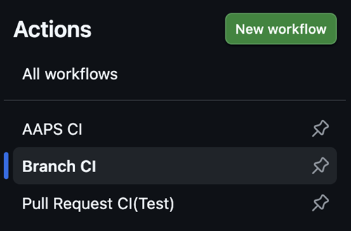
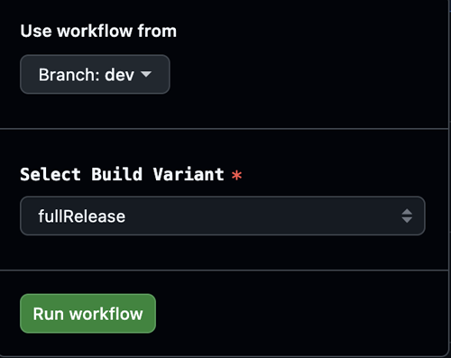
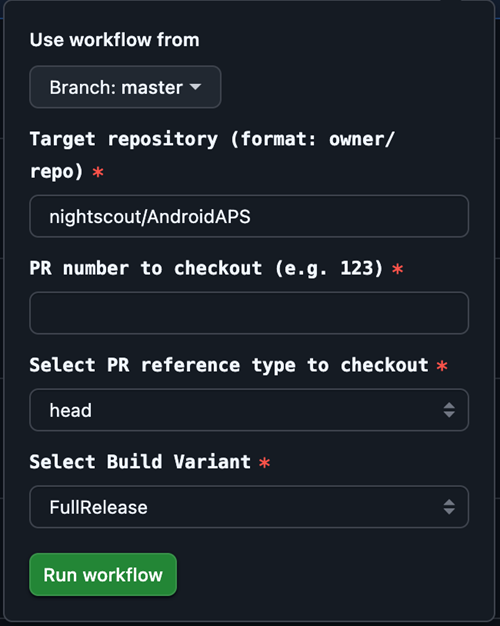

# Utvecklingsgren

```{warning}
Dev-grenen är bara till för vidareutveckling av AAPS. Den ska användas på en separat telefon för tester, <font color="#FF0000">**inte för verklig loopning!**</font>
```

Den stabilaste versionen av AAPS finns i [master-grenen](https://github.com/nightscout/AndroidAPS/tree/master). Vi rekommenderar att du stannar på master-grenen för verklig loopning.

Dev-versionen av AAPS är bara för utvecklare och testare som är vana vid att hantera stacktraces, läsa loggfiler och kanske starta en debugger för att skriva felrapporter som är till nytta för utvecklarna (kort sagt: personer som vet vad de gör utan att behöva hjälp!). Därför är många ofärdiga funktioner avstängda. För att slå på dessa funktioner går du in i **Engineering Mode** genom att skapa en fil som heter `engineering_mode` i katalogen /AAPS/extra. Om du slår på Engineering Mode kan loopen sluta fungera helt.

Dev-grenen är ändå ett bra ställe för att se vilka funktioner som testas, hjälpa till att rätta fel och ge återkoppling om hur de nya funktionerna fungerar i praktiken. Många testar dev-grenen på en gammal telefon och pump tills de är säkra på att den är stabil – all användning sker på egen risk. När du testar nya funktioner, kom ihåg att du själv väljer att testa en funktion som fortfarande utvecklas. Det sker på egen risk, och du måste vara noggrann för att hålla dig säker.

Om du hittar ett fel eller tror att något har gått fel när du använder dev-grenen, titta under [fliken Issues](https://github.com/nightscout/AndroidAPS/issues) om någon annan redan har hittat det, eller lägg till det själv om ingen har gjort det. Ju mer information du kan dela här, desto bättre (glöm inte att du kan behöva dela dina [loggfiler](../GettingHelp/AccessingLogFiles.md)). De nya funktionerna kan också diskuteras på [Discord](https://discord.gg/4fQUWHZ4Mw).

En dev-version har ett utgångsdatum. Det kan verka opraktiskt när versionen fungerar bra, men det har ett syfte. När bara en dev-version används är det lättare att hålla reda på de fel som folk rapporterar. Utvecklarna vill inte hamna i ett läge där tre olika dev-versioner används samtidigt, där fel är rättade i vissa men inte i andra, och folk fortsätter att rapportera fel som redan är rättade.

(branch-ci-test)=

## Testa en viss gren (branch-ci)

För att bygga en testgren väljer du branch-ci. Då kan du välja en viss gren som APK-filen skapas från. Du kan använda den här metoden när du behöver testa dev-grenen.





(github-pr-test)=

## Testa ändringar i en pull request (driftsättning med GitHub CI actions)

Finns från och med 3.3.2.1.dev

- Passar för testare och för dig som hjälper till med tester.

```{eval-rst}
.. raw:: html

    <!--crowdin: exclude-->
    <div align="center" style="max-width: 360px; margin: auto; margin-bottom: 2em;">
      <div style="position: relative; width: 100%; aspect-ratio: 9/16;">
        <iframe
          src="https://geo.dailymotion.com/player/x9rdx1q.html?video=x9rdx1q&loop=true&mute=true"
          loading="lazy"
          style="position: absolute; top: 0; left: 0; width: 100%; height: 100%;"
          frameborder="0"
          allowfullscreen>
        </iframe>
      </div>
    </div>
```



- Target repository: repot som innehåller PR:en, i formatet ägare/repo. Behåll standardvärdet **nightscout/AndroidAPS** om du inte har blivit ombedd att använda ett annat repo (bara utvecklare ska göra detta).

- PR number: Ange numret på den PR som du vill testa.

- PR reference types: Det finns två typer av PR-referenser:
    
    - head:
    - Hämtar det faktiska innehållet från grenen hos den som skapade PR:en (alltså den ursprungliga commit-historiken utan sammanslagningar).
    - Det motsvarar PR-grenens ursprungliga läge, som om den hämtades direkt från en fork eller en funktionsgren.
    
    - merge:
    
    - Hämtar resultatet av en sammanslagning som GitHub har simulerat i förväg, där PR:en slås ihop med målgrenen (t.ex. dev).
    - Detta är en virtuell merge-commit som GitHub skapar automatiskt.
    - Denna commit finns bara när PR:en saknar konflikter och kan slås ihop.
    
    - variant:
    
    - Se [variant](#browserbuild-variant)