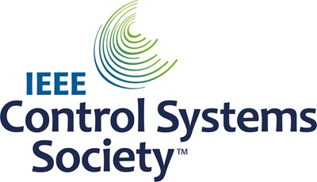

# Helt sluten loop

```{contents} In this page
:backlinks: entry
:depth: 2
```

Den största fördelen med helt sluten loop **FCL** är att den kan efterlikna en artificiell bukspottkörtel och göra den dagliga hanteringen enklare, utan att du behöver ge bolus till måltider.

Även om **hybrid sluten loop** ('HCL') bygger på en algoritm, kräver den fortfarande att användaren själv ger bolus före måltider. Därför kan loopen gå in i ett tillfälligt stopp (tillfällig basal på noll) för att undvika att för mycket insulin ges.

I **FCL** behövs inte längre någon bolus efter måltidens storlek: låt algoritmen sköta det!  **AAPS** kan hantera måltider utan att användaren ger någon bolus och utan att mata in kolhydrater, i ett läge som kallas ‘oannonserade måltider’ **(‘UAM’)**. **UAM** gör att **AAPS** klarar felaktigt inmatade kolhydrater bättre genom att vara mer aggressiv.

## Vad kan du förvänta dig?

Det finns många publicerade studier om de goda resultat som **FCL** kan ge. Mer att läsa finns här:

1)   National Library of Medicine, PubMed [First Use of Open-Source Automated Insulin Delivery AndroidAPS in Full Closed-Loop Scenario: Pancreas4ALL Randomized Pilot Study](https://pubmed.ncbi.nlm.nih.gov/36826996/);

2)  ClinicalTrials.gov National Library of Medicine, klinisk prövning [Feasibility and Safety Study of the Automated Insulin Delivery Closed Loop System Pancreas4ALL (ASAP)](https://www.clinicaltrials.gov/study/NCT04835350?term=Feasibility%20and%20Safety%20Study%20of%20the%20Automated%20Insulin%20Delivery%20Closed%20Loop%20System%20Pancreas4ALL%20(ASAP)&rank=1)

För att lyckas med **FCL** behöver användaren:

- kontrollera om förutsättningarna för **FCL** är uppfyllda;
- ställa in **automatiseringar** som är anpassade efter behoven i den dagliga hanteringen; och
- finjustera inställningarna i **AAPS** (särskilt **automatiseringar**).


## Allmänna överväganden om varför man (inte) ska gå från HCL till FCL

**FCL** passar inte alla:

- Vissa **FCL**-användare når TIR (70-180) runt 90 % och HbA1c under 6 %, men andra användare föredrar en striktare kontroll. Särskilt krävs troligen förbolus för att minimera värden över 140 mg/dl vid kost med snabba kolhydrater.
- Att justera **AAPS** kan vara svårt. Det passar inte användare som känner sig överväldigade av AAPS.  Du behöver avsätta några veckor för att justera och finjustera din **FCL**. Att lägga den tiden kan ge bättre resultat och bättre **BG**-kontroll.
- Måltiderna kan bli enklare att hantera, men träning kan fortfarande vara svårt med **FCL**. De flesta av oss vill begränsa mellanmål vid träning för att hålla vikten.
- Det är fortfarande svårt att få till en **FCL** för barn (se nedan).


## Väl inställd hybrid sluten loop

Det är klokt att först få till en väl inställd **HCL** innan du funderar på att gå över till **FCL**.  För att lyckas med **FCL** krävs en mycket personlig justering av användarens inställningar, så att **AAPS** kan ge insulin på ett sätt som nära efterliknar DIN fungerande hybrida slutna loop.

**FCL** kräver att användaren ställer in och justerar sina **automatiseringar**. Men du måste ha god förståelse för dina insulinbehov innan du börjar med **FCL**. Fel kan döljas av andra fel som tar ut dem. Det kan skapa ett instabilt **FCL**-system som är svårt att rätta till senare. Du kan räkna med att nå ungefär samma %TIR med din FCL som du har i dag med din **HCL**.

**FCL är en egen (DIY) uppsättning automatiseringar som användaren bestämmer genom att analysera sina data, både från sin fungerande HCL och från de första erfarenheterna av FCL, när inställningarna justeras.**

## Snabbt insulin (Lyumjev, Fiasp)

**FCL** kräver snabbt insulin.  Detta är för att **FCL** i början av en måltidsrelaterad **BG**-stegring ska kunna hålla **BG** inom målområdet (enligt vanlig definition under 180 mg/dl (10 mmol/l)).

En modellstudie (detaljer i LINK FullLoop V2/March2023, avsnitt 2.2) kan visa i siffror att *snabbare insuliner*

Källa:

 


IEEE Control Systems Magazine, ResearchGate [The Artificial Pancreas and Meal Control: An Overview of Postprandial Glucose Regulation in Type 1 Diabetes](https://www.researchgate.net/publication/322866519_The_Artificial_Pancreas_and_Meal_Control_An_Overview_of_Postprandial_Glucose_Regulation_in_Type_1_Diabetes);

- ger betydligt lägre **BG**-toppar än långsammare insuliner;
- klara en första måltidsbolus som kommer några minuter senare, utan att topparna blir oacceptabelt höga; och
- minimera effekten på **BG**-toppen från olika mängder kolhydrater (måltidsstorlekar).

**FCL** är troligen inte effektiv med annat insulin än Lyumjev eller Fiasp, om inte användaren äter mycket måttligt med kolhydrater eller lågkolhydratkost.

Men Fiasp eller Lyumjev kan ge täta ocklusioner i pumpen, även efter att man har optimerat t.ex. nållängden. Det är viktigt att hålla koll på hur länge kanylen eller podden har suttit. Många användare upplever att insulinet verkar bra i högst 48 timmar, sedan börjar kanylen/podden fungera sämre.

## Förutsättningar

**BG**-värden och en stabil Bluetooth-anslutning krävs för att **AAPS** ska kunna fungera optimalt utan att förlora värdefull tid. **FCL** kräver ett tekniskt stabilt system dygnet runt:

- **hur väl din CGM fungerar**. Din CGM får inte ge hoppiga **BG**-värden som **FCL** kan misstolka som tecken på att en måltid börjar. På samma sätt kan kalibreringar av **CGM** ge hoppiga värden.
- hur och var eventuell utjämning av **CGM**-data görs, och vad det kan betyda för din justering. Särskilt hur delta definieras, och att AAPS känner igen detta som tecken på att en måltid börjar.
- Bluetooth-stabilitet för pump och CGM;
- att undvika (eller åtminstone tidigt upptäcka) stopp i pumpen (ocklusion);
- dataflödet och de appar som används i din telefon, samt skillnader mellan sensorns användningsdagar;
- att hålla alla **AAPS**-komponenter väl laddade och ha reservdelar nära till hands; och
- att alltid byta kanyl (eller pod) i god tid för att minska risken för ocklusion;

Detta varierar beroende på dina **AAPS**-komponenter och din livsstil.

## Begränsningar som gäller måltider

- Det kan vara enklare att ställa in en **FCL** för personer vars kost inte innehåller livsmedel med snabb och stor effekt på **BG**, och vars måltidsmönster inte varierar kraftigt från dag till dag. Det betyder inte nödvändigtvis lågkolhydratkost.

- Kost rik på fett eller protein, eller långsam matsmältning/gastropares, gör det snarare lättare än svårare för **FCL**, eftersom sena kolhydrater fint täcker de oundvikliga “svansarna” av sen verkan från den bolus som behövs runt toppen.

### Glykemiskt index och effekt på blodsockret

Utmaningen för **UAM**-läget ökar med ökande 'Effekt på blodsockret' ('EBG')

- Börja måttligt/lågt och justera inställningarna i din **profil**. Först därefter kan du "testa" måltider med hög **EBG**.
- Överväg en första bolus på < 50 % om du äter något med mycket hög **EBG**.

1) **Ingen EBG**: t.ex. färskt kött, fisk, ägg, bacon, oljor, ost. 2) **Låg EBG**: t.ex. färska grönsaker och bär, svamp, nötter, mjölk, yoghurt, keso. 3) **Måttlig EBG**: t.ex. fullkornsbröd/fullkornspasta, potatis, vildris, havre, torkad frukt. 4) **Hög EBG**: t.ex. vetebröd, baguette, rostbröd, våfflor, kakor, potatismos, pasta, ris. 5) **Mycket hög EBG**: t.ex. socker, söta drycker, fruktjuice, cornflakes, godis, sötsaker, potatischips, salta kringelpinnar.


De svåraste måltiderna för **FCL** är de som bara består av livsmedel med mycket hög och hög **EBG** (se rött i bilden): **BG** stiger inte bara snabbt, det finns också lite fett/protein/fibrer som kan balansera den oundvikliga “svansen” av insulinaktivitet som kommer när man försöker hålla nere det höga glukosvärdet tidigt.

Oregelbundet ätande av mellanmål och söta drycker med mycket snabba kolhydrater är ett problem för **FCL**.


## Förbereda för aktivitet/träning

Vid träning eller fysisk aktivitet med pump eller hybrid sluten loop rekommenderas att användaren minskar **IOB** före träningen.

Med **FCL** är algoritmen inställd för att upptäcka **UAM** och automatiskt ge insulin mot stigande **BG**.  Ett högt **Tillfälligt målvärde** och en lägre **Procent av profil** (som verkar redan runt måltidens början) bör ställas in i god tid före all aktivitet.

Ovanlig eller oregelbunden träning är svår för **FCL**. Träning kräver planering (särskilt om du vill minska behovet av extra kolhydrater/mellanmål vid låga värden under träning). Efter en aktiv dag rekommenderas att en lägre **Procent av profil** ställs in för natten när kvällsmåltiden är helt smält: ställ i **automatiseringar** in ett förhöjt (>100 mg/dL) **BG**-målvärde, med **Aktivera SMB vid högt tillfälligt målvärde** avstängt under **Inställningar** i **AAPS**.

## Hinder för barn

**FCL** kan ge extra utmaningar för barn, till exempel:

- Lyumjev eller Fiasp kanske inte finns tillgängligt eller tolereras dåligt.
- Basaldosen per timme kan vara mycket låg, vilket ger en dålig grund för stora **SMB:er**.
- Kosten kan innehålla mycket sött. Med den låga blodvolymen i en liten kropp finns en stark tendens till mycket höga **BG**-toppar.
- Tillväxthormoner och stora förändringar i insulinkänslighet gör det svårt att hålla **FCL** rätt inställd.


## Aktivera förstärkta SMB:er: säkerhet

I **HCL** finns säkerhetsbegränsningar för hur stora bolusar loopen kan ge automatiskt.

**FCL**-loopare behöver inte längre ge en stor bolus runt måltidens början. Det betyder att storleksgränserna för **SMB:er** måste vidgas så att loopen kan ge tillräckligt stora **SMB:er**.

Om du använder **AAPS** i Master-versionen rekommenderas att **Inställningar** i **AAPS** ställs in med den största tillåtna **SMB**-storlek som **FCL** kan ge (maxUAMSMBBasalMinutes=120, dvs. basal för 2 timmar vid den tiden på dygnet).

Om din basaldos är mycket låg kan de resulterande **SMB**-gränserna bli för låga för att ge tillräcklig kontroll över stigande **BG** efter måltid. En möjlig lösning är att undvika kost som ger kraftiga **BG**-toppar. Algoritmen [Auto ISF](#Open-APS-features-auto-isf) (finns bara i en dev-version med Engineering Mode) har inställningen **Utökning av SMB maxintervall**, som utökar standardmaximum på basal för 2 timmar med en faktor >1, och låter dig höja standardvärdet 50 % för **SMB leveransförhållande**.

**Följ instruktionerna för att låta AAPS efterlikna din bolus med ett par SMB:er**.

Kontrollera regelbundet pluginskärmen för **APS** (**Konfiguration → APS → Öppna plugin**) för att se om dina **SMB:er** får vara tillräckligt stora för att ge det insulin som loopen behöver runt måltidens början.

Om inte, kommer dina försök att justera inställningarna ibland inte att ge något resultat!


```{admonition} Boosting **ISF** can become dangerous
:class: danger

Följ noga och analysera storleken på **SMB:er** strax efter att måltiden har börjat. Justera i steg och ändra inte mer än 1 eller 2 parametrar åt gången.

Inställningarna i **AAPS** måste vara tillräckligt bra för att klara din (!) variation av måltider.
```

## Upptäckt av måltider/dina automatiseringar för förstärkning

För en lyckad **FCL** är **ISF** den viktigaste parametern att justera. När du använder **AAPS** Master + **automatiseringar** måste **en profiländring till > 100 % startas automatiskt när en måltid känns igen** (via glukosdelta) och ge ett skärpt **ISF**.

**AAPS** Master tillåter upp till 130 % tillfällig **profil** i **HCL**-läge. Att förstärka **ISF** görs i 3 steg:

- Steg 1 - granska det **ISF** som gäller för den här måltidstimmen i **profilen**, och se om t.ex. Autosens föreslår en ändring som tar hänsyn till kroppens aktuella insulinkänslighet (de senaste timmarna).
- Steg 2 - använd en faktor (1/Profil%, som ställs in i **automatiseringen**) för att förstärka **ISF**.
- Steg 3 - kontrollera att det föreslagna **ISF** ligger inom de inställda säkerhetsgränserna.

### Mallar för automatiseringar i FCL

Rutor att bocka i högst upp. Du kan välja:

- I din lista med **automatiseringar** kan du bocka ur kryssrutan (till vänster om varje rad) => Då inaktiveras den **automatiseringen**. Du kan till exempel göra detta för alla **FCL**-**automatiseringar** för frukost, för att använda **HCL** vid frukost.

- För varje **automatiseringsregel** kan du bocka i rutan för Användaråtgärd => då körs de angivna åtgärderna inte automatiskt när villkoren är uppfyllda. I stället varnar huvudskärmen i **AAPS** dig varje gång din **FCL** skulle ge en **SMB** automatiskt. Du kan då svara ‘ja’ eller ‘nej’. Detta är mycket användbart under justeringsfasen.

Den här funktionen kan vara användbar i vissa situationer, som “foot to floor”-syndromet, där **BG** plötsligt stiger när man stiger upp på morgonen, men användaren vill undvika en helt automatisk reaktion som om “frukosten har börjat”.

Avsnittet nedan ger vägledning om hur du kombinerar villkor i **automatiseringar** och hur du hanterar situationer där **AAPS** bör öka (eller minska) insulintillförseln. Eftersom **ISF** inte kan justeras direkt, ger en höjning av **Procent av profil** över 100 % samma effekt för vårt syfte.

### Automatiska stora SMB:er när bg stiger

Nyckeln till en lyckad **FCL**: **i början av BG-stegringar från måltider måste loopen ge mycket stora automatiska SMB:er så snabbt som möjligt** för att “komma ikapp” med den **IOB** som behövs (jämför med din vanliga bolus för en liknande måltid i **HCL**!)

För att uppnå detta bör data från din **HCL** analyseras för att avgöra vilka **delta** som troligen inte är måltidsrelaterade och vilka som kan vara det.

- Eftersom du kan ange att **automatiseringen** gäller inom ett förbestämt tidsfönster, behöver du bara analysera där.
- Om du äter mycket olika måltider (t.ex. en frukost med mycket kolhydrater men en lunch med lite kolhydrater) kan du välja att göra två olika (uppsättningar av) **automatiseringar** för varje tidsintervall.
- Uteslut nätterna om du ibland ser hopp på grund av falska låga värden när du ligger på sensorn (compression lows)
- Oftast räcker det att använda deltat för de senaste 5 minuterna.
- Men du kan också använda ett av medeldeltana. Genom att jämföra deltan i villkoren för dina **automatiseringar** kan du till och med ange åtgärder med olika aggressivitet beroende på om **BG** stiger allt snabbare eller inte.

> ( delta – short avg delta )>n   är ett uttryck som kan användas för att upptäcka acceleration, för att starta första **SMB** vid första tecken på stigande **BG**. -                                                                             
> Obs: går inte att använda med dåliga eller kraftigt utjämnade **CGM**-värden!

En **CGM** med ojämna data sätter användaren i en dålig sits, eftersom du för säkerhets skull måste ta i („sandbag“) när du bestämmer vilket delta som säkert är ett tecken på att en måltid har börjat. Det betyder:

- **FCL** förlorar ytterligare tid, vilket ger högre **BG**-toppar och lägre %**TIR**;
- du kan inte använda ett tidigare eller mindre delta, som även utan måltid skulle kunna starta de **SMB:er** som ska ersätta användarens bolus i **FCL**.

Dessutom är **iob låg** vid de första stegringarna efter en måltid. Med detta i åtanke kan en automatisering (#1) för middagen se ut så här:


Automatisering #1

Om villkoren är uppfyllda ger **AAPS** 1 eller 2 **SMB:er** under de närmaste 12 minuterna, med ett förstärkt **ISF** enligt den inställda förhöjda **Procent av profil** (i exemplet en förstärkning av insulinReq med 30 %). Så länge villkoren är uppfyllda förlängs **automatiseringsregeln** med ytterligare 12 minuter. En måltid med lite kolhydrater kan ge en långsammare **BG**-stegring. Det är bra att ha ytterligare en automatisering (#2) som startar vid ett lägre delta och ger en svagare insulinökning.


Samma **automatisering** startar troligen även vid måltider med mer kolhydrater, när den branta stegringen som anges i automatisering #1 är över.

Du behöver “trappa” dessa två (+ kanske en tredje) **automatiseringar** så att de passar det du ser i dina måltider (variation) => Att ställa in lämpliga hoppstorlekar, **iob**-kriterier och förstärkningar blir en stegvis justeringsprocess.  Om du lägger in lämpliga tidsintervall i villkoren kan du dessutom enkelt göra olika automatiseringar för dina olika måltider under dagen (frukost, lunch, middag).

Observera att ett "överflöd" av **iob** måste stoppas redan i stegringsfasen (!), så att de sena effekterna av **insulinet** ("**svansen**" efter 3-5 timmar) inte blir större än vad loopen kan bromsa med tillfällig basal på noll (“ta bort” basal för att minska risken för hypo).

Vid stora måltider kommer det **ibland en andra stegring**. Då har oftast också iob sjunkit lite, och de mer aggressiva automatiseringarna börjar verka igen. (Kontrollera att ditt iob-villkor i automatisering #2 inte är för lågt inställt för att detta ska kunna hända).

Strax efter att några första **SMB:er** har getts kommer en **balanserad fas**, där en måttlig insulintillförsel bör täcka de extra kolhydrater som tas upp. (Utom vid måltider med lite kolhydrater, där loopen kanske ser en för svag **BG**-stegring och redan nu går över till tillfällig basal på noll).

Huvudskärmen i **AAPS** (där du ser cob=0 i **UAM** full loop) kan i denna fas be om fler kolhydrater. I **UAM**-läget betyder det bara att du kan göra en mycket grov rimlighetskontroll: Är det troligt att så mycket kolhydrater finns kvar i kroppen, ännu inte upptagna, från måltiden för ungefär en timme sedan (som du inte gav loopen någon information om)?


### iob-tröskel

Ofta får **automatiseringarna** #1 och/eller #2 iob att stiga till nivåer som oftast räcker för **dina** måltider. För personlig justering, titta i dina **HCL**-data på de högsta iob-värdena vid väl hanterade måltider (ofta: din måltidsbolus), och över vilken nivå det blev hypo (eller behov av extra kolhydrater) i slutet.

Rimliga **iob-trösklar**, där du bör minska hur aggressiv din loop är, är kanske inte desamma för alla måltider. Men särskilt under den första timmen efter att måltiden har börjat, som är mycket avgörande i **UAM**-läget. Det skiljer sig för varje användare. För vissa användare tas bara ungefär 30 g/timme upp, och då kan det gå att bestämma en meningsfull **iob** som inte beror på den exakta måltiden.

För ovanliga måltider, eller för att sänka den om träning följer, kan **iob**-tröskeln snabbt ändras i din **automatisering**.

Automatisering (#3), ”iobTH nådd => **SMB:er** av”, är gjord för att avsluta (eller pausa, tills nästa kolhydratrelaterade stegring kommer) den aggressiva **SMB**-förstärkningen.


Automatisering #3

Den talar om för loopen att det är bättre att inte använda fler **SMB:er** över din inställda **iob-tröskel**

- Exemplet gör detta genom att ställa in TT=111 (vilket är ganska godtyckligt; välj ett tal >100 som du lätt känner igen som din automatiska **SMB**-avstängning)
- Under [Inställningar → OpenAPS SMB](#Preferences-openaps-smb-settings) i **AAPS** ska du i allmänhet inte tillåta **SMB** vid förhöjt målvärde.                                                                                                                   
  Det insulin som behövs måste då ges mycket mer försiktigt genom flaskhalsen **tillfälliga basaler**

**Obs: Automatisering #3 fungerar bara när inget tillfälligt målvärde (TT) är aktivt.** Så om du har använt EatingSoonTT måste det vara avslutat vid den tidpunkten, vilket oftast bör vara 30-40 minuter efter att måltiden har börjat.

Ett sätt att göra detta är att skapa ett villkor i en **automatisering** som avslutar ett eventuellt pågående EatingSoonTT med villkoret **iob**>65% * iobTH.
> Sätt att arbeta med EatingSoonTT Vissa loopare ställer in ett EatingSoonTT ungefär en timme eller mer före måltiden (genom att trycka på TT-knappen, eller automatiskt via ett sänkt **BG**-målvärde i **profilen** om måltiderna är på ganska fasta tider), bara för att säkert få ett lågt **BG** vid start och lite mer **iob**. Men om man utgår från att **FCL** alltid är på väg mot målvärdet, ger detta kanske inte så mycket, och du kanske hellre vill skapa en **automatisering** som ställer in ett EatingSoonTT när måltidens början känns igen (glukosdelta, eller acceleration = delta > avg delta). Ett lågt **TT** är viktigt i detta skede, eftersom loopen beräknar varje **SMB** med (förutsagt glukos minus TT)/sens, så ett lågt TT gör det resulterande insulinReq större.

Efter att de första förstärkta **SMB**:erna har getts bör ditt inställda iobTH och **automatisering** #3 ge en bra balans: glukostoppen begränsas, men det blir inte heller hypo efter måltiden.

Om din frukost har ett helt annat kolhydratinnehåll än din vanliga middag kan du ha nytta av att skapa **automatiseringar** som gäller vid respektive tid på dygnet och har olika **iobTH** (kanske också olika delta och olika inställd **Procent av profil**). Både du, när du bestämmer ditt måltidsspektrum och dina inställningar (särskilt **iobTH**), och loopen, som hanterar **BG**-kurvan när den utvecklas, måste acceptera vissa topphöjder för att minska risken för hypo mot slutet av **DIA** för **SMB:erna**.

### Stillastående höga bg-värden

Om du efter en “rik” måltid ser en långvarig stagnation med **högt BG**-värde hjälper **automatisering** #4 (nedan), “post-meal High”, mot insulinresistens från fettsyror: Efter måltider med flera rätter, stor flottig pizza eller en raclettekväll kan glukoskurvan få två pucklar eller, mycket ofta, en lång hög platå.


Automatisering #4


Automatisering #5

Automatisering #4, “post-meal High”, passar också i hybrid sluten loop.

Dessutom behövs en automatisering #5 som avslutar, “Stop pmH”, så att insulintillförseln blir mindre aggressiv så snart glukosvärdet sjunker. (Men ofta begränsar loopen ändå ytterligare insulin för att förhindra hypo, eftersom det förutsagda glukosvärdet redan är lågt).

## Förebygga hypo

Kärnproblemet är att **UAM**-**FCL** (utan inmatade kolhydrater) **inte kan veta hur många g kolhydrater som fortfarande finns kvar** att ta upp, och som kanske kan förbruka den “svansen” av insulin utan att du får hypo av den.

Med förstärkta **SMB:er** har **FCL** “kommit ikapp” med det vi tidigare gjorde med en måltidsbolus. Men **i slutet av insulinets verkan (“svansen”) kan risken för hypo bli ett allvarligt problem**.

Som förberedelse för **FCL** måste användaren titta närmare på **hur iob förändras över tid** vid typiska måltider, och bedöma **när det blir för mycket och hur du kan fånga det genom att justera dina automatiseringar**. Det är möjligt eftersom vi har flera inställningar att justera med. Det kan vara svårt att få detta rätt

I allmänhet är det ingen idé att fortsätta optimera inställningarna för en enda sorts måltid. När du har en tillräckligt bra inställning, t.ex. för en sorts lunch som du ofta äter, testa hur den fungerar med andra sorters måltider och hur du skulle “kompromissa”.

För att förhindra hypo under timme 3 – 5 efter måltiden, minska aggressiviteten innan det samlas för mycket iob. Konkreta metoder:

- Bli mildare och mildare med **ISF** redan medan glukosvärdet stiger, som i exemplen med automatisering #1 och #2.
- Bestäm iob-tröskeln, över vilken **AAPS** blir betydligt försiktigare (automatisering #3, ovan). Observera att denna **iob** kan överskridas av den sista **SMB** som gavs innan den började gälla, och sedan ytterligare av tillfälliga basaler om loopen ser ett insulinReq. Kolhydrater som tas upp ger en motrörelse mot lägre iob.
- Iob-tröskeln kan skilja sig mellan måltider: Genom att klona automatiseringarna kan du enkelt skilja mellan tidsintervall för frukost, lunch och middag (eller till och med platser, som personalmatsalen eller hos svärmor osv.)
> Inom dessa tidsintervall kan du skilja ännu mer genom att ställa in olika TT för lågkolhydratmåltider respektive snabba kolhydrater osv., och på så sätt “koda” olika typer av måltider som kan förekomma vid den tiden på dagen, och starta dem med **automatiseringar** som är särskilt anpassade för dem. Detta behövs troligen inte, om inte dina matvanor varierar mycket.

Inför en speciell måltid kan du höja din **iob**-tröskel, eller göra en annan ändring i någon av dina automatiseringar på under 5 sekunder, direkt i din AAPS-telefon (**Hantera → Automation**).

Risken för hypo några timmar efter måltiden handlar i grunden om huruvida måltiden var sammansatt så att **insulinsvansarna från kampen mot huvuddelen av kolhydraterna** kommer att **förbrukas av “förlängda kolhydrater”** (för stort/fördröjt kolhydratupptag/protein/fett/fibrer).

Med tiden lär du dig mönster och justerar dina automatiseringar – kanske ändrar du till och med dina matvanor lite, t.ex. genom att ibland äta ett litet(!) sent mellanmål, som kan hjälpa till att hålla en bra **balans mellan insulinaktivitet och kolhydratupptag** under **hela** måltidens tid (matsmältning, upptag). Det gör livet lättare för din loop (och för dig själv).

### Ordning på programmerade automatiseringar

Problem kan uppstå om definitionerna i **automatiseringar** överlappar varandra. Exempel: Problemet är att delta >8 också är delta >5, dvs. det kan finnas två konkurrerande **automatiseringar**. Vad gör loopen då? Den bestämmer alltid enligt den ordning som dina **automatiseringar** visas i under **Hantera → Automation**.  Exempel: Regeln delta > +8 måste komma först (och starta den starkaste förstärkningen om alla villkor är uppfyllda); sedan kommer kontrollen av delta >5 (och en mildare reaktion). Om ordningen är den omvända kommer regeln delta>8 aldrig att gälla, eftersom delta>5 redan gäller och saken är avgjord.
> Tips för automatiseringar: Det är mycket enkelt att ändra ordningen. I **Hantera → Automation**, tryck och håll på handtaget **=** till höger om en regel och dra den till en annan plats.

Det är också mycket enkelt och snabbt att ändra villkor eller åtgärder när som helst, på några sekunder, direkt i din AAPS-telefon; till exempel inför en mycket speciell måltid. (Men glöm inte att ställa tillbaka det till det normala för nästa dag).

(full-closed-loop-troubleshooting)=

## Felsökning

### Hur du går tillbaka till hybrid sluten loop

Du kan bocka ur kryssrutorna för de **automatiseringar** som hör till din **FCL**, och gå tillbaka till att ge bolus till måltider och mata in kolhydrater igen. Om du hade tagit bort knapparna **Insulin** eller **Kalkylator** från huvudskärmen, lägg tillbaka dem i inställningarna för [verktygsfältet Snabbstart](#quicklaunch) (de finns alltid kvar under **Behandlingar** i navigeringsfältet längst ner). Kom ihåg att det nu återigen är du som måste ge bolus till måltider.

Det kan vara klokt att bara använda **FCL** för måltider (tidsintervall) där **automatiseringarna** är helt definierade och ikryssade, och bara bocka ur dem för andra måltider när du vill använda **HCL** (eller inte har definierat några än, under din övergångsperiod).

Det går till exempel utmärkt, utan några extra steg efter att **automatiseringar** för middagens tidsintervall har definierats, att bara använda **FCL** för middagar, medan frukost och lunch görs i **HCL** som du är van vid.


### Är förutsättningarna för FCL fortfarande uppfyllda?

- Stämmer den grundläggande **profilen** fortfarande?
- Har kvaliteten på **CGM**-data blivit sämre
- Se förutsättningarna (ovan).

### Glukos blir för högt

- Måltider känns inte igen tillräckligt snabbt
    - Kontrollera om Bluetooth är (o)stabilt
    - Kontrollera om du kan ställa in mindre delta för att starta första **SMB**
    - Experimentera med en aperitif eller soppa några minuter innan måltiden börjar
- SMB:erna är för svaga
    - Kontrollera ordningen på **automatiseringarna** (t.ex.: stort delta före litet delta)
    - Kontrollera (i realtid) på pluginskärmen för **APS** om profilens basal per timme och inställda minuter (max 120) begränsar tillåten SMB-storlek
    - Kontrollera (i realtid) på pluginskärmen för **APS** om %profil måste ställas högre
- Om alla dina inställningar redan är vid gränsen kan du behöva leva med det tillfälligt höga värdet, eller ändra din kost.
> Om du är redo att testa en dev-version tillåter [Auto ISF](#Open-APS-features-auto-isf) också ännu större SMB:er. Vissa användare ger också en liten förbolus i sin “FCL”. Men detta påverkar hur glukoskurvan, och därmed upptäckten av stegringar och de startade **SMB:erna**, beter sig, och är därför inte lätt att använda med en övertygande total nytta.
- En viktig iakttagelse från pilotanvändarna var att det har stor betydelse hur dina glukos- och iob-kurvor ser ut när måltiden börjar, för hur höga topparna från kolhydraterna blir: Att gå nedåt (t.ex. mot ett inställt EatingSoonTT), bygga upp lite iob och redan ha en kurva som böjer sig mot stark positiv acceleration verkar hjälpa mycket för att hålla topparna låga.

### Glukos blir för lågt

- Måltider känns igen felaktigt
    - Kontrollera om du kan ställa in större delta för att starta första **SMB**
    - Klicka i “Användaråtgärd” i den aktuella automatiseringen, så att du i framtiden kan bestämma direkt om automatiseringen ska blockeras om den inte är måltidsrelaterad
    - För att mellanmål inte ska starta **SMB:er** som för en måltid, ställ in ett TT>100 när du äter mellanmål (som du ändå skulle göra vid träning och för mellanmål mot hypo)
- SMB:erna ger totalt sett för mycket insulin
    - Kontrollera (i realtid) på pluginskärmen för **APS** om **Utökning av SMB maxintervall** måste ställas lägre
    - Kontrollera (i realtid) på pluginskärmen för **APS** om **Procent av profil** måste ställas lägre
    - SMB leveransförhållande kan troligen ställas lägre. Observera att det i detta fall gäller för alla **SMB:er** (alla tidsintervall),
- Problem med insulinets “svans” efter måltider
    - Du kan behöva äta ett mellanmål (när du ser en hypoprognos) eller druvsockertabletter (om du redan är i hypoområdet). Men observera att den mängd kolhydrater som loopen ibland säger att du behöver troligen är överdriven, eftersom loopen inte har någon som helst information om hur mycket kolhydrater du har ätit (medan du kanske kan gissa hur mycket mer, inkl. från fett och protein, som fortfarande väntar på att tas upp).
    - Det vore värdefullt att veta om problemet främst uppstår redan när bg stiger. Då kan ett lägre iobTH vara en enkel lösning.
    - Om behovet av extra kolhydrater uppstår ofta, skriv ner hur många gram som behövdes (räkna inte med det du kanske åt för mycket och som krävde extra insulin igen).  Använd sedan KH-kvoten (IC) i din profil för att uppskatta hur mycket mindre insulin **SMB** borde ha gett, och använd den informationen i din justering (av **Procent av profil** i **automatiseringar**, eller kanske också ditt inställda iobTH). Detta kan gälla de **SMB:er** som gavs när glukosvärdet var högt, eller också de **SMB:er** som gavs under **BG**-stegringen.
    - Det kan mycket väl vara så att du helt enkelt måste acceptera högre **BG**-toppar för att inte gå för lågt. Eller ändra kosten till något med mindre kolhydrater och mer protein och fett.


### Mer information

Se till att hålla kontakten med andra **FCL**-användare.

Diskussion om helt sluten loop med automatiseringar:

- Engelska:   [Discord-kanal](https://discord.gg/ChXj8BaKwA)

- Tyska:  [German Looper Community](https://de.loopercommunity.org/t/ueber-die-kategorie-full-loop/10107)
