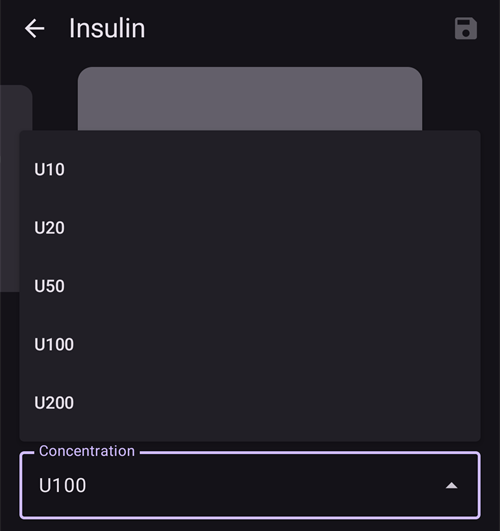
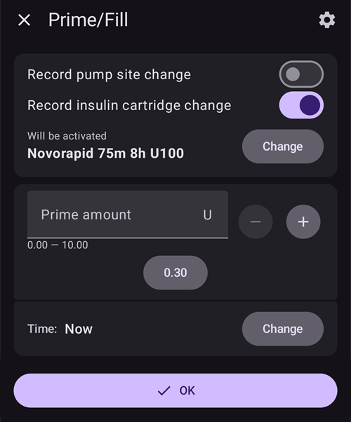

(Insulin-Concentration)=
# Insulinkoncentration

```{warning}
Alla kommersiella pumpar är gjorda för att användas **ENDAST** med insulin U100. Det kan vara farligt att använda en annan insulinkoncentration i en pump. Allt fler användare kör AAPS med andra koncentrationer, men omräkningen måste alltid hanteras och leder ofta till fel (även för mycket erfarna användare!).
```

## Påminnelse om grunderna för insulin

Det här kapitlet tar upp de viktigaste begreppen för hur insulin mäts och ges.

### Insulinenheten: ett mått på verkan

Insulin mäts i **internationella enheter (IU)**. De anger insulinets biologiska aktivitet (förmågan att sänka blodsockret), inte bara dess fysiska massa.

- **Definition:** 1 IU motsvarar aktiviteten hos en viss mängd insulin, standardiserad till **ungefär 0,04167 mg**.
- **Viktigt:** En "enhet" betyder samma biologiska effekt för alla insulintyper. Det ger en jämn dosering.

### Insulinkoncentrationer

Insulin finns i olika styrkor. Styrkan anges som antal enheter per milliliter (ml).

- **U100:** Den globala standarden, innehåller **100 IU/ml**.
- **U200–U500:** Mer koncentrerade insuliner (t.ex. innehåller U200 200 IU/ml) för mindre injektionsvolymer.
- **U40/U50:** Mindre vanliga, historiska koncentrationer (40 IU/ml och 50 IU/ml). **U40 kräver sprutor som är gjorda för U40.**
- **Manuell spädning:** En klinisk metod för att göra kraftigt utspätt insulin (t.ex. U50, U10) i sällsynta fall, till exempel för nyfödda eller vid extrem känslighet. Det kräver en mycket noggrann beredning på apotek.

```{admonition} Critical Warning
:class: danger
Att använda en koncentration med en enhet som inte passar är extremt farligt och kan ge en allvarlig överdos eller underdos. **Kontrollera alltid tre gånger att insulinkoncentrationen passar sprutan, pennan eller pumpen.**
```

## När används en koncentration som inte är standard?

Insulinpumpar är gjorda för insulin U100, men vissa medicinska situationer kräver koncentrationer som inte är standard. I dessa fall krävs extrem försiktighet och mycket noggrann hantering.

### Användningsfall 1: utspätt insulin för mycket små doser

- **Situation:** Behandling av typ 1-diabetes hos mycket små bebisar och småbarn.
- **Problem:** Deras insulinbehov är så litet att pumpens minsta dos (t.ex. 0,05 U) ändå kan vara för stor. Det gör det svårt att styra blodsockret exakt och ger hög risk för hypoglykemi.
- **Lösning:** Använd kraftigt utspätt insulin (t.ex. U10, alltså 10 IU/ml).
- **Effekt:** Volymen vätska som ges per insulinenhet blir större. När insulinets "paket" får större volym men lägre koncentration går det att göra mycket finare justeringar och dosera mer exakt med pumpens befintliga inställningar.

```{admonition} Critical Safety Note on Dilution
:class: danger
Spädning av insulin är en högriskåtgärd som aldrig får göras hemma utan särskild utbildning och medicinsk övervakning. Den måste göras av sjukvårdspersonal eller en utbildad vårdare, med steril spädningsvätska som är gjord just för den insulintypen. **Använd aldrig kranvatten, koksaltlösning eller någon annan vätska**, eftersom det kan göra insulinet verkningslöst, ändra dess verkan och föra in farliga föroreningar.
```

### Användningsfall 2: koncentrerat insulin vid stort insulinbehov eller tydlig insulinresistens

- **Situation:** Behandling av vuxna eller ungdomar med tydlig insulinresistens, eller personer som får lokal smärta av tillsatserna i vanligt insulin.
- **Problem:**
  1. **Stort behov:** Ett mycket stort dagligt insulinbehov kan överskrida pumpens gränser för maximal bolus eller maximal dygnsdos.
  1. **Smärta:** Konserveringsmedlen i insulin kan svida eller irritera när insulinet ges.
- **Lösning:** Använd ett mer koncentrerat insulin, till exempel U200 (200 IU/ml).
- **Effekt:** Den insulindos som behövs ges i halva volymen. Användaren måste justera pumpens interna inställningar (t.ex. halvera basaldoser och bolusar) för den dubbla koncentrationen, så att rätt antal enheter ges. Det minskar också volymen av vätska som kan irritera och som ges under huden.

## Hur hanterar man insulinkoncentration med AAPS (AAPS 3 och äldre)?

För att använda annat insulin än U100 i en AAPS-loop krävs en mycket noggrann konfiguration, så att programmets beräkningar stämmer med det insulin som faktiskt ges. En vanlig metod är "att använda en ändrad profil".

### Att använda en ändrad profil

Med den här metoden lurar man AAPS att tro att patientens insulinbehov är mindre än det är. Det kompenserar för att pumpen ger mer koncentrerat insulin än den är gjord för. Exemplet nedan gäller koncentrationen U200 i en pump som är gjord för U100.

- **Grundproblemet:** En pump gjord för U100 är kalibrerad för att ge **10 µl** för **1 enhet**. Om du fyller den med U200 (1 enhet U200 motsvarar **5 µl** insulin) och väljer **1 enhet** på pumpen, så ger den **10 µl** insulin. Men den volymen innehåller nu **2 enheter U200-insulin**. Det leder till en överdos på 100 %.
- **Lösningen med "profilbyte 50 %":** För att rätta till detta skalas patientens hela behandlingsprofil i AAPS så att den blir "dubbelt så svag".
  1. Användaren skapar en ny profil utifrån sin vanliga U100-profil med funktionen "profilbyte **50 %**".
  1. Det skapar en ny profil där:
     - **basaldoserna** halveras.
     - **kolhydratkvoten (KH-kvot, IC)** fördubblas (t.ex. 1:10 g blir 1:20 g).
     - **insulinkänslighetsfaktorn (ISF)** fördubblas (t.ex. "1 enhet sänker BG med 50 mg/dl (2,8 mmol/l)" blir "1 enhet sänker BG med 100 mg/dl (5,6 mmol/l)").
- **Det rättade resultatet:** AAPS tror nu att patienten bara behöver hälften så mycket insulin. När AAPS beräknar och skickar en bolus på **1 enhet** ger pumpen (gjord för U100 men fylld med U200) **10 µl**, som innehåller **2 verkliga enheter U200-insulin**. Eftersom AAPS beräknade dosen utifrån en profil med "halv styrka" är denna dos på **2 verkliga enheter** den rätta, avsedda dosen. Loopens beräkning med "halv styrka" stämmer då med pumpens leverans med "dubbel styrka".

```{admonition} Critical Risks and Common Errors
:class: caution

Den här metoden ger stora risker, eftersom appens data hela tiden skiljer sig från verkligheten.

**Huvudfelet: felet med "extern bolus"**

Det vanligaste misstaget sker när insulin ges och registreras **utanför** systemet AAPS–pump.

- **Situationen:** AAPS använder den ändrade profilen och beräknar en bolus på **5 enheter** till en måltid. Användaren injicerar den med en U200-penna.
- **Det dubbla felet:**
  1. **Fel vald dos:** Användaren tänker "AAPS beräknar 5 enheter" och räknar, på grund av U200-pennan, med att ge **5 verkliga enheter U200** utan omräkning. Men eftersom profilen är halverad behöver kroppen egentligen **10 verkliga enheter**. Det är en **underdos på 50 %**, vilket kan leda till hyperglykemi.
  1. **Fel beräkning av aktivt insulin (IOB) (för högt IOB):** När användaren registrerar denna externa bolus i AAPS anger hen **5 enheter**. Det är fel. Eftersom profilen i AAPS gäller U200 är **1 enhet i AAPS lika med 2 verkliga enheter**. De 5 verkliga enheter som pennan gav ska därför registreras som **2,5 enheter** i appen. När användaren registrerar 5 enheter blir IOB 100 % för högt. AAPS tror nu att det finns 5 "koncentrerade enheter" aktiva (motsvarar 10 verkliga enheter), men bara 5 verkliga enheter verkar. Det kan få loopen att minska basalinsulinet eller kommande bolusar, och det gör risken för hyperglykemi efter den första underdosen ännu större.

**Andra risker:**

- **Vilseledande data och rapporter:** Alla data i AAPS eller Nightscout – även IOB, total dygnsdos (TDD) och historiska rapporter – är i "koncentrerade enheter". Det ger användaren och vårdteamet en felaktig bild. En läkare som läser en rapport kan se en TDD på 30 enheter utan att förstå att patienten egentligen fick 60 verkliga enheter. Det kan leda till felaktiga bedömningar av behandlingen.
- **Ändrad mental modell:** Efter lång användning börjar användaren "tänka" i appens halverade värden. Hen vänjer sig vid att ISF är 100 mg/dl (5,6 mmol/l) eller att basalen är 0,5 U/h och glömmer att värdena är "koncentrerade". Det skapar ett farligt beroende av systemet och man tappar känslan för sitt verkliga insulinbehov. Det är kritiskt för säkerheten när pumpen går sönder eller appen får problem.

**Slutsats:** Den här metoden kräver ständig vaksamhet. Användaren måste hela tiden räkna om mellan en "koncentrerad värld" i appen och den fysiska världen. All insulintillförsel utanför systemet och all granskning av data bryter denna mentala modell och ger en allvarlig risk. Metoden ändrar i grunden betydelsen av varje siffra i systemet.
```

## Att använda koncentrationsparametern (ny funktion i AAPS 4.0)

För att minska riskerna med en ändrad profil finns en ny funktion som hanterar insulinkoncentrationen direkt i AAPS. Funktionen gör omräkningarna automatiskt, så att huvudappen alltid kan arbeta i **verkliga internationella enheter (IU)**.

### Så fungerar det: automatisk omräkning

Grundprincipen är en tydlig uppdelning mellan appens logik och kommunikationen med pumpen:

- **AAPS använder internationella enheter:** AAPS huvuddatabas, algoritmer, rapporter och loggar **använder alltid verkliga IU**. Det betyder att ditt IOB, din TDD och dina behandlingsinställningar (basal, ISF, IC) visar de verkliga biologiska insulinenheterna.
- **Pumpdrivrutinen använder koncentrerade enheter:** Alla värden som skickas till eller tas emot från pumpdrivrutinen räknas automatiskt om till "koncentrerade enheter" i pumpdrivrutinen, utifrån den valda koncentrationen.
  - **Exempel med U200:** När användaren begär en **bolus på 1 enhet** får pumpdrivrutinen **0,5 CU (koncentrerade enheter)** innan den skickar dosen till pumpen. Pumpen (inställd för U100) ger då **5 µl**, som innehåller **1 IU U200-insulin**.

### Fördelar och kvarstående risker

**Fördelar:**

- Det behövs ingen ändrad profil, och de mentala räknefel som följer med den försvinner.
- Användaren kan alltid "tänka" i verkliga IU.
- För en extern bolus med penna väljer du bara den insulinmängd du vill ge på pennan (oavsett vilken penna och insulinkoncentration du använder). Ingen omräkning behövs, eftersom pennor för U100 och U200 alltid använder IU när du väljer enheter.
- Alla rapporter och data i AAPS (TDD, IOB) är i verkliga IU. Det ger en tydlig bild för användaren och vårdteamet.
- Risken att räkna fel på externa bolusar försvinner, eftersom de registreras i verkliga IU.

**Kvarstående risker:**

- **Byte av mental modell:** Användare som byter från metoden med "ändrad profil" måste byta tillbaka till den rätta, verkliga profilen (alltså dubbelt så stark om de kommer från U200) och behöver tid för att ändra sin **mentala modell**. När de har vant sig vid "koncentrerade" värden i appen måste de lära sig att lita på de **verkliga, synliga IU-värdena** som visas överallt. Under denna period finns det risk för feltolkningar.
- **Manuell bolus på pumpen:** Om du använder pumpens egen bolusfunktion (utan AAPS) blir det en överdos på 100 %, eftersom pumpen ger U200-insulin med volymberäkningar för U100.
- **Allmän varning:** Att använda koncentrationer som inte är standard är fortfarande en avancerad metod med risker och rekommenderas inte officiellt.

```{admonition} Never use the pump's own interface (tube pump users) to deliver a bolus manually
:class: danger
Sätt en permanent lapp med texten **"U200 Insulin"** på pumpen som påminnelse, så att du aldrig glömmer det!
```

### Visning i användargränssnittet

För tydlighetens skull visar användargränssnittet både verkliga och koncentrerade enheter där det behövs. Observera att användargränssnittet inte ändras om det aktuella insulinet är U100.

**Exempel på visning:**

- **Dialogen för bolusförlopp:**
  - Dialogen Bolusförlopp hör till själva AAPS-appen, så den visar bara informationen i IU (samma som användaren valde): **`2,50 U / 10,00 U levererat`**
- **Pumpdrivrutinens gränssnitt (aktuell status):**
  - I pumpens översikt visas den givna mängden i båda enheterna. Om till exempel `U200` är vald: **`Senaste bolus: 10 U (5 CU) (10')`**

**Observera:** Båda enheterna (U och CU) syns bara i pumpens huvudöversikt. Beroende på din pump kan det finnas andra skärmar där bara de koncentrerade enheterna visas. Historiska data i pumpdrivrutiner är i regel kvar i "koncentrerade enheter".

### Aktivera funktionen

På grund av säkerhetsriskerna är den här parametern inte aktiverad från början. För att aktivera den: slutför mål 3 och slå på **Stöd för insulinkoncentration** i de allmänna inställningarna.

### Skapa ett nytt insulin med en annan koncentration

För att skapa ett insulin med en annan koncentration öppnar du först **Hantera → Insulininställningar**.

- Tryck på ikonen "+" längst ned på skärmen.
- Välj den nya koncentrationen i listan (U10, U20, U50, U100 och U200 finns).
  - Utspädda koncentrationer som U10, U20 eller U50 är till för barn med mycket låga basaldoser.
  - U200 är främst för vuxna med stort insulinbehov.

  

- Justera topptid, insulinets verkningstid (DIA) och ändra insulinets smeknamn om du vill (valfritt).
- Tryck på spara-knappen uppe till höger på skärmen.

Nu är insulinet skapat, men det kan inte väljas direkt i **Insulininställningar**.

### Byta koncentration från U100 till Uxxx (AAPS 4)

```{admonition} Switching concentration is only allowed during a reservoir or patch/pod change
:class: warning
Av säkerhetsskäl registrerar AAPS ett byte av koncentration bara vid ett reservoarbyte eller podbyte.
```

När du börjar med insulin U100 stämmer hela din profil, alla historiska data och rapporter med standarden internationella enheter. Därför är bytet mycket "enkelt":

- För en pod-pump finns ett eget steg när du byter pump, där du väljer det insulin du har fyllt i den.
- För en slangpump trycker du på knappen Förfyllning (för insulinbyte) i översikten (utökad vy av statusfältet) och sedan på knappen "Ändra".

1. Välj önskad koncentration i listan (t.ex. `U200`).
1. Välj sedan rätt insulin nedanför. Tills du bekräftar står det **Kommer att aktiveras** ovanför namnet (i stället för **Aktivt just nu**).

   

1. **Viktigt:** bytet av koncentration registreras i AAPS först när profilbytet har förts över till pumpen.
   - Det här steget är obligatoriskt för alla pod-pumpar.
   - För slangpumpar: vänta tills profilbytet har förts över till pumpen, eller i **Hantera → Profil** eller **Insulininställningar**.

Klart!

Om ett tillfälligt **Profilbyte** (ett med varaktighet) är igång när du byter insulin, får även den profil som kommer tillbaka när det tillfälliga bytet slutar det nya insulinet. Det gamla insulinet kommer inte tillbaka.

### Byta koncentration för användare med insulin U200 och en profil på 50 % (AAPS 4)

Om du redan använder U200 i pumpen, men med en profil på 50 %, behöver du göra fler steg än vid ett vanligt byte från insulin U100.

Tänk på att den svåraste delen troligen inte är att göra bytet rätt i AAPS, utan att träna hjärnan att tänka i "IU" i stället för "CU" igen. Alla vanliga värden för bolusar (frukost, lunch, middag ...) blir dubbelt så höga, och detsamma gäller din TDD, dina basaldoser osv. Var mycket försiktig så att du inte gör fel under de första veckorna, tills du "tänker" i internationella enheter igen.

- Förbered först en ny profil där alla värden stämmer med internationella enheter:
  - Gör ett tillfälligt profilbyte till 200 % av din vanliga aktiva profil.
  - Öppna menyn (☰) → **Behandlingar**, gå till fliken **Profilbyte** och klona den nya profilen på 200 % (se [Klona ett profilbyte](#your-aaps-profile-clone-profile-switch)).
  - Byt tillbaka till din vanliga profil fram till nästa reservoarbyte eller podbyte.
  - Gå till **Hantera → Profil** och ge den nya profilen ett tydligt namn (det blir din framtida profil för insulin U200 som är inställt i AAPS 4).
- Om du använder funktionen Dynamisk ISF (DynISF) måste du stänga av den i minst en vecka:
  - All historik som är sparad i AAPS eller Nightscout är i fel enheter (CU), hälften av det verkliga värdet i internationella enheter. Vänta minst en vecka med insulin U200 i pumpen innan du slår på den igen.
- Nu är du redo att byta insulin (med ett nytt U200 definierat i **Insulininställningar**) vid nästa insulinbyte eller podbyte.
- När det nya U200-insulinet är rätt tillämpat: glöm inte att aktivera den nya vanliga profilen som du förberedde i första steget.

## Hur hanterar man externa bolusar med olika pennor?

### Med insulin U200 och en profil på 50 % (AAPS 3)

Tänk på att alla pennors skalor är i internationella enheter. Oavsett vilken penna du använder (U100, U200) måste du alltså räkna om åt båda hållen om du ger en extern bolus med penna:

- Från AAPS till pennan: om kalkylatorn föreslår en bolus, eller om du har en viss mängd i tankarna, multiplicera med 2 när du väljer mängden på pennan, jämfört med samma bolus given från AAPS.
- Från pennan till AAPS: om du har valt en mängd på pennan för en extern bolus, dela mängden med 2 när du registrerar den i AAPS (knappen Insulin, extern bolus). Då blir IOB rätt beräknat i CU (koncentrerade enheter).

### Med insulin U200 och den hantering av koncentration som finns i AAPS 4

Det är mycket enklare när AAPS själv hanterar koncentrationen: välj bara önskad mängd på pennan (oavsett penna och insulin) och registrera den i AAPS.

- Om du väljer extern bolus under knappen Insulin kan du välja vilken insulintyp som helst som är definierad i **Insulininställningar** (främst U100 och U200 för pennor). Så får du ett mycket exakt beräknat IOB, även om topp/DIA för pennans insulin skiljer sig mycket från topp/DIA för pumpens insulin.
