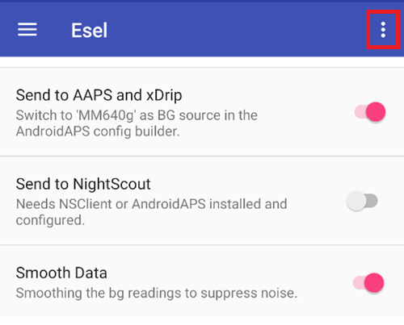

# Eversense

Det finns fyra olika sätt att få tillgång till värdena från Eversense:

- ESEL i companion-läge
- ESEL i patchat läge
- xDrip som följeslagarapp (companion app)
- Läsare för aviseringar (inbyggd i **AAPS**)

## ESEL

Hämta och installera [ESEL-appen](https://github.com/BernhardRo/Esel/tree/master/apk) enligt de här [instruktionerna](https://github.com/BernhardRo/Esel?tab=readme-ov-file#esel).

- Öppna menyn med tre punkter (⋮) uppe till höger i ESEL och välj **Settings** (finns också i menyn ☰). I inställningarna:
  - Slå på "Send to AAPS and xDrip"
  - **Stäng av** "Send to Nightscout"
  - BG-data från Eversense kan vara brusiga, så vi rekommenderar att du slår på "Smooth Data" i ESEL.



### Companion-läge

Läser data från Eversense-appens aviseringar (fungerar med den vanliga Eversense-appen, finns sedan ESEL version 3.0.1).

1. Använd den officiella Eversense-appen från Google Play Butik
   - Valfritt, men krävs för att fylla i saknade data (backfill): logga in på ditt Eversense-konto
   - Slå på automatisk synkronisering (Auto synchronization) under Sync
2. Inställningar i ESEL:
   - Stäng av inställningen "Get data from patched Eversense App"
   - För att fylla i saknade data (backfill): slå på "Fill missing data from eversensedms.com"
   - Ange dina inloggningsuppgifter för Eversense som e-postadress och lösenord
3. Välj "MM640g" som BG-källa i [**Konfiguration → BG-källa**](#Config-Builder-bg-source).

### Patchad Eversense-app

 Kräver en patchad version av Eversense-appen (fungerar helt offline, även för att fylla i saknade data).

1. Avinstallera Eversense-appen (Varning: dina lokala historiska data (äldre än 1 vecka) försvinner!)

2. Installera den [patchade Eversense-appen](https://cr4ck3d3v3r53n53.club) och använd den så som tillverkaren beskriver

   - Starta Eversense-appen, logga in, anslut till din sändare och använd den precis som den vanliga appen.

3. Inställningar i ESEL:

   - Slå på inställningen "Get data from patched Eversense App"


Om du kör ESEL med en nyinstallerad Eversense-app för första gången kan det ta upp till 15 min innan dina första värden visas i xDrip!

4. Välj "MM640g" som BG-källa i [**Konfiguration → BG-källa**](#Config-Builder-bg-source).

## xDrip

xDrip kan läsa aviseringar från tillverkarens app, på samma sätt som ESEL. Det går inte att fylla i saknade data (backfill).

- Ladda ned och installera xDrip: [xDrip](https://github.com/NightscoutFoundation/xDrip)
- I xDrip måste “Companion App” väljas som datakälla.
- Välj xDrip i [**Konfiguration → BG-källa**](#Config-Builder-bg-source).
- Ställ in xDrip enligt förklaringarna på sidan om xDrip-inställningar [xDrip-inställningar](../CompatibleCgms/xDrip.md).
- Slå på [Exponentiell utjämning](../CompatibleCgms/SmoothingBloodGlucoseData.md) i AAPS.

## Läsare för aviseringar

**AAPS** kan läsa glukosvärdena direkt från aviseringarna från den officiella Eversense-appen, utan någon annan app emellan. Det går inte att fylla i saknade data (backfill).

- Välj **Läsare för aviseringar** i [**Konfiguration → BG-källa**](#Config-Builder-bg-source) och ge **AAPS** åtkomst till aviseringar när du blir tillfrågad.
- Se till att Eversense-appen visar det aktuella glukosvärdet i sin avisering.

```{warning}
BG-värdena kommer inte alltid var 5:e minut, och dubbletter kan förekomma.
```