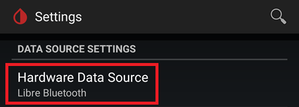
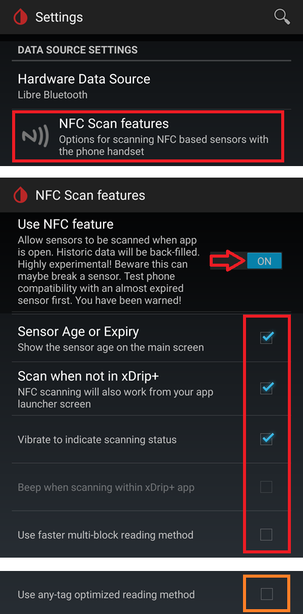
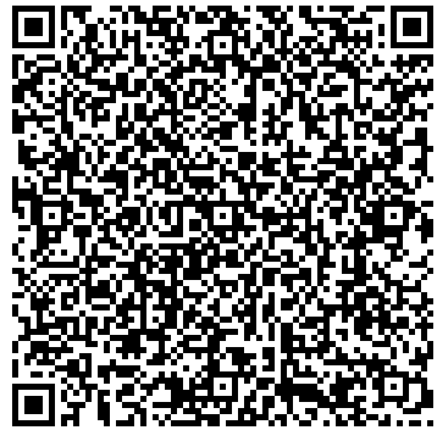
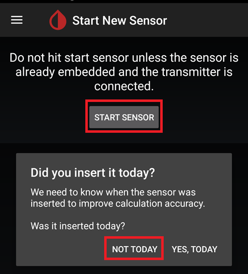
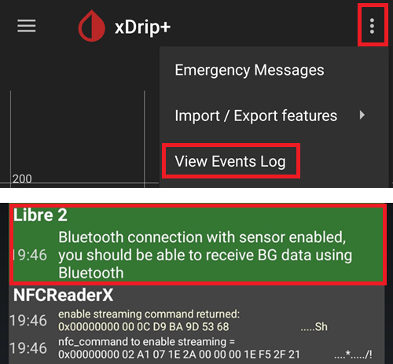

# Så ställer du in FSL 2 och OOP2 för direkt Bluetooth-anslutning i xDrip

Överförd från [MinimalL00per](https://www.minimallooper.com/post/how-to-setup-freestyle-libre-2-and-oop2-to-use-a-native-Bluetooth-connection-in-xdrip) till markdown och **reviderad/uppdaterad**: 25 augusti 2025, psonnera

Längst ned i detta dokument finns en lista med definitioner. Om du inte känner till några termer eller förkortningar kan du *[hoppa ned](#minimallooper-definitions)* för att få förklaringar.

 

## Konfiguration

### Hårdvara

- *FSL2 och 2+* **OBS: versionerna för USA, Kanada, Nya Zeeland och Australien stöds INTE**

**(VALFRITT) Läsare** (fungerar inte med FSL2+)

- Läsare 1 (med uppdaterad firmware)

- Läsare 2

*OBS: Om du tänker använda läsaren i den här lösningen MÅSTE du STARTA sensorn med LÄSAREN FÖRST. Om du inte gör det kan du inte använda läsaren för att hämta värden från den aktiverade sensorn. När sensorn har värmts upp kan du hämta värden från LL-appen eller xDrip.*

### Mjukvara

**OOP** - Out of Process Algorithm, en extern Android-app (APK) som hjälper till att hämta rådata från sensorn för att få fram blodsockervärden. xDrip skickar insamlade BT-rådata från FSL2 till OOP, och blodsockervärden skickas tillbaka till xDrip.

- **OOP2**

  - **Fungerar bara med europeiska FSL2/2+-sensorer**

  - Sluten källkod (finns inte på GitHub)

  - Syftet är att avkryptera sensorns krypterade rådata och skicka tillbaka dem till xDrip. Sedan kan xDrip användas antingen med rådata, som kräver kalibrering, eller ge blodsockervärden som liknar dem från Läsare 1.

[***xDrip***](https://jamorham.github.io/)

- [*Nightly*](https://github.com/NightscoutFoundation/xDrip/releases) senaste källkoden, byggd varje natt. Inte grundligt testad

- [*Stable*](https://xdrip-plus-updates.appspot.com/stable/xdrip-plus-latest.apk) senaste stabila, testade versionen.

- **OBS: nya sensorer kräver en uppdaterad OOP2-app. Därför rekommenderas minst den senaste utgåvan av xDrip (Stable), som passar med den senaste OOP2.**

 

## Gör så här

- *Ladda först ned och installera apparna nedan*
- *Avinstallera appar som kan störa*
- *Så startar du en FSL2-sensor i läget direkt Bluetooth med LL och xDrip
  - [*Steg 1: Installera och ställ in apparna*](#minimallooper-step1)
  - [*Steg 2: Inställningar i xDrip*](#minimallooper-step2)
  - [*Steg 3: Sätt in sensorn fysiskt*](#minimallooper-step3)
  - [*Steg 4: Starta LL-appen och starta sensorn med den allra första NFC-skanningen*](#minimallooper-step4)
  - [*Steg 5: Öppna xDrip och NFC-SKANNA FSL2-sensorn*](#minimallooper-step5)
  - [*Steg 6: Starta den nya sensorn i xDrip*](#minimallooper-step6)
  - [*Steg 7: Vänta 60 sekunder och NFC-skanna sensorn igen*](#minimallooper-step7)
  - [*Steg 8: Insamling av data mellan 3 och 15 minuter*](#minimallooper-step8)
  - [*Steg 9: Kontrollera att sensorn är ansluten och skickar data*](#minimallooper-step9)

- *[Anteckningar](#minimallooper-notes)*
- *[Fördelar](#minimallooper-advantages)*
- *[Nackdelar](#minimallooper-disadvantages)*
- <u>*\[Felsökning\](#minimallooper-troubleshooting)*</u>

## Innan du börjar

Vi rekommenderar starkt att du gör detta med en **ny sensor**. Det har rapporterats att en anslutning kan göras med en sensor som redan är igång (***se [nedan](#minimallooper-started-sensor)***), men det är mycket troligt att LL-appen eller läsaren skapar en ny privat delad nyckel för kommunikationen när den ansluter. Det betyder att xDrip efter bindningen inte känner till den nya nyckeln och inte kan kommunicera med sensorn. Försök att ansluta till en sensor som är igång på egen risk, helst mot slutet av sensorns livstid.

### Ladda först ned och installera apparna nedan

(Libre2_OOP2)=

- **OOP2** - Versioner av oop2 finns här:

  (*Obs: du måste vara inloggad på Google för att öppna länken.*)

*[oop2.apk](https://drive.google.com/file/d/1106h2s12b3Ev9gKCTU2G75q8h9ChHjcz/view?usp=sharing)* - OOP2_21_09_25 (05d1989) **2025.09.21** (senaste versionen)

- **xDrip** - **<u>senaste versionen</u>** (minst version 2025.09.26) finns här:

[*xDrip.apk*](https://github.com/NightscoutFoundation/xDrip/releases)

(minimallooper-started-sensor)=

### Vad gör jag om sensorn redan är startad? Kan jag fortfarande få värden i xDrip? JA!

Många har frågat om den här metoden går att använda med en sensor som redan är aktiv, och svaret är ett tydligt **JA**: du kan starta en sensor som redan är igång.

1.  **FÖRST** ska du se till att du har gjort ändringarna och inställningarna i xDrip och installerat och ställt in OOP2 enligt beskrivningen nedan.

2.  **SEDAN** går du vidare till *Steg 5*, och **SE TILL** att du har tvångsstängt LL innan du börjar. Följ sedan alla steg till slutet.

*OBS: Du kan inte använda din aktiverade FSL2-sensor med FSL-läsaren OM den inte startades med FSL-läsaren först. Om den STARTADES med FSL-läsaren först kan du **skanna** sensorn och hämta värden både med läsaren OCH med appar som LL och xDrip.*

## Så startar du en FSL2-sensor i läget direkt Bluetooth med LL och xDrip

*OBS: Om det finns inställningar i skärmbilderna som inte är markerade med en RUTA och som är AVBOCKADE (alltså avstängda), SKA DU LÅTA DEM VARA AVSTÄNGDA. Skärmbilderna visar en fungerande konfiguration för ALLA inställningar som syns. Om du vill prova att slå på eller av andra funktioner när du har en fungerande sensor får du göra det på egen risk.*

(minimallooper-step1)=

### Steg 1: Installera och ställ in apparna

**Installera och ställ in OOP2** och kontrollera att den fungerar genom att bara öppna appen.


**Settings**

- *Use service* **på**

- *Use foreground service* **på**

- *Timer Duration* **5 minutes**

  - Ändra till **1 sec** om du inte får resultat tillräckligt snabbt (skärmbilden nedan visar den här inställningen).

**Version 2: 93e5cac-2020.12.08 (senaste versionen)**


**Installera xDrip**, lägsta version: senaste utgåvan. Mer dokumentation om installation och inställning av xDrip finns [*här*](../CompatibleCgms/xDrip.md).

(minimallooper-step2)=

### Steg 2: Inställningar i xDrip

**Hardware Data Source**: Libre Bluetooth



**NFC Scan features**: *inställningar som inte nämns antas vara avstängda.*

- *Use NFC feature*: **på**
- *Sensor Age or Expiry*: **på**
- *Scan when not in xDrip*: **på**
- *Use Any-tag optimized reading method*: **av**, men prova **på** om du har problem att skanna



- *Starting Bluetooth connection with FSL2 sensor*: **Always connect to libre2 sensors**


- *Smooth libre 3 data when using xxx method*: lämna standardvärdet. Öka värdet för sensorer med mycket brus, minska det när den är stabil.


**Less Common Settings -\> Bluetooth Settings** (*dessa är viktiga och kan variera med din telefon/installation*)

- *Turn Bluetooth on*: **på**
- *Trust Auto-Connect*: **på**
- *Use Background Scans*: **på**
- *Always discover services*: **på**

Du kan ställa in xDrip med QR-koden nedan. Du behöver skanna den (eller ladda bilden) i xDrip -> Auto Configure.

```{admonition} QR Code
:class: dropdown


```


När du har skannat QR-koden ovan: om du har en Samsung-telefon (detta hjälper också för många kinesiska märken), skanna den andra QR-koden nedan för att ändra inställningarna och få en stabilare anslutning:

- *Trust Auto-Connect*: **av**
- *Use Background Scans*: **av**

```{admonition} QR Code
:class: dropdown


```


**Advanced settings for FSL2** (*valfritt men användbart*)

- *show Raw values in Graph*: **på**

- *show Sensor info in Status*: **på**


**Extra Logging Settings** (*behövs för felsökning om något inte fungerar*)

- *Extra tags for logging*: ange detta värde

`BgReading:d,jamorham librereceiver:v,LibreOOPAlgorithm:v,jamorham nsemulator:v,DexCollectionService:v`


(minimallooper-OOPsettings)=

**Less Common Settings -\> Other misc options**

> **Inställningar för OOP2**

- *Out of process Libre algorithm*: **AV**

(*SE TILL ATT DETTA ÄR **AV** FÖR OOP2, ANNARS FÅR DU INGA VÄRDEN!*)


(minimallooper-step3)=

### Steg 3: Sätt in sensorn fysiskt

(minimallooper-step4)=

### Steg 4: Starta LL-appen och starta sensorn med den allra första NFC-skanningen

Starta LL-appen, skanna sedan den nyinsatta sensorn, och stäng sedan och inaktivera eller avinstallera LL-appen. **Du måste fortfarande vänta hela 60 minuter på att sensorn värms upp innan du fortsätter och startar sensorn i xDrip**. Lita inte på värdena innan dess, eftersom sensorn fortfarande kalibrerar sig internt och värdena varierar kraftigt.

#### Steg 4a (VALFRITT, använd FSL-läsaren):

**Starta FSL2-sensorn (inte 2+) genom att skanna den med FSL-läsaren vid den allra första NFC-skanningen**

Om du vill kunna använda **FSL-läsaren** och även LL-appen eller xDrip för att läsa värden från FSL2-sensorn, **måste du skanna den nyinsatta FSL2-sensorn med FSL-läsaren FÖRST.** När sensorn har värmts upp kan du sedan använda LL-appen eller xDrip för att skanna värden.

*OBS: LL-appen behövs bara för den ALLRA FÖRSTA NFC-skanningen efter att sensorn har satts in. Den skickar signalen för uppvärmning och start. Efter det MÅSTE appen inaktiveras (app settings-\>force close) eller avinstalleras. Du kan använda den patchade appen 2.3 eller de officiella versionerna, det spelar ingen roll. Det viktigaste är att LL-appen inte körs när xDrip försöker starta BT-bindningen med sensorn, eftersom LL-appen stör kommunikationen när Bluetooth ansluter igen.*

*Det har rapporterats att det räcker att stänga av **platsbehörigheten** för LL-appen i Androids systeminställningar för att den inte ska störa anslutningen. Några användare har rapporterat att detta fungerar. Än en gång: **jag rekommenderar att du inaktiverar eller avinstallerar appen**, men du kan prova detta om du vill experimentera.*

(minimallooper-step5)=

### Steg 5: Öppna xDrip och NFC-SKANNA FSL2-sensorn

(*Påminnelse! Se till att LL är inaktiverad (plats avstängd) eller avinstallerad OCH att du har väntat hela 60 minuter på att sensorn ska värmas upp och kalibrera sig internt.*)

**NFC-SKANNA** FSL2-sensorn med xDrip. Detta skickar en signal till sensorn att slå på Bluetooth-parkoppling, så att bindningen (bonding) kan börja. En liten avisering visas kort längst ned på översiktsskärmen i xDrip med texten **Scanning**, följd av aviseringen **Scanned OK!** när NFC-skanningen av FSL 2-sensorn har lyckats.


(minimallooper-step6)=

### Steg 6: Starta den nya sensorn i xDrip

Tryck på **hamburgermenyn** uppe till vänster på **översiktsskärmen i xDrip**. Välj sedan **Start Sensor**.

Tryck på **Start Sensor** på skärmen **Start New Sensor**. En fråga visas: **Did you insert it today?** Svara genom att trycka på **NOT TODAY**.




*OBS: Om du av misstag tryckte på "YES, TODAY" måste du välja "stop sensor" i xDrips huvudmeny och sedan "start sensor" genom att göra Steg 5 igen.*

(minimallooper-step7)=

### Steg 7: Vänta 60 sekunder och NFC-skanna sensorn igen

En andra NFC-skanning behövs för att **LÄGGA TILL** sensorn som den Bluetooth-enhet som xDrip ska hämta värdena från. När det är klart ser du en avisering med texten **NEW SENSOR STARTED**.


Du måste vänta 60 sekunder, eftersom sensorn inte kan skannas mer än en gång per minut under den här processen. Om sensorn skannas för tidigt visas varningen **Not so quickly, wait 60 seconds** på översiktsskärmen i xDrip.


Öppna händelseloggarna (event logs) i xDrip och kontrollera att sensorn har parkopplats korrekt med xDrip.



(minimallooper-step8)=

### Steg 8: Insamling av data mellan 3 och 15 minuter

Efter 3 till 15 minuter har tillräckligt med data samlats in för att de första värdena ska visas. *Om du fortfarande inte får några värden efter den tiden kan det ibland hjälpa att starta om telefonen.*

Om du använder en Samsung-telefon (eller många kinesiska märken) och har problem att få data, skanna QR-koden nedan i xDrip -> Auto Configure.

```{admonition} QR Code
:class: dropdown


```

Den ändrar Bluetooth-inställningarna i xDrip till:

- *Trust Auto-Connect*: **av**
- *Use Background Scans*: **av**

(minimallooper-step9)=

### Steg 9: Kontrollera att sensorn är ansluten och skickar data

Tryck på hamburgermenyn uppe till vänster på översiktsskärmen i xDrip och välj **System Status**. På skärmen System Status visar fältet **Bluetooth Device:** det aktiva FSL2-namnet enligt mönstret **ABB___XXXXXXXXXXX**, där XXX står för sensorns serienummer. Fältet **Connection Status** visar **Connected** och fältet **Sensor Start:** visar när sensorn startades.


På skärmen **BT Device** (svep åt vänster) kan du se fler detaljer om sensorns anslutning. Du kan också använda skärmen för att felsöka anslutningen. Nedan finns en lista med fälten och vad de är till för, som hjälp vid felsökning av anslutningen.

*OBS: **<u>RÖR INTE</u> OCH ÄNDRA INTE Bluetooth Pairing från <u>Disabled</u>** i det här fönstret. Om du gör det försöker xDrip parkoppla direkt. Det misslyckas (Not bonded) och du måste börja om från Steg 5.*


- **Phone Service State:** Senaste gången telefonen fick en BT-anslutning till sensorn (det bör vara mindre än 5 minuter sedan)
- **Bluetooth Device:** Visar anslutningens aktuella status (antingen **Connected** eller **Disconnected**)
- **Device Mac Address**: Detta är sensorns hårdvaru-ID
- **Bluetooth Pairing**: Detta ska vara **<u>Disabled, tap to enable</u>**. Var försiktig så att du INTE trycker på det. Om du trycker på det av misstag, tryck igen tills det visar disabled igen.
- **Slowest wake up**: Du kan strunta i detta. xDrip lägger inte all tid på att vänta på värden: den börjar vänta sig dem efter en viss tid (vanligtvis 5 minuter). Om inga data kommer vid den tiden ser du "Woke up early", vilket betyder att xDrip väntade sig data men att det inte fanns några. Slowest wake up är den längsta fördröjningen innan data har tagits emot på vanligt sätt.
- **Next Wake up**: Ska visa 5 minutes


(minimallooper-notes)=

### Anteckningar

- **Använda NFC-skanningar med LL EFTER att bindningen/parkopplingen i xDrip är klar**: Du kan göra NFC-skanningar, men bindningen/parkopplingen med xDrip måste vara klar först. Titta alltid i xDrip om det snart är dags för nästa 5-minutersvärde (t.ex. 4 minuter sedan). Om det är nära 5 min, vänta tills det nya BT-värdet har kommit och gör sedan NFC-skanningen. Om du skannar vid fel tidpunkt störs BT-processen i xDrip och inga BT-värden tas emot. Det kan ta en stund innan bindningen görs om och data skickas igen, och ibland kan LL "stjäla" sensorns BT-anslutning. Men mellan dessa BT-värden har jag inte haft några problem med att göra en NFC-skanning och direkt efter det inaktivera appen. Jag vet inte säkert om LL måste inaktiveras varje gång, men jag inaktiverar den för säkerhets skull.

- **Vad händer?** När en Bluetooth-anslutning skapas, skapas också en privat delad nyckel som behövs för kommunikationen mellan sensorn och appen/enheten som anropar den. Det är mycket troligt att LL-appen eller läsaren skapar en ny privat delad nyckel för kommunikationen under anslutningen. Det betyder att xDrip efter bindningen inte känner till den nya nyckeln och inte kan kommunicera med sensorn.

  - Flera användare har rapporterat att LL-appen kan startas igen när sensorn har startats och xDrip tar emot värden. I Androids behörigheter för LL-appen behöver du bara stänga av inställningen **Allow Location**. När detta är klart bör du kunna använda LL-appen och xDrip samtidigt. Jag rekommenderar att du inte väljer någon standardapp för NFC-skanning, utan i stället väljer vilken app som ska läsa sensorn vid varje NFC-skanning. GLÖM INTE heller att tvångsstänga LL-appen vid nästa sensorbyte, efter den första NFC-skanningen för uppvärmning av den nya sensorn. När sensorn är inställd och xDrip tar emot värden kan du starta LL-appen igen.

&nbsp;

- **Starta om telefonen**: Efter omstarten, och efter att du har inaktiverat eller tvångsstängt appen, ska du KOMMA IHÅG att kontrollera att LL-appen INTE körs. Jag föreslår att du provar en omstart för att se om LL startar igen av sig själv. Du kan titta i inställningarna för LL-appen under Androids appinställningar i telefonen. Om den fortfarande är aktiverad ska du inaktivera LL-appen igen. Att avinstallera LL-appen kan vara det enda sättet att undvika detta. Detta är för att LL inte av misstag ska ta över BT-bindningen. Efter en omstart tar det också samma 3–15 minuter att få BT-värden från sensorn. Ha tålamod och planera för detta om du startar om nära tidpunkter då du behöver ett BG-värde för att ta bolus, äta osv.

&nbsp;

- **Inställningar för batterioptimering**: Se till att UNDANTA dessa appar från telefonens batterioptimering

  - xDrip

  - OOP 2

  - LL

  - AAPS

&nbsp;

- **Använda flygplansläge:** I vissa situationer vill du slå på flygplansläget (när du flyger ;-), eller när du sover och inte vill ha Wi-Fi- eller mobilsignaler från telefonen nära huvudet), och det kan ge problem med Bluetooth-kommunikationen när flygplansläget slås på. Om du slår på flygplansläget på telefonen och sedan slår på Bluetooth försvinner blodsockervärdena. Den enda lösningen är att starta om insamlaren (collector) i xdrip+ -\> System Status -\> Classic Status Page. Efter omstart av insamlaren kom blodsockervärdena tillbaka.

 

(minimallooper-advantages)=

### Fördelar

- **Patchad LL-app behövs inte längre** Du behöver inte längre en patchad version av LL-appen för att hämta värden från FSL2-sensorn. Du kan använda den patchade LL-appen, men de officiella versionerna av LL-appen kan göra den första NFC-skanningen för start på samma sätt som den patchade appen. Det är ingen skillnad när det gäller NFC-skanningen som startar sensorn.

&nbsp;

- **NFC-läsare från tredje part behövs inte längre** NFC-läsare från tredje part, till exempel Miaomiao, Bubble eller Blucon, behövs inte längre *(men kan fortfarande användas)* för att samla in värden, eftersom sensorn nu kan skicka dem själv via Bluetooth. Mindre hårdvara betyder färre saker som kan gå fel, färre enheter att ladda och en enklare uppsättning.

&nbsp;

- **Du kan fortfarande NFC-skanna värden med FSL2-läsaren (version 1 med uppdaterad firmware eller version 2) OM FSL2-sensorn har startats med FSL-läsaren FÖRST.** Den fristående FSL2-läsaren kan fortfarande användas för att skanna värden från den aktiva sensorn när den är bunden via Bluetooth till xDrip.

  - Du **MÅSTE** starta sensorn med den allra första NFC-skanningen för att starta uppvärmningen **med FSL-läsaren FÖRST**. Efter detta kan även andra appar göra NFC-skanningar av den nu aktiverade sensorn.
- Som jag förstår det kommer FSL2-sensorn (så länge den inte har skapat eller försöker skapa en anslutning) alltid att annonsera att den finns (och är tillgänglig) via BLE exakt varannan minut (synligt för alla Bluetooth-enheter som kan söka efter Bluetooth-enheter). Den enhet som först svarar på annonsen vinner och är den *enda* enhet som får ansluta och läsa sensorn, eftersom en privat delad nyckel skapas vid NFC-skanningen. Den nyckeln används för att avkoda kommunikationen från FSL 2. Sensorn är sedan inte tillgänglig för andra enheter som saknar den privata delade nyckeln och som kanske också försöker ansluta. Det verkar som att FSL 2-läsaren alltid vinner, vem "motståndaren" än är.

&nbsp;

- **Minimal hårdvara** Mitt mål har alltid varit att ha så få medicinska enheter som möjligt på kroppen. FSL2 tillsammans med Omnipod-systemet uppfyller det målet. Det här är ännu viktigare när jag reser (både korta och långa resor), eftersom jag behöver färre saker och färre byten av dem. Då får jag mer plats för annat i bagaget. Förhoppningsvis kommer det i framtiden en pod-pump som bara har en utbytbar reservoar, där chip och motor kan byggas som en del som behålls och används igen. Det skulle minska avfallet och förpackningarna vid byten, vilket också ger mer plats i resväskan för annat.

&nbsp;

- **Inga fler luckor på en timme vid sensorbyte** Eftersom du kan starta en ny sensor med LL-appen med en första NFC-skanning, kan den nuvarande sensorn fortsätta att gå och skicka värden via Bluetooth samtidigt. Efter 20 minuter kan du få värden från den nya sensorn, men det är bäst att vänta 1 timme så att sensorn hinner kalibrera sig internt. Det betyder att du kan stoppa den nuvarande sensorn och starta den nya (efter att den har satts in och värmts upp med LL:s NFC-skanning en timme tidigare), och inom 3 till 15 minuter har du dina första kalibreringar och värden.

&nbsp;

(minimallooper-disadvantages)=

### Nackdelar

- **Omstart av telefonen:** Eftersom Bluetooth-processen måste starta igen när telefonen startas om, måste du först se till att du inaktiverar LL-appen manuellt (om du inte har avinstallerat den), och ha tålamod tills de första värdena kommer (3 till 15 min). Det betyder att du ska välja tidpunkt för omstarter så att de inte sker vid viktiga tillfällen, som korrektionsbolus eller måltider och mellanmål.

&nbsp;

- **Du kan inte köra LL och xDrip samtidigt för Bluetooth-värden**. LL försöker alltid "stjäla" Bluetooth-anslutningen till sensorn och bindningen. Om det händer sitter du fast med LL under resten av sensorns livstid. Att köra apparna samtidigt fungerar alltså inte alltid. Som jag nämner nedan kan du aktivera LL-appen och göra en NFC-skanning för att få LL:s värde (om du behöver jämföra, vill hämta historik för dig själv eller rapporter till din endokrinolog). Men du ska inaktivera den så snart du har fått värdet, och inte försöka göra detta inom en minut från när xDrip ska hämta sitt Bluetooth-värde. Jag vet inte hur FSL2-läsaren fungerar under tiden, men jag ska testa det senare.
- Flera användare har rapporterat att LL-appen kan startas igen när sensorn har startats och xDrip tar emot värden. I Androids behörigheter för LL-appen behöver du bara stänga av inställningen **Allow Location**. När detta är klart bör du kunna använda LL-appen och xDrip samtidigt. Jag rekommenderar att du inte väljer någon standardapp för NFC-skanning, utan i stället väljer vilken app som ska läsa sensorn vid varje NFC-skanning. GLÖM INTE heller att tvångsstänga LL-appen vid nästa sensorbyte, efter den första NFC-skanningen för uppvärmning av den nya sensorn. När sensorn är inställd och xDrip tar emot värden kan du starta LL-appen igen.

&nbsp;

- **NFC-läsare från tredje part kan fortfarande användas**. Ja, jag räknade upp detta som en nackdel, men jag vill också påpeka att om något går fel med sensorn och LL tar över den, kan du alltid gå tillbaka till att sätta en NFC-läsare på sensorn för att få värden i xDrip. Du kan också använda en sådan enhet i stället för en direkt Bluetooth-anslutning om du känner dig tryggare med en NFC-läsare från tredje part (Miaomiao, Bubble, Blucon). Ibland fungerar vissa telefoner inte så bra med sensorns egen Bluetooth-bindning och datahämtning. Du kan använda dessa enheter som reserv eller till vardags. Det finns alltså fortfarande som alternativ.
- Om du tänker använda **FSL-läsaren** som NFC-läsare för att hämta värden MÅSTE du starta FSL2-sensorn med den **ALLRA FÖRSTA NFC-skanningen** för att värma upp sensorn med **LÄSAREN FÖRST**.

&nbsp;

- **LV-data laddas inte upp automatiskt** Eftersom LL-appen inte har en ständig Bluetooth-anslutning (LL ska inte köras samtidigt med xDrip när sensorn skickar Bluetooth-värden), tar den inte emot värden automatiskt från sensorn. Det betyder att blodsockerdata inte laddas upp automatiskt till LV, och därmed inte heller till andra telefoner med LL. Jag räknar detta som en nackdel, eftersom jag vet att många föräldrar är beroende av den här funktionen, liksom de som måste använda LV-rapporter för sin vårdgivare. Du kan fortfarande öppna LL-appen och skanna var 8:e timme för att få de bakåtfyllda data från sensorn till LL (3 gånger varje dag, minst var 8:e timme, men fler skanningar behövs troligen för att få med data från hela dygnet), men även detta är något du måste göra manuellt.

&nbsp;

(minimallooper-definitions)=

### Definitioner

- **BT** - Bluetooth

- **BLE** - Bluetooth Low Energy

- **FSL** - FreeStyle Libre
  - **Libre 1 (FSL1)** - bara NFC. Första versionen av sensorn

  - **Libre 2 (FSL2)** - Bluetooth och NFC. Andra versionen av sensorn.

  - **Libre 3 (FSL3)** - Bluetooth och NFC. Tredje, mindre versionen av sensorn. Stöds inte av OOP2 (se Juggluco).

- **LL** - LibreLink, **appen** som används för att starta sensorn med den första NFC-skanningen

- **LV** - LibreView, molntjänst för att dela data med ditt diabetesteam (överväg att använda Tidepool eller Nightscout)

- **MM** - MiaoMiao, namn och tillverkare av en NFC-läsare från tredje part som skickar värden via Bluetooth till xDrip.

- **NFC** - Near Field Communication (närfältskommunikation), där du håller telefonens NFC-läsare nära sensorn för att starta en avläsning. Detta kallas ofta "skanna sensorn", "sensorskanning" eller "NFC-skanning". Detta använder inte Bluetooth på något sätt.

- **OOP1** - Out of Process Algorithm version 1, appen från tredje part som tar emot rådata (som skickas till xDrip från sensorn via Bluetooth eller NFC-skanning) och sedan använder en algoritm (mycket lik hårdvarualgoritmen i sensorns chip) för att bearbeta rådata. Den skickar tillbaka ett kalibrerat blodsockervärde (kalibrerat av OOP1-algoritmen, inte av xDrips egna kalibreringar) till xDrip, som antingen visar det eller vid behov bearbetar det vidare med xDrips kalibrering (med ett blodvärde från stick i fingret).

- **OOP2** - Out of Process Algorithm version 2, appen från tredje part som tar emot krypterade data från FSL 2-sensorn (via Bluetooth eller NFC-skanning) och sedan avkrypterar dem. När data har avkrypterats skickas de till xDrip.

 

(minimallooper-troubleshooting)=

### Felsökning

#### Det går inte att skanna sensorn med NFC

- Se till att telefonens NFC-läsare är påslagen i Androids inställningar.
- NFC-läsaren måste fungera med taggar av typen **ISO 15693**. Vissa Cubot-telefoner är mycket svåra att använda.
- Läs i telefonens dokumentation var NFC-antennen sitter. Håll telefonen mot sensorn i 10 sekunder: NFC-avläsning i xDrip tar längre tid än i tillverkarens app eller läsaren.
- Prova att stänga xDrip innan du skannar sensorn.
- Se till att ingen annan app vill läsa sensorn (du kan få se ett val mellan olika appar när du skannar: välj xDrip men flytta inte telefonen).
- Prova alla kombinationer av NFC-inställningarna i xDrip *Use faster multi-block reading method* och *Use Any-tag optimized reading method*. NFC-skanningar fungerar oftast bäst med båda dessa **av**.

#### Fastnar på insamling av de första värdena

*Obs: FSL 2 räknas inte som en betrodd datakälla när den kalibreras manuellt.*

Ställ in strategin för [OOP2-kalibrering](#minimallooper-OOPsettings) på "No calibration" tills allt fungerar.

Sedan kan du bestämma om du vill kalibrera eller inte.


#### Sensorn visas som FSL1


Se till att du har de senaste versionerna av xDrip och OOP2.

#### Anslutningen till sensorn misslyckas

- Kontrollera att OOP1 är avstängd (se [här](#minimallooper-OOPsettings))


- Kontrollera att OOP2 inte försätts i viloläge av telefonens appar och inställningar för batterisparande
- Kontrollera att Google Play Protect är avstängt, eftersom det stänger av OOP2
- Har du ändrat Bluetooth Pairing i System Status? Tryck på det igen så att det blir **<u>Disabled</u>** igen


#### Värden saknas

Se till att OOP2 visar värden som inte är 0 eller -1. Sådana värden kan vara ett tecken på att sensorn håller på att gå sönder (exempel nedan i mmol/l).


Om sensorns ålder inte ökar kan det också vara ett tecken på att sensorn har problem. Det betyder att xDrip fick ett värde men kastade det eftersom det inte var godtagbart (sensorfel).


#### Gör om parkopplingen av sensorn från början

1. xDrip-menyn -> Stop sensor (det stoppar inte FSL2, det ändrar bara xDrips läge till ej startad)
2. xDrip-menyn -> System status -> Forget device
3. Skanna sensorn med NFC i xDrip. Vänta minst en minut
4. xDrip-menyn -> Start sensor. Vänta minst en minut
5. Skanna sensorn med NFC i xDrip några gånger. Vänta alltid minst en minut mellan två skanningar.
