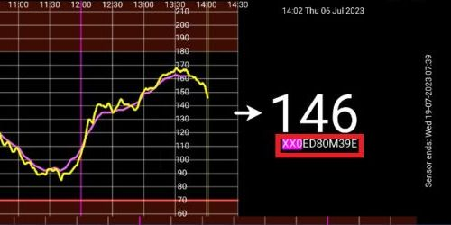

# **Freestyle Libre 3** och 3+

Freestyle Libre 3 (FSL3) kräver en särskild inställning för att skicka BG-värden till AAPS. Det finns två sätt att få värden från Freestyle Libre 3 (FSL3) till AAPS.

Metoderna nedan använder den separata appen Juggluco. Den använder Juggluco för att ta emot rådata från sensorn varje minut, som sedan skickas till xDrip eller AAPS. Nya sensorer kan startas antingen med appen Libre 3 eller direkt i Juggluco. Guiden nedan visar hur du startar en sensor med appen Juggluco. Om sensorn har startats med ett inloggat LibreView-konto kan du också växla mellan Juggluco och appen Libre 3 som mottagare.

Juggluco kan också skicka data till LibreView för delning med vårdpersonal, om sensorn har startats med appen Libre 3.

I xDrip kan sensorn kalibreras i intervallet -40 mg/dl till +20 mg/dl (-2,2 mmol/l till +1,1 mmol/l) för att kompensera för skillnader mellan en mätning med blodsockermätare och sensorvärdena.

## Metod 1: använd minutvärden direkt
**AAPS** är anpassat för värden var 5:e minut. Därför har bearbetning av minutvärden ibland begränsningar.

Se [här](#juggluco-to-aaps).

## Metod 2: räkna om minutvärden till 5-minutersvärden i xDrip
Den här metoden använder Juggluco för att ta emot rådata från sensorn varje minut. Data skickas sedan till xDrip, som utjämnar dem till värden var 5:e minut och skickar dem till AAPS.

### Steg 1: Ställ in Juggluco
Ladda ned och installera appen Juggluco [här](https://www.juggluco.nl/Juggluco/download.html). Följ instruktionerna [här](https://www.juggluco.nl/Juggluco/libre3/)

Se till att du skickar glukosvärdena till xDrip: i Juggluco-inställningarna kan du ställa in Juggluco att skicka sina glukosvärden till andra appar. Juggluco kan skicka tre typer av sådana sändningar (broadcasts): **Patched Libre broadcast** användes ursprungligen av den patchade appen Librelink och kan användas för att skicka glukosvärden till xDrip.

### Steg 2: Ställ in xDrip

Blodsockervärdena tas emot av appen xDrip på telefonen.

- Om du inte redan har gjort det: ladda ned [xDrip](https://github.com/NightscoutFoundation/xDrip) och följ instruktionerna på [sidan om xDrip-inställningar](../CompatibleCgms/xDrip.md).
- Välj "Libre2 (patched app)" som datakälla i xDrip.
- Om det behövs, ange "BgReading:d,xdrip libre_receiver:v" under Less Common Settings → Extra Logging Settings → Extra tags for logging. Detta loggar fler felmeddelanden för felsökning.

- Tekniskt sett skickas det aktuella blodsockervärdet till xDrip varje minut. Ett viktat medelvärdesfilter beräknar som standard ett utjämnat värde över de senaste 25 minuterna. Du kan ändra perioden i menyn NFC Scan features.

  → Hamburger menu → Settings → NFC Scan features → Smooth libre 3 data when using xxx method

  

### Steg 3: Starta sensorn i xDrip

Starta sensorn i xDrip med "Start Sensor" och "not today". Du behöver inte hålla telefonen mot sensorn. "Start Sensor" startar faktiskt inte fysiskt någon Libre 3-sensor och påverkar dem inte på något sätt. Detta är bara för att tala om för xDrip att en ny sensor skickar blodsockervärden. Om möjligt, ange två värden från blodmätningar för den första kalibreringen. Nu bör blodsockervärdena visas i xDrip var 5:e minut. Värden som saknas, t.ex. för att du var för långt från din telefon, fylls inte i efteråt.

Vänta minst 15–20 minuter om det fortfarande inte finns några data.

Efter ett sensorbyte hittar xDrip automatiskt den nya sensorn och raderar alla kalibreringsdata. Du kan kontrollera ditt blodsocker efter aktiveringen och göra en ny första kalibrering.

### Steg 4: Ställ in AAPS

- Se [här](#juggluco-to-xdrip) och kom sedan tillbaka.

- Om **AAPS** inte får BG-värden när telefonen är i flygplansläge, använd "Identify receiver"
- Stäng av utjämning (det görs redan i xDrip)

## Följande sensorbyten

1. Öppna Juggluco och skriv upp serienumret för den nuvarande sensorn

2. Skanna nu bara din nya sensor med telefonens NFC-läsare. Juggluco visar ett meddelande om processen har startats.
3. När du är redo att inaktivera den gamla sensorn öppnar du Juggluco-menyn genom att trycka var som helst på den tomma ytan uppe till vänster på skärmen.
4. Välj den utgångna sensorn och tryck på "Terminate"

Obs: När två sensorer är aktiva skickar Juggluco det senaste värdet från någon av sensorerna till xDrip. Om sensorerna inte är kalibrerade så att de visar ungefär samma BG kan detta ge hoppiga BG-värden i xDrip. Om du avslutar fel sensor kan du aktivera den igen genom att bara skanna sensorn.

## Växla sensorn mellan appen Libre 3 och Juggluco

Om sensorn har startats med ett inloggat LibreView-konto kan du också växla mellan Juggluco och appen Libre 3 som mottagare. Detta kräver följande steg:

1. Installera appen Libre 3 från Google Play Butik
2. Ställ in appen Libre 3 med det LibreView-konto som sensorn aktiverades med.
3. Tvångsstoppa appen Juggluco i Androids inställningar.
4. Tryck på "Start Sensor" i Libre 3-menyn, välj "Yes", "Next" och skanna din sensor.
5. Efter några minuter bör BG-värdena synas i appen Libre 3.

För att växla från appen Libre 3 till Juggluco måste du tvångsstoppa appen Libre 3 i Androids inställningar och fortsätta med steg 1 och 2.

(libre3-experiences-and-troubleshooting)=
## Erfarenheter och felsökning

### Felsökning av anslutningen Libre3 -> Juggluco

- Se till att du använder en aktuell version av appen Juggluco
- Kontrollera dina inställningar enligt den här guiden
- Ibland kan du behöva tvångsstoppa appen Libre 3 och Juggluco och starta dem igen.
- Stäng av Bluetooth och slå på det igen
- Vänta en stund eller försök stänga Juggluco
- Äldre versioner av Juggluco (under 2.9.6) skickar inte vidare data från Libre3-sensorn till anslutna enheter (t.ex. Juggluco på WearOS). Du kan behöva trycka på "Resend data" i den patchade Libre3-appen (Juggluco-menyn).

### Mer hjälp

Ursprungliga instruktioner: [jkaltes webbplats](https://www.juggluco.nl/Juggluco/libre3/)

Ytterligare GitHub-repo: [GitHub-länk](https://github.com/maheini/FreeStyle-Libre-3-patch)
