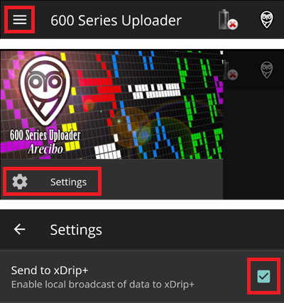

# MM640g eller MM630g

-   Om du inte redan har gjort det: ladda ned [600SeriesAndroidUploader](https://pazaan.github.io/600SeriesAndroidUploader/) och följ instruktionerna på [Nightscout](https://nightscout.github.io/uploader/setup/?h=uploader#medtronic-600-series-with-uploader).
-   I 600 Series Uploader går du till Settings > Send to xDrip och väljer ON (bock).

-   Välj MM640g i [**Konfiguration → BG-källa**](#Config-Builder-bg-source).

