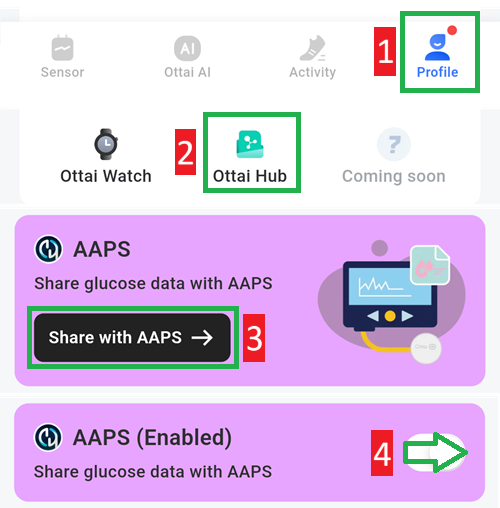

# Ottai M8

## Använda M8 med Ottai-appen

-   Ladda ned och installera apk-filen från <https://play.google.com/store/apps/details?id=com.ottai.seas>. För den kinesiska versionen av Ottai, använd <https://ottai.com.cn/70ICjxAI4i>

-   Starta sensorn

- Välj **Syai/Ottai** i [**Konfiguration → BG-källa**](#Config-Builder-bg-source).

Slå på sändning (broadcast) i appen Ottai:

1. Välj Profile
2. Ottai hub
3. Tryck på Share with AAPS och godkänn avtalet om dataöverföring till tredje part
4. Slå på Share glucose data with AAPS

