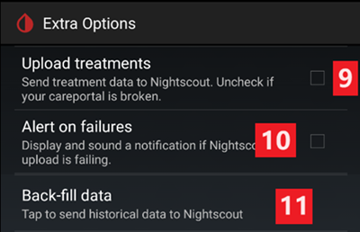
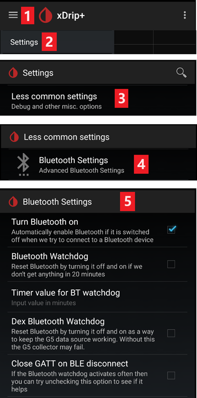
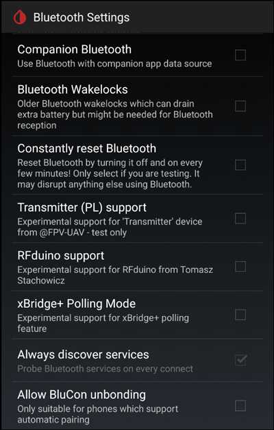

# xDrip-inställningar

Om du inte redan har gjort det, ladda ned och installera den senaste versionen av xDrip från [sidan med xDrip-versioner](https://github.com/NightscoutFoundation/xDrip/releases).

Stäng av batterioptimering och tillåt bakgrundsaktivitet för xDrip-appen.

## Grundinställningar för alla CGM- och FGM-system

### Stäng av uppladdning till Nightscout

Låt ingen annan app ladda upp data (blodsocker och behandlingar) till Nightscout.

→ Hamburger Menu (1) → Settings (2) → Cloud Upload (3) → Nightscout Sync (REST-API) (4) → Slå **AV** `Enabled` (5)

#### Stäng av automatisk kalibrering och behandlingar

Kontrollera att `Automatic Calibration` (7) är avstängd. Om kryssrutan för `Automatic Calibration` är markerad, slå på `Download treatments` (6) en gång, avmarkera sedan `Automatic Calibration` och stäng av `Download treatments` igen.

Tryck på `Extra Options`(8)

    {admonition} Säkerhetsvarning
    :class: warning
    Du måste stänga av "Upload treatments" i xDrip, annars kan behandlingar dubbleras i AAPS, vilket ger fel COB och IOB.

Stäng av `Upload treatments`(9) och se till att du **INTE** använder `Back-fill data` (11).

Alternativet `Alert on failures` ska också vara avstängt (10). Annars får du ett larm var 5:e minut vid problem med wifi eller mobilnätet, eller om servern inte är tillgänglig.

### **Inter-app Settings** (sändning)

Om du använder AAPS måste du slå på sändning (broadcast) i xDrips Inter-App settings så att data skickas vidare till AAPS.

→ Hamburger Menu (1) → Settings (2) → Inter-app settings (3) → Broadcast locally **ON** (4)

För att värdena ska vara identiska i AAPS och i xDrip bör du slå på `Send the displayed glucose value` (5).

Slå på Compatible Broadcast (6).

Om du också har slagit på `Accept treatments` i xDrip och `Aktivera sändningar till xDrip+` i xDrip-pluginet i AAPS, får xDrip information om insulin, kolhydrater och basal från AAPS.

Om du slår på `Accept Calibrations` använder xDrip kalibreringarna från AAPS. Var försiktig när du använder den här funktionen med Dexcom-sensorer: läs [detta](https://navid200.github.io/xDrip/docs/Calibrate-G6.html) först.

Kom ihåg att stänga av Import Sounds, så att xDrip inte spelar en ringsignal varje gång AAPS skickar en ändring av basal eller profil.

(xdrip-identify-receiver)=

#### Identify receiver

- Om du har problem med lokal sändning (AAPS får inga BG-värden från xDrip), gå till → Hamburger Menu (1) Settings (2) → Inter-app settings (3) → Identify receiver (7) och ange `info.nightscout.androidaps` för AAPS-bygget (om du använder bygget PumpControl, ange i stället `info.nightscout.aapspumpcontrol`!!).
- Var uppmärksam: autokorrigering ändrar ibland i till stor bokstav. Du **måste bara använda små bokstäver** när du skriver `info.nightscout.androidaps` (eller `info.nightscout.aapspumpcontrol` för PumpControl). Ett stort I hindrar appen från att ta emot BG-värden från xDrip.
    
    

## Använd AAPS för att kalibrera i xDrip

- Om du vill kunna kalibrera med AAPS, gå i xDrip till Settings → Interapp Compatibility → Accept Calibrations och välj ON. 
- Du kan också gå igenom alternativen i Settings → Less Common Settings → Advanced Calibration Settings.

## Dexcom-sensorer

Allt som gäller själva Dexcom-sensorn och sändaren (starta, stoppa, byta, kalibrera, felsöka) beskrivs och hålls uppdaterat i [xDrips Dexcom-dokumentation](https://navid200.github.io/xDrip/docs/Dexcom_page.html). Följ de instruktionerna för sensorn. Inställningarna som kopplar xDrip till **AAPS** (beskrivs ovan på den här sidan) är den enda delen som är specifik för AAPS.

### Dexcom G6 och ONE

- Ställ in xDrip enligt de [rekommenderade inställningarna](https://navid200.github.io/xDrip/docs/G6-Recommended-Settings.html).
- Sändarna för Dexcom G6 och ONE kan vara anslutna samtidigt till Dexcom-mottagaren (eller i stället till pumpen t:slim) och till en app i din telefon.
- Om du använder xDrip som mottagare ska du först avinstallera Dexcom-appen. **Du kan inte ansluta xDrip och Dexcom-appen till sändaren samtidigt!**
- Om du behöver Clarity och vill dra nytta av funktionerna i xDrip kan du använda [Build Your Own Dexcom App](#DexcomG6-if-using-g6-with-build-your-own-dexcom-app) med lokal sändning till xDrip, eller använda xDrip som följeslagarapp (Companion app) som tar emot aviseringar från den officiella Dexcom-appen (BG-värdena kan då komma med fördröjning).

#### Omstart av sensorn

- Med nuvarande sändare använder xDrip alltid sändarens [inbyggda algoritm](https://navid200.github.io/xDrip/docs/Native-Algorithm.html). Det finns ingen anledning att stänga av den.
- [Förebyggande omstarter](https://navid200.github.io/xDrip/docs/Preemptive-Restart.html) (Preemptive restarts) fungerar bara med äldre sändare (firmware 1.6.5.25 eller tidigare), där de behövs för att sensorn inte ska stoppa efter 10 dagar. Nyare sändare (Firefly) ignorerar dem.
- För att starta om en sensor med en Firefly-sändare måste du [ta bort sändaren](https://navid200.github.io/xDrip/docs/Remove-transmitter.html), och värdena kan vara mycket felaktiga efter omstarten, vilket är farligt när du loopar: läs hela [Restart a sensor](https://navid200.github.io/xDrip/docs/Restart-G6-sensor.html) och [kalibrera försiktigt](https://navid200.github.io/xDrip/docs/Calibrate-after-G6Restart.html).

(xdrip-connect-g6-transmitter-for-the-first-time)=

#### Starta, stoppa och byta sensorer

Följ instruktionerna:

- [Starta en G6- eller ONE-sändare](https://navid200.github.io/xDrip/docs/Starting-G6.html)
- [Stoppa och starta en G6- eller ONE-sensor](https://navid200.github.io/xDrip/docs/Dexcom/StartG6Sensor.html)
- [Ta bort sändaren från en sensor](https://navid200.github.io/xDrip/docs/Remove-transmitter.html)
- [Sändarens livslängd](https://navid200.github.io/xDrip/docs/Transmitter-lifetime.html) kan bara förlängas ([hård återställning](https://navid200.github.io/xDrip/docs/Hard-Reset.html)) på sändare som har fått nytt batteri eller är modifierade, inte på Firefly.

(xdrip-replace-transmitter)=

#### Byta sändare

- Stäng av den ursprungliga Dexcom-mottagaren (om du använder den) och slå inte på den igen innan xDrip visar värden.
- Glöm enheten i xDrip (System Status → Forget Device) OCH i telefonens Bluetooth-inställningar (visas som DexcomXX, där XX är de två sista siffrorna i sändarens serienummer).
- Håll den gamla sändaren utanför Bluetooth-räckvidd så att den inte ansluter igen.
- Följ sedan [Starta en G6- eller ONE-sändare](https://navid200.github.io/xDrip/docs/Starting-G6.html).

### Dexcom G7, ONE+ och Stelo

- Följ [instruktionerna för G7, ONE+ och Stelo](https://navid200.github.io/xDrip/docs/Dexcom/G7.html) (en ny version av xDrip krävs, se den länkade sidan).
- Se även sidan [Dexcom G7, ONE+ och Stelo](../CompatibleCgms/DexcomG7.md) för de uppsättningar som finns med **AAPS**.

(xdrip-troubleshooting-dexcom-g5-g6-and-xdrip)=

### Felsökning för Dexcom och xDrip

- [Felsökning av anslutning för G6/ONE](https://navid200.github.io/xDrip/docs/Connectivity-troubleshoot.html)
- [Felsökning för G7/ONE+/Stelo](https://navid200.github.io/xDrip/docs/Dexcom/G7_Troubleshooting.html)
- [Problem när du startar en ny sensor](https://navid200.github.io/xDrip/docs/Dexcom/SensorFailedStart.html)
- Hela listan: se **Troubleshooting** på [xDrips Dexcom-sida](https://navid200.github.io/xDrip/docs/Dexcom_page.html).

## Libre 1

- Ställ in din brygga från NFC till Bluetooth i xDrip
    
    → Hamburger Menu (1) → Settings (2) → Less common settings (3) → Bluetooth Settings (4)

- I Bluetooth Settings markerar du kryssrutorna exakt som på skärmbilderna nedan (5)
    
    - Stäng av watchdogs, eftersom de återställer telefonens Bluetooth och avbryter anslutningen till pumpen.
    
    

- Du kan prova att slå på följande inställningar (7)
    
    - Använd skanning
    - Trust Auto-Connect
    - Use Background Scans

- Om du lätt tappar anslutningen till bryggan eller har svårt att få tillbaka anslutningen, **STÄNG AV DEM** (8).
    
    

- Låt alla andra alternativ vara avstängda om du inte vet varför du vill slå på dem.
    
    

### Batterinivå för Libre smart reader

- Batterinivån för bryggor som MiaoMiao och Bubble kan visas i AAPS (inte för Blucon).
- Detaljer finns på [sidan med skärmbilder](#screens-sensor-level-battery).

### Anslut Libre-sändaren och starta sensorn

- Om din sensor kräver det (Libre 2 EU och Libre 1 US), installera den senaste OOP-algoritmen (out of process).

- Sensorn måste redan vara startad med tillverkarens app eller med läsaren (xDrip kan inte starta eller stoppa Libre-sensorer).

- Ställ in datakällan på Libre Bluetooth.
    
    → Hamburger Menu (1) → Settings (2) → Välj Libre Bluetooth i Hardware Data source (3)
    
    

- Sök efter Bluetooth-enheter och anslut bryggan.
    
    → Hamburger Menu (1) → Scan Bluetooth (2) → Scan (3)
    
    - Om xDrip inte hittar bryggan, kontrollera att den inte är ansluten till tillverkarens app. Sätt den på laddning och återställ den.
    
    

- Starta sensorn i xDrip.
    
        {admonition} Säkerhetsvarning
        :class: warning
        Använd inte sensordata innan uppvärmningen på en timme är klar: värdena kan vara extremt höga och leda till felaktiga beslut i AAPS.
    
    → Hamburger Menu (1) → Start sensor (2) → Start sensor (3) → Ange den exakta tiden då du startade sensorn med läsaren eller tillverkarens app. Om du inte startade den i dag, svara "Not Today" (4).

(xdrip-libre2-patched-app)=

## Libre 2 patchad app

- Ställ in datakällan på Libre patched app.
    
    → Hamburger Menu (1) → Settings (2) → Välj Libre (patched App) i Hardware Data source (3)
    
    

- Du kan lägga till `BgReading:d,xdrip libre_receiver:v` under Less Common Settings->Extra Logging Settings->Extra tags for logging. Det loggar fler felmeddelanden för felsökning.

