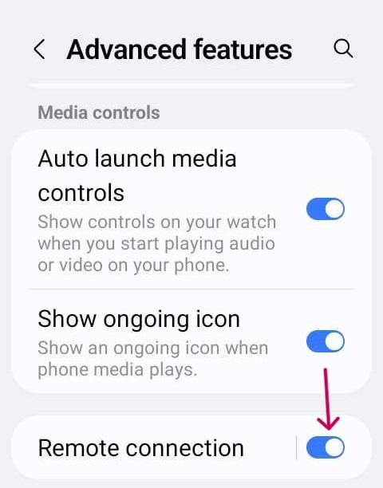

# Jelly

## Jelly Star Mini

**Funktioner**

* Android 13
* 8 GB RAM

**Fördelar**

* Den är verkligen liten.
* Även om du berättar det för andra ser de den kanske inte som en vanlig smarttelefon. De godtar den då lättare som ett undantag när telefoner normalt inte är tillåtna.

**Nackdelar**

* Rekommenderas bara för erfarna loopare. Vissa inställningar är svåra att känna igen: du måste veta av erfarenhet från en stor Android-telefon med AAPS hur och var saker finns. Vissa knappar i AAPS är små och svåra att trycka på: du behöver trycka exakt, med tjocka fingrar går det inte.
* Kan bara användas som looptelefon. Det är bättre att ha en vanlig smarttelefon i fickan. 

### Optimering av batteritid

Jelly har kraftfulla optimeringsfunktioner som **måste** stängas av för AAPS (och andra DIY-appar som BYODA, xDrip, OOP2, Juggluco osv.).

Du kan låta Intelligent assistance (intelligent assistans) vara på, men den **måste vara avstängd för DIY-appar**.

Du kan slå på NFC för Libre-sensorer.

### Optimering av batteritid

För att undvika störningar i **AAPS** ska 'batterianvändning' på Jelly Star stängas av genom att välja 'obegränsad' för **AAPS** (och för andra **DIY-appar** som BYODA, xDrip, OOP2, Juggluco osv.).

### Google Play Protect

Kom ihåg att stänga av Google Play Protect.

### Fjärranslutning för Wear-apk

För vissa smartklockor, som Samsung Galaxy, måste 'Remote connection' (Fjärranslutning) under Advanced features (Avancerade funktioner) i appen Galaxy Wearable vara **påslagen** för att använda Jelly, **Wear.apk** och **AAPS** på avstånd via Wi-Fi.

