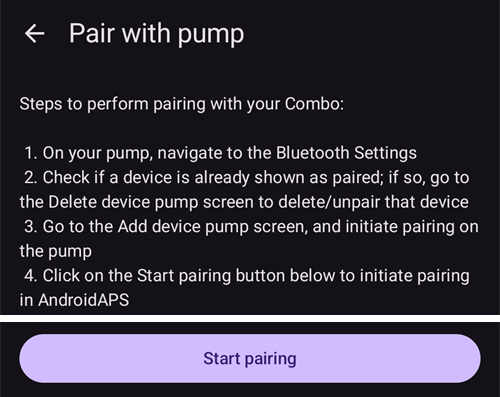
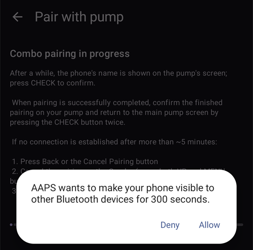
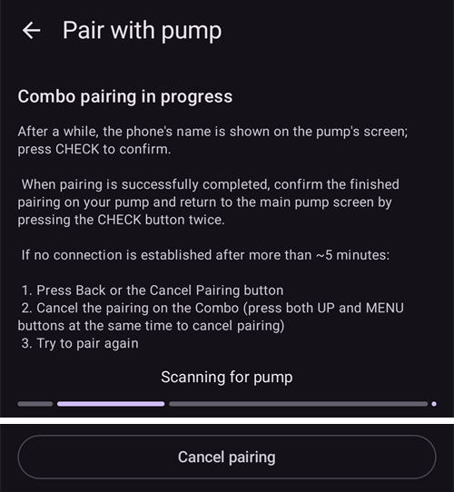
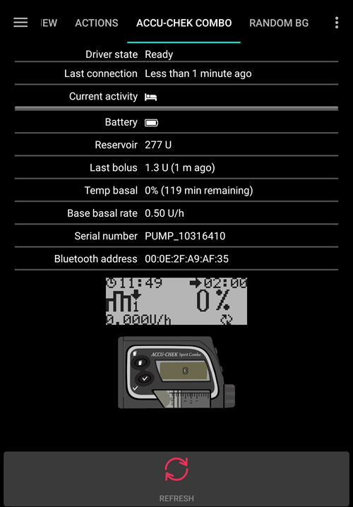

# Accu-Chek Combo

**Den här programvaran är en del av en gör-det-själv-lösning (DIY) och är ingen produkt. Den kräver att DU läser, lär dig och förstår systemet, också hur du använder det. Den sköter inte hela din diabetesbehandling åt dig. Men den kan förbättra din diabetes och din livskvalitet om du är beredd att lägga ner den tid som krävs. Skynda inte. Ge dig själv tid att lära dig. Du ensam är ansvarig för vad du gör med den.**

```{admonition} Accu-Chek Combo is being phased out
:class: note

Roche lämnar marknaden för insulinpumpar för att fokusera sitt diabetesutbud på CGM:en Accu-Chek SmartGuide. Roche har meddelat att försäljningen av både Accu-Chek Combo och Accu-Chek Insight upphör. Även den sista pumpen, mikropumpen Accu-Chek Solo, avvecklas (sista leveranserna i Tyskland i slutet av 2025). Förändringen införs region för region, med start i Tyskland. Andra europeiska marknader väntas följa efter. Om du är beroende av den här pumpen, planera i god tid för ett byte till en pump som stöds.
```

```{contents} Table of contents
:depth: 1
:local: true
```

## Pumpens funktioner med AAPS

* Kommunicerar med **AAPS** via telefonens inbyggda Bluetooth, utan någon extra kommunikationsenhet.
* Automatisk hantering av sommartid och tidszoner.

## Krav på hårdvara och programvara

* En Roche Accu-Chek Combo (vilken firmware som helst, alla fungerar).
* En Smartpix- eller Realtyme-enhet tillsammans med 360 Configuration Software för att ställa in pumpen. (Roche skickar Smartpix-enheter och konfigurationsprogrammet gratis till sina kunder om de ber om det.)
* En kompatibel telefon med Android 12 eller nyare. Se [versionsinformationen](#maintenance-android-version-aaps-version) för detaljer.
* Appen **AAPS** installerad på din telefon.

Vissa telefoner kan fungera bättre än andra. Det beror på hur bra deras Bluetooth-stöd är och om de har extra, mycket aggressiv energisparlogik. En lista med telefoner finns på sidan [Telefoner](#Phones-list-of-tested-phones). Observera att listan inte är komplett och bygger på användarnas egna erfarenheter. Du uppmuntras att också skriva in dina erfarenheter och på så sätt hjälpa andra (de här projekten bygger på att man ger tillbaka).

(combov2-before-you-begin)=
## Innan du börjar

**SÄKERHETEN FÖRST** - gör inte detta i en miljö där du inte kan återhämta dig från ett fel. Ha din Smartpix- eller Realtyme-enhet till hands, tillsammans med 360 Configuration Software. Räkna med ungefär en timme för att ställa in allt och kontrollera att allt fungerar som det ska.

Var medveten om följande begränsningar:

* Förlängd bolus och multiwave-bolus stöds för närvarande inte (du kan använda [förlängda kolhydrater](../DailyLifeWithAaps/ExtendedCarbs.md) i stället).
* Bara en basalprofil (den första) stöds.
* Den lägsta basaldosen i din **Profil** är 0,05 U/h. **AAPS** godtar inte en **Profil** med en lägre dos. Combo avrundar basaldoser till sina egna steg (0,01 U/h under 1 U/h, 0,05 U/h upp till 10 U/h, 0,1 U/h över det). **AAPS** använder de doser som pumpen verkligen ger.
* Tillfälliga basaler är begränsade till 500 % av den aktuella basaldosen. **AAPS** tar hänsyn till denna gräns.
* Loopen stängs av om den profil som är aktiv i pumpen inte är profil nr 1. Detta fortsätter tills profil nr 1 görs aktiv. När det är gjort märker AAPS vid nästa anslutning (antingen av sig själv efter en stund eller för att du trycker på **Uppdatera** på pumpskärmen för Accu-Chek Combo) att profil nr 1 är den aktuella, och slår på loopen igen.
* Om loopen begär att en pågående tillfällig basal (TBR) ska avbrytas, ställer Combo i stället in en tillfällig basal på 90 % eller 110 % i 15 minuter. Det beror på att ett riktigt avbrott av en tillfällig basal ger ett larm på pumpen med många vibrationer, och de vibrationerna går inte att stänga av.
* Bluetooth-anslutningens stabilitet varierar mellan olika telefoner. Det ger larm om "pump unreachable" (pumpen kan inte nås) när ingen anslutning till pumpen längre kan upprättas. Om felet uppstår, kontrollera att Bluetooth är påslaget och tryck på **Uppdatera** på pumpskärmen (**Hantera** > **Pump**) för att se om det var ett tillfälligt problem. Om det fortfarande inte finns någon anslutning, starta om telefonen. Det brukar lösa problemet.
* Det finns ett annat problem där en omstart inte hjälper. Då måste du trycka på en knapp på pumpen (det återställer pumpens Bluetooth-stack) innan pumpen tar emot anslutningar från telefonen igen.
* Undvik att ställa in en tillfällig basal på pumpen, eftersom loopen tar över styrningen av tillfälliga basaler. Det kan ta upp till 20 minuter innan en ny tillfällig basal på pumpen upptäcks, och dess effekt räknas bara från den tidpunkt då den upptäcks. I värsta fall kan det alltså finnas 20 minuter tillfällig basal som inte syns i IOB.

Drivrutinen stöder för närvarande följande språk på Combo. (Detta har inget med språket i AAPS att göra - det är språket som visas på Combos egen LCD-display.)

* Engelska
* Spanska
* Franska
* Italienska
* Ryska
* Turkiska
* Polska
* Tjeckiska
* Ungerska
* Slovakiska
* Rumänska
* Kroatiska
* Nederländska
* Grekiska
* Finska
* Norska
* Portugisiska
* Svenska
* Danska
* Tyska
* Slovenska
* Litauiska

**Viktigt**: Om din pump är inställd på ett språk som inte finns i listan, kontakta utvecklarna och ställ in pumpens språk på ett av språken i listan. Annars fungerar drivrutinen inte som den ska.

## Inställning av telefonen

Det är mycket viktigt att batterioptimeringar är avstängda. AAPS känner redan av när det påverkas av sådana optimeringar och ber dig i appen att stänga av dem. Men på moderna Android-telefoner är Bluetooth _självt_ en app (en systemapp). Och oftast körs den "Bluetooth-appen" _med batterioptimering påslagen som standard_. Därför kan Bluetooth sluta svara när telefonen vill spara energi, eftersom telefonen då stänger Bluetooth-appen. Det betyder att batterioptimeringar också måste stängas av i inställningarna för Bluetooth-systemappen. Tyvärr skiljer det sig mellan telefoner hur man hittar Bluetooth-systemappen. I standard-Android går du till Inställningar -> Appar -> Visa alla N appar (N = antalet appar på din telefon). Öppna sedan menyn i det övre högra hörnet och tryck på "Visa system", "Visa systemappar" eller "Alla appar". Leta nu efter en app som heter "Bluetooth" i den utökade listan med appar. Välj den och tryck på "Batteri" på sidan "Appinfo". Stäng där av batterioptimeringar (kallas ibland "batterianvändning").

## Inställning av Combo

* Ställ in pumpen med Accu-Chek 360 Configuration Software. Om du inte har programmet, kontakta Accu-Chek-kundtjänsten. De brukar skicka en cd med "360° Pump Configuration Software" och en SmartPix USB-infraröd anslutningsenhet till registrerade användare (Realtyme-enheten fungerar också om du har en sådan).

  - **Nödvändiga inställningar** (markerade med grönt i skärmbilderna):

     * Ställ in eller behåll menykonfigurationen "Standard". Då visas bara de menyer och funktioner på pumpen som stöds. De som inte stöds (förlängd bolus/multiwave-bolus, flera basalprofiler) döljs. Om de används begränsas loopen, eftersom det då inte går att köra loopen på ett säkert sätt.
     * Kontrollera att _Quick Info Text_ är inställd på "QUICK INFO" (utan citattecken, finns under _Insulin Pump Options_).
     * Ställ in TBR _Maximum Adjustment_ på 500 %
     * Stäng av _Signal End of Temporary Basal Rate_
     * Ställ in TBR _Duration increment_ på 15 min
     * Slå på Bluetooth

  - **Rekommenderade inställningar** (markerade med blått i skärmbilderna)

     * Ställ in larmet för låg reservoarnivå som du vill
     * Ställ in en maxbolus som passar din behandling, som skydd mot fel i programvaran
     * Ställ på samma sätt in en maximal längd för tillfällig basal som skydd. Tillåt minst 3 timmar, eftersom alternativet att koppla från pumpen i 3 timmar ställer in 0 % i 3 timmar.
     * Slå på knapplåset på pumpen så att ingen bolus kan ges från pumpen, särskilt om pumpen användes tidigare och snabbbolus var en vana.
     * Ställ in tidsgränsen för displayen och menyn på minimum, alltså 5,5 respektive 5. Då kan AAPS återhämta sig snabbare från fel och det blir färre vibrationer vid sådana fel

  

  

  

  

## Aktivera drivrutinen och parkoppla den med Combo

* Öppna **menyn** (☰) i det övre vänstra hörnet, gå till [**Konfiguration** > **Pump**](../SettingUpAaps/ConfigBuilder.md) och välj **Accu-Chek Combo**.

  

  När det är valt visar kortet **Accu-Chek Combo** två knappar, **Inställningar** och **Öppna plugin**:

  

  **Inställningar** öppnar inställningarna för Accu-Chek Combo-drivrutinen (se [Inställningar](#combov2-preferences) nedan):

  

  **Öppna plugin** (eller **Hantera** > **Pump**) öppnar pumpskärmen för Accu-Chek Combo. Innan en pump är parkopplad visar den **Inte parkopplad till en pump**:

  

* Tryck på **Parkoppling** på pumpskärmen. Skärmen **Parkoppla med pump** öppnas. Följ stegen som visas på skärmen och tryck sedan på **Påbörja parkoppling**. När Android ber om tillåtelse att göra telefonen synlig för andra Bluetooth-enheter, tryck på **Tillåt**. Till slut visar Combo en 10-siffrig PIN-kod för parkoppling på sin skärm, och **AAPS** ber om den. Skriv in PIN-koden i fältet **10-siffrig PIN-kod**.

  

  

  

  Bilderna nedan kommer från en äldre version av **AAPS**. Stegen och texterna är desamma, men skärmarna ser lite annorlunda ut.

  

  

  

* Om PIN-koden skrivs in fel visar **AAPS** **PIN-koden fungerade inte. Kontrollera om det fanns ett stavfel. Om detta fortsätter att ske, avbryt och försök parkoppla igen.**

  

* När **Parkopplingen med Combo lyckades** visas, tryck på **OK**. Du kommer tillbaka till pumpskärmen, som nu visar pumpens status (se [Innehåll på pumpskärmen för Accu-Chek Combo](#combov2-tab-contents) nedan). Knappen **Parkoppling** ersätts av **Ta bort parkoppling**.

* Kontrollera din inställning (med pumpen **frånkopplad** från alla kanyler, för säkerhets skull!): använd AAPS för att ställa in en tillfällig basal på 500 % i 15 min och ge en bolus. Pumpen ska nu ha en pågående tillfällig basal och bolusen i historiken. AAPS ska också visa den aktiva tillfälliga basalen och den givna bolusen.

* På Combo rekommenderas att du slår på knapplåset så att ingen bolus kan ges från pumpen, särskilt om pumpen användes tidigare och funktionen "quick bolus" (snabbbolus) var en vana.

## Om parkoppling

Accu-Chek Combo utvecklades innan Bluetooth 4.0 kom, och bara ett år efter den allra första Android-versionen. Därför är dess sätt att parkoppla med andra enheter inte 100 % kompatibelt med hur det görs i Android i dag. För att lösa detta helt skulle AAPS behöva behörigheter på systemnivå, och de finns bara för systemappar. Systemappar installeras av telefontillverkaren - användare kan inte installera systemappar.

Följden är att parkopplingen aldrig kommer att fungera helt utan problem. Under parkopplingen kan särskilt Androids dialogruta för Bluetooth-PIN visas kort och sedan försvinna av sig själv. Men ibland stannar den kvar på skärmen och ber om en 4-siffrig PIN-kod. (Blanda inte ihop den med Combos 10-siffriga PIN-kod för parkoppling.) Skriv inte in något, tryck bara på Avbryt. Om parkopplingen inte fortsätter, följ instruktionerna på skärmen för att försöka parkoppla igen.

(combov2-tab-contents)=
## Innehåll på pumpskärmen för Accu-Chek Combo

Gå till **Hantera** > **Pump** för att öppna pumpskärmen. När en pump är parkopplad visas följande information (uppifrån och ned):



1. **Drivrutinsstatus**: Drivrutinen kan ha något av följande tillstånd:
   - **Frånkopplad**: Det finns ingen Bluetooth-anslutning. Drivrutinen är i detta tillstånd för det mesta och ansluter bara till pumpen när det behövs - det sparar energi
   - **Ansluter**
   - **Kontrollerar pump**: pumpen är ansluten, men drivrutinen gör just nu säkerhetskontroller för att se att allt är OK och uppdaterat
   - **Klar**: drivrutinen är redo att ta emot kommandon från AAPS
   - **Pausad**: pumpen är pausad (visas som "stopped" på Combo)
   - En beskrivning av kommandot som körs, till exempel **Sätter basalprofil** eller **Uppdaterar pumpens status**
   - **Fel**: ett fel har uppstått. Anslutningen avslutades och kommandon som pågick avbröts
2. **Senast ansluten**: Hur många minuter sedan drivrutinen senast anslöt till Combo. Om det går mer än 30 minuter visas raden i rött
3. **Batterinivå**: Batteriets nivå. Combo visar bara **Fullt**, **Lågt** eller **Tomt** och inget mer exakt (som en procentsats), så bara dessa tre nivåer visas här
4. **Reservoar**: Hur många IU som finns i Combos reservoar just nu
5. **Senaste bolus**: Hur många minuter sedan den senaste bolusen gavs. Om ingen bolus har getts sedan AAPS startades visas raden inte
6. **Tillfällig basal**: Detaljer om den tillfälliga basal som är aktiv just nu. Om ingen är aktiv visas raden inte
7. **Profilens basaldos**: Den basaldos som är aktiv just nu enligt profilen (basaldosen utan påverkan från en aktiv tillfällig basal)
8. **Serienummer**: Combos serienummer som pumpen anger (det motsvarar serienumret på baksidan av Combo)
9. **Bluetooth-adress**: Combos 6 byte långa Bluetooth-adress, visad i formatet `XX:XX:XX:XX:XX:XX`

Medan drivrutinen gör något (till exempel ställer in en basalprofil) visas en ruta under listan som beskriver vad som pågår, med en tunn förloppsindikator.

Combo kan styras via Bluetooth i läget _remote-terminal_ (fjärrterminal) eller i läget _command_ (kommando). Fjärrterminalläget motsvarar "fjärrkontrolläget" på Combos blodsockermätare, som efterliknar pumpens LCD-display och fyra knappar. Vissa kommandon måste drivrutinen utföra i detta läge, eftersom de inte finns i kommandoläget. Kommandoläget är mycket snabbare, men som sagt begränsat. När fjärrterminalläget är aktivt visas den aktuella fjärrterminalskärmen i fältet precis ovanför bilden av Combo. När drivrutinen byter till kommandoläget lämnas fältet dock tomt.

(Du påverkar inte detta. Drivrutinen bestämmer helt själv vilket läge den använder. Det här är bara en upplysning så att du vet varför du ibland ser Combo-bilder i det fältet.)

Längst ned finns dessa knappar:

- **Uppdatera**: Uppdaterar pumpstatusen direkt. Knappen används också för att tala om för AAPS att ett tidigare upptäckt fel nu är åtgärdat och att AAPS kan kontrollera igen att allt är OK (mer om det nedan i [avsnittet om larm](#combov2-alerts)). Du kan bara trycka på den när drivrutinen är frånkopplad, pausad eller i felläge.
- **Ta bort parkoppling**: Tar bort parkopplingen mellan Combo och **AAPS** och Android, efter att du bekräftat **Vill du verkligen ta bort parkopplingen med pumpen?**. När ingen pump är parkopplad ersätts knappen av **Parkoppling**.

(combov2-preferences)=
## Settings

Dessa inställningar finns för Combo-drivrutinen (**Konfiguration** > **Pump** > **Accu-Chek Combo** > **Inställningar**, eller ikonen för inställningar (kugghjulet) på pumpskärmen). Uppifrån och ned:

1. **Varaktighet för sökning (i sekunder)**: Vid parkoppling gör drivrutinen telefonen synlig för pumpen. Den styr hur länge telefonen är synlig. Som standard är maxvärdet (300 sekunder = 5 minuter) valt. Android tillåter inte att telefonen är synlig hur länge som helst, så en tid måste väljas.
2. **Auto-detektera och ange byte av insulinreservoar automatiskt**: Om detta är påslaget registrerar drivrutinen det "reservoarbyte" som du annars skulle registrera själv med **Hantera** > **Förfyllning**. Detta förklaras [mer utförligt nedan](#combov2-autodetections).
3. **Auto-detektera och ange byte av batteri automatiskt**: Om detta är påslaget registrerar drivrutinen det "batteribyte" som du annars skulle registrera själv med **Hantera** > **Byte av pumpbatteri**. Detta förklaras [mer utförligt nedan](#combov2-autodetections).
4. **Aktivera detaljerad Combo-loggning**: Drivrutinen loggar då mycket mer. **VARNING**: Slå inte på detta om inte en utvecklare ber dig om det. Annars kan det ge mycket brus i loggarna från **AAPS** och göra dem mindre användbara.

Parkoppling och borttagning av parkoppling görs på pumpskärmen, inte i inställningarna (se ovan).

(combov2-autodetections)=
## Automatisk upptäckt och registrering av batteri- och reservoarbyten

Drivrutinen kan upptäcka batteri- och reservoarbyten genom att hålla koll på batteri- och reservoarnivåerna. Om Combo rapporterade låg batterinivå förra gången pumpstatusen uppdaterades, och batterinivån nu vid den nya uppdateringen visas som normal, drar drivrutinen slutsatsen att du har bytt batteri. Samma logik används för reservoarnivån: om den nu är högre än förut tolkas det som ett reservoarbyte.

Det fungerar bara om batteriet och reservoaren byts när nivåerna rapporteras som låga _och_ det nya batteriet och reservoaren är tillräckligt fyllda.

Dessa automatiska upptäckter kan stängas av i drivrutinens [inställningar](#combov2-preferences).

(combov2-alerts)=
## Larm (varningar och fel) och hur de hanteras

Combo visar larm som fjärrterminalskärmar. Varningar visas med en "Wx"-kod (x är en siffra) och en kort beskrivning. Ett exempel är "W7", "TBR OVER". Fel ser likadana ut, men visas med en "Ex"-kod i stället.

Vissa varningar kvitteras automatiskt av drivrutinen. Dessa är:

- W1 "reservoir low": drivrutinen gör om detta till en varning om "låg reservoarnivå" som visas på huvudskärmen i AAPS
- W2 "battery low": drivrutinen gör om detta till en varning om "låg batterinivå" som visas på huvudskärmen i AAPS
- W3, W6, W7, W8: alla dessa är bara information till användaren, så drivrutinen kan kvittera dem automatiskt utan risk

Andra varningar kvitteras _inte_ automatiskt. Fel kvitteras _aldrig_ automatiskt. Båda hanteras på samma sätt: drivrutinen visar en larmdialog ovanpå AAPS och avbryter alla kommandon som pågår. Drivrutinen går sedan in i läget "fel" (se [innehållet på pumpskärmen för Accu-Chek Combo ovan](#combov2-tab-contents)). I detta läge kan inga kommandon köras. Användaren måste åtgärda felet på pumpen. Ett ocklusionsfel kan till exempel kräva att kanylen byts. När du har åtgärdat felet kan normal drift återupptas genom att trycka på **Uppdatera** på pumpskärmen för Accu-Chek Combo. Drivrutinen ansluter då till Combo och uppdaterar dess status. Den kontrollerar bland annat om ett fel fortfarande visas på skärmen. Drivrutinen uppdaterar också pumpstatusen automatiskt efter en stund, så du måste inte trycka på knappen.

Bolus är ett specialfall. Den ges i Combos kommandoläge, som inte rapporterar under bolusen att ett larm har kommit. Därför kan drivrutinen inte kvittera varningar automatiskt _under_ en bolus. Det betyder tyvärr att pumpen piper tills bolusen är klar. Det vanligaste larmet under en bolus är oftast W1 "reservoir low" (låg reservoarnivå). Kvittera **inte** Combo-varningar manuellt på själva pumpen under en bolus. Du riskerar att avbryta bolusen. Drivrutinen tar hand om varningen när bolusen är klar.

Larm som kommer medan drivrutinen inte är ansluten till Combo märks inte av drivrutinen. Combo kan inte själv skicka larmet till telefonen. Det är alltid telefonen som måste starta anslutningen. Därför finns larmet kvar tills drivrutinen ansluter till pumpen. Du kan trycka på **Uppdatera** på pumpskärmen för att starta en anslutning och låta drivrutinen hantera larmet direkt (i stället för att vänta tills AAPS själv bestämmer sig för att ansluta).

**VIKTIGT**: Om ett fel uppstår, eller om en varning visas som inte kvitteras automatiskt, går drivrutinen in i felläge. I det läget **BLOCKERAS LOOPEN** tills pumpstatusen har uppdaterats! Den avblockeras när pumpstatusen har uppdaterats (antingen genom att trycka på **Uppdatera** eller genom drivrutinens automatiska uppdatering) och inget fel visas längre.

## Saker att vara försiktig med när du använder Combo

* Kom ihåg att detta inte är en produkt. Särskilt i början måste du övervaka och förstå systemet, dess begränsningar och hur det kan gå fel. Vi avråder starkt från att använda systemet om den som använder det inte kan förstå det helt.
* På grund av hur Combos fjärrstyrning fungerar är flera åtgärder (särskilt att ställa in en basalprofil) långsamma jämfört med andra pumpar. Detta är tyvärr en begränsning i Combo som inte går att komma runt.
* Ställ inte in eller avbryt en tillfällig basal på pumpen. Loopen tar över styrningen av tillfälliga basaler och kan inte fungera pålitligt annars, eftersom det inte går att ta reda på starttiden för en tillfällig basal som användaren har ställt in på pumpen.
* Tryck inte på några knappar på pumpen medan AAPS kommunicerar med pumpen (Bluetooth-logotypen visas på pumpen medan den är ansluten till AAPS). Då bryts Bluetooth-anslutningen. Gör det bara om det är problem med att upprätta en anslutning (se [avsnittet "Innan du börjar" ovan](#combov2-before-you-begin)).
* Tryck inte på några knappar medan pumpen ger en bolus. Försök särskilt inte att kvittera larm genom att trycka på knappar. Se [avsnittet om larm](#combov2-alerts) för en utförligare förklaring av varför.

## Checklista när ingen anslutning till Combo kan upprättas

Drivrutinen gör sitt bästa för att ansluta till Combo och använder några knep för att göra anslutningen så pålitlig som möjligt. Ändå upprättas ibland ingen anslutning. Här är några steg du kan prova för att lösa problemet.

1. Tryck på en knapp på Combo. Ibland slutar Combos Bluetooth-stack att svara och tar inte längre emot anslutningar. När du trycker på en knapp på Combo så att LCD-displayen visar något, återställs Bluetooth-stacken. För det mesta är detta det enda steg som behövs för att lösa anslutningsproblemen.
2. Starta om telefonen. Det kan behövas om det är problem med telefonens egen Bluetooth-stack.
3. Om Combos batterilock är gammalt, överväg att byta det. Gamla batterilock kan ge problem med Combos strömförsörjning, vilket påverkar Bluetooth.
4. Om anslutningsförsöken fortfarande misslyckas, överväg att ta bort parkopplingen och sedan parkoppla pumpen igen.

(combov2-tips-for-basic-usage)=
## Tips för grundläggande användning

### Så säkerställer du en smidig drift

* **Ha alltid smarttelefonen med dig** och lägg den bredvid sängen på natten. Eftersom pumpen kan ligga bakom eller under din kropp när du sover, fungerar en högre placering (på en hylla eller ett bord) bäst.
* Se alltid till att pumpbatteriet är så fullt som möjligt. Se avsnittet om batteriet för tips om batteriet.
* Styr om möjligt bara pumpen via AAPS-appen. För att göra det lättare, slå på knapplåset på pumpen under **PUMP SETTINGS / KEY LOCK / ON**. Bara när du byter batteri eller reservoar behöver du använda pumpens knappar.


### Pumpen kan inte nås. Vad gör jag?

#### Slå på larm när pumpen inte kan nås
* I **AAPS**, tryck på ikonen **Inställningar** (kugghjulet) längst upp till höger på huvudskärmen, gå till **Lokala larm**, slå på **Varna om pumpen inte går att nå** och ställ in **Tröskel för otillgänglig pump** på **31** minuter.
* Då hinner du lämna rummet utan att larmet går när telefonen ligger kvar på skrivbordet, men du får en varning om pumpen inte kan nås under längre tid än en tillfällig basal varar.

#### Få kontakt med pumpen igen

* När AAPS visar larmet **Pumpen kan inte nås**, lås först upp knapplåset och **tryck på valfri knapp på pumpen** (t.ex. knappen "ned"). Så snart pumpens display har slocknat, tryck på **Uppdatera** på pumpskärmen för Accu-Chek Combo (**Hantera** > **Pump**). Oftast fungerar kommunikationen då igen.
* Om det inte hjälper, starta om din smarttelefon. Efter omstarten aktiveras AAPS igen och en ny anslutning till pumpen upprättas.

* Tester med olika smarttelefoner har visat att vissa telefoner ger felet "pump unreachable" (pumpen kan inte nås) oftare än andra. Se [Telefoner](#Phones-list-of-tested-phones) för smarttelefoner som har testats med gott resultat.

#### Grundorsaker och följder av täta kommunikationsfel
* På telefoner med **lite minne** (eller **aggressiva energisparinställningar**) stängs AAPS ofta av. Du märker det på att behandlingsknapparna (verktygsfältet Snabbstart) på huvudskärmen inte visas när du öppnar AAPS, eftersom systemet startar. Det kan ge larm om att pumpen inte kan nås vid start. I fältet **Senast ansluten** på pumpskärmen (**Hantera** > **Pump**) kan du se när AAPS senast kommunicerade med pumpen.


* Detta fel kan tömma pumpens batteri snabbare, eftersom basalprofilen läses från pumpen när appen startas om.
* Det ökar också risken för det fel som gör att pumpen avvisar alla inkommande anslutningar tills någon trycker på en knapp på pumpen.

### Avbrott av tillfällig basal misslyckas
* Ibland kan AAPS inte kvittera larmet **TBR CANCELED** automatiskt. Då måste du antingen trycka på **Uppdatera** på pumpskärmen för Accu-Chek Combo eller kvittera larmet på pumpen.

### Att tänka på om pumpbatteriet

#### Byta batteri
* Efter ett larm om **låg batterinivå** bör batteriet bytas så snart som möjligt. Då finns det alltid tillräckligt med energi för en pålitlig Bluetooth-kommunikation med smarttelefonen, även om telefonen är längre bort från pumpen.
* Även efter ett larm om **låg batterinivå** kan batteriet räcka ganska länge. Men vi rekommenderar att du alltid har ett nytt batteri med dig efter ett larm om "låg batterinivå".
* Innan du byter batteri, tryck på symbolen **Loop** på huvudskärmen och välj **Pausa loop** i 1 timme.
* Vänta tills telefonen har kommunicerat med pumpen och Bluetooth-logotypen på pumpen har försvunnit.


* Lås upp knapplåset på pumpen, sätt pumpen i stoppläge, bekräfta en eventuellt avbruten tillfällig basal och byt batteriet snabbt.
* Du behöver inte ställa in pumpens klocka igen efter batteribytet: AAPS uppdaterar pumpens datum och tid automatiskt.
* Sätt sedan tillbaka pumpen i körläge och välj **Återuppta** när du trycker på ikonen **Loop pausad** på huvudskärmen.
* AAPS ställer in en nödvändig tillfällig basal igen när nästa blodsockervärde kommer.

(Accu-Chek-Combo-Tips-for-Basic-usage-battery-type-and-causes-of-short-battery-life)=
#### Batterityp och orsaker till kort batteritid
* Eftersom intensiv Bluetooth-kommunikation drar mycket energi, använd bara **batterier av hög kvalitet** som Energizer Ultimate Lithium, "Power One"-batterierna från det "stora" Accu-Chek-servicepaketet, eller Eneloop-batterier om du vill använda laddningsbara batterier.

 

Typisk livslängd för de olika batterityperna:
* **Energizer Ultimate Lithium**: 4 till 7 veckor
* **Power One Alkaline** (Varta) från servicepaketet: 2 till 4 veckor
* **Eneloop laddningsbara** batterier (BK-3MCCE): 1 till 3 veckor

Om batteritiden är mycket kortare än ovan, kontrollera följande möjliga orsaker:
* Det finns några varianter av Combo-pumpens skruvbara batterilock som delvis kortsluter batterierna och tömmer dem snabbt. Lock utan detta problem känns igen på de guldfärgade metallkontakterna.
* Om pumpens klocka inte "överlever" ett kort batteribyte är troligen kondensatorn trasig. Den håller klockan igång under ett kort strömavbrott. I så fall kan det hjälpa att Roche byter ut pumpen, vilket inte är något problem under garantitiden.
* Smarttelefonens hårdvara och programvara (Android-operativsystemet och Bluetooth-stacken) påverkar också pumpens batteritid, även om de exakta faktorerna inte är helt kända ännu. Om du har möjlighet, prova en annan smarttelefon och jämför batteritiderna.

### Förlängd bolus, multiwave-bolus
OpenAPS-algoritmen stöder inte en parallell förlängd bolus eller multiwave-bolus. Men en liknande behandling kan uppnås med följande alternativ:
* Använd **eCarbs** när du anger kolhydrater eller använder kalkylatorn: ange kolhydraterna för hela måltiden och den tid du räknar med att kolhydraterna kommer ut som glukos i blodet. Systemet räknar då ut små mängder kolhydrater som fördelas jämnt över hela tiden. Det gör att algoritmen ger motsvarande insulindoser, samtidigt som den hela tiden kontrollerar hur blodsockret stiger eller sjunker totalt. För en multiwave-liknande bolus kan du också kombinera en mindre direkt bolus med eCarbs.
* Innan du äter, ställ in ett tillfälligt målvärde **Äta snart** på 80 mg/dl (4,4 mmol/l) i flera timmar (tryck på målvärdet på huvudskärmen, eller **Hantera** > **Tillfälligt målvärde**). Tiden ska baseras på det intervall du skulle välja för en förlängd bolus. Då hålls ditt målvärde lägre än vanligt och mängden insulin som ges ökar.
* Använd sedan **Kalkylator** för att ange alla kolhydrater i måltiden, men använd inte direkt de värden som den föreslår. Om en multiwave-liknande bolus ska ges, justera insulindosen nedåt. Beroende på måltiden måste algoritmen nu ge fler SMB:er eller högre tillfälliga basaler för att motverka att blodsockret stiger. Här bör du vara mycket försiktig när du provar säkerhetsgränserna för basaldosen (Max U/h, Maximum basal IOB) och vid behov ändra dem tillfälligt.

* Använd inte förlängd bolus eller multiwave-bolus direkt på pumpen. Drivrutinen stöder dem inte (se [Innan du börjar](#combov2-before-you-begin)). Om en multiwave-bolus ändå ges på pumpen registrerar **AAPS** den från pumphistoriken som en vanlig bolus plus en förlängd bolus, så att den räknas in i IOB. En förlängd bolus fungerar inte med en sluten loop (se [den här sidan](#extended-bolus-and-why-they-wont-work-in-closed-loop-environment) för detaljer).

### Larm vid bolus
* Efter varje bolus läser drivrutinen pumpens bolushistorik. Detta är en säkerhetsfunktion för att räkna ut aktivt insulin (IOB) rätt, även när en bolus ges direkt från pumpen.
* Om pumphistoriken före en bolus innehåller en bolus som **AAPS** inte kände till (till exempel en bolus som getts direkt på pumpen), ges den begärda bolusen **inte**, eftersom den beräknades utan det insulinet. **AAPS** visar **Pumphistoriken innehåller en bolus som AAPS inte kände till. Den begärda bolusen levererades inte...** Kontrollera bolushistoriken i pumpen och ditt IOB. Om en bolus fortfarande behövs, räkna ut den igen. Detta gäller också när den okända bolusen hittas vid en ny anslutning.
* Om bolusen gavs men pumphistoriken också innehöll andra bolusar som **AAPS** inte kände till, registreras de nu och **AAPS** ber dig kontrollera IOB före nästa bolus.
* Om anslutningen till pumpen bryts **under** en bolus registrerar **AAPS** inte 0 U: appen visar hur mycket pumpen hade gett fram till dess och varnar för att pumpen kanske fortfarande ger resten. **Ge inte en ny bolus.** **AAPS** läser den verkliga mängden från pumphistoriken vid nästa anslutning.
* Om anslutningen bryts medan **AAPS** skickar bolusen, vet man inte om pumpen tog emot den. Kontrollera bolushistoriken i pumpen före nästa bolus.
* Om **AAPS** inte kan bekräfta att en bolus gavs, visar appen **Bolusen misslyckades. Det verkar som om ingen bolus levererades. För att vara säker, kontrollera pumpen för att undvika dubbel bolus och ge sedan bolusen igen.** En bolus görs aldrig om automatiskt.

## Var du kan få hjälp

Combo-drivrutinen utvecklas av communityn på **frivillig** basis. Innan du ber om hjälp:

1. **Läs** det avsnitt i dokumentationen som gäller, så att du vet hur funktionen ska fungera.
2. **Fråga** i kanalen *#AAPS* på [Discord](https://discord.gg/4fQUWHZ4Mw) eller i någon av de andra [communitykanalerna](../GettingHelp/WhereCanIGetHelp.md).
3. **Rapportera en bugg**: sök först bland [befintliga ärenden](https://github.com/nightscout/AndroidAPS/issues). Om ditt problem inte finns där, skapa ett [nytt ärende](https://github.com/nightscout/AndroidAPS/issues) och bifoga dina [loggfiler](../GettingHelp/AccessingLogFiles.md).

När du ber om hjälp, ange telefonens märke och modell, Android-version, **AAPS**-version och en enkel beskrivning av problemet (vad som ändrades, när det fungerade senast).
