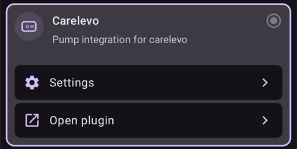

# CareLevo

CareLevo är en slanglös pod-pump som tillverkas av CareMedi. Varje pod rymmer upp till 300 U insulin och bärs i upp till 7 dagar (168 timmar). Den kommunicerar med **AAPS** via telefonens Bluetooth, utan någon extra enhet.

```{admonition} New driver
:class: warning
Drivrutinen för CareLevo är ny i **AAPS**. Läs hela den här sidan innan du aktiverar din första pod, och ha pumpens egen bruksanvisning till hands.
```

Den minsta dos som podden kan ge är 0,05 U. Ställ in basaldoserna i **Profil** på minst 0,05 U/h i steg om 0,05 U/h. Annars skiljer sig insulinet som **Profil** räknar med lite från insulinet som podden ger. **AAPS** använder de basaldoser som podden har godkänt.

```{contents} Table of contents
:depth: 1
:local: true
```

## Pumpens funktioner med AAPS

* Kommunicerar med **AAPS** via telefonens inbyggda Bluetooth, utan någon extra kommunikationsenhet.
* Bolus i steg om 0,05 U.
* Basaldoser från 0,05 U/h till 15 U/h i steg om 0,05 U/h, med basalsegment på 30 minuter.
* Tillfälliga basaler ställs in som en absolut dos, upp till 12 timmar.
* Förlängd bolus upp till 8 timmar.
* Byte till/från sommartid och byte av tidszon måste du göra manuellt. Podden meddelar dig när tidszonen ändras.

## Ställa in pumpen

1. Öppna **menyn** (☰) uppe till vänster på huvudskärmen i **AAPS** och välj **Konfiguration**.
1. Välj **Carelevo** i avsnittet Pump.
1. Tryck på bakåtknappen för att gå tillbaka till huvudskärmen.



## Settings

Öppna pumpskärmen med **Hantera → Pump** (eller **Konfiguration → Pump → Öppna plugin**).

Öppna inställningarna för CareLevo genom att trycka på ikonen **Inställningar** (kugghjulet) uppe till höger. Det finns tre inställningar:


### Inställning för avisering om lite insulin

Podden meddelar dig när insulinet som är kvar i reservoaren når den mängd som du har valt. Den kan ställas in från 20 U till 50 U i steg om 5 U. Standardvärdet är 30 U. Oberoende av den här inställningen ger podden ett kritiskt larm och slutar ge insulin när mindre än 10 U är kvar.

### Inställning för avisering om poddens användningstid

Podden meddelar dig när den har burits det antal timmar som du har valt, så att du kan planera bytet. Den kan ställas in från 24 till 167 timmar. Standardvärdet är 116 timmar.

### Infolarm från podden

När inställningen är på piper podden när en bolus, förlängd bolus eller tillfällig basal startar och när den slutar. Standardvärdet är av.

## Pumpskärmen


Pumpskärmen visar **Bluetooth-status** (Ingen aktiv pod, Frånkopplad eller Ansluten), poddens **Serienr**, dess **Aktiveringstid** och **Utgångstid**, aktuell **Basaldos** och **Tillfällig basaldos**, **Insulin kvar** (kvar / påfyllt), **Poddens återstående tid** och **Totalt levererat insulin**.

Vilka knappar som visas beror på poddens tillstånd:

* **Aktivera pod**: startar aktiveringen av en ny pod, se nedan.
* **Insulinguide**: visar de tolv stegen för att fylla en pod med insulin.
* **Pausa insulinleverans** / **Återuppta insulinleverans**: pausar och startar insulinleveransen igen, se nedan.
* **Kassera pod**: stoppar den aktuella podden så att en ny kan aktiveras.

## Aktivera en pod

Innan du börjar, se till att en **Profil** är aktiv i **AAPS** och att Bluetooth är på. Podden måste aktiveras inom en begränsad tid efter att den har slagits på. Om tiden går ut ger podden larmet **Tiden för att sätta på podden har gått ut** och kan inte användas.

Tryck på **Aktivera pod** på pumpskärmen och följ stegen. Du kan avbryta när som helst innan nålen har satts in. Det du har angett försvinner då.

### Välj insulin

Bekräfta vilket insulin du använder. Podden kräver snabbverkande U-100-insulin.

### Fyll podden med insulin

Fyll podden med 50 till 300 U, med tanke på hur länge du ska bära den. Tryck på **Insulinguide** om du behöver instruktionerna för påfyllning. Tryck sedan på påfyllningsmängden och välj den mängd som du fyllde på. **AAPS** använder den för att visa hur mycket insulin som är kvar.

### Anslut podden

1. Ta ut podden ur blisterförpackningen och ta av nålskyddet.
1. Håll poddens strömknapp intryckt i mer än en sekund. Efter pipet, tryck på **Sök pod**.
1. Om podden som hittades är rätt, tryck på **Bekräfta**. Tryck på **Sök igen** om den inte är det.

### Säkerhetskontroll

När podden är ansluten, tryck på **Säkerhetskontroll**. Podden testar sig själv och förfyller. Kontrollera att en insulindroppe har bildats på nålspetsen. Om ingen droppe syns, tryck på **Försök igen**. När kontrollen är klar, tryck på **Nästa**.

### Placering och fastsättning av podden

1. Välj platsen där du ska bära podden.
1. Rengör platsen noga med en spritsudd.
1. Ta bort skyddstejpen och fäst podden på huden med den markerade punkten uppåt.
1. Tryck på **Nästa** när podden sitter fast.

### Sätt in nålen

1. Vrid säkerhetslocket i pilens riktning och ta bort det.
1. Tryck ner applikatorns tryckknapp hela vägen och håll den intryckt i 10 sekunder. Ett pip hörs när nålen har satts in.
1. Ta bort applikatorn och tryck på **Bekräfta insättning**.

Om insättningen misslyckas visar **AAPS** hur många försök som är kvar. När inga försök är kvar ger podden larmet **Fel vid insättning av nål** och måste bytas.

Insulinleveransen startar så snart insättningen har bekräftats.

## Meddelanden om bolus

Om podden vägrar en bolus visar **AAPS** varför. Till exempel betyder *Bolusdos kan inte levereras. Bolus tillgänglig: 2,8 U* att podden bara kan ge den mängden just nu.

Om du stoppar en bolus och podden inte bekräftar stoppet, väntar **AAPS** tills bolusen är slut och registrerar den mängd som podden rapporterar. Om en bolus inte registrerades (till exempel för att den stoppades medan den pågick), lägger **AAPS** till den utifrån poddens totala mängd och ber dig kontrollera IOB innan du försöker igen.

## Pausa och återuppta insulinleveransen

Tryck på **Pausa insulinleverans** på pumpskärmen och välj hur länge leveransen ska pausas: från 30 minuter till 4 timmar i steg om 30 minuter. Leveransen startar inte igen av sig själv: när pausen är slut ger podden varningen **Starta insulin**. Tryck på **Återuppta insulinleverans** på pumpskärmen, eller **Starta insulin** i varningen, och bekräfta.

## Kassera en pod

Tryck på **Kassera pod** på pumpskärmen och bekräfta. Insulinleveransen stoppas och podden kan inte användas längre. Ta bort podden från kroppen och aktivera en ny.

När ett kritiskt larm har stoppat podden, erbjuder larmet i stället **Inaktivera pod**. Om du trycker på den kasseras podden på samma sätt.

(carelevo-alarms-and-notifications)=

## Larm och aviseringar

Podden rapporterar händelser på tre nivåer. Alla visas som aviseringar i **AAPS**.

### Kritiska larm

Insulinleveransen har stoppats. Gör något direkt:

* **Lite insulin**: mindre än 10 U är kvar. Inaktivera podden och byt den.
* **Podden har gått ut**: podden har nått slutet av sin livslängd. Inaktivera podden och byt den.
* **Låg batterinivå**: kassera podden och byt den.
* **Hög/låg temperatur**: gå till en lämplig temperatur, mellan 40 ℉ och 99 ℉ (4,4 ℃ och 37,2 ℃).
* **Automatisk avstängning**: podden stoppade eftersom varningen Automatisk avstängning inte besvarades. Tryck på **Starta insulin** för att starta basalleveransen igen.
* **Tiden för att sätta på podden har gått ut**, **Självtestet misslyckades**, **Fel i podden**, **Ocklusion** och **Fel vid insättning av nål**: inaktivera podden och byt den.

### Varningar

Insulinleveransen fortsätter, men något behöver din uppmärksamhet:

* **Lite insulin**: reservoaren har nått mängden som är inställd i **Inställning för avisering om lite insulin**. Förbered byte av pod.
* **Podden går snart ut** och **Poddens livslängd har gått ut**: byt pod.
* **Låg batterinivå**: förbered byte av pod.
* **Hög/låg temperatur**: leveransen pausas tills podden åter är mellan 40 ℉ och 99 ℉ (4,4 ℃ och 37,2 ℃).
* **Automatisk avstängning**: tryck på **OK**. Om du inte gör det blir varningen ett kritiskt larm och leveransen stoppas.
* **Aktiveringen av podden är inte klar**: tryck på **OK** för att slutföra aktiveringen.
* **Starta insulin**: pausen som du ställde in är slut. Tryck på **Starta insulin** för att återuppta leveransen.
* **Slå på Bluetooth** och **BLE inte ansluten**: telefonen når inte podden. Slå på Bluetooth eller kontrollera anslutningen till podden.

### Meddelanden

Bara för information: **Lite insulin**, **Avisering om poddens användningstid** (tiden som är inställd i **Inställning för avisering om poddens användningstid** har passerat), **Avisering om kontroll av podden**, **Byte av tidszon** och **Kontrollera blodsockret** (en viss tid efter en bolus).

Podden rapporterar också när dess egen funktion för paus vid lågt blodsocker (**LGS**) startar eller slutar. **AAPS** använder inte den här funktionen. Loopen hanterar lågt blodsocker själv.

## Var du kan få hjälp

Rapportera problem med drivrutinen för CareLevo på [sidan för GitHub-ärenden för AAPS](https://github.com/nightscout/AndroidAPS/issues) eller i AAPS-communityns kanaler, se [Var kan jag få hjälp?](../GettingHelp/WhereCanIGetHelp.md).
