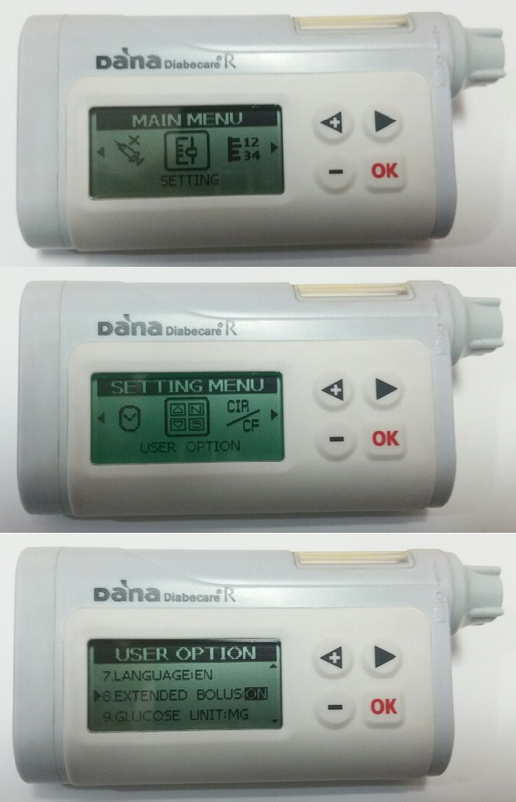

# DanaR

*De här instruktionerna gäller för att ställa in appen och pumpen om du har en DanaR. Gå till sidan [DanaRS, Dana-i och Dana-i2](./DanaRS-Insulin-Pump.md) om du i stället har en DanaRS, som kom ut 2017.*

## Pumpens funktioner med AAPS

* Kommunicerar med **AAPS** via telefonens inbyggda Bluetooth, utan någon extra kommunikationsenhet.
* Byte av tidszon och sommartid kräver inget särskilt, eftersom pumpen inte använder sin egen historik.

## Ställa in

* Gå till Main Menu > Setting > User Option i pumpen
* Slå på "8. Extended Bolus"

* Gå till Main Menu > Setting > Discovery
* Gå till Bluetooth i telefonens inställningar, sök efter enheter i närheten, välj serienumret för din DanaR och ange lösenordet (lösenordet för parkoppling är 0000). Om DanaR inte visas i sökningen: starta om telefonen, ta ut batteriet ur DanaR, sätt tillbaka det och gör om de här två stegen.

* Öppna **menyn** (☰) uppe till vänster i **AAPS**, gå till **Konfiguration** > **Pump** och välj den typ av DanaR som du har (**Dana R**, **Dana R Korea** eller **Dana R v2**).
  
  

* Öppna pumpskärmen: tryck på **Öppna plugin** på DanaR-kortet (eller gå till **Hantera** > **Pump**).

* Tryck på **Parkoppling**. På skärmen för parkoppling: 
  * Ange pumpens lösenord under **Pumplösenord** (standardlösenordet är 1234).
  * Tryck på serienumret för din DanaR under **Välj parkopplad enhet**. Om listan är tom: tryck på **Öppna Bluetooth-inställningar** och parkoppla först pumpen med telefonen (se steget ovan). När du kommer tillbaka till **AAPS** visas pumpen i listan. Om den inte gör det, tryck på uppdateringsikonen.
  * Tryck på **Parkoppling**. **AAPS** ansluter till pumpen och kontrollerar lösenordet.
* Om du vill ändra inställningarna för drivrutinen, tryck på **Inställningar** på DanaR-kortet i **Konfiguration** > **Pump**: 
  * **Bolushastighet** (DanaR och DanaRv2): ändra standardhastigheten för bolus (12 s/U, 30 s/U eller 60 s/U).
  * **Använd förlängd bolus för >200%** (DanaR och DanaR Korean): slå på detta om du vill att **AAPS** ska tillåta en basal över 200 %. Observera att du då inte kan loopa med höga tillfälliga basaler medan du använder förlängda bolusar för mat.
* Ställ in basalsteget i pumpen på 0,01 U/h
* Ställ in bolussteget i pumpen på 0,1 U. **AAPS** läser bolussteget från pumpen och använder det för varje bolus.
* Slå på förlängda bolusar i pumpen

## Resa över tidszoner med DanaR-pumpen

Information om resor över tidszoner finns i avsnittet [Resa över tidszoner med pumpar](#timezone-traveling-danarv2-danars).

## Var du kan få hjälp

Utvecklingen av DanaR-drivrutinen görs av communityn på **frivillig** basis. Innan du ber om hjälp:

1. **Läs** det avsnitt i den här dokumentationen som gäller, för att se hur funktionen är tänkt att fungera.
2. **Fråga** i kanalen *#AAPS* på [Discord](https://discord.gg/4fQUWHZ4Mw) eller i någon av de andra [kanalerna i communityn](../GettingHelp/WhereCanIGetHelp.md).
3. **Rapportera en bugg** genom att först söka bland [befintliga ärenden](https://github.com/nightscout/AndroidAPS/issues). Om ditt problem inte finns där, skapa ett [nytt ärende](https://github.com/nightscout/AndroidAPS/issues) och bifoga dina [loggfiler](../GettingHelp/AccessingLogFiles.md).

När du ber om hjälp, ange telefonens märke och modell, Android-version, version av **AAPS** och en enkel och tydlig beskrivning av problemet (vad som ändrades, när det senast fungerade).