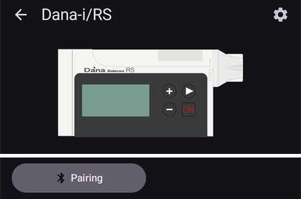
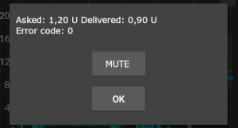

# DanaRS, Dana-i och Dana-i2

*De här instruktionerna gäller för att ställa in appen och pumpen om du har en DanaRS från 2017 eller senare, en Dana-i eller en Dana-i2. Gå till sidan [DanaR](./DanaR-Insulin-Pump.md) om du i stället har den ursprungliga DanaR.*

**Dana-i2 kan användas från AAPS version 4.0.** Den använder samma drivrutin **Dana-i/RS** som Dana-i.

* I pumparna DanaRS/i/i2 använder appen "BASAL A". Befintliga data skrivs över.

    {contents} Innehåll
    :depth: 1
    :local: true

## Pumpens funktioner med AAPS

* Kommunicerar med **AAPS** via telefonens inbyggda Bluetooth, utan någon extra kommunikationsenhet.
* Byte till och från sommartid och byte av tidszon måste göras manuellt (se [Resa över tidszoner](#timezone-traveling-danarv2-danars)).

(DanaRS-Insulin-Pump-pairing-pump)=

## Parkoppla pumpen

* Öppna **menyn** (☰) uppe till vänster på huvudskärmen i **AAPS** och välj **Konfiguration**.
* Tryck på **Pump** och välj **Dana-i/RS**.
    
    
    
    När den är vald visar kortet **Dana-i/RS** två knappar, **Inställningar** och **Öppna plugin**:
    
    
    
    **Inställningar** öppnar inställningarna för drivrutinen Dana-i/RS:
    
    
    
    **Öppna plugin** (eller **Hantera** > **Pump**) öppnar pumpskärmen för Dana-i/RS. Innan en pump har parkopplats ser den ut så här:
    
    

* Tryck på **Parkoppling** på pumpskärmen. **AAPS** söker efter pumpar i närheten.

* Tryck på din pump i listan.
    
    

* **Du måste bekräfta parkopplingen på pumpen!** Det fungerar på samma sätt som andra Bluetooth-parkopplingar som du kanske känner till (till exempel mellan smartphone och bilstereo).
    
    

* Följ parkopplingen som passar typen och firmware i din pump:
    
    * För DanaRS v1 frågar **AAPS** efter **Pumplösenord (endast v1)**. Ange pumpens lösenord (se [Standardlösenord](#DanaRS-Insulin-Pump-default-password)).
    * För DanaRS v3 ber **AAPS** dig att trycka på OK på pumpen och skriva in de 2 serierna av siffror och bokstäver som visas på pumpen. Håll pumpens skärm tänd genom att trycka på minusknappen tills du är klar. Tryck sedan på **Klar**.
    * För Dana-i och Dana-i2 visas Androids vanliga dialogruta för parkoppling. Ange det 6-siffriga numret som visas på pumpen.

* När **Parkopplingen lyckades!** visas, tryck på **Klar**.
    
    
    
    Du är tillbaka på pumpskärmen, som nu visar pumpens status.
    
    

* Välj **Bolushastighet** under **Inställningar** för att ändra standardhastigheten för bolus (12 s/U, 30 s/U eller 60 s/U).

* Ställ in basalsteget i pumpen på 0,01 U/h i läkarmenyn (Doctors menu, se pumpens bruksanvisning).
* Ställ in bolussteget i pumpen på 0,05 U i läkarmenyn (Doctors menu, se pumpens bruksanvisning). **AAPS** läser basal- och bolussteget från pumpen och använder dem för varje bolus, så att en bolus alltid passar steget som är inställt i pumpen. Pumpskärmen visar dem på raden **Basal/bolus-steg**.
* Slå på förlängda bolusar i pumpen

### Alternativ som bara visas för vissa modeller

* **Autolås**: på en Dana-i2 har skärmen **Användaralternativ** (på pumpskärmen, **Hantera** > **Pump**) en brytare **Autolås** för pumpens inställning för automatiskt lås. Tryck på **Spara till pump** när du har ändrat den.
* **Enkelt läge**: på pumpmodeller som har ett enkelt menyläge visar pumpskärmen en rad **Enkelt läge** med **På** eller **Av**.
* Om en Dana-i2 vägrar en bolus visar **AAPS** orsaken, till exempel *Pumpen är inte förfylld*, *Inte tillräckligt med insulin i reservoaren* eller *Easy Sleep-läget är på i pumpen*.

(DanaRS-Insulin-Pump-default-password)=

### Standardlösenord

* För DanaRS med firmware v1 och v2 är standardlösenordet 1234.
* För DanaRS med firmware v3 eller Dana-i räknas standardlösenordet fram från tillverkningsdatumet som MMDD, där MM är månaden och DD är dagen då pumpen tillverkades (t.ex. '0124' för månad 01 och dag 24).
    
    * Välj REVIEW i MAIN MENU och öppna sedan SHIPPING INFORMATION i undermenyn
    * Nummer 3 är tillverkningsdatumet. 
    * För v3/i används lösenordet bara för att låsa menyn i pumpen. Det används inte för kommunikation och du behöver inte ange det i AAPS.

(DanaRS-Insulin-Pump-change-password-on-pump)=

## Byt lösenord i pumpen

* Tryck på OK-knappen på pumpen
* Välj "OPTION" i huvudmenyn (gå åt höger genom att trycka på pilknappen några gånger)
    
    

* Välj "USER OPTION" i menyn OPTION
    
    

* Bläddra ner med pilknappen till "11. password"
    
    

* Tryck på OK för att ange det gamla lösenordet.

* Ange det **gamla lösenordet** (standardlösenord, se [ovan](#DanaRS-Insulin-Pump-default-password)) och tryck på OK
    
    

* Om du anger fel lösenord här visas inget meddelande om att det misslyckades!

* Ange ett **nytt lösenord** (ändra siffrorna med knapparna + & - / gå åt höger med pilknappen).
    
    

* Bekräfta med OK-knappen.

* Tryck på OK för att spara inställningen.
    
    

* Gå ner till "14. EXIT" och tryck på OK för att gå ut.
    
    

(DanaRS-Insulin-Pump-dana-rs-specific-errors)=

## Fel som gäller Dana RS

### Fel under insulinleverans

Om anslutningen mellan AAPS och Dana RS bryts medan en bolus ges (t.ex. om du går ifrån telefonen medan Dana RS pumpar insulin), visas följande meddelande och du hör ett larmljud.

* Oftast är det bara ett kommunikationsproblem och rätt mängd insulin har getts.
* Kontrollera i pumphistoriken att rätt bolus gavs. Du kan göra det i själva pumpen, eller i **AAPS** på pumpskärmen (**Hantera** > **Pump**) > **Pumphistorik** > **Bolusar**.
* Ta bort felposten i [behandlingar](#screens-bolus-carbs) om du vill.
* Den verkliga mängden läses och sparas vid nästa anslutning. Om du vill göra det direkt, tryck på **Uppdatera** på pumpskärmen, eller vänta bara på nästa anslutning.

## Viktigt när du byter telefon

När du byter till en ny telefon behöver du göra så här:

* [Exportera inställningar](../Maintenance/ExportImportSettings.md) på den gamla telefonen
* Flytta inställningar från den gamla till den nya telefonen

### DanaRS v1

* **Parkoppla Dana RS manuellt** med den nya telefonen
* Om du kryssar i **Byt även pumpinställningar** när du importerar, importeras även inställningarna för pumpanslutningen. Då "känner" AAPS på den nya telefonen redan till pumpen och startar därför ingen Bluetooth-sökning. Därför måste den nya telefonen och pumpen parkopplas manuellt.
* Installera AAPS på den nya telefonen.
* [Importera inställningar](../Maintenance/ExportImportSettings.md) på den nya telefonen

### DanaRS v3, Dana-i, Dana-i2

* Starta parkopplingen så som det beskrivs [ovan](#DanaRS-Insulin-Pump-pairing-pump).
* Ibland kan du först behöva rensa parkopplingsinformationen i **AAPS**. Tryck på **Ta bort parkoppling** på pumpskärmen (**Hantera** > **Pump**) och bekräfta **Återställ parkopplingen?**. Tryck sedan på **Parkoppling** igen.

## Resa över tidszoner med pumparna DanaRS, Dana-i och Dana-i2

Information om resor över tidszoner finns i avsnittet [Resa över tidszoner med pumpar](#timezone-traveling-danarv2-danars).

## Var du kan få hjälp

Utvecklingen av drivrutinen för DanaRS/Dana-i/Dana-i2 görs av communityn på **frivillig** basis. Innan du ber om hjälp:

1. **Läs** det avsnitt i den här dokumentationen som gäller, för att se hur funktionen är tänkt att fungera.
2. **Fråga** i kanalen *#AAPS* på [Discord](https://discord.gg/4fQUWHZ4Mw) eller i någon av de andra [kanalerna i communityn](../GettingHelp/WhereCanIGetHelp.md).
3. **Rapportera en bugg** genom att först söka bland [befintliga ärenden](https://github.com/nightscout/AndroidAPS/issues). Om ditt problem inte finns där, skapa ett [nytt ärende](https://github.com/nightscout/AndroidAPS/issues) och bifoga dina [loggfiler](../GettingHelp/AccessingLogFiles.md).

När du ber om hjälp, ange telefonens märke och modell, Android-version, version av **AAPS** och en enkel och tydlig beskrivning av problemet (vad som ändrades, när det senast fungerade).