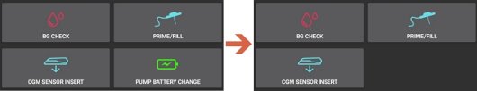

# Diaconn G8

```{contents} Table of contents
:depth: 1
:local: true
```

## Pumpens funktioner med AAPS

* Kommunicerar med **AAPS** via telefonens inbyggda Bluetooth, utan någon extra kommunikationsenhet.
* Byte till/från sommartid och byte av tidszon måste du göra manuellt.

## Parkoppla insulinpumpen via Bluetooth

- Tryck på **menyn** (☰) uppe till vänster.


- Tryck på **Konfiguration** > **Pump** och välj **Diaconn G8**.


När den är vald visar kortet **Diaconn G8** två knappar, **Inställningar** och **Öppna plugin**:


**Inställningar** öppnar inställningarna för drivrutinen Diaconn G8 (se [Inställningar för insulinpumpen Diaconn G8](#diaconn-g8-insulin-pump-option-setting) nedan).

**Öppna plugin** (eller **Hantera** > **Pump**) öppnar pumpskärmen för Diaconn G8. Innan en pump har parkopplats ser den ut så här:


```{admonition} Older screenshot
:class: note
Skärmbilden ovan är från en tidigare **AAPS**-version. I **AAPS** 4 startar du parkopplingen med knappen **Parkoppla** på pumpskärmen. Det finns ingen inställning **Vald pump**.
```

- Tryck på **Parkoppla** på pumpskärmen. Skärmen **Diaconn parkoppling** öppnas och **AAPS** söker efter pumpar i närheten.
- Tryck på insulinpumpens modellnummer när det visas i listan (till exempel **DIACONN-65010**).


- Det finns två sätt att kontrollera ditt modellnummer:

1. De sista 5 siffrorna i serienumret (SN) på pumpens baksida.
2. Tryck på O-knappen > Information > BLE > De sista 5 siffrorna.


- När du har valt din pump visas ett fönster som ber om en PIN-kod. Ange PIN-koden som visas på pumpen för att slutföra anslutningen.

 

- När **Parkopplingen lyckades!** visas trycker du på **OK** för att gå tillbaka till pumpskärmen.

## Kontrollera pumpstatus och synkronisera loggar

- När pumpen är ansluten öppnar du pumpskärmen (**Hantera** > **Pump**). Den visar pumpens status (batteri, reservoar, senaste anslutning, senaste bolus, basaldos med mera).
- Tryck på **Uppdatera** för att ansluta till pumpen, uppdatera statusen och synkronisera loggarna.
- Tryck på **Pumphistorik** för att se historiken som har lästs från pumpen.


```{admonition} Older screenshot
:class: note
Skärmbilden ovan är från en tidigare **AAPS**-version. I **AAPS** 4 visas pumpens status på pumpskärmen (**Hantera** > **Pump**) och synkroniseras med knappen **Uppdatera**.
```

(diaconn-g8-bluetooth-troubleshooting)=

## Felsökning av Bluetooth

**Vad du gör om Bluetooth-anslutningen till pumpen är instabil.**

### Metod 1) Starta om AAPS och kontrollera sedan pumpen igen

- Tryck på **menyn** (☰) uppe till vänster.
- Tryck på **Avsluta** längst ned i menyn.


- Starta **AAPS** igen och kontrollera anslutningen till pumpen.

### Metod 2) Om den första metoden inte fungerar: koppla bort Bluetooth och anslut sedan igen.

- Håll Bluetooth-knappen längst upp intryckt i cirka 3 sekunder.


- Tryck på inställningsknappen för den parkopplade Diaconn G8-insulinpumpen.


- Ta bort parkopplingen.


- Öppna pumpskärmen i **AAPS** (**Hantera** > **Pump**), tryck på **Ta bort parkoppling** och bekräfta **Återställ parkopplingen?**.
- Gör om parkopplingen av pumpen via Bluetooth (se ovan).

## Mer information

(diaconn-g8-insulin-pump-option-setting)=

### Inställningar för insulinpumpen Diaconn G8

- **Konfiguration** > **Pump** > **Diaconn G8** > **Inställningar**
- Eller tryck på inställningsikonen (kugghjulet) uppe till höger på pumpskärmen (**Hantera** > **Pump**).


- **Bolushastighet** anger hur snabbt pumpen ger en bolus.
- Om alternativet **Logga reservoarbyten** är aktiverat laddas uppgifterna automatiskt upp till careportal när händelsen "Insulin Change" inträffar.
- Om alternativet **Logga nålbyte** är aktiverat laddas uppgifterna automatiskt upp till careportal när händelsen "Site Change" inträffar.
- Om alternativet **Logga slangbyte** är aktiverat läggs uppgifterna automatiskt till som en anteckning när händelsen "Tube Change" inträffar.
- Om alternativet **Logga batteribyten** är aktiverat laddas uppgifterna automatiskt upp till careportal när händelsen "Battery Change" inträffar. Du kan också själv registrera ett batteribyte med **Hantera** > **Byte av pumpbatteri**. (Obs! Stoppa alla pågående insulinfunktioner innan du byter batteri.)
- **Diaconn Molnsynkronisering** skickar pumploggarna till Diaconns moln.



```{admonition} Older screenshot
:class: note
Skärmbilden ovan är från en tidigare **AAPS**-version. I **AAPS** 4 registrerar du ett batteribyte med **Hantera** > **Byte av pumpbatteri**. Det finns ingen flik **Åtgärder**.
```

### Funktionen förlängd bolus

- Om du använder förlängd bolus stängs den slutna loopen av.
- Läs [den här sidan](#extended-bolus-and-why-they-wont-work-in-closed-loop-environment) för att förstå varför förlängd bolus inte fungerar med sluten loop.

## Var du kan få hjälp

Drivrutinen för Diaconn G8 utvecklas av communityn på **frivillig** basis. Innan du ber om hjälp:

1. **Läs** det avsnitt i dokumentationen som gäller, så att du vet hur funktionen ska fungera.
2. **Fråga** i kanalen *#AAPS* på [Discord](https://discord.gg/4fQUWHZ4Mw) eller i någon av de andra [communitykanalerna](../GettingHelp/WhereCanIGetHelp.md).
3. **Rapportera en bugg**: sök först bland [befintliga ärenden](https://github.com/nightscout/AndroidAPS/issues). Om ditt problem inte finns där, skapa ett [nytt ärende](https://github.com/nightscout/AndroidAPS/issues) och bifoga dina [loggfiler](../GettingHelp/AccessingLogFiles.md).

När du ber om hjälp, ange telefonens märke och modell, Android-version, **AAPS**-version och en enkel beskrivning av problemet (vad som ändrades, när det fungerade senast).
