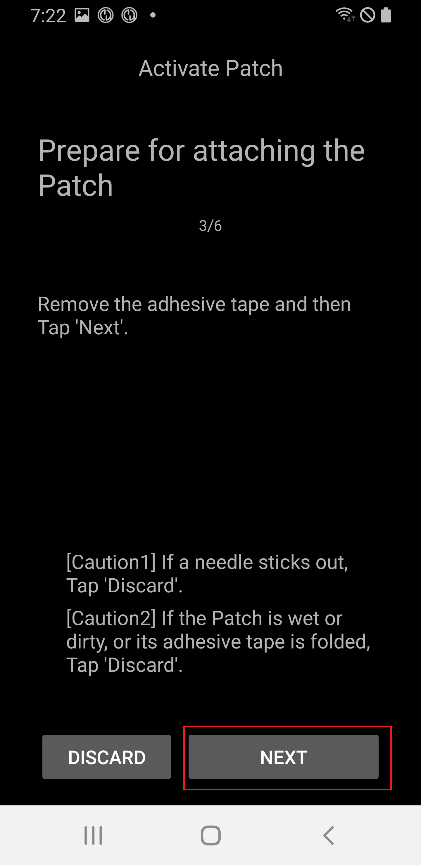
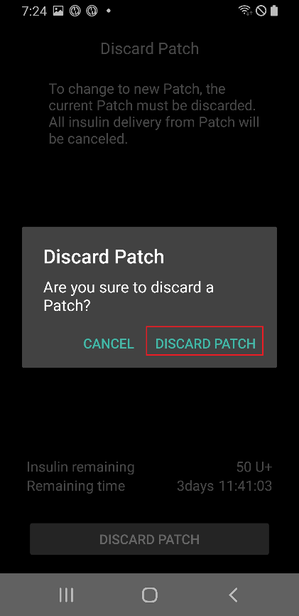
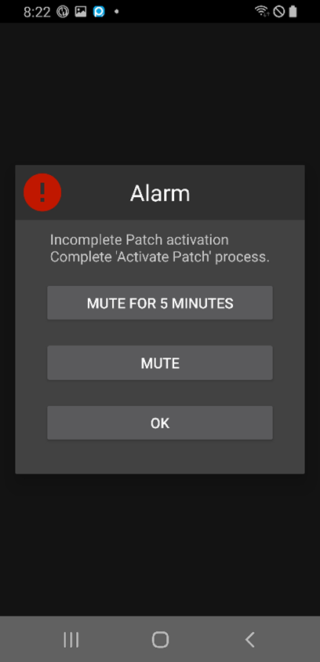

# EOPatch2

Podden behöver snabbverkande U-100-insulin, till exempel NovoRapid eller Humalog. Använd det snabbverkande insulin som din läkare har skrivit ut till dig.

Den minsta dos som podden kan ge är 0,05 U. Ställ in varje basaldos i din **Profil** på minst 0,05 U/h, i steg om 0,05 U/h. Annars avrundar **AAPS** varje dos till närmaste 0,05 U/h (aldrig ned till 0) och använder de doser som podden verkligen ger. Därför skiljer sig den totala insulinmängden per dag något från din **Profil**. På samma sätt måste en bolus vara minst 0,05 U.

```{contents} Table of contents
:depth: 1
:local: true
```

## Pumpens funktioner med AAPS

* Kommunicerar med **AAPS** via telefonens inbyggda Bluetooth, utan någon extra kommunikationsenhet.
* Byte till/från sommartid och byte av tidszon måste du göra manuellt.

## Ställa in pumpen

1. Öppna **menyn** (☰) uppe till vänster på huvudskärmen i **AAPS** och välj **Konfiguration**.
1. Välj **EOPatch2** i avsnittet **Pump**.
1. Tryck på bakåtknappen för att gå tillbaka till huvudskärmen.

 

När den är vald visar kortet **EOPatch2** två knappar, **Inställningar** och **Öppna plugin**:


## Settings

Du kan öppna inställningarna för EOPatch2 på två sätt:

* tryck på **Inställningar** på kortet **EOPatch2** i **Konfiguration**, eller
* öppna pumpskärmen (**Hantera** → **Pump**) och tryck på kugghjulsikonen uppe till höger.

Det finns tre inställningar:


### Varningar för låg reservoar

En varning visas när insulinet som är kvar i podden sjunker till den här mängden eller lägre. Du kan ställa in 10 till 50 U, i steg om 5 U. Standardvärdet är 10 U.

### Påminnelse om att byta pod

Påminner dig om hur lång tid det är kvar innan den aktuella podden går ut. Du kan ställa in 1 till 24 timmar, i steg om 1 timme. Standardvärdet är 4 timmar.

### Påminnelsesignaler från podden

När inställningen är på piper podden när en bolus, förlängd bolus eller tillfällig basal startar och när den slutar. Den påverkar inte din vanliga basal. Standardvärdet är av.

## Aktivera en ny pod

### Öppna aktiveringsguiden

Öppna pumpskärmen med **Hantera** → **Pump** (eller tryck på **Öppna plugin** på kortet **EOPatch2** i **Konfiguration**). När ingen pod är aktiv visar skärmen **Inte aktiverad** och knappen **Aktivera pod** längst ned.

Tryck på **Aktivera pod** för att starta guiden.


Guiden leder dig genom varje steg. Raden med punkter längst upp visar hur långt du har kommit.

```{note}
Om du aldrig har aktiverat en **Profil** i **AAPS** visar guiden först sidan **Profil krävs**. Välj den profil som ska användas och tryck på **Aktivera profil**.
```

### Insulinpåfyllning

Stick in sprutans nål i poddens påfyllningsport för insulin. Tryck långsamt in kolven för att fylla podden. När det finns mer än 80 U i podden piper den en gång och startar.

När du hör pipet trycker du på **Påbörja parkoppling**.


```{warning}
- Vrid inte nålspaken förrän guiden säger till. Om du vrider den för tidigt kan det orsaka allvarliga problem vid påfyllningen eller säkerhetskontrollen.
- Podden rymmer 80 till 200 U. Om du fyller på mindre än 80 U fungerar podden inte.
- Ta ut insulinet ur kylskåpet 15 till 30 minuter före påfyllningen, så att det får rumstemperatur. Insulinet måste vara minst 10 °C.
```

### Parkoppling

**AAPS** försöker nu parkoppla med podden automatiskt. Under parkopplingen visas två förfrågningar om Bluetooth-parkoppling från Android. Tryck på **OK** på den första. Tryck på **OK** igen på den andra, som visar en kod (passkey).

```{warning}
- Håll podden och telefonen högst 30 cm från varandra under parkopplingen.
- När podden har startat piper den var 3:e minut tills parkopplingen är klar.
- Du måste aktivera podden färdigt inom 60 minuter efter att den har startat. Om du inte hinner det, kassera podden.
```

  

```{admonition} Older screenshot
:class: note
De två skärmbilderna av Bluetooth-parkopplingen är från en äldre version av **AAPS**: skärmen i **AAPS** bakom Androids förfrågan om parkoppling ser annorlunda ut i **AAPS** 4.
```

### Välj insulin

Välj det insulin som du fyllde podden med och tryck på **Nästa**. **AAPS** gör ett profilbyte med detta insulin efter aktiveringen.

### Förbered för att sätta fast podden

Ta bort skyddstejpen från podden och tryck sedan på **Nästa**.

Om en nål sticker ut, eller om podden är blöt, smutsig eller tejpen är vikt, tryck i stället på **Kassera** och använd en ny pod.



### Plats

Det här steget visas bara om **Hantera pumpplatsrotation** är påslaget i inställningarna för platsrotation. Tryck på den plats på kroppsbilden där du ska sätta fast podden och tryck på **Nästa**, eller tryck på **Hoppa över**.

### Sätta fast podden

Insulinet ska gå in på ett ställe med fettvävnad under huden, men med få nerver och blodkärl. Magen, armen eller låret är bra val. Rengör och torka stället och sätt sedan fast podden på huden.

Kontrollera infusionsstället och tryck sedan på **Starta säkerhetskontroll**.

```{warning}
- Tryck jämnt på kanterna av poddens tejp så att hela podden fäster ordentligt mot huden.
- Om podden inte fäster helt kan luft komma in mellan podden och huden. Det försämrar fästet och poddens vattentålighet.
```


### Säkerhetskontroll

Säkerhetskontrollen tar cirka 30 sekunder. När den är klar piper podden en gång. Om den misslyckas, tryck på **Försök igen**.

```{warning}
För säker användning: vrid inte nålspaken förrän säkerhetskontrollen är klar.
```

 

```{admonition} Older screenshot
:class: note
Skärmbilderna från **Förbered för att sätta fast podden** till **Säkerhetskontroll** är från en äldre version av **AAPS** och kan se annorlunda ut i **AAPS** 4.
```

### Sätta in nålen

Håll podden stadigt. Vrid nålspaken uppåt mer än 100° för att sätta in nålen. Podden piper en gång när nålen är rätt insatt. Fortsätt sedan att vrida spaken hela vägen för att ta bort den. Tryck på **Nästa**.

```{caution}
Om du går till nästa steg utan att höra pipet visas **Fel vid insättning av nål**. Lyssna efter pipet och tryck på **Försök igen**. Om felet kvarstår, tryck på **Kassera** för att inaktivera podden.
```

### Podaktivering slutförd

Den sista sidan bekräftar att podden är aktiv och att den påminner dig när den närmar sig sin utgångstid. Tryck på **Slutför** för att gå tillbaka till pumpskärmen.

## Kassera podden

Byt podden när den har lite insulin kvar, när den går ut eller om den är trasig. Vi rekommenderar att du inte använder en pod längre än 84 timmar efter att den har startat.

1. Öppna pumpskärmen (**Hantera** → **Pump**). Tryck på **Kassera pod** medan en pod är aktiv.
1. Sidan **Kassera pod** visar hur lång tid och hur mycket insulin som är kvar i podden. Tryck på **Kassera pod**.
1. En dialogruta ber dig bekräfta. Tryck på **Kassera pod** igen.
1. När podden har inaktiverats visar guiden **Kassering av podden är slutförd.** Ta bort podden från kroppen och tryck på **Bekräfta**.

Därefter går guiden direkt vidare till att aktivera en ny pod (se ovan). Tryck på bakåtpilen om du vill avbryta här.

När ingen pod är aktiv visar **AAPS** pumpen som pausad och registrerar en tillfällig basal på 0 U/h. Därför räknas inget basalinsulin in i IOB förrän nästa pod har aktiverats.

   

```{admonition} Older screenshot
:class: note
Skärmbilderna ovan är från en tidigare version av **AAPS**. I **AAPS** 4 öppnar du pumpskärmen via **Hantera** → **Pump**, och knappen där heter **Kassera pod**.
```

```{admonition} If the patch does not respond
:class: warning
Om **AAPS** inte kan nå podden kan en sida visas om hur du stänger av poddens larm för hand: ta bort podden från kroppen, dra av tejpen och tryck med ett gem hårt in i hålet bredvid påfyllningsporten för insulin.

Sidan **Kassera pod** har också knappen **Tvingad återställning**. Den tar bara bort podden från **AAPS**, utan att skicka något kommando till podden. Podden fortsätter att ge insulin tills batteriet tar slut eller tills du stänger av den för hand. Använd den bara om en vanlig kassering misslyckas, och ta bort podden från kroppen.
```

## Pausa och återuppta insulinleveransen

När du pausar insulinleveransen avbryts också en pågående förlängd bolus och tillfällig basal. När du återupptar startas de **inte** igen. Medan insulinleveransen är pausad piper podden var 15:e minut.

### Pausa insulinleveransen

1. Öppna pumpskärmen (**Hantera** → **Pump**) och tryck på **Pausa pump**.
1. En dialogruta förklarar vad som kommer att pausas. Tryck på **Bekräfta**.
1. Välj i dialogrutan **Tid för basalpaus** hur länge du vill pausa: 30 min, 1 tim, 1 tim 30 min eller 2 tim. Tryck på **Bekräfta**.

Insulinleveransen pausas under den tid du valde.

  

```{admonition} Older screenshot
:class: note
Skärmbilderna ovan är från en tidigare version av **AAPS**. I **AAPS** 4 öppnar du pumpskärmen via **Hantera** → **Pump**, och knappen där heter **Pausa pump**.
```

### Återuppta insulinleveransen

1. Öppna pumpskärmen (**Hantera** → **Pump**) och tryck på **Återuppta pump**.
1. Tryck på **Bekräfta** i dialogrutan **Återuppta insulinleverans**.

 

```{admonition} Older screenshot
:class: note
Skärmbilderna ovan är från en tidigare version av **AAPS**. I **AAPS** 4 öppnar du pumpskärmen via **Hantera** → **Pump**, och knappen där heter **Återuppta pump**.
```

```{warning}
När paustiden är slut visar **AAPS** varningen **Insulinpausen är slut**. Insulinleveransen startar **inte** igen förrän du bekräftar det. Om du inte gör det kan du få hyperglykemi (högt blodsocker).
```

(eopatch2-alarms-and-warnings)=

## Larm och varningar

### Larm

Larm gäller brådskande situationer med högsta prioritet och kräver att du agerar direkt. **AAPS** ger ett larm som fortsätter tills du kvitterar det, och visar meddelandet som en avisering på **huvudskärmen**. Ett larm betyder att det är problem med podden som används. I många fall måste podden kasseras och bytas mot en ny.

När du trycker på **Bekräfta** i aviseringen hanterar **AAPS** larmet. För de flesta larm inaktiveras podden då. För larmet **Olämplig temperatur** heter knappen **Försök igen**.

 

```{admonition} Older screenshot
:class: note
Skärmbilderna av larmen är från en äldre version av **AAPS** och kan se annorlunda ut i **AAPS** 4.
```

De olika larmen förklaras nedan.

| Larm                      | Förklaring                                                                                                                                                 |
| ------------------------- | ---------------------------------------------------------------------------------------------------------------------------------------------------------- |
| Tom reservoar             | Podden har slut på insulin.                                                                                                                                |
| Podden har gått ut        | Poddens användningstid är slut och den kan inte ge mer insulin.                                                                                            |
| Ocklusion                 | Poddens insulinväg verkar vara blockerad.                                                                                                                  |
| Fel i uppstartstest       | Podden hittade ett oväntat fel i sitt självtest efter starten.                                                                                             |
| Olämplig temperatur       | Podden är utanför sin normala arbetstemperatur när du aktiverar eller använder den. Flytta podden till ett ställe med lämplig temperatur (4,4 till 37 °C). |
| Fel vid insättning av nål | Nålen sattes inte in rätt under aktiveringen. Kontrollera att poddens kant för nålinsättning och nålspaken ligger i en rak linje.                          |
| Batterifel                | Poddens inbyggda batteri håller på att ta slut och podden kommer att stängas av.                                                                           |
| Aktiveringsfel            | Podden aktiverades inte helt inom 60 minuter efter starten.                                                                                                |
| Pod-fel                   | Podden hittade ett oväntat fel när den aktiverades eller användes.                                                                                         |

### Varningar

Varningar gäller situationer med medelhög eller låg prioritet. En varning visas som en avisering på **huvudskärmen**.


```{admonition} Older screenshot
:class: note
Den här skärmbilden är från en äldre version av **AAPS**: i **AAPS** 4 visas varningen på huvudskärmen, som ser annorlunda ut.
```

De olika varningarna förklaras nedan.

| Varning                       | Förklaring                                                                                                            |
| ----------------------------- | --------------------------------------------------------------------------------------------------------------------- |
| Insulinpausen är slut         | Paustiden som du valde är slut. Tryck på **Återuppta pump** i aviseringen för att starta insulinleveransen igen.      |
| Låg reservoar                 | Insulinet som är kvar i podden är under den mängd som är inställd i **Varningar för låg reservoar**.                  |
| Poddens livslängd har löpt ut | Poddens användningsperiod är slut.                                                                                    |
| Podden löper ut snart         | Podden måste kasseras inom 1 timme.                                                                                   |
| Ofullständig pod-aktivering   | Aktiveringen av podden avbröts i mer än 3 minuter efter parkopplingen. Öppna pumpskärmen och aktivera podden färdigt. |
| Pod-batteri lågt              | Poddens batteri är svagt.                                                                                             |

## Var du kan få hjälp

Drivrutinen för EOPatch2 utvecklas av communityn på **frivillig** basis. Innan du ber om hjälp:

1. **Läs** det avsnitt i dokumentationen som gäller, så att du vet hur funktionen ska fungera.
2. **Fråga** i kanalen *#AAPS* på [Discord](https://discord.gg/4fQUWHZ4Mw) eller i någon av de andra [communitykanalerna](../GettingHelp/WhereCanIGetHelp.md).
3. **Rapportera en bugg**: sök först bland [befintliga ärenden](https://github.com/nightscout/AndroidAPS/issues). Om ditt problem inte finns där, skapa ett [nytt ärende](https://github.com/nightscout/AndroidAPS/issues) och bifoga dina [loggfiler](../GettingHelp/AccessingLogFiles.md).

När du ber om hjälp, ange telefonens märke och modell, Android-version, **AAPS**-version och en enkel beskrivning av problemet (vad som ändrades, när det fungerade senast).
