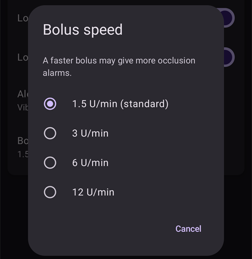
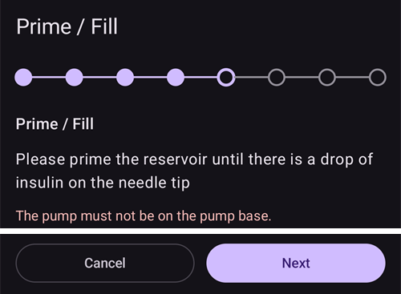

# Equil

De här instruktionerna beskriver hur du ställer in insulinpumpen Equil.

```{contents} Table of contents
:depth: 1
:local: true
```

## Pumpens funktioner med AAPS

* Slanglös pod-pump som kommunicerar med **AAPS** via telefonens inbyggda Bluetooth, utan någon extra kommunikationsenhet.
* **AAPS** behandlar Equil som en pod-pump med en reservoar på 200 U: huvudskärmen visar statuslamporna för pod-pumpar, och **Förfyllning** och **Byte av pumpbatteri** erbjuds inte. Påfyllning, förfyllning och batteribyte görs i pumpens guider.
* Medan pumpen är pausad eller stoppad registrerar **AAPS** en tillfällig basal på 0 U/h. Därför räknas inget basalinsulin in i IOB.
* Byte till/från sommartid och byte av tidszon måste du göra manuellt.

## Krav på hårdvara och programvara
* **Kompatibel Equil-hårdvara**

  För närvarande stöds Equil 5.3 och 5.4.

* **AAPS** byggd och installerad enligt instruktionerna i [Bygga APK](../SettingUpAaps/BuildingAaps.md)

## Ställa in

### Välj pumpen Equil

Öppna **menyn** (☰) uppe till vänster, välj **[Konfiguration](#Config-Builder-pump)** och välj **Equil** under **Pump**.

När den är vald visar kortet **Equil** två knappar, **Inställningar** och **Öppna plugin**:


**Öppna plugin** (eller **Hantera** → **Pump**) öppnar pumpskärmen för Equil. Innan en pump har parkopplats ser den ut så här:


### Settings

Öppna inställningarna för Equil med **Inställningar** på kortet **Equil**, eller med kugghjulsikonen uppe till höger på pumpskärmen.


* **Larm för lågt batteri**: varnar dig när pumpens batteri är lågt.
* **Larm för lite insulin**: varnar dig när det är lite insulin kvar i reservoaren.
* **Varningsljud**: hur pumpen varnar dig: **Stäng av ljudet**, **Vibrera endast**, **Endast tonen** eller **Vibration och pip**.
* **Bolushastighet**: hur snabbt en bolus ges: **1,5 U/min (standard)**, **3 U/min**, **6 U/min** eller **12 U/min**. En snabbare bolus kan ge fler ocklusionslarm.



```{admonition} Max basal and max bolus on the patch
:class: note
Själva podden vägrar alla basaldoser över ett maxvärde som **AAPS** programmerar in i den. **AAPS** använder det högsta av din [inställning](../SettingUpAaps/Preferences.md) **max basal** och den högsta basaldosen per timme i din **Profil**, så att podden alltid godtar din profil och de tillfälliga basaler som loopen begär. **AAPS** skickar också din högsta tillåtna bolus till podden.

När du ändrar **max basal** eller **max bolus** skickar **AAPS** de nya värdena till podden automatiskt. De skickas också vid varje profilbyte. Du behöver inte ställa in något på själva podden.
```

### Parkoppla pumpen

Tryck på **Parkoppla** på pumpskärmen. En guide leder dig genom varje steg. Raden med punkter längst upp visar hur långt du har kommit.

Om Android frågar om **AAPS** får hitta och ansluta till enheter i närheten, tryck på **Tillåt**. **AAPS** behöver detta för att hitta pumpen.


Guiden har de här stegen. Tryck på **Nästa** för att gå vidare, eller på **Avbryt** för att lämna guiden.

1. **Profil krävs**: visas bara om du aldrig har aktiverat en **Profil** i **AAPS**. Välj den profil som ska användas och tryck på **Aktivera profil**.
1. **Montera pumpen**: sätt ihop pumpen, den fyllda reservoaren och det laddade batteriet.

   

1. **Hitta pumpen**: **AAPS** söker efter Equil-pumpar i närheten. Välj din pump i listan.

   
1. **Parkoppla enhet**: du kan ange ett lösenord för parkoppling i **Ange lösenord för parkoppling**. Det måste vara 4 tecken långt och bestå av tecknen `ABCDEF0123456789`. Tryck på **Parkoppla**.

   

1. **Välj insulin**: visas bara om du har ställt in mer än ett insulin. Välj insulinet som finns i reservoaren.
1. **Förfyll / Fyll**: pumpen får **inte** sitta på bottenplattan. Tryck på **Förfyll/fyll** och förfyll reservoaren tills det finns en droppe insulin på nålspetsen. Tryck på **Nästa**.

   
1. **Platsrotation**: visas bara om **Hantera pumpplatsrotation** är påslaget i inställningarna för platsrotation. Tryck där du ska sätta fast pumpen, eller tryck på **Hoppa över**.
1. **Fäst pumpen**: sätt fast pumpen på bottenplattan.

   
1. **Förfyll kanyl**: när pumpen sitter på bottenplattan trycker du på **Rensa luft** för att ta bort luft ur kanylen. Tryck på **Nästa**.

   

1. **Bekräfta**: sätt pumpen på kroppen och tryck på **Slutför**.

   

```{warning}
Om du anger ett eget lösenord för parkoppling (rekommenderas för din säkerhet), spara det på ett säkert ställe. Lösenordet sparas i pumpen. Pumpen frågar efter det vid varje ny parkoppling, tills du tar bort parkopplingen på rätt sätt i **AAPS**. Fram till dess kan pumpen inte heller användas med den ursprungliga handenheten (PDA).
```

### Pumpskärmen efter parkoppling

När pumpen är parkopplad visar pumpskärmen de här knapparna:

* **Uppdatera**: läser pumpens status och historik direkt.
* **Pausa** / **Återuppta insulintillförsel**: stoppar eller startar insulinleveransen igen.
* **Byt reservoar**: leder dig genom att ta loss pumpen, sätta i en ny reservoar (och vid behov ett nytt batteri), förfylla och sätta fast den igen. Det första steget frågar *Sätter du också på ett nytt infusionsset (bottenplatta och kanyl)?*
  * **Ja, nytt infusionsset**: du väljer plats, kanylen förfylls och **AAPS** registrerar ett insulinbyte och ett kanylbyte.
  * **Nej, bara reservoar eller batteri**: kanylen förfylls inte och **AAPS** registrerar bara ett insulinbyte.

  Efter ett reservoarbyte visar batterinivån **-** tills **AAPS** läser den från pumpen igen.

  

* **Historik**: visar händelserna som pumpen har registrerat.
* **Ta bort parkoppling av enhet**: leder dig genom att ta loss pumpen och ta bort parkopplingen med **AAPS**. Det stoppar insulinleveransen, flyttar pumpens kolv tillbaka till botten och tar bort parkopplingen.

### Larm

* Larmet för lite insulin hörs en gång vid varje nivå (10 U, 5 U och 2 U) och när reservoaren är tom. Larmet för lågt batteri hörs en gång vid 10 % och en gång vid 5 %. Varje nivå larmar bara en gång fram till nästa reservoarbyte.
* Pumpens larm och stopp registreras också som meddelanden i behandlingarna, vid den tid då pumpen loggade dem. Då kan du se i efterhand när och varför pumpen stoppade.
* Om reservoaren tar slut under en bolus registrerar **AAPS** bara det insulin som hann ges och visar båda mängderna.

## Var du kan få hjälp

Drivrutinen för Equil utvecklas av communityn på **frivillig** basis. Innan du ber om hjälp:

1. **Läs** det avsnitt i dokumentationen som gäller, så att du vet hur funktionen ska fungera.
2. **Fråga** i kanalen *#AAPS* på [Discord](https://discord.gg/4fQUWHZ4Mw) eller i någon av de andra [communitykanalerna](../GettingHelp/WhereCanIGetHelp.md).
3. **Rapportera en bugg**: sök först bland [befintliga ärenden](https://github.com/nightscout/AndroidAPS/issues). Om ditt problem inte finns där, skapa ett [nytt ärende](https://github.com/nightscout/AndroidAPS/issues) och bifoga dina [loggfiler](../GettingHelp/AccessingLogFiles.md).

När du ber om hjälp, ange telefonens märke och modell, Android-version, **AAPS**-version och en enkel beskrivning av problemet (vad som ändrades, när det fungerade senast).
