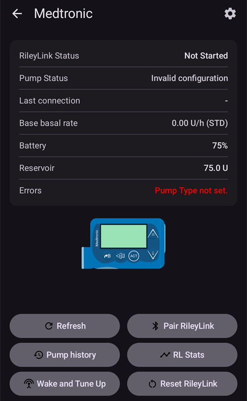
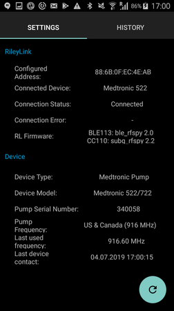

# Medtronic-pumpar

Drivrutinen fungerar inte med nyare modeller, inklusive alla modeller som slutar på G (530G, 600-serien [630G, 640G, 670G], 700-serien [770G, 780G] osv.).

Följande kombinationer av modell och firmware är kompatibla:

- 512/712 (alla firmwareversioner)
- 515/715 (alla firmwareversioner)
- 522/722 (alla firmwareversioner)
- 523/723 (firmware 2.4A eller lägre)
- 554/754 EU-version (firmware 2.6A eller lägre)
- 554/754 kanadensisk version (firmware 2.7A eller lägre)

Hur du kontrollerar pumpens firmware står i [OpenAPS-dokumentationen](https://openaps.readthedocs.io/en/latest/docs/Gear%20Up/pump.html#how-to-check-pump-firmware-check-for-absence-of-pc-connect) eller i [LoopDocs](https://loopkit.github.io/loopdocs/build/step3/#medtronic-pump-firmware).

    {contents} Innehåll
    :depth: 1
    :local: true

## Pumpens funktioner med AAPS

* Kräver en RileyLink-kompatibel enhet för att kommunicera med **AAPS**.
* Automatisk hantering av sommartid och tidszoner.

## Krav på hårdvara och programvara

- **Telefon:** Medtronic-drivrutinen bör fungera med alla Android-telefoner som har stöd för Bluetooth-anslutningar. **VIKTIGT: Telefontillverkare implementerar Bluetooth på olika sätt, så varje telefonmodell kan bete sig olika. Till exempel hanterar vissa telefoner på- och avstängning av Bluetooth på olika sätt. Det kan påverka hur det fungerar när AAPS behöver ansluta igen till din RileyLink-enhet.**
- **RileyLink-kompatibel enhet:** Android-telefoner kan inte kommunicera med Medtronic-pumpar utan en separat enhet som sköter kommunikationen. Enheten ansluter till telefonen via Bluetooth och till pumpen via en kompatibel radioanslutning. Den första sådana enheten hette RileyLink, men nu finns flera andra alternativ som kan ha fler funktioner.
    
    - RileyLink finns på [getrileylink.org](https://getrileylink.org/product/rileylink916)
    - Orangelink finns på [getrileylink.org](https://getrileylink.org/product/orangelink)
    - Emalink (flera modeller) finns på [github.com](https://github.com/sks01/EmaLink)
    - Gnarl (kräver lite extra gör-det-själv-arbete), mer information finns på [github.com](https://github.com/ecc1/gnarl)

En jämförelsetabell för olika RileyLink-kompatibla enheter finns på [getrileylink.org](https://getrileylink.org/rileylink-compatible-hardware-comparison-chart)

(MedtronicPump-configuration-of-the-pump)=

## Konfiguration av pumpen

Följande inställningar ska göras på pumpen för att AAPS ska kunna skicka kommandon på distans. Stegen för att göra varje ändring på en Medtronic 715 står inom parentes för varje inställning. De exakta stegen kan variera beroende på pumptyp och/eller firmwareversion.

- **Aktivera fjärrläge på pumpen** (tryck på Act på pumpen och gå till Utilities -> Remote Options, välj On och gör Add ID på nästa skärm och lägg till ett valfritt ID, till exempel 111111). Minst ett ID måste finnas i listan Remote ID för att pumpen ska ta emot fjärrkommunikation.
- **Ställ in Max Basal** (tryck på Act på pumpen och gå till Basal och välj sedan Max Basal Rate) Om du till exempel sätter värdet till fyra gånger din högsta standardbasal kan du få en tillfällig basal på 400 %. Det högsta värdet som pumpen tillåter är 34,9 enheter per timme.
- **Ställ in Max Bolus** (tryck på Act på pumpen och gå till Bolus och välj sedan Max Bolus) Det här är den största bolus som pumpen tar emot. Det högsta värdet som pumpen tillåter är 25.
- **Ställ in profilen på Standard**. (Tryck på Act på pumpen och gå till Basal och sedan Select Patterns) Pumpen behöver bara en profil, eftersom AAPS hanterar olika profiler på telefonen. Inga andra mönster (patterns) behövs.
- **Ställ in typ av tillfällig basal** (tryck på Act på pumpen och gå till Basal och sedan Temp Basal Type). Välj Absolute (inte Percent).

## Konfiguration av telefon/AAPS för Medtronic

- **Parkoppla inte den RileyLink-kompatibla enheten via Bluetooth-menyn på telefonen.** Om du parkopplar via Bluetooth-menyn på telefonen kan AAPS inte se din RileyLink-kompatibla enhet när du följer instruktionerna nedan.
- Stäng av automatisk skärmrotation på telefonen. På vissa enheter gör automatisk skärmrotation att Bluetooth-sessioner startar om, vilket kan ge problem med din Medtronic-pump. 
- Det finns två sätt att konfigurera din Medtronic-pump i AAPS:

1. Använd installationsguiden vid en ny installation
2. I **Konfiguration** > **Pump**, genom att välja **Medtronic**
    
    
    
    När det är valt visar kortet **Medtronic** två knappar, **Inställningar** och **Öppna plugin**:
    
    
    
    **Inställningar** öppnar inställningarna för Medtronic-drivrutinen:
    
    
    
    **Öppna plugin** (eller **Hantera** > **Pump**) öppnar pumpskärmen för Medtronic. Innan en pump har parkopplats ser den ut så här:
    
    

När du konfigurerar Medtronic-pumpen med installationsguiden kan det hända att du inte kan slutföra installationen på grund av Bluetooth-problem (t.ex. att du inte kan ansluta till pumpen). Om det händer ska du välja alternativet virtuell pump för att slutföra konfigurationen och sedan felsöka vidare med alternativ 2.

När du ställer in AAPS för din Medtronic-pump måste du ställa in följande i **Inställningar** (se bilden på inställningarna ovan):

- **Serienummer på pumpen**: Står på baksidan av pumpen och börjar med SN. Ange bara de 6 siffrorna, utan bokstäver (t.ex. 123456).
- **Pumptyp**: Den pumpmodell som du använder (t.ex. 522). 
- **Pumpfrekvens**: Det finns två alternativ, beroende på var pumpen ursprungligen såldes. Läs [Vanliga frågor](#MedtronicPump-faq) om du är osäker på vilket alternativ du ska välja: 
    - för USA & Kanada används frekvensen 916 MHz
    - för resten av världen används frekvensen 868 MHz
- **Max basal på pumpen (U/h)**: Måste vara samma som inställningen på pumpen (se Konfiguration av pumpen ovan). Välj även den här inställningen noga, eftersom den bestämmer hur mycket AAPS kan ge via din basal. Det här sätter i praktiken den högsta möjliga tillfälliga basalen. Om du till exempel sätter värdet till fyra gånger din högsta standardbasal kan du få en tillfällig basal på 400 %. Det högsta värdet som pumpen tillåter är 34,9 enheter per timme.
- **Max bolus på pumpen (U)** (per timme): Måste vara samma som inställningen på pumpen (se Konfiguration av pumpen ovan). Tänk noga igenom den här inställningen, eftersom den bestämmer hur stor bolus AAPS någonsin kan ge.
- **Fördröjning innan bolus startas (s)**: Antal sekunder från att en bolus ges tills kommandot faktiskt skickas till pumpen. Under den tiden kan du avbryta bolusen om ett boluskommando skickades av misstag. Det går inte att avbryta en bolus som har startat via AAPS. Det enda sättet att avbryta en bolus som redan har startat är att pausa pumpen manuellt och sedan återuppta den.
- **Medtronic-kodning**: Bestämmer var Medtronic-kodningen görs (i hårdvara eller i mjukvara). Det är bäst att välja hårdvarukodning (dvs. att den RileyLink-kompatibla enheten gör kodningen), eftersom mindre data då skickas. Att välja programvarukodning (dvs. att AAPS gör kodningen) kan hjälpa om anslutningen ofta bryts. Den här inställningen ignoreras om din RileyLink-enhet har firmwareversion 0.x.
- **Batterityp (Power View)**: För att den återstående batterinivån ska beräknas rätt ska du välja vilken typ av AAA-batteri du använder. När något annat än enkel vy är valt visar AAPS den beräknade återstående batterinivån i procent och volt. Följande alternativ finns:
    
    - Ej vald (enkel vy)
    - Alkaliskt (utökad vy)
    - Litium (utökad vy)
    - NiZn (utökad vy)
    - NiMH (utökad vy)
- **Använd sökning**: Aktiverar Bluetooth-sökning innan anslutning till dina RileyLink-kompatibla enheter. Det här bör göra anslutningen till enheten mer pålitlig.

- **Visa batterinivå som rapporteras av OrangeLink/EmaLink/DiaLink**: Den här funktionen stöds bara av nyare link-enheter som EmaLink eller OrangeLink. Värdet visas som **RileyLink-batteri** på pumpskärmen för Medtronic.
- **Sätt neutrala tillfälliga basaler**: Som standard piper Medtronic-pumpar varje hel timme när en tillfällig basal är aktiv. Om du aktiverar det här alternativet hör du färre pip, eftersom en tillfällig basal avbryts vid timskiftet så att pipet inte hörs.

(pairing-your-rileylink-compatible-device)=

### Parkoppla din RileyLink-kompatibla enhet

Din RileyLink-kompatibla enhet parkopplas från pumpskärmen för Medtronic, inte från Bluetooth-menyn på telefonen:

- Öppna pumpskärmen (**Hantera** > **Pump**, eller **Öppna plugin** på kortet Medtronic i **Konfiguration** > **Pump**).
- Tryck på **Parkoppla RileyLink**. **AAPS** söker efter RileyLink-kompatibla enheter i närheten.
- Tryck på din enhet i listan. När **RileyLink-parkoppling lyckades** visas trycker du på **OK**.

## Pumpskärmen för Medtronic

Gå till **Hantera** > **Pump** för att öppna pumpskärmen för Medtronic. Pumpskärmen visar aktuell pumpstatus och några åtgärder som är specifika för Medtronic (se bilden på pumpskärmen ovan).

- **RileyLink-status**: Aktuell status för anslutningen mellan telefonen och den RileyLink-kompatibla enheten. Den bör alltid visa Ansluten. Alla andra statusar kan kräva att du gör något. 
- **RileyLink-batteri**: Aktuell batterinivå för din EmaLink eller OrangeLink. Visas bara om **Visa batterinivå som rapporteras av OrangeLink/EmaLink/DiaLink** är aktiverat i Medtronic-inställningarna.
- **Pumpstatus**: Aktuell status för anslutningen till pumpen. Eftersom pumpen inte är ansluten hela tiden visas oftast sovikonen. Det finns flera andra möjliga statusar, till exempel "Väcker" när AAPS försöker skicka ett kommando, eller andra pumpkommandon som "Hämta tid", "Ställ in tillfällig basal" osv.
- **Batterinivå**: Visar batteristatus utifrån värdet som har valts för **Batterityp (Power View)** i Medtronic-inställningarna.
- **Senast ansluten**: Hur länge sedan den senaste lyckade anslutningen till pumpen var.
- **Senaste bolus**: Hur länge sedan den senaste lyckade bolusen gavs.
- **Profilens basaldos**: Den basaldos som pumpen ger den här timmen enligt din aktiva profil.
- **Tillfällig basal**: Den tillfälliga basal som ges just nu. Den kan vara 0 enheter per timme.
- **Reservoar**: Hur mycket insulin som finns i reservoaren (uppdateras minst en gång per timme).
- **Fel**: Felmeddelande om det finns ett problem (visas oftast vid fel i konfigurationen).

Längst ner på skärmen finns dessa knappar:

- **Uppdatera** uppdaterar pumpens aktuella status. Använd den bara om anslutningen har varit bruten länge, eftersom all data då måste hämtas igen (hämta historik, hämta/ställa in tid, hämta profil, hämta batteristatus osv.).
- **Parkoppla RileyLink**: Hittar och parkopplar din RileyLink-kompatibla enhet (se [ovan](#pairing-your-rileylink-compatible-device)).
- **Pumphistorik**: Visar pumphistoriken (se [nedan](#MedtronicPump-pump-history)).
- **RL-statistik**: Visar RL-statistik (se [nedan](#MedtronicPump-rl-status-rileylink-status)).
- **Väck och finjustera frekvens** och **Återställ RileyLink**: Se [Åtgärder](#medtronic-actions) nedan.
- **Ta bort bolusblockering**: Visas bara en kort stund efter en bolus, medan **AAPS** väntar på att pumpen ska ge klart bolusen. Om du trycker på den avslutas väntan.

(MedtronicPump-pump-history)=

## Pumphistorik

Pumphistoriken hämtas var 5:e minut och sparas lokalt. Bara historik för de senaste 24 timmarna sparas. Här kan du enkelt se hur pumpen har betett sig, om det behövs. Bara poster som är relevanta för AAPS sparas, så konfigurationsfunktioner som inte är relevanta finns inte med.

Tryck på **Pumphistorik** på pumpskärmen för att öppna den. Som standard är **Alla** valt. Tryck på en av filterknapparna högst upp (till exempel **Bolusar**, **Basaldoser** eller **Larm**) för att bara visa en typ av poster.

(MedtronicPump-rl-status-rileylink-status)=

## RL-status (RileyLink-status)

 

Dialogrutan RL-status har två flikar:

- **Inställningar**: Visar inställningar för den RileyLink-kompatibla enheten: konfigurerad adress, ansluten enhet, anslutningsstatus, anslutningsproblem och RileyLinks firmwareversioner. Enhetstyp är alltid Medtronicpump, Modell är din modell, Serienummer är det konfigurerade serienumret, Pumpfrekvens visar vilken frekvens du använder och Senaste frekvens är den frekvens som användes senast.
- **Historik**: Visar kommunikationshistoriken. Poster med RileyLink visar tillståndsändringar för RileyLink och poster med Medtronic visar vilka kommandon som skickades till pumpen.

(medtronic-actions)=

## Actions

När Medtronic-drivrutinen används finns två extra åtgärder på pumpskärmen (**Hantera** > **Pump**):

- **Väck och finjustera frekvens** - Om AAPS inte har anslutit till pumpen på länge (den ska ansluta var 5:e minut) kan du tvinga fram en frekvensjustering (Tune Up). Det här försöker nå pumpen genom att söka igenom alla radiofrekvenser som pumpen kan använda. Om en anslutning lyckas sparas den frekvens som fungerade som standard. Medan frekvensjusteringen pågår visas det i RileyLink-status på pumpskärmen. Om en frekvensjustering misslyckas (till exempel för att pumpen var utom räckhåll) försöker **AAPS** igen av sig själv ungefär var 10:e minut.
- **Återställ RileyLink** - Om du återställer din RileyLink-kompatibla enhet kan du behöva använda den här åtgärden så att enheten konfigureras igen (frekvens, frekvenstyp och kodning ställs in).

## Viktigt att veta

### Var särskilt noga med NS-konfigurationen

AAPS använder serienumret för synkronisering, och serienumret syns i NS. Den som känner till serienumret på en gammal Medtronic-pump kan använda det för att styra pumpen på distans. Var därför extra noga med att skydda din NS-sida så att pumpens serienummer inte läcker ut. Se https://nightscout.github.io/nightscout/security/

### OpenAPS-användare

OpenAPS-användare bör notera att AAPS med Medtronic fungerar på ett helt annat sätt än OpenAPS. Med AAPS sker kontakten med pumpen främst via telefonen. Vid normal användning behöver du troligen bara använda pumpens meny när du byter reservoar. Det är mycket annorlunda mot OpenAPS, där åtminstone en del av en bolus oftast ges med pumpens knappar för snabb bolus. Om pumpen används för att ge en bolus manuellt kan det bli problem om AAPS försöker ge en bolus samtidigt. Det finns kontroller som ska förhindra problem i sådana fall, men du bör ändå undvika det så långt det går.

### Loggning

Om du behöver felsöka din Medtronic-pump väljer du menyikonen uppe till vänster på skärmen och väljer Underhåll och Loggningsinställningar. Vid felsökning av Medtronic-problem ska Pump, PumpComm och PumpBTComm kontrolleras.

### Medtronic CGM

Medtronic CGM stöds för närvarande INTE.

### Manuell användning av pumpen

Undvik att ge bolus eller ställa in tillfälliga basaler manuellt på pumpen. Alla sådana kommandon ska skickas via AAPS. Om du ändå ger kommandon manuellt måste det gå minst 3 minuter mellan dem för att minska risken för problem.

### Byte av tidszon och sommartid (DST), eller resor med Medtronic-pump och AAPS

AAPS upptäcker automatiskt byte av tidszon och uppdaterar pumpens tid när telefonen byter till den nya tiden.

Om du reser österut lägger du till timmar till aktuell tid (t.ex. från GMT+0 till GMT+2). Det ger inga problem eftersom det inte blir någon överlappning (det går t.ex. inte att få samma timme två gånger). Att resa västerut kan däremot ge problem, eftersom du i praktiken går tillbaka i tiden. Det kan ge felaktiga IOB-data.

Utvecklarna känner till problemen vid resor västerut och arbetar på en möjlig lösning. Se https://github.com/andyrozman/RileyLinkAAPS/issues/145 för mer information. Tills vidare: tänk på att problemet kan uppstå och övervaka noga när du byter tidszon.

### Är GNARL en helt kompatibel RileyLink-kompatibel enhet?

GNARL-koden stöder fullt ut alla funktioner som Medtronic-drivrutinen i AAPS använder, vilket betyder att den är helt kompatibel. Observera att det här kräver extra arbete, eftersom du måste skaffa kompatibel hårdvara och sedan ladda GNARL-koden till enheten.

**Kommentar från författaren:** Observera att GNARL-programvaran fortfarande är experimentell och lite testad, och den ska inte anses vara lika säker att använda som en RileyLink.

(MedtronicPump-faq)=

## Vanliga frågor (FAQ)

(MedtronicPump-what-to-do-if-i-loose-connection-to-rileylink-and-or-pump)=

### Vad gör jag om jag tappar anslutningen till RileyLink och/eller pumpen?

Det finns flera saker du kan prova för att lösa anslutningsproblem.

- Tryck på **Väck och finjustera frekvens** på pumpskärmen (**Hantera** > **Pump**) enligt beskrivningen ovan.
- Stäng av Bluetooth på telefonen, vänta 10 sekunder och slå sedan på det igen. Då tvingas RileyLink-enheten att ansluta till telefonen igen.
- Återställ RileyLink-enheten. Sedan måste du trycka på **Återställ RileyLink** på pumpskärmen (**Hantera** > **Pump**).
- Andra användare har sett att följande steg kan återställa anslutningen när andra metoder inte har fungerat: 
    1. Starta om telefonen
    2. *Medan* telefonen startar om, starta om RileyLink-enheten
    3. Öppna AAPS och låt anslutningen återställas

### Så tar du reda på vilken frekvens din pump använder

På baksidan av pumpen finns en rad med ditt modellnummer och en särskild kod på 3 bokstäver. De två första bokstäverna anger frekvenstypen och den sista anger färgen. Möjliga värden för frekvens:

- NA - Nordamerika (i frekvensvalet ska du välja "USA & Kanada (916 MHz)")
- CA - Kanada (i frekvensvalet ska du välja "USA & Kanada (916 MHz)")
- WW - Hela världen (i frekvensvalet ska du välja "Resten av världen (868 MHz)")

(MedtronicPump-pump-unreachable)=

### Så åtgärdar du felet "Pumpen kan inte nås"

Vissa Medtronic-pumpar rapporterar felet "Pumpen kan inte nås" efter en uppdatering av **AAPS**. Åtgärda det genom att byta kodningstyp:

1. Gå till **Konfiguration** > **Pump** och tryck på **Inställningar** på kortet **Medtronic**.
2. Ställ in **Medtronic-kodning** på **Hårdvara 4b6b-kodning**.

## Var du kan få hjälp

Medtronic-drivrutinen utvecklas av communityn på **frivillig** basis. Innan du ber om hjälp:

1. **Läs** det avsnitt i den här dokumentationen som gäller, för att se hur funktionen är tänkt att fungera.
2. **Fråga** i kanalen *#AAPS* på [Discord](https://discord.gg/4fQUWHZ4Mw) eller i någon av de andra [kanalerna i communityn](../GettingHelp/WhereCanIGetHelp.md).
3. **Rapportera en bugg** genom att först söka bland [befintliga ärenden](https://github.com/nightscout/AndroidAPS/issues). Om ditt problem inte finns där, skapa ett [nytt ärende](https://github.com/nightscout/AndroidAPS/issues) och bifoga dina [loggfiler](../GettingHelp/AccessingLogFiles.md).

När du ber om hjälp, ange telefonens märke och modell, Android-version, version av **AAPS** och en enkel och tydlig beskrivning av problemet (vad som ändrades, när det senast fungerade).