(medtrum-nano-300u)=
# Medtrum Nano 200U / 300U

Dessa instruktioner gäller inställning av insulinpumpen Medtrum.

```{contents} Table of contents
:depth: 1
:local: true
```

## Pumpens funktioner med AAPS
* All loop-funktionalitet stöds (SMB, tillfällig basal osv.)
* Automatisk hantering av sommartid och tidszoner
* Förlängd bolus stöds inte av drivrutinen i AAPS

## Krav på hårdvara och programvara
* **Kompatibla Medtrum-pumpbaser och reservoarpoddar**
    - Stöds just nu:
        - Medtrum TouchCare Nano 200U med pumpbas ref: **MD0201** och **MD8201**.
        - Medtrum TouchCare 300U med pumpbas ref: **MD8301**.
        - Om du har en modell som inte stöds och vill donera hårdvara eller hjälpa till med tester, kontakta oss via Discord [här](https://discordapp.com/channels/629952586895851530/1076120802476441641).
* **AAPS byggd och installerad** enligt instruktionerna i [Bygga APK](../SettingUpAaps/BuildingAaps.md).
* **Kompatibel Android-telefon** med Bluetooth (BLE)
    - Se [Versionsinformation](../Maintenance/ReleaseNotes.md) för AAPS

## Innan du börjar

**SÄKERHETEN FÖRST** Gör inte detta i en miljö där du inte kan återhämta dig från ett fel (extra poddar, insulin och enheter för att styra pumpen är ett måste).

**PDM:en och Medtrum-appen fungerar inte med en pod som har aktiverats av AAPS.** Tidigare har du kanske använt din PDM eller Medtrum-appen för att skicka kommandon till pumpen. Av säkerhetsskäl kan du bara använda den aktiverade podden med den enhet eller app som användes för att aktivera den.

*Det betyder INTE att du ska slänga din PDM. Vi rekommenderar att du förvarar den på ett säkert ställe som reserv i nödfall, till exempel om du tappar bort telefonen eller om AAPS inte fungerar som det ska.*

**Pumpen slutar inte att ge insulin när den inte är ansluten till AAPS** Standarddoserna för basal programmeras i pumpen enligt den profil som är aktiv just nu. Så länge AAPS fungerar skickar den kommandon för tillfällig basal som pågår i högst 120 minuter. Om pumpen av någon anledning inte får några nya kommandon (till exempel för att kommunikationen bröts på grund av avståndet mellan pump och telefon) går pumpen tillbaka till den standardbasal som är programmerad i pumpen när den tillfälliga basalen tar slut.

**Profilen i AAPS stöder inte tidsintervall på 30 minuter för basaldoser** Om du är ny med AAPS och ställer in din basalprofil för första gången: basaldoser som börjar på halvtimmen stöds inte, och du måste justera din basalprofil så att varje dos börjar på hel timme. Om du till exempel har en basaldos på 1,1 enheter som börjar 09:30 och pågår i 2 timmar till 11:30, så fungerar det inte. Du måste ändra denna basaldos på 1,1 enheter till tidsintervallet 9:00-11:00 eller 10:00-12:00. Även om själva Medtrum-pumpen stöder steg på 30 minuter i basalprofilen kan AAPS för närvarande inte ta hänsyn till dem i sina algoritmer.

**Basaldoser på 0 U/h i profilen stöds INTE i AAPS** Medtrum-pumpen stöder visserligen basaldosen noll, men AAPS använder multiplar av profilens basaldos för att bestämma automatiska behandlingar och kan därför inte fungera med basaldosen noll. Den lägsta basaldosen i profilen är 0,05 U/h.

En tillfällig basal på noll kan du få med funktionen "Koppla från pumpen" eller genom att kombinera Inaktivera loop/tillfällig basal eller Pausa loop/tillfällig basal.

## Ställa in

```{caution}
När du aktiverar en pod med **AAPS** **MÅSTE** du stänga av alla andra enheter som kan kommunicera med Medtrum-pumpbasen, till exempel en aktiv PDM eller Medtrum-appen.
```

### Steg 1: Välj Medtrum-pumpen

#### Alternativ 1: Nya installationer

Om du installerar **AAPS** för första gången leder guiden **Installationsguide** dig genom inställningen. Välj **Medtrum** när du kommer till steget **Pump**.

Om du är osäker kan du också välja **Virtuell pump** och välja **Medtrum** senare, när du har ställt in **AAPS** (se alternativ 2).


#### Alternativ 2: Skärmen Konfiguration

I en befintlig installation kan du välja pumpen **Medtrum** under [Konfiguration > Pump](#Config-Builder-pump):

Öppna **menyn** (☰) uppe till vänster, tryck på **Konfiguration** > **Pump** och välj kortet **Medtrum**. Bara en pump kan vara aktiv åt gången.


När det är valt visar kortet **Medtrum** två knappar, **Inställningar** och **Öppna plugin**:


**Öppna plugin** (eller **Hantera → Pump**) öppnar pumpskärmen för Medtrum. Där byter du poddar och ser pumpens status. Innan en pod har aktiverats ser den ut så här:


(medtrum-step-2)=
### Steg 2: Ändra Medtrum-inställningarna

Tryck på **Inställningar** på kortet **Medtrum** under **Konfiguration** > **Pump**. Du kan också trycka på kugghjulsikonen uppe till höger på pumpskärmen för Medtrum. Då öppnas **Inställningar för Medtrum-pump**:

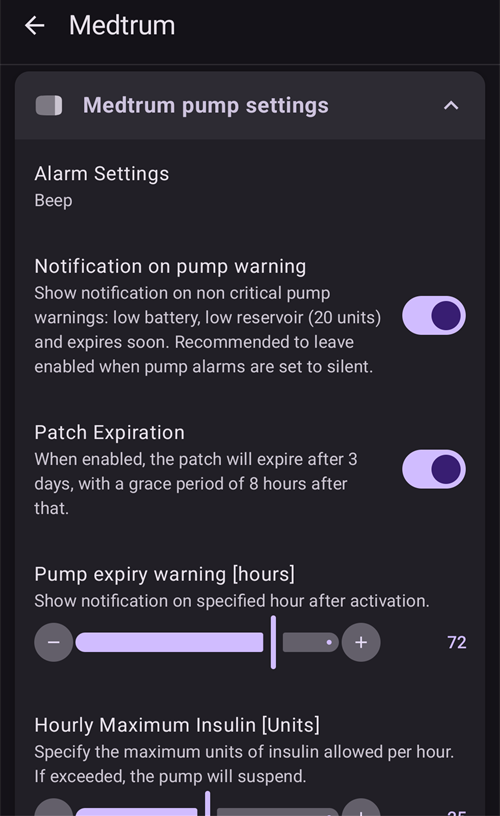

```{note}
Det finns ingen inställning för **Serienummer** längre. **AAPS** hittar din pumpbas med en Bluetooth-skanning första gången du aktiverar en pod (se [Steg 3](#medtrum-activate-patch)) och sparar dess serienummer. Om du vill använda en annan pumpbas, se [Ta bort parkoppling](#medtrum-unpair).
```

#### Larminställningar

***Standard: Pip.***

Den här inställningen ändrar hur pumpen varnar dig när det finns en varning eller ett fel.

- **Pip**: podden piper vid larm och varningar.
- **Ljudlös**: podden varnar dig inte vid larm och varningar.

Obs: I ljudlöst läge larmar **AAPS** ändå, beroende på volyminställningarna i din telefon. Om du inte reagerar på larmet piper podden till slut.

#### Avisering vid pumpvarning

***Standard: Aktiverad.***

Den här inställningen ändrar hur **AAPS** visar aviseringar för pumpvarningar som inte är kritiska. När den är aktiverad visas en avisering i telefonen när en pumpvarning uppstår, till exempel:
- Låg batterinivå
- Låg reservoarnivå i pumpen (20 enheter)
- Pumpen löper ut snart

Vi rekommenderar att du har den aktiverad när pumpens larm är inställda på **Ljudlös**. I båda fallen visas dessa varningar också på pumpskärmen för Medtrum under [Aktiva larm](#medtrum-active-alarms).

(medtrum-patch-expiration)=
#### Poddens utgångsdatum

***Standard: Aktiverad.***

Den här inställningen ändrar hur podden beter sig. När den är aktiverad löper podden ut efter 3 dagar och ger en hörbar varning om du har ljud aktiverat. Efter 3 dagar och 8 timmar slutar podden att fungera.

Om inställningen är avaktiverad varnar podden dig inte innan den slutar fungera. Med nyare firmware i pumpbasen fungerar en pod i högst 5 dagar.

#### Varning om att pumpen löper ut [timmar]

***Standard: 72 timmar.***

Den här inställningen ändrar tiden för varningen om att podden löper ut. När [Poddens utgångsdatum](#medtrum-patch-expiration) är aktiverat visar **AAPS** en avisering så här många timmar efter aktiveringen.

#### Maximalt insulin per timme [enheter]

***Standard: 25 U.***

Den här inställningen ändrar den största mängd insulin som kan ges under en timme. Om gränsen överskrids pausas podden och ger ett larm. Du kan återställa larmet med knappen **Återställ larm** på pumpskärmen, se [Återställ larm](#nano-reset-alarms).

Ställ in ett rimligt värde utifrån ditt insulinbehov.

#### Maximalt insulin per dag [enheter]

***Standard: 80 U.***

Den här inställningen ändrar den största mängd insulin som kan ges under en dag. Om gränsen överskrids pausas podden och ger ett larm. Du kan återställa larmet med knappen **Återställ larm** på pumpskärmen, se [Återställ larm](#nano-reset-alarms).

Ställ in ett rimligt värde utifrån ditt insulinbehov.

#### Skanna vid anslutningsfel

***Standard: Av.***

Finns under **Avancerade inställningar**.

Aktivera detta endast om du har anslutningsproblem. När den är aktiverad söker drivrutinen efter pumpen igen innan den försöker återansluta till den. Se till att behörigheten Plats för **AAPS** är inställd på "Tillåt alltid".

### Steg 2b: Larminställningar i AAPS

Dessa inställningar är inte en del av Medtrum-drivrutinen. Du öppnar dem med ikonen **Inställningar** (kugghjulet) uppe till höger på huvudskärmen. Se [Inställningar](../SettingUpAaps/Preferences.md) för mer information.

#### BT Watchdog

Öppna **Inställningar** > **Pump**:


**BT Watchdog** stänger av telefonens Bluetooth i en sekund om **AAPS** inte kan ansluta till pumpen. Det kan hjälpa på vissa telefoner där Bluetooth hänger sig.

Aktivera den här inställningen om du ofta har problem med anslutningen till pumpen.

#### Lokala larm

Öppna **Inställningar** > **Lokala larm**:


##### Varna om pumpen inte går att nå

***Standard: Aktiverad.***

Den här inställningen är alltid på när Medtrum-drivrutinen är aktiverad. Den varnar dig när pumpen inte går att nå. Det kan hända när pumpen är utom räckhåll, eller när den inte svarar på grund av en trasig pod eller pumpbas, till exempel när vatten läcker in mellan pumpbasen och podden.

Av säkerhetsskäl går det inte att stänga av den här inställningen.

##### Tröskel för otillgänglig pump

***Standard: 30 min.***

Den här inställningen ändrar hur länge **AAPS** väntar innan du får en varning om att pumpen inte går att nå.

Du kan ändra den här inställningen när du använder Medtrum-pumpen, men av säkerhetsskäl rekommenderar vi att du behåller 30 minuter.

(medtrum-activate-patch)=
### Steg 3: Aktivera podden

**Innan du fortsätter:**
- Ha din Medtrum-pumpbas och en ny reservoarpod redo.
- Stäng av andra enheter som kan kommunicera med Medtrum-pumpen (PDM och Medtrum-appen).
- Se helst till att **AAPS** är inställd och att en [profil är aktiverad](../DailyLifeWithAaps/ProfileSwitch-ProfilePercentage.md). Om ingen profil är aktiv börjar aktiveringen med steget **Profil krävs**, där du väljer vilken profil som ska aktiveras.

#### Starta aktiveringen

Öppna [pumpskärmen för Medtrum](#nano-overview) (**Hantera → Pump**) och tryck på **Byt pod**. Om du har ställt in [skydd för inställningar](#Preferences-protection) måste du först ange ditt lösenord eller din PIN-kod.

Om en pod redan är aktiv ombeds du först inaktivera den, se [Inaktivera podden](#nano-deactivate-patch).

Aktiveringen är en guide som går steg för steg. Följ anvisningarna för att fylla och aktivera en ny pod. Tryck på **Avbryt** i vilket steg som helst för att avbryta.

```{important}
Sätt podden på kroppen och för in kanylen först när guiden säger åt dig att göra det (efter att förfyllningen är slutförd).
```

Vilka steg du ser först beror på din inställning:

1. **Profil krävs**: bara om ingen profil är aktiv. Välj vilken profil som ska användas och fortsätt sedan.
2. **Hitta pumpen**: bara första gången, eller efter att du har använt [Ta bort parkoppling](#medtrum-unpair). Anslut pumpbasen till en ny pod för att slå på den. **AAPS** söker efter Medtrum-pumpbaser i närheten (deras namn börjar med `MT`). Tryck på din i listan. **AAPS** sparar dess serienummer och går sedan direkt till fyllning av podden.

   

3. **Aktivera pod**: bara när **AAPS** redan känner till din pumpbas. På skärmen står det "Ingen aktiv pod. Tryck på **Nästa** för att påbörja aktiveringsprocessen." Se till att pumpbasen **inte** är ansluten till podden ännu, och tryck sedan på **Nästa**.

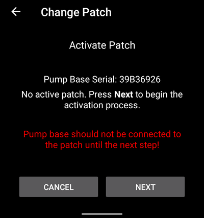

#### Anslut och fyll podden

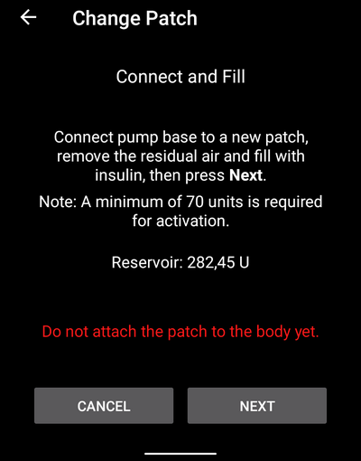

Anslut pumpbasen till podden, ta bort kvarvarande luft och fyll podden med insulin. Minst 70 enheter krävs för aktivering. Skärmen visar reservoarnivån. Fäst inte podden på kroppen ännu.

När podden har upptäckts och fyllts visas knappen **Nästa**. Tryck på den.

#### Välj insulin

Det här steget visas bara om du har ställt in mer än ett insulin i **AAPS**. Välj det insulin som du fyller podden med. **AAPS** gör ett profilbyte med detta insulin efter aktiveringen.

#### Förfyll podden

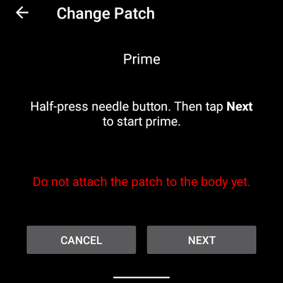

Ta **inte** bort säkerhetslåset. Halvtryck på nålknappen på podden och tryck sedan på **Nästa** för att starta förfyllningen.

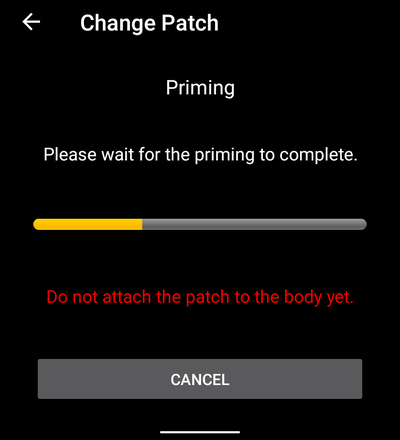

Vänta tills förfyllningen är slutförd.

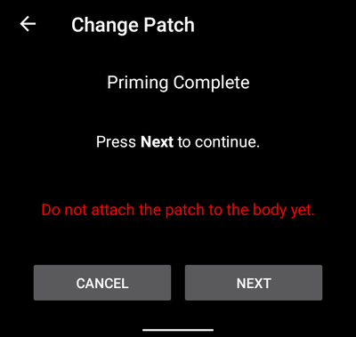

När förfyllningen är slutförd trycker du på **Nästa** för att fortsätta.

#### Platsrotation

Det här steget visas bara om du hanterar pumpplatser med [Platsrotation](#Aapsscreens-site-rotation) (inställningen **Hantera pumpplatsrotation**). Välj var på kroppen du sätter podden, eller hoppa över det här steget.

#### Sätt fast podden

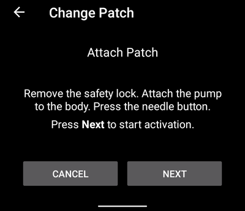

Rengör huden och ta bort skyddsfilmerna. Ta bort säkerhetslåset, fäst podden på kroppen och tryck på nålknappen för att föra in kanylen.

Tryck på **Nästa** för att aktivera podden.

#### Aktivera podden

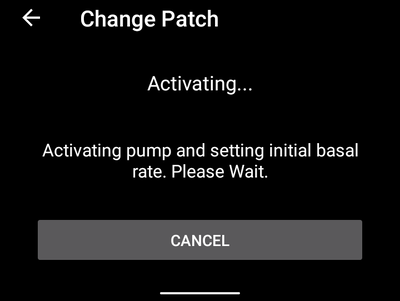

**AAPS** aktiverar pumpen och ställer in den första basaldosen. Vänta. När aktiveringen är slutförd visas den här skärmen:

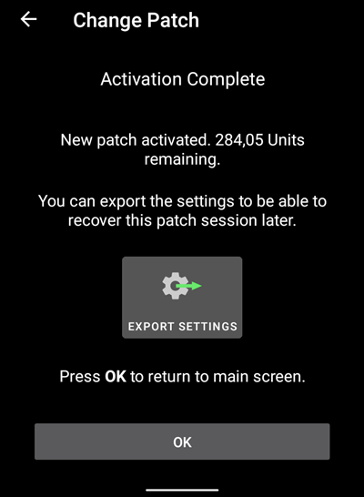

```{admonition} Older screenshot
:class: note
Förutom **Hitta pumpen** kommer skärmbilderna för aktiveringen ovan från en tidigare version av **AAPS** och kan se annorlunda ut i **AAPS** 4.
```

Den visar hur många enheter som finns kvar i podden. Tryck på **OK** för att återgå till pumpskärmen.

```{tip}
Efter en ny aktivering, [exportera dina inställningar](../Maintenance/ExportImportSettings.md). Då kan du återställa den här pod-sessionen senare, till exempel i en ny telefon.
```

(nano-deactivate-patch)=

### Inaktivera podden

För att inaktivera den aktiva podden öppnar du [pumpskärmen för Medtrum](#nano-overview) (**Hantera → Pump**) och trycker på **Byt pod**.

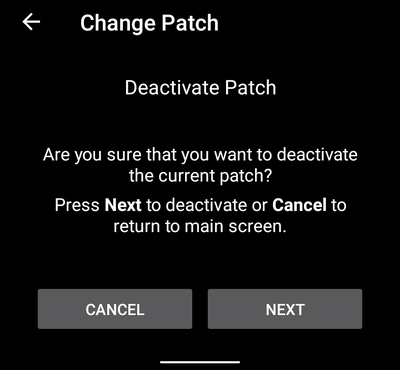

Du ombeds bekräfta att du vill inaktivera den nuvarande podden. **Detta kan inte ångras.** Tryck på **Nästa** för att inaktivera, eller på **Avbryt** för att återgå till pumpskärmen.

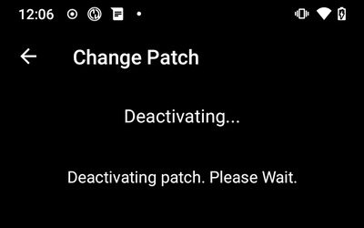

Om **AAPS** inte kan inaktivera podden (till exempel för att pumpbasen redan har tagits bort från podden), tryck på **Kassera** för att glömma den nuvarande pod-sessionen. Sedan kan du aktivera en ny pod.

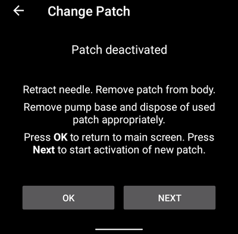

När inaktiveringen är slutförd drar du tillbaka nålen och tar bort podden från kroppen. Ta bort pumpbasen och kassera den använda podden. Tryck på **OK** för att återgå till pumpskärmen, eller på **Nästa** för att börja aktivera en ny pod.

(nano-resume-interrupted-activation)=

### Återuppta en avbruten aktivering

Om en aktivering av en pod avbryts, till exempel för att telefonens batteri tar slut, kan du återuppta den. Öppna [pumpskärmen för Medtrum](#nano-overview) (**Hantera → Pump**) och tryck på **Byt pod**.

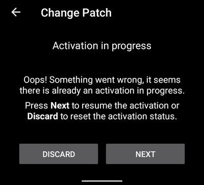

Tryck på **Nästa** för att återuppta aktiveringen. Tryck på **Kassera** för att återställa aktiveringsstatus, så att du kan aktivera en ny pod.

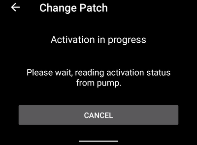

```{admonition} Older screenshot
:class: note
Skärmbilderna i **Inaktivera podden** och **Återuppta en avbruten aktivering** kommer från en tidigare version av **AAPS** och kan se annorlunda ut i **AAPS** 4.
```

Drivrutinen läser aktiveringsstatus från pumpen. Om det fungerar fortsätter guiden i det steg där den stannade.

(nano-overview)=

## Pumpskärm

Pumpskärmen för Medtrum (**Hantera → Pump**) visar aktuell status för Medtrum-podden. Där finns också knappar för att byta pod, återställa larm och uppdatera status. En banderoll högst upp visar viktiga tillstånd, till exempel **Podden är inte aktiverad** eller **Pumpen är pausad**.


Skärmen kan visa dessa rader. Vissa rader visas bara när de har ett värde.

- **Senast ansluten**: hur länge sedan **AAPS** senast anslöt till pumpen.
- **Senaste bolus**: den senaste bolusen som gavs.
- **Batterinivå**: poddens aktuella batterispänning.
- **Reservoar**: aktuell reservoarnivå.
- **Serienummer**: serienumret på din pumpbas.
- **Pumpstatus**: pumpens aktuella tillstånd. Till exempel **Aktiv** (podden är aktiverad och fungerar normalt) eller **Stoppad** (podden är inte aktiverad).
- **Profilens basaldos**: basaldosen från din profil som gäller just nu.
- **Tillfällig basal**: den tillfälliga basalen, om en sådan pågår.
- **Aktiv bolus**: den bolus som ges just nu.
- **Aktiva larm**: se [nedan](#medtrum-active-alarms).
- **Pumptyp**: modellen på din pumpbas.
- **FW-version**: pumpbasens firmwareversion.
- **Pod-nr**: löpnumret för den aktiverade podden. Det ökar med ett varje gång du aktiverar en ny pod.
- **Aktivering**: datum och tid när podden aktiverades, och hur länge sedan det var.
- **Podden löper ut**: datum och tid när podden löper ut. Visar **Ej aktiverad** om [Poddens utgångsdatum](#medtrum-patch-expiration) är avstängt.

(medtrum-active-alarms)=
### Aktiva larm

Den här raden visar alla larm som är aktiva just nu, till exempel låg reservoarnivå eller en pod som snart löper ut.

### Uppdatera

Den här knappen uppdaterar poddens status. Den finns bara när en pod är aktiv och **AAPS** inte är ansluten till pumpen just då.

### Byt pod

Den här knappen startar guiden för att byta pod. Se [Aktivera podden](#medtrum-activate-patch) för mer information.

(medtrum-unpair)=
### Ta bort parkoppling

Den här knappen visas bara när **AAPS** känner till en pumpbas. Den raderar pumpbasens sparade serienummer och kopplar ifrån. Nästa gång du aktiverar en pod söker **AAPS** efter en pumpbas igen (steget **Hitta pumpen**). Använd detta om du byter till en annan pumpbas. Gör det bara när ingen pod är aktiv.

(nano-reset-alarms)=

### Återställ larm

Knappen **Återställ larm** visas bara på pumpskärmen när podden har pausat sig själv, till exempel efter ett larm om maximalt insulin per dag. Tryck på den för att återställa larmen och återuppta insulinleveransen.

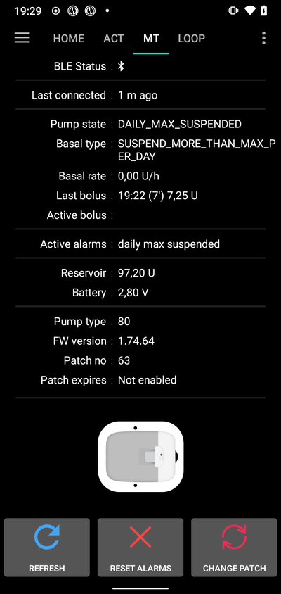

```{admonition} Older screenshot
:class: note
Skärmbilden ovan är från en tidigare **AAPS**-version. I **AAPS** 4 ser pumpskärmen annorlunda ut, men knappen **Återställ larm** fungerar på samma sätt.
```

## Byta telefon, exportera/importera inställningar

När du byter till en ny telefon gör du så här:
* [Exportera inställningarna](../Maintenance/ExportImportSettings.md) i din gamla telefon.
* För över inställningsfilen från den gamla telefonen till den nya och importera den i **AAPS**. Markera **Byt även pumpinställningar** på importskärmen, annars förs pod-sessionen inte över till den nya telefonen.

Den importerade inställningsfilen måste vara från den pod-session som du använder nu, annars ansluter inte podden (se [Slanglösa pumpar](#ExportImportSettings-tubeless-pumps)).

Efter en import av inställningar synkroniserar drivrutinen historiken med pumpen. Det kan ta en stund, beroende på hur gammal inställningsfilen är. Förloppet ("Synkroniserar poster, ... kvar") visas på huvudskärmen:


(medtrum-nano-troubleshooting)=

## Felsökning

### Anslutningsproblem

Om anslutningen avbryts på grund av timeout eller om du har andra anslutningsproblem:
- I Androids appinställningar för **AAPS**, ställ in behörigheten Plats på "Tillåt alltid".
- Prova att aktivera **Skanna vid anslutningsfel** (Medtrum-inställningar > **Avancerade inställningar**) och **BT Watchdog** (**Inställningar** > **Pump**), se [Steg 2](#medtrum-step-2).

### Bluetooth-problem
För kända problem med Bluetooth-anslutningar, avbrott mot pumpar/poddar eller problem med aktivering och anslutning, se [Felsökning av Bluetooth](../GettingHelp/BluetoothTroubleshooting.md)

### Aktiveringen avbröts

Om aktiveringen avbryts, till exempel för att telefonens batteri tar slut eller telefonen kraschar, kan du återuppta den. Tryck på **Byt pod** på pumpskärmen och följ stegen i [Återuppta en avbruten aktivering](#nano-resume-interrupted-activation).

### Förebygga pod-fel

Podden kan ge många olika fel. För att undvika fel som återkommer ofta:
- Se till att pumpbasen sitter ordentligt i podden och att inga glipor syns.
- Tryck inte för hårt på kolven när du fyller podden. Försök inte fylla podden med mer än maxmängden för din modell.

## Var du kan få hjälp

Allt utvecklingsarbete för Medtrum-drivrutinen görs av communityn på **frivillig** basis. Tänk på det och följ dessa riktlinjer innan du ber om hjälp:

-  **Nivå 0:** Läs det relevanta avsnittet i den här dokumentationen så att du förstår hur funktionen som du har problem med ska fungera.
-  **Nivå 1:** Om du fortfarande har problem som du inte kan lösa med hjälp av det här dokumentet, gå till kanalen *#Medtrum* på **Discord** med [den här inbjudningslänken](https://discord.gg/4fQUWHZ4Mw).
-  **Nivå 2:** Sök bland befintliga ärenden för att se om ditt problem redan har rapporterats under [Issues](https://github.com/nightscout/AAPS/issues). Om det finns, bekräfta/kommentera/lägg till information om ditt problem. Om inte, skapa ett [nytt ärende](https://github.com/nightscout/AndroidAPS/issues) och bifoga [dina loggfiler](../GettingHelp/AccessingLogFiles.md).
-  **Ha tålamod – de flesta i vår community är vänliga frivilliga, och att lösa problem kräver ofta tid och tålamod från både användare och utvecklare.**