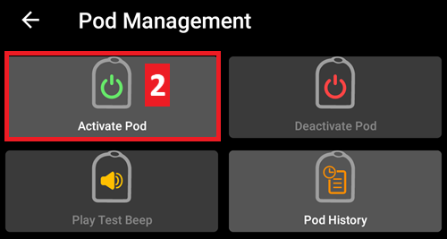
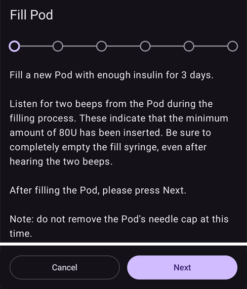
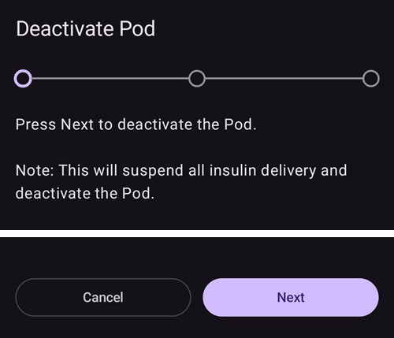
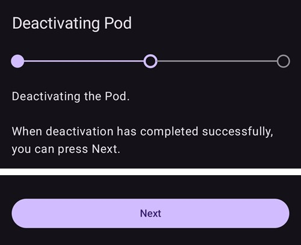
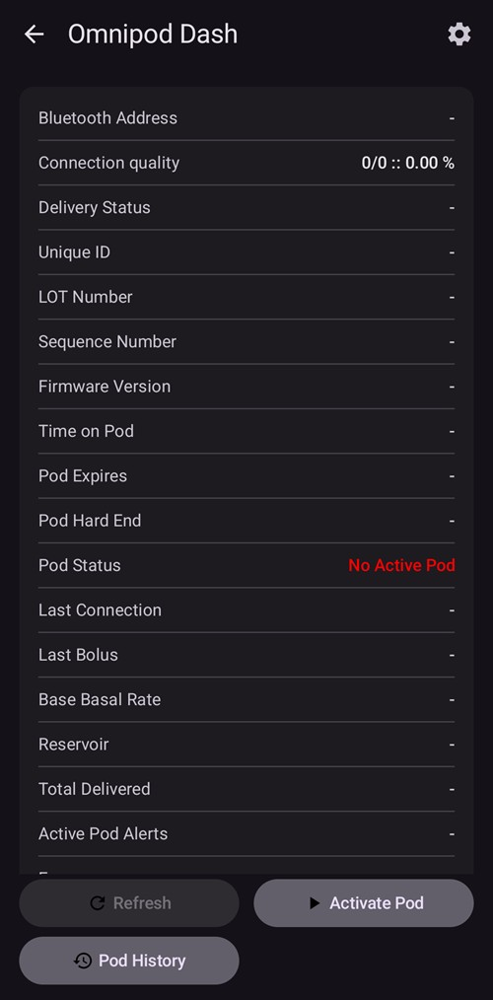
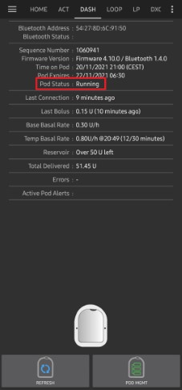
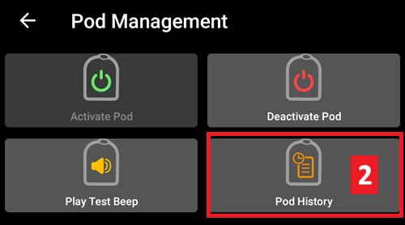

# Omnipod DASH

Dessa instruktioner gäller för att ställa in pumpen av generationen **Omnipod DASH** **(INTE Omnipod Eros)**. DASH-drivrutinen är ett väl beprövat sätt att loopa med Omnipod.

```{contents} Table of contents
:depth: 1
:local: true
```

## Specifikationer för Omnipod DASH

Viktiga egenskaper för **Omnipod DASH** ('DASH'):

- DASH-poddar känns igen på det **blå nålskyddet** (den äldre EROS-podden har ett genomskinligt nålskydd). I övrigt är poddarna identiska när det gäller fysiska mått.
- DASH behöver ingen BLE-länk/brygga (ingen RileyLink, OrangeLink eller EmaLink behövs).
- DASH använder Bluetooth-anslutningen bara när ett kommando skickas (t.ex. en bolus), och kopplar ner direkt efter att kommandot har skickats.
- **AAPS** väntar tills podden går att nå för att skicka kommandon.
- Vid aktivering av podden hittar och ansluter **AAPS** till en ny DASH-pod.
- Förväntad räckvidd från telefonen: 5–10 meter (kan variera).

(omnipod-dash-constraints)=

## Kända begränsningar och problem med Omnipod DASH i AAPS
- Det allmänna rådet är att köra **AAPS** på Android 14 eller 16. Communityn har rapporterat många [problem](https://github.com/nightscout/AndroidAPS/issues/3471) med Android 15. Om du ändå kör Android 15 behöver du troligen slå på **Bluetooth-bindning (bonding)** (i avsnittet **Avancerade inställningar** i [Dash-inställningarna](#omnipod-dash-advanced-settings)) för att kunna aktivera och använda poddar. Se [Allmän felsökning](../GettingHelp/GeneralTroubleshooting.md) för mer information om inställningarna för bindning.
- Byte till/från sommartid och byte av tidszon tillämpas inte automatiskt. Efter en tidsändring måste du uppdatera podden manuellt: tryck på **Uppdatera** på DASH-pumpskärmen och tryck sedan på **Ställ in tid** (visas när poddens och telefonens tidszoner skiljer sig åt) eller gör ett **Profilbyte** (se [Byte av tidszon för Omnipod Dash](#timezone-traveling-with-pumps)).
- Dash stöder bara basaldoser i steg om 0,05 U/h. Om du försöker ställa in basal i steg om 0,01 i din **AAPS-profil** varnar AAPS inte, även om podden avrundar dosen uppåt till steg om 0,05. Om du öppnar **Pod-historik** på DASH-pumpskärmen visar den att basal 0,05 har ställts in. Det betyder också att den lägsta basaldos som DASH tillåter i **AAPS** är 0,05 U/h.
- Inställningsfilen innehåller den aktiva podsessionen. Exportera dina inställningar efter varje podaktivering, och läs [Exportera och importera inställningar](#omnipod-dash-export-import) innan du importerar inställningar.
- När en ny basalprofil ställs in pausar DASH leveransen innan den nya **profilen** för basal ställs in. Om kommunikationen avbryts eller ett fel uppstår startar basalprofilen inte om automatiskt. Se avsnittet [Återuppta insulinleveransen](#omnipod-dash-resuming-insulin-delivery) för mer information.
- Om varningar är inställda och podden snart går ut fortsätter podden att pipa tills varningarna har kvitterats, se [Kvittera podvarningar](#omnipod-dash-silencing-pod-alerts) för mer information.
- Det finns ett antal kända problem med Bluetooth som kan orsaka problem vid aktivering av podden. Se [Felsökning av Bluetooth](../GettingHelp/BluetoothTroubleshooting.md) för det kända problemet och lösningar.

(hardware-software-requirements)=

(omnipod-dash-hardware-software-requirements)=
## Krav på hårdvara och programvara

- Omnipod DASH känns igen på det blå nålskyddet.


- **En kompatibel Android-telefon** med Bluetooth Low Energy (BLE) (se [Telefoner](../Getting-Started/Phones.md) för mer information). Dessutom hjälper följande information dig med andra viktiga saker att tänka på för att lyckas aktivera och använda DASH på en kompatibel telefon:
    -  **AAPS**-drivrutinen för Omnipod Dash ansluter till DASH-podden via Bluetooth.  
      **AAPS** skapar automatiskt en ny Bluetooth-anslutning till podden varje gång ett kommando ska skickas (t.ex. en bolus). Efter att kommandot har skickats kopplas Bluetooth-anslutningen ner direkt.
       - **OBS:**
         - Bluetooth-anslutningen kan avbrytas eller störas av andra Bluetooth-enheter som är kopplade till telefonen som kör **AAPS**, till exempel hörlurar. Sådana enheter kan orsaka anslutningsfel eller problem vid aktivering av podden på vissa telefonmodeller. Det är en bra idé att titta på listan med [testade hårdvarukonfigurationer](https://docs.google.com/spreadsheets/u/1/d/e/2PACX-1vScCNaIguEZVTVFAgpv1kXHdsHl3fs6xT6RB2Z1CeVJ561AvvqGwxMhlmSHk4J056gMCAQE02sAWJvT/pubhtml?gid=683363241&single=true) för kända fungerande konfigurationer när du väljer telefon för Omnipod DASH.
         - Det finns ett antal kända problem med Bluetooth som kan orsaka problem vid aktivering av podden (se [Felsökning](#omnipod-dash-troubleshooting) för råd om andra Bluetooth-problem), särskilt avsnittet [Problem med Bluetooth](#omnipod-dash-bluetooth-related-issues).
    - Telefonen måste ha **Android 12 eller nyare**, med **AAPS** byggd och installerad enligt instruktionerna i [**Bygga AAPS**](../SettingUpAaps/BuildingAaps.md). Kör alltid den senaste släppta versionen.
- En [**kontinuerlig glukosmätare (CGM)**](../Getting-Started/CompatiblesCgms.md) som stöds

Instruktionerna nedan förklarar hur du aktiverar en ny podsession med **AAPS**. Vänta tills din nuvarande pod snart går ut, eftersom du måste aktivera en ny pod med **AAPS**. När en pod har inaktiverats kan den inte användas eller aktiveras igen. Inaktiveringen är slutgiltig.

## Innan du börjar

Se till att du har läst och förstått hela den här guiden, avsnittet **Innan du börjar** och **[Begränsningar och problem med Omnipod och AAPS](#omnipod-dash-constraints)**, så att du undviker kända problem.

### **SÄKERHETEN FÖRST** – Du **BÖR INTE** försöka ansluta **AAPS** till en pod första gången utan att ha tillgång till allt detta:
1. Extra poddar (3 eller fler i reserv)
2. Extra insulin och utrustning för pennbehandling (MDI)
3. En fungerande Omnipod PDM (om **AAPS** slutar fungera)
4. Telefoner som stöds är ett måste! (Se [Krav på hårdvara/mjukvara](#hardware-software-requirements))
5. Rätt version av AAPS byggd och installerad

### Din Omnipod Dash PDM behövs inte längre när drivrutinen för Dash i AAPS har aktiverat din pod.
- Innan du började använda **AAPS** har du eller din vårdgivare styrt podden med Omnipod PDM (eller i vissa regioner en telefonapp) för att skicka kommandon till din DASH (t.ex. en bolus).
- DASH kan bara ha en Bluetooth-enhet åt gången (t.ex. PDM eller telefon) ansluten för att styra den och skicka kommandon.
- Den enhet som aktiverar podden är från och med då den enda enhet som får kommunicera med podden. Det betyder att när du har aktiverat en DASH med din Android-telefon i **AAPS**, **kan du inte längre använda din PDM med den podden!** Så länge podden är aktiv är **AAPS**-drivrutinen för Dash i din Android-telefon den nya PDM:en för din pod.
- **SLÄNG INTE din PDM!** Vi rekommenderar att du behåller den som reserv och för nödsituationer, till exempel om du tappar bort telefonen eller om **AAPS** inte fungerar som det ska.

### Din pod **SLUTAR INTE** att leverera insulin när den inte är ansluten till AAPS.
Standardbasaldoserna programmeras i podden vid aktiveringen enligt den aktuella aktiva [**profilen**](../SettingUpAaps/YourAapsProfile.md).  
Så länge **AAPS** fungerar skickar den kommandon för justering av basaldosen som gäller i högst 120 minuter.  
Om podden av någon anledning inte får några nya kommandon (till exempel för att kommunikationen bröts på grund av avståndet pod ➜ telefon) går podden automatiskt tillbaka till standardbasaldoserna enligt din [**profil**](../SettingUpAaps/YourAapsProfile.md).

### Profiler i AAPS stöder inte basaldoser i tidsintervall om 30 minuter
Om du är ny med **AAPS** och ställer in din [**profil**](../SettingUpAaps/YourAapsProfile.md) för basal för första gången, tänk på att basaldoser som börjar på halvtimmar inte stöds. Till exempel: om du i din Omnipod PDM har en basaldos på 1,1 enheter som börjar 09:30 och varar i 2 timmar till 11:30, går det inte att återskapa exakt den här **profilen** för basal i **AAPS**.  
Du måste ändra den här basaldosen på 1,1 enheter till tidsintervallet 9:00–11:00 eller 10:00–12:00. Även om själva DASH-hårdvaran stöder steg om 30 minuter i **profilen** för basal, stöder **AAPS** INTE den här funktionen.

### Basaldoser på 0 U/h i profilen stöds INTE i AAPS
DASH stöder visserligen en basaldos på noll, men **AAPS** använder multipler av basaldosen i användarens **profil** för att bestämma automatiska behandlingar och kan inte fungera med en basaldos på noll.  
I stället kan en tillfällig basaldos på noll uppnås med funktionen "Koppla från pumpen", eller med en kombination av Inaktivera loop/tillfällig basal eller Pausa loop/tillfällig basal.  
**OBS:** Den lägsta basaldos som DASH tillåter i **AAPS** är 0,05 U/h.

## Välja Dash i AAPS

Det finns **två** sätt att välja drivrutinen för Omnipod DASH i **AAPS**:

### Alternativ 1: Nya installationer

När du installerar **AAPS** för första gången leder **Installationsguide** dig genom de viktigaste funktionerna och installationskraven för **AAPS**. När du kommer till steget **Pump**, välj **Omnipod Dash**.


Om du inte är säker än kan du välja **Virtuell pump** nu och välja **Omnipod Dash** senare, när du har ställt in **AAPS** (se alternativ 2).

(omnipod-dash-option-2-config-builder)=
### Alternativ 2: Skärmen Konfiguration

I en befintlig installation kan du välja pumpen **Omnipod Dash** på skärmen **Konfiguration**:

1. Öppna **menyn** (☰) i det övre vänstra hörnet av huvudskärmen och välj **Konfiguration**.
2. Tryck på **Pump** och välj alternativknappen för **Omnipod Dash** (*"Pumpintegration för Omnipod Dash (den nya, Bluetooth-aktiverade modellen med blå nålskydd)"*).

3. När den är vald visar kortet **Omnipod Dash** två knappar:
   - **Inställningar** öppnar [Dash-inställningarna](#omnipod-dash-settings).
   - **Öppna plugin** öppnar [DASH-pumpskärmen](#omnipod-dash-tab).

   

### Kontroll av valet av Omnipod-drivrutin

För att kontrollera att **Omnipod Dash** är vald, öppna **Hantera** (navigeringen längst ner på huvudskärmen) och tryck på **Pump**. DASH-pumpskärmen öppnas, som visas i nästa avsnitt.

(omnipod-dash-tab)=

## DASH-pumpskärmen

På DASH-pumpskärmen hanterar du dina poddar: du aktiverar och inaktiverar dem, uppdaterar podstatus, kvitterar varningar och tittar på podhistoriken. Öppna den med **Hantera** > **Pump**, eller med **Öppna plugin** på kortet **Omnipod Dash** i **Konfiguration** > **Pump**.

Så här ser skärmen ut utan en aktiv pod:


Och så här ser skärmen ut med en aktiv pod:


Ikonen **Inställningar** (kugghjulet) i det övre högra hörnet öppnar [Dash-inställningarna](#omnipod-dash-settings).

***OBS:** Om ett fält på pumpskärmen visar (osäker), tryck på **Uppdatera** för att uppdatera podstatus.*

### Fält

- **Bluetooth-adress:** Poddens Bluetooth-adress.

- **Anslutningskvalitet:** Hur pålitligt **AAPS** ansluter till podden, visat som *lyckade anslutningar / alla anslutningsförsök :: andel lyckade*, till exempel `412/420 :: 98.10 %`. Efter mer än 50 lyckade anslutningar blir värdet gult under 90 % och rött under 70 %. Ett lågt värde tyder på ett Bluetooth-problem (se [Problem med Bluetooth](#omnipod-dash-bluetooth-related-issues)).

- **Leveransstatus:** Den råa leveransstatus som podden rapporterar. Detta fält visas bara i versioner med Engineering Mode.

- **Unikt ID:** Det unika ID som **AAPS** gav podden vid aktiveringen.

- **LOT-nummer:** Poddens tillverkningsnummer (lot).

- **Sekvensnummer:** Poddens sekvensnummer.

- **Firmwareversion:** Poddens firmware- och Bluetooth-versioner.

- **Tid i Pod:** Den aktuella tiden i podden, med dess tidszon. Texten blir röd när poddens tidszon skiljer sig från telefonens tidszon, och gul när poddens tid avviker mer än 10 minuter.

- **Pod går ut:** Datum och tid när podden går ut (72 timmar efter aktiveringen). Texten blir gul under de sista 4 timmarna före denna tid. Den blir aldrig röd, eftersom podden fortsätter att leverera insulin efter denna tid.

- **Pod stängs av:** Slutet på poddens tidsfrist (8 timmar efter **Pod går ut**, för en maximal livslängd på 80 timmar). Texten blir gul när tidsfristen börjar (vid **Pod går ut**) och röd under de sista 4 timmarna före avstängningen. Under tidsfristen visas även återstående tid, till exempel *(17 min återstår)*. Podden slutar leverera insulin vid avstängningen och måste bytas.

- **Pod-status:** Poddens tillstånd: **Ingen aktiv pod**, **Konfiguration pågår**, **Körs**, **Pausad** eller, efter ett podfel, **ALARM**.

- **Senaste anslutning:** Hur länge sedan **AAPS** senast kommunicerade med podden.

  - *nyss* – för mindre än 10 sekunder sedan.

  - *mindre än en minut sedan* – för mellan 10 och 60 sekunder sedan.

  - *XX minuter sedan* – för mer än 1 minut sedan (och *X timmar och XX minuter sedan* efter en timme).

- **Senaste bolus:** Mängden i den senaste bolusen som skickades till podden och hur länge sedan den gavs. En obekräftad bolus markeras med (osäker).

- **Profilens basaldos:** Basaldosen som är programmerad för den aktuella tiden i din **profil**.

- **Tillfällig basaldos:** Den tillfälliga basaldos (TBR) som körs just nu, med starttid och varaktighet. Detta fält visas bara när en tillfällig basal körs.

- **Reservoar:** Visar *Mer än 50 U kvar* när det finns mer än 50 enheter kvar i reservoaren. Under 50 enheter visas den exakta mängden. Värdet blir rött under 20 enheter.

- **Totalt levererat:** Den totala mängden insulin som har levererats från reservoaren. Det inkluderar insulinet som användes för förfyllning.

- **Aktiva pod-varningar:** Varningar som är aktiva i podden just nu, till exempel *Pod löper snart ut* eller *Låg reservoar*.

- **Fel:** Podfelet, om podden har gått sönder, visat i rött som *Podfel:* följt av felkod och namn, till exempel *Podfel: 020 ALARM_OCCLUDED*. Titta i [Pod-historik](#omnipod-dash-view-pod-history) och i loggfilerna för tidigare fel och mer detaljerad information. Se [Podfel](#omnipod-dash-pod-failures).

- **PDM-avisering:** Visas bara efter ett podfel. Den visar felet så som Omnipod PDM skulle ha visat det: en rubrik (till exempel *Ocklusion upptäckt*, *Tom reservoar* eller *Podden har löpt ut*), vad som hände (till exempel *Insulintillförsel stoppad. Byt pod nu.*) och en *Ref:*-kod.

### Knappar

Knapparna längst ner på pumpskärmen ändras med poddens tillstånd. Bara de knappar som är meningsfulla just då visas.

- **Uppdatera:** Frågar podden om dess aktuella status.
  - *Använd den för att uppdatera podstatus och för att rensa fält som visar (osäker).*
  - *Se avsnittet [Felsökning](#omnipod-dash-troubleshooting) nedan för mer information.*

- **Kvittera larm:** Stoppar poddens varningspip (till exempel när podden går ut eller vid låg reservoar). Visas bara när podden har en aktiv varning. Se [Kvittera podvarningar](#omnipod-dash-silencing-pod-alerts).

- **Återuppta insulintillförsel:** Återupptar insulinleveransen på en pausad pod. Visas bara när leveransen är pausad. Se [Återuppta insulinleveransen](#omnipod-dash-resuming-insulin-delivery).

- **Ställ in tid:** Ställer in podden på telefonens tidszon genom att skicka din **profil** för basal igen. Visas bara när poddens tidszon skiljer sig från telefonens tidszon.

- [**Aktivera pod**](#omnipod-dash-activate-pod): Förfyller och aktiverar en ny pod. Visas när ingen pod är aktiv.

- [**Inaktivera pod**](#omnipod-dash-deactivate-pod): Inaktiverar den aktiva podden. Visas så snart en pod är parkopplad med **AAPS**, även när en aktivering avbröts halvvägs (till exempel för att podden gick sönder under aktiveringen). **AAPS** ber dig bekräfta innan podden inaktiveras.

- **Spela upp testljud:** Får podden att spela upp ett enda testpip.

- [**Pod-historik**](#omnipod-dash-view-pod-history): Visar aktivitetshistoriken för den aktiva podden.

- **Kassera pod:** Tar bort en ofullständig pod från **AAPS**. Visas bara när en podaktivering avbröts halvvägs. **AAPS** ber dig bekräfta. Efter kasseringen kan **AAPS** inte längre kommunicera med den podden: ta bort den från kroppen.


```{admonition} Older screenshot
:class: note
Skärmbilden ovan är från en tidigare **AAPS**-version, som hade en separat meny **Podhantering**. I **AAPS** 4 är alla dessa åtgärder, bland annat **Aktivera pod**, **Inaktivera pod**, **Spela upp testljud** och **Pod-historik**, knappar med text direkt på pumpskärmen.
```

(omnipod-dash-activate-pod)=

## Aktivera en pod

1. Öppna DASH-pumpskärmen (**Hantera** > **Pump**) och tryck på **Aktivera pod**. Aktiveringsguiden öppnas.

   

   ```{admonition} Older screenshot
   :class: note
   Skärmbilden ovan är från en tidigare **AAPS**-version. I **AAPS** 4 är **Aktivera pod** en knapp direkt på DASH-pumpskärmen i stället för i menyn **Podhantering**.
   ```

   Om du aldrig har aktiverat en **profil** i **AAPS** tidigare visar guiden först steget **Profil krävs**: välj den profil som ska användas vid aktiveringen och fortsätt.

2. Steget **Fyll Pod** visas. Fyll en ny pod med tillräckligt med insulin för 3 dagar, **minst 80 enheter**. Lyssna efter två pip från podden: de betyder att minimimängden 80 enheter har fyllts på. Töm påfyllningssprutan helt, även efter att du hört de två pipen. Ta inte bort poddens nålskydd ännu.

   ***OBS:** När du räknar ut hur mycket insulin du behöver för 3 dagar, kom ihåg att förfyllningen av podden använder cirka 3–10 enheter.*

   

   

   Se till att den nya podden och telefonen som kör **AAPS** är nära varandra och tryck på **Nästa**.

3. Om du använder mer än ett insulin i **AAPS** visas steget **Välj insulin**. Det visar insulinet som är **Aktivt just nu**. Om du har fyllt podden med ett annat insulin, tryck på **Ändra** och välj det. **AAPS** gör ett **Profilbyte** med detta insulin när aktiveringen är klar. Tryck på **Nästa**.

   

4. I steget **Initiera Pod** parkopplar **AAPS** med den nya podden och förfyller den. Du hör ett klick följt av en serie tickande ljud när podden förfyller sig själv. När detta har lyckats visas knappen **Nästa**. Tryck på **Nästa**.

       

   ***OBS**: Om ett felmeddelande som _Skanningen misslyckades_ eller _'Could not find an available pod for activation'_ visas (det kan hända), få inte panik. Tryck på **Försök igen**. I de flesta fall fortsätter aktiveringen då utan problem.*

   

   Om podden har gått sönder (till exempel för att dess aktiveringstid har överskridits) visas **Inaktivera pod** i stället för **Försök igen**. Använd den och börja om med en ny pod.

   Om du trycker på **Avbryt** innan aktiveringen är klar ber **AAPS** dig bekräfta att du vill avsluta. Tryck på **OK** för att lämna guiden, eller på **Avbryt** för att stanna kvar.

   

5. Om du hanterar platsrotation för pumpen i **AAPS** (**Hantera pumpplatsrotation** i inställningarna för [Platsrotation](#Aapsscreens-site-rotation)) visas steget **Plats**. Välj var du ska sätta podden på kroppsbilden och tryck på **Nästa**, eller tryck på **Hoppa över**.

   

6. Förbered sedan infusionsplatsen för den nya podden. Tvätta händerna för att undvika risk för infektion. Rengör infusionsplatsen med tvål och vatten eller en spritsudd, och låt huden lufttorka helt innan du fortsätter. Om plåstret irriterar huden kan du använda en skyddsservett eller skyddsspray för huden.

   I steget **Fäst Pod**, ta bort poddens blå nålskydd av plast. Om kanylen eller något annat sticker ut ur podden, eller om den ser ovanlig ut: **STOPP**. Tryck på **Avbryt** och börja om med en ny pod. Om allt ser **OK** ut, ta bort det vita skyddspappret från plåstret och fäst podden på den valda platsen på kroppen.

   När du är klar, tryck på **Nästa**.

   

7. En bekräftelsedialog visas: *När du trycker på OK skjuts kanylen in.* **Tryck på OK BARA om du är redo att skjuta in kanylen!**

   

8. I steget **Skjut in kanylen** ställer **AAPS** in ditt basalprogram och podden skjuter in kanylen. Det kan ta en stund (högst 1–2 minuter). **Ha tålamod!**

   ***OBS:** Det är bra att nypa ihop huden nära kanylens insättningsställe innan kanylen skjuts in. Det hjälper nålen att gå in smidigt och minskar risken för ocklusioner (stopp).*

       

9. När kanylen har skjutits in visas knappen **Nästa**. Tryck på **Nästa**.

   

10. Steget **Pod aktiverad** visas. Kontrollera att kanylen har skjutits in korrekt, och byt pod om du tror att den inte har det.

    Tryck på **Slutför**.

    Grattis! Du har nu startat en ny podsession.

    

11. Du är tillbaka på DASH-pumpskärmen. Den visar nu information om din aktiva pod, bland annat aktuell basaldos, reservoarnivå, levererat insulin, podfel och varningar. **Aktivera pod** ersätts av **Inaktivera pod**: du kan inte aktivera en ny pod utan att först inaktivera den aktiva podden.

    ***OBS:** Mer information om det som visas finns i [DASH-pumpskärmen](#omnipod-dash-tab).*

    

    ***OBS:** Det är bra att exportera dina inställningar EFTER att du har aktiverat podden. Exportera dina inställningar efter varje podbyte och en gång i månaden. Kopiera den exporterade inställningsfilen till en molnlagring (till exempel Google Drive) eller någon annanstans utanför telefonen, ifall du tappar bort telefonen (se [**Exportera inställningar**](../Maintenance/ExportImportSettings.md)).*

Om en tidigare aktivering avbröts efter att podden hade förfyllts fortsätter **Aktivera pod** från steget **Fäst Pod**.

(omnipod-dash-deactivate-pod)=

## Inaktivera en pod

Under normala förhållanden håller en pod i tre dagar (72 timmar), plus en tidsfrist på 8 timmar efter varningen om att podden går ut: totalt 80 timmar.

Så inaktiverar du en pod (antingen för att den har gått ut eller för att den har gått sönder):

1. Öppna DASH-pumpskärmen (**Hantera** > **Pump**) och tryck på **Inaktivera pod**.

   

2. I steget **Inaktivera pod**, tryck på **Nästa**. En dialog frågar *En inaktiverad Pod kan inte användas igen. Inaktivera denna Pod nu?* Tryck på **OK** för att börja inaktivera podden, eller på **Avbryt** för att behålla den. Inaktiveringen pausar all insulinleverans och kan inte ångras.

   

3. Steget **Inaktiverar Pod** visas medan **AAPS** inaktiverar podden. Podden piper för att bekräfta att inaktiveringen lyckades.

   

   ```{admonition} Older screenshot
   :class: note
   Skärmbilden ovan är från en tidigare **AAPS**-version. I **AAPS** 4 visar guiden hur långt den har kommit som en rad med punkter högst upp i stället för en förloppsindikator.
   ```

   När inaktiveringen har lyckats visas knappen **Nästa**. Tryck på **Nästa**.

   

   Om inaktiveringen misslyckas visas ett felmeddelande och knappen **Kassera pod**. Läs [Kassera en pod](#omnipod-dash-discard-pod) nedan innan du använder den. Du kan också trycka på **Avbryt** och försöka med **Inaktivera pod** igen senare.

4. Steget **Pod inaktiverad** visas. Ta bort podden från kroppen och tryck på **Slutför**.

   

5. Du är tillbaka på DASH-pumpskärmen. Kontrollera att fältet **Pod-status** visar **Ingen aktiv pod** och att knappen **Aktivera pod** visas igen.

   

(omnipod-dash-discard-pod)=

### Kassera en pod

Kassera en pod bara när all kommunikation med den misslyckas hela tiden. Om **AAPS** fortfarande kan kommunicera med podden, använd **Inaktivera pod** i stället.

- **AAPS** ber dig bekräfta innan podden kasseras.
- Efter det kan **AAPS** inte längre kommunicera med den podden.
- **Insulinleveransen har INTE pausats**, eftersom podden inte inaktiverades korrekt. **Ta bort podden från kroppen!**
- Steget **Pod kasserad** bekräftar att poddens status har kasserats. Tryck på **Slutför**. Nu kan du aktivera en ny pod.

(omnipod-dash-resuming-insulin-delivery)=

## Återuppta insulinleveransen

**OBS**: Vid **profilbyten** måste **AAPS**, precis som PDM:en, pausa leveransen i podden innan den nya **profilen** för basal ställs in. Om kommunikationen misslyckas mellan kommandona för paus och återupptagning kan leveransen förbli pausad. Läs [**Leverans pausad**](#omnipod-dash-delivery-suspended) i felsökningsavsnittet för mer information.

När insulinleveransen är pausad måste du be podden att återuppta insulinleveransen. När kommandot har utförts levererar podden insulin igen med basaldosen för den aktuella tiden i din aktiva **profil**. Podden tar åter emot kommandon för bolus, **tillfällig basal (TBR)** och **SMB**.

1. Öppna DASH-pumpskärmen och kontrollera att fältet **Pod-status** visar **Pausad**. Tryck på **Återuppta insulintillförsel** för att be podden att återuppta normal insulinleverans.

   

2. När kommandot har lyckats visar fältet **Pod-status** **Körs** och knappen **Återuppta insulintillförsel** försvinner.

   

   

   ```{admonition} Older screenshot
   :class: note
   Skärmbilderna ovan är från en tidigare **AAPS**-version, som visade en bekräftelsedialog. I **AAPS** 4 ser du resultatet på DASH-pumpskärmen: fältet **Pod-status** visar **Körs** och knappen **Återuppta insulintillförsel** är borta.
   ```

   Om kommandot misslyckas visar **AAPS** en varningsdialog som börjar med *Det gick inte att återuppta leveransen*. Tryck på **Uppdatera** och försök igen.

   

(omnipod-dash-silencing-pod-alerts)=

## Kvittera podvarningar

Det här avsnittet förklarar hur du stoppar poddens pip när podden närmar sig slutet av sin livslängd. När pipen börjar beror på inställningarna under **Varningar** (se [Dash-inställningar](#omnipod-dash-settings)):

- **Påminnelse timmar före utgång (72 timmar):** hur många timmar före utgången efter 72 timmar podden börjar pipa.
- **Varning vid timmar före avstängning (80 timmar):** hur många timmar före avstängningen efter 80 timmar podden piper igen.

En pods maximala livslängd är 80 timmar (3 dagar och 8 timmar). Poddens tillverkare rekommenderar dock att inte gå längre än 72 timmar (3 dagar).

***OBS**: Knappen **Kvittera larm** visas bara på DASH-pumpskärmen när podden har en aktiv varning, till exempel när podden går ut eller vid låg reservoar. Om knappen **Kvittera larm** inte visas men du hör podden pipa, tryck på **Uppdatera**.*

1. När påminnelsetiden nås piper podden för att tala om att den snart går ut och att du behöver byta den. På DASH-pumpskärmen visar fältet **Pod går ut (1)** exakt när podden går ut (72 timmar efter aktiveringen). Texten blir gul 4 timmar före denna tid. Därefter blir **Pod stängs av** gult och visar tiden som är kvar tills podden slutar leverera insulin. Fältet **Aktiva pod-varningar (2)** visar **Pod löper snart ut**, och knappen **Kvittera larm (3)** visas.

   

2. Tryck på **Kvittera larm**. **AAPS** skickar kommandot till podden för att stoppa pipen om att podden går ut.

   

   ```{admonition} Older screenshot
   :class: note
   Skärmbilden ovan är från en tidigare **AAPS**-version, där den här skärmen var fliken **DASH**. I **AAPS** 4 finns knappen **Kvittera larm** på DASH-pumpskärmen (**Hantera** > **Pump**).
   ```

3. När varningarna har kvitterats visas varningen inte längre i fältet **Aktiva pod-varningar**, knappen **Kvittera larm** försvinner och podden slutar pipa.

   

   ```{admonition} Older screenshot
   :class: note
   Skärmbilden ovan är från en tidigare **AAPS**-version, som visade en bekräftelsedialog. I **AAPS** 4 ser du resultatet på DASH-pumpskärmen: varningen är borta från fältet **Aktiva pod-varningar**.
   ```

   Om kommandot misslyckas visar **AAPS** en varningsdialog som börjar med *Det gick inte att kvittera larm*. Tryck på **Uppdatera** och försök igen.

Varningen för låg reservoar fungerar på samma sätt. När insulinet som är kvar i podden sjunker till **Antal enheter** som är inställt under **Varningar** piper podden. Fältet **Reservoar** visar mängden som är kvar, fältet **Aktiva pod-varningar** visar **Låg reservoar**, och knappen **Kvittera larm** visas. Tryck på **Kvittera larm** för att stoppa pipen, och planera ditt nästa podbyte.


(omnipod-dash-view-pod-history)=

## Visa podhistorik

Det här avsnittet förklarar hur du tittar på historiken för din aktiva pod och filtrerar den efter typ av åtgärd. Podhistoriken visar kommandona som har skickats till din aktiva pod och deras resultat under poddens livslängd på tre dagar (72–80 timmar).

Den är användbar för att kontrollera bolusar, tillfälliga basaler och basalkommandon som har skickats till podden. De andra kategorierna hjälper vid felsökning och visar ordningen på händelserna som ledde fram till ett fel.

**OBS:** **Bara det senaste kommandot kan vara osäkert**. Nya kommandon *skickas inte* förrän det **senaste 'osäkra' kommandot blir 'bekräftat' eller 'avvisat'**. För att 'åtgärda' ett osäkert kommando, tryck på **Uppdatera** på DASH-pumpskärmen.

1. Öppna DASH-pumpskärmen och tryck på **Pod-historik**.

   

   ```{admonition} Older screenshot
   :class: note
   Skärmbilden ovan är från en tidigare **AAPS**-version. I **AAPS** 4 är **Pod-historik** en knapp direkt på DASH-pumpskärmen i stället för i menyn **Podhantering**.
   ```

2. Skärmen **Pod-historik** öppnas med filtret **Alla** valt. Den listar varje kommando med tid och resultat, nyaste först, grupperat per dag. Använd filterknapparna högst upp (till exempel **Bolusar** eller **Basaldoser**) för att bara visa en typ av kommando. Tryck på bakåtpilen för att gå tillbaka till DASH-pumpskärmen.

    

   ```{admonition} Older screenshot
   :class: note
   Den andra skärmbilden ovan är från en tidigare **AAPS**-version, där du valde typ av kommando i listan **Typ**. I **AAPS** 4 använder du filterknapparna som visas i den första skärmbilden.
   ```

   För bolusar följs mängden av bolustypen när det inte är en vanlig bolus, till exempel *0,05 U (SMB)* eller *0,05 U (Basalkorrigering)*. En basalkorrigering är en mycket liten bolus (en puls från podden, 0,05 U) som drivrutinen skickar själv; du har inte begärt den.

   ```{admonition} Why basal corrections happen
   :class: note
   Podden levererar basalinsulin i pulser om 0,05 U, styrda av en inbyggd klocka. Varje gång basaldosen ändras (till exempel när loopen ställer in en ny **TBR**) startar podden om klockan, och pulsen som den räknade fram mot går förlorad. Eftersom loopen ofta ändrar basaldosen, särskilt på natten, kan podden till slut leverera mindre basalinsulin än väntat.

   **AAPS** jämför det basalinsulin som podden rapporterar som levererat med det som borde ha levererats. När underskottet når en halv puls eller mer levererar drivrutinen en extra puls som basalkorrigering, så att du ändå får det basalinsulin som din profil och loopen begärde. Ingen korrigering skickas när podden är pausad, eller när en **TBR** på noll körs.
   ```

(omnipod-dash-settings)=

## Dash-inställningar

Det finns två sätt att öppna inställningarna för Dash-drivrutinen:

- Tryck på ikonen **Inställningar** (kugghjulet) i det övre högra hörnet av [DASH-pumpskärmen](#omnipod-dash-tab).
- Öppna **menyn** (☰) i det övre vänstra hörnet av huvudskärmen och välj **Konfiguration** > **Pump**. På kortet **Omnipod Dash**, tryck på **Inställningar**.

Inställningarna är grupperade i fyra avsnitt som kan fällas ut: **Bekräftelsepip**, **Varningar**, **Aviseringar** och **Avancerade inställningar**. Tryck på ett avsnitt för att öppna det:


De flesta inställningar är på/av-reglage.

### Bekräftelsepip


Bekräftelsepip från podden vid leverans och ändringar av bolus, basal, SMB och tillfällig basal.

**Boluspip aktiverade:**    Podden piper när en bolus levereras. På som standard.

**Basalpip aktiverade:**    Podden piper när en ny basaldos ställs in, eller när den aktiva basaldosen avbryts eller ändras. Av som standard.

**SMB-pip aktiverade:**  Podden piper när en SMB levereras. På som standard.

**Pip för tillfällig basal aktiverade:**  Podden piper när en tillfällig basal ställs in eller avbryts. Av som standard.

### Varningar


```{admonition} Older screenshot
:class: note
Skärmbilden ovan är från en tidigare **AAPS**-version. I **AAPS** 4 finns dessa inställningar i det utfällbara avsnittet **Varningar**.
```

Podvarningar för när podden går ut, avstängning och låg reservoar. När du ändrar dessa inställningar medan en pod är aktiv skickar **AAPS** de nya varningsinställningarna till podden.

***OBS:** En avisering i **AAPS** visas ALLTID för varje varning när **AAPS** har kommunicerat med podden efter att varningen utlöstes. Att avfärda aviseringen stoppar INTE poddens varning. För att stoppa varningen, öppna DASH-pumpskärmen och tryck på **Kvittera larm**.*

**Påminnelse för utgångstid aktiverad:**    När detta är på piper podden när påminnelsetiden nås. På som standard.

**Påminnelse timmar före utgång (72 timmar):** Hur många timmar före poddens utgång efter 72 timmar påminnelsen börjar (1 till 24 timmar; standard 4).

**Varning för utgångstid aktiverad:**   När detta är på piper podden när varningstiden nås, och igen 1 timme före avstängning. På som standard.

**Varning vid timmar före avstängning (80 timmar):**  Hur många timmar före poddens avstängning efter 80 timmar varningen börjar (1 till 8 timmar; standard 8).

**Varning för låg reservoar aktiverad:**    Podden varnar dig när insulinet som är kvar i reservoaren sjunker till värdet i **Antal enheter**. På som standard.

**Antal enheter:**    Antalet enheter då varningen för låg reservoar utlöses (5 till 50 enheter; standard 20).

### Aviseringar


Välj om **AAPS** ska spela upp ett ljud med sina aviseringar när det är osäkert om en tillfällig basal, SMB eller bolus har levererats, och när leveransen är pausad.

***OBS:** Detta är bara aviseringar i telefonen; podden själv piper inte.*

**Ljud för aviseringar om osäker tillfällig basal aktiverat:**  Spelar upp ett ljud med aviseringen när **AAPS** är osäker på om en tillfällig basal ställdes in.

**Ljud för aviseringar om osäker SMB aktiverat:**  Spelar upp ett ljud med aviseringen när **AAPS** är osäker på om en SMB levererades.

**Ljud för aviseringar om osäker bolus aktiverat:**    Spelar upp ett ljud med aviseringen när **AAPS** är osäker på om en bolus levererades.

**Ljud för avisering om pausad insulinleverans aktiverat:**     Spelar upp ett ljud med aviseringen när insulinleveransen är pausad.

(omnipod-dash-advanced-settings)=

### Avancerade inställningar


**Bluetooth-bindning (bonding):**  Binder podden till telefonen via Bluetooth. Prova detta bara om podden inte kan hålla en stabil anslutning, till exempel på Android 15 (se [Kända begränsningar och problem med Omnipod DASH i AAPS](#omnipod-dash-constraints)). När detta är på visar telefonen förfrågningar om parkoppling som du måste godkänna. Låt det vara avstängt om podden ansluter som den ska. Det har ingen effekt under Android 15. Av som standard.

## Insulin- och kanylålder

[Statusraden](#screens-sensor-level-battery) på huvudskärmen visar åldern på ditt insulin och din kanyl. Med Omnipod fungerar de lite annorlunda än med slangpumpar.

**AAPS** registrerar automatiskt ett kanylbyte och ett insulinbyte varje gång du aktiverar en pod. Det nollställer åldrarna för **Insulin** och **Kanyl** efter varje podbyte. Du behöver inte registrera dem själv med **Förfyllning**. Det beror på att podden skjuter in kanylen direkt i huden där den sitter: Omnipod använder ingen slang.

Åldern för **Pumpbatteri** rapporteras inte: batteriet och insulinreservoaren är inbyggda i varje pod, och batteriet räcker alltid längre än själva podden (högst 80 timmar).


```{admonition} Older screenshot
:class: note
Skärmbilden ovan är från en tidigare **AAPS**-version, där dessa åldrar visades i avsnittet **Careportal** på fliken **Åtgärder**. I **AAPS** 4 visas de i statusraden på huvudskärmen.
```

### Nivå

**Insulinnivå**

Insulinnivån som visas är den mängd som podden rapporterar. Podden rapporterar dock den faktiska reservoarnivån först när den är under 50 enheter. Fram till dess visas *Mer än 50 U kvar*. Mängden som rapporteras är inte exakt: när podden rapporterar 'tom' finns det i de flesta fall fortfarande några enheter insulin kvar i reservoaren.

DASH-pumpskärmen visar nivån så här:

  * **Mer än 50 U kvar** – Podden rapporterar mer än 50 enheter i reservoaren.
  * **Under 50 enheter** – Den exakta mängden insulin som är kvar i reservoaren, enligt podden.

Ytterligare anmärkning:
  * **SMS** – Returnerar värdet, eller 50+U när det är mer än 50 enheter, i SMS-svar.
  * **Nightscout** – Laddar upp värdet 50 till Nightscout när det är mer än 50 enheter (version 14.07 och äldre). Nyare versioner rapporterar värdet 50+ när det är mer än 50 enheter.

(omnipod-dash-troubleshooting)=

## Felsökning

Det här avsnittet tar upp vanliga kända problem och lösningar när du använder Omnipod DASH med AAPS. Det finns också ett avsnitt [Allmän felsökning](../GettingHelp/GeneralTroubleshooting.md) i dokumentationen som du bör läsa, eftersom det också tar upp ämnen som gäller vissa problem med podden.

---

(omnipod-dash-bluetooth-related-issues)=

## Problem med Bluetooth

För kända problem med Bluetooth-anslutningar, avbrott mot pumpar/poddar eller problem med aktivering och anslutning, se [Felsökning av Bluetooth](../GettingHelp/BluetoothTroubleshooting.md)

---

(omnipod-dash-delivery-suspended)=

### Leverans pausad

  - Det finns inte längre någon pausknapp. Om du vill "pausa" podden kan du ställa in en **tillfällig basal (TBR)** på noll i x minuter.
  - Vid **profilbyten** måste DASH pausa leveransen innan den nya **profilen** för basal ställs in. Om kommunikationen misslyckas mellan de två kommandona kan leveransen förbli pausad. När detta händer:
     - Inget insulin levereras, det gäller basal, SMB, manuell bolus osv.
     - Det kan komma en avisering om att ett av kommandona är obekräftat: det beror på när felet inträffade.
     - **AAPS** försöker ställa in den nya basalprofilen var 15:e minut.
     - **AAPS** visar var 15:e minut en avisering om att leveransen är pausad, om leveransen fortfarande är pausad (det gick inte att återuppta leveransen).
     - Knappen [**Återuppta insulintillförsel**](#omnipod-dash-resuming-insulin-delivery) visas på DASH-pumpskärmen om du vill återuppta leveransen manuellt.
     - Om **AAPS** inte lyckas återuppta leveransen själv (det händer om podden inte går att nå, ljudet är avstängt osv.) börjar podden pipa 4 gånger per minut i 3 minuter, och sedan upprepas det var 15:e minut om leveransen fortfarande är pausad i mer än 20 minuter.
  - För obekräftade kommandon, tryck på **Uppdatera** på DASH-pumpskärmen för att bekräfta eller avvisa dem.

*****OBS:** När du hör pip från podden, anta inte att leveransen fortsätter utan att kontrollera telefonen. Leveransen kan förbli pausad, ***så du måste kontrollera!******

---
(omnipod-dash-pod-failures)=

### Podfel

- Poddar går ibland sönder av olika skäl, bland annat på grund av hårdvarufel i själva podden.
- Det är bäst att inte öppna supportärenden eller begära ersättningspoddar hos Insulet, eftersom AAPS inte är ett godkänt sätt att använda poddarna.
- En lista med felkoder finns [**här**](https://github.com/openaps/openomni/wiki/Fault-event-codes) som hjälp att hitta orsaken.

När en pod går sönder slutar den leverera insulin och piper hela tiden. **AAPS** visar en avisering på huvudskärmen med felkod och namn, och *Ref:*-koden, till exempel *Podfel: 020 ALARM_OCCLUDED*. Tryck på **Avfärda** för att stänga aviseringen. Det stoppar inte poddens pip.


På DASH-pumpskärmen visar fältet **Pod-status** **ALARM**, fältet **Fel** visar podfelet och fältet **PDM-avisering** förklarar det, till exempel *Ocklusion upptäckt. Insulintillförsel stoppad. Byt pod nu. Kontrollera ditt blodsocker*.


En pod som har gått sönder kan inte användas igen. Kontrollera ditt blodsocker, och [inaktivera sedan podden](#omnipod-dash-deactivate-pod) och aktivera en ny.

---
### Förebygga podfel 49

Detta fel beror på att podden är i fel tillstånd för ett kommando, eller på ett fel under ett kommando för insulinleverans. Det är när drivrutinen och podden inte är överens om det faktiska tillståndet. Podden reagerar då (som en inbyggd säkerhetsåtgärd) med felkod 49 (0x31), som inte går att återställa, och det slutar med en så kallad ”screamer”: det långa, irriterande pipet som bara kan stoppas genom att sticka hål på rätt ställe på baksidan av podden. Den exakta orsaken till ett ”podfel 49” är ofta svår att spåra. Det kan till exempel hända efter att appen har kraschat, när du kör en utvecklingsversion eller efter en ominstallation.

---

### Larm om att pumpen inte kan nås

När ingen kommunikation kan upprättas med podden under en förinställd tid visas larmet ”Pumpen kan inte nås”. Larm för otillgänglig pump kan ställas in genom att trycka på ikonen **Inställningar** (kugghjulet) uppe till höger på huvudskärmen och sedan välja **Lokala larm** ➜ **Tröskel för otillgänglig pump**. Rekommenderat värde är att larma efter **120** minuter.

---
(omnipod-dash-export-import)=
### Exportera och importera inställningar

När du exporterar inställningarna i **AAPS** kan du återställa alla dina inställningar och mål, till exempel efter en ominstallation av **AAPS** eller på en ny telefon. **Exportera dina inställningar direkt efter varje podaktivering** och kopiera filen till en säker plats utanför telefonen (till exempel Google Drive), så att även den aktiva podden kan återställas. Se [Skapa och återställa säkerhetskopior](#ExportImportSettings-Settings-Export).

```{admonition} Importing settings can end your active Pod
:class: warning
På telefonen som redan styr podden, låt **Byt även pumpinställningar** vara avbockad: podsessionen behålls och bara de andra inställningarna importeras. Bocka bara i den på en ny telefon, med en fil som exporterades under den pod som du har på dig nu. Se [Slanglösa pumpar](#ExportImportSettings-tubeless-pumps).
```

Om de importerade inställningarna innehåller en pod som inte längre är aktiv, se nästa avsnitt.

---
### Importera inställningar som innehåller podstatus från en inaktiv pod

När du importerar inställningar som innehåller data för en pod som inte längre är aktiv försöker AAPS ansluta till den, vilket naturligtvis misslyckas. Du kan inte aktivera en ny pod i den här situationen.

Så tar du bort den gamla podsessionen:
1. På DASH-pumpskärmen, tryck på **Inaktivera pod**. Inaktiveringen kommer troligen att misslyckas.
2. När den misslyckas, tryck på **Kassera pod** och bekräfta (se [Kassera en pod](#omnipod-dash-discard-pod)).
3. När den gamla podden är borttagen kan du aktivera en ny pod.

### Allmänt fel: java.lang.IllegalStateException: Trying to set a Bluetooth Address to ***, but it is already set to ***.

Om du får det här felet när du försöker initiera en ny pod beror det på att **AAPS** fortfarande har inställningar för en gammal pod sparade i konfigurationen.


Det kan hända om du återställer från en säkerhetskopia, eller om en inaktivering av podden misslyckas.

Lös det genom att trycka på **Avbryt** för att lämna aktiveringen. På DASH-pumpskärmen, tryck på **Kassera pod** om den visas. Annars, tryck på **Inaktivera pod**, och när inaktiveringen misslyckas, tryck på **Kassera pod** (se [Kassera en pod](#omnipod-dash-discard-pod)).

Nu bör du kunna aktivera en ny pod.

---
### Installera om AAPS

När du avinstallerar **AAPS** förlorar du alla dina inställningar, mål och den aktuella podsessionen. **Se till att du har en nyligen exporterad inställningsfil så att du kan återställa dem!**

När en pod är aktiv, använd en export som gjordes under den aktuella podsessionen (se [Exportera och importera inställningar](#omnipod-dash-export-import)).

1. Exportera dina inställningar och spara en kopia på en säker plats (t.ex. Google Drive).
2. Avinstallera **AAPS** och starta om telefonen.
3. Installera den nya versionen av **AAPS**.
4. Importera dina inställningar.
5. Kontrollera alla inställningar (importera eventuellt inställningarna igen).
6. Aktivera en ny pod.
7. När du är klar: exportera de aktuella inställningarna.

---
### Uppdatera AAPS till en nyare version

I de flesta fall behöver du inte avinstallera. Du kan göra en installation ”ovanpå” den gamla genom att starta installationen av den nya versionen. Detta går också när en podsession är aktiv.

1. Exportera dina inställningar.
2. Installera den nya versionen av **AAPS**.
3. Kontrollera att installationen lyckades
4. ÅTERUPPTA podden eller aktivera en ny pod.
5. När du är klar: exportera de aktuella inställningarna.

---
### Varningar från Omnipod-drivrutinen

Drivrutinen för Omnipod Dash visar olika unika varningar på **huvudskärmen**. De flesta är bara information och kan avfärdas, medan vissa kräver en åtgärd av användaren för att lösa orsaken till varningen.

Här nedan finns en sammanfattning av de viktigaste varningarna som du kan stöta på:

- *Podfel: XXX NAMN*, följt av *Ref: ...*: podden har gått sönder och slutat leverera insulin. Byt podden. Se [Podfel](#omnipod-dash-pod-failures).
- *Ingen aktiv pod*: ingen podsession hittades. Den här aviseringen kommer tillbaka tills du aktiverar en ny pod. När en pod har aktiverats försvinner den automatiskt.
- *Insulinleverans är pausad*: podden har pausat insulinleveransen. Se [Återuppta insulinleveransen](#omnipod-dash-resuming-insulin-delivery).
- *Inställningen av basalprofilen kan ha misslyckats. Leveransen kan vara pausad! Uppdatera podstatus manuellt på pumpskärmen och återuppta leveransen vid behov.* Det kan ha misslyckats att ställa in **profilen** för basal i podden. Tryck på **Uppdatera** på DASH-pumpskärmen, och tryck på **Återuppta insulintillförsel** om den visas.
- *Det går inte att bekräfta att SMB (X U) gavs. Uppdatera poddens status för att bekräfta eller avvisa detta kommando.* **AAPS** kunde inte bekräfta att **SMB** levererades. Tryck på **Uppdatera** på DASH-pumpskärmen och kontrollera fältet **Senaste bolus**.
- *Osäker status för bolusleverans. Uppdatera podstatus för att bekräfta eller avvisa.* Samma sak gäller för en vanlig bolus: tryck på **Uppdatera** på DASH-pumpskärmen.
- *Poddens tidszon skiljer sig från telefonens. Basaldosen är felaktig. Gör ett profilbyte för att åtgärda* Se anmärkningen om sommartid och tidszon i [Kända begränsningar och problem med Omnipod DASH i AAPS](#omnipod-dash-constraints).

(omnipod-dash-where-to-get-help-for-dash)=

## Var du kan få hjälp

Allt utvecklingsarbete för DASH görs av communityn på **frivillig** basis. Tänk på det och följ dessa riktlinjer innan du ber om hjälp:

-  **Nivå 0:** Läs det relevanta avsnittet i den här dokumentationen så att du förstår hur funktionen som du har problem med ska fungera.
-  **Nivå 1:** Om du fortfarande har problem som du inte kan lösa med hjälp av det här dokumentet, gå till kanalen *#AAPS* på **Discord** via [den här inbjudningslänken](https://discord.gg/4fQUWHZ4Mw). Det finns också många Facebook-grupper och andra grupper där du kan fråga (se [**Var kan jag få hjälp?**](../GettingHelp/WhereCanIGetHelp.md))
-  **Nivå 2:** Sök bland befintliga ärenden för att se om ditt problem redan har rapporterats under [Issues](https://github.com/nightscout/AndroidAPS/issues). Om det finns, bekräfta/kommentera/lägg till information om ditt problem. Om inte, skapa ett [nytt ärende](https://github.com/nightscout/AndroidAPS/issues) och bifoga [dina loggfiler](../GettingHelp/AccessingLogFiles.md).
-  **Ha tålamod – de flesta i vår community är vänliga frivilliga, och att lösa problem kräver ofta tid och tålamod från både användare och utvecklare.**

När du ber om hjälp, ha följande information redo, så att de i communityn kan hjälpa dig med dina frågor och problem:
- Telefonens märke och modell
- Android-version (t.ex. 15 eller 16)
  - Har du nyligen uppgraderat Android?
- Den version av **AAPS** som du kör
- En enkel beskrivning av problemet, där du tänker på några av följande saker
   - Fungerade det tidigare?
   - När fungerade det och när fungerade det inte?
   - Har du ändrat konfigurationen eller profilinställningarna?
   - Har du parkopplat en ny Bluetooth-enhet?
   - Har du uppgraderat eller installerat en ny app?
   - Hur länge fungerade det innan det slutade fungera?
