# Omnipod Eros

Dessa instruktioner gäller konfiguration av pumpen Omnipod av generationen Eros (**INTE Omnipod Dash**).

```{admonition} Omnipod Eros is being phased out
:class: note

[Omnipod System](https://www.omnipod.com/current-podders/resources/omnipod-system) (det ursprungliga Omnipod-systemet, med både Personal Diabetes Manager (PDM) och podden) håller på att avvecklas, och slutdatumet skiljer sig mellan länder. Till exempel kommer det inte längre att finnas i Kanada efter den 30 juni 2026. Om du är beroende av Eros-pumpen, planera i god tid för ett byte till en pump som stöds.
```

**Den här programvaran är en del av en gör-det-själv-lösning (DIY) för artificiell bukspottkörtel. Den är ingen färdig produkt, utan kräver att DU läser, lär dig och förstår systemet, även hur du använder det. Du ensam är ansvarig för vad du gör med den.**

```{contents} Table of contents
:depth: 1
:local: true
```

## Krav på hårdvara och programvara

- **Pod-kommunikationsenhet**

> Komponent som förmedlar kommunikationen från din telefon med AAPS till poddar av generationen Eros.
> 
> > -   [OrangeLinks webbplats](https://getrileylink.org/product/orangelink)
> > -  [433MHz RileyLink](https://getrileylink.org/product/rileylink433)
> > -   [Emalinks webbplats](https://github.com/sks01/EmaLink) - [Kontaktinformation](mailto:getemalink@gmail.com)
> > -   DiaLink - [Kontaktinformation](mailto:Boshetyn@ukr.net)
> > -   [LoopLinks webbplats](https://www.getlooplink.org/) - [Kontaktinformation](https://jameswedding.substack.com/) - Inte testad

-   **Mobiltelefon**

> Komponent som kör AAPS och skickar styrkommandon till pod-kommunikationsenheten.
> 
> > - En [Android-telefon](#Phones-list-of-tested-phones) som stöds, med **AAPS** och tillhörande komponenter installerade.

- 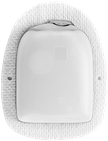  **Enhet för insulinleverans**

> Komponent som tolkar de kommandon som den får från pod-kommunikationsenheten och som kommer från din telefon med AAPS.
> 
> > - En ny Omnipod-pod (generationen Eros – **INTE DASH**)

Dessa instruktioner förutsätter att du startar en ny pod-session. Om så inte är fallet, ha tålamod och börja med detta vid nästa podbyte.

På denna sida betyder **RileyLink** vilken som helst av pod-kommunikationsenheterna som listas ovan.

## Innan du börjar

**SÄKERHETEN FÖRST** – gör inte detta i en miljö där du inte kan hantera ett fel (extra poddar, insulin, laddad RileyLink och telefon är ett måste).

**Din Omnipod PDM fungerar inte längre när AAPS Omnipod-drivrutin har aktiverat din pod**. Tidigare använde du din Omnipod PDM för att skicka kommandon till din Omnipod Eros-pod. En Omnipod Eros-pod tillåter bara att en enda enhet kommunicerar med den. Den enhet som aktiverar podden är från och med då den enda enhet som får kommunicera med den. Det betyder att när du har aktiverat en Omnipod Eros-pod med din RileyLink via AAPS Omnipod-drivrutin **kan du inte längre använda din PDM med podden**. AAPS Omnipod-drivrutin med RileyLink fungerar nu som din PDM. *Det betyder INTE att du ska slänga din PDM. Vi rekommenderar att du sparar den som reserv och för nödfall när AAPS inte fungerar som det ska.*

**Bara en RileyLink i taget kan kommunicera med en pod.** **AAPS** kommer ihåg en parkopplad RileyLink. Om du parkopplar en annan ersätter den den tidigare.

**Podden stängs inte av när RileyLink är utom räckhåll.** När RileyLink är utom räckhåll eller signalen till den aktiva podden blockeras fortsätter podden att leverera basalinsulin. När du aktiverar en pod programmeras basalprofilen från AAPS in i den nya podden. Om kontakten med podden bryts går den tillbaka till denna basalprofil. Du kan inte ge nya kommandon förrän RileyLink är inom räckhåll igen och har återupprättat anslutningen.

**Basalprofiler med 30-minutersintervall stöds INTE i AAPS.** Om du är ny med AAPS och ställer in din basalprofil för första gången: basaldoser som börjar på en halvtimme stöds inte, och du måste justera basalprofilen så att varje dos börjar på hel timme. Exempel: om du har en basaldos på 1,1 U som börjar 09:30 och varar i 2 timmar till 11:30 fungerar det inte.  Du måste ändra denna basaldos på 1,1 U till tidsintervallet 9:00–11:00 eller 10:00–12:00.  Omnipod-hårdvaran stöder basalintervall på 30 minuter, men AAPS algoritmer kan för närvarande inte ta hänsyn till dem.

## Aktivera Omnipod-drivrutinen i AAPS

Du kan aktivera Omnipod-drivrutinen i AAPS på **två sätt**:

### Alternativ 1: Installationsguiden

När du har installerat en ny version av AAPS startar **Installationsguiden** automatiskt. Om du redan har exporterat dina inställningar från en tidigare installation kan du importera dem i guiden. För nya installationer, fortsätt nedan.

Gå igenom [Installationsguiden](../SettingUpAaps/SetupWizard.md) tills du kommer till steget **Pump**, och välj sedan **Omnipod Eros** (beskrivningen lyder "Pumpintegration för Omnipod Eros").


Installationsguiden parkopplar inte din RileyLink. När du är klar med guiden, öppna pumpskärmen för Omnipod och parkoppla RileyLink enligt [avsnittet Ställ in RileyLink](#OmnipodEros-rileylink-setup).

**ELLER**

### Alternativ 2: Skärmen Konfiguration

Öppna **menyn** (☰) uppe till vänster > **Konfiguration** > **Pump** och välj **alternativknappen** för **Omnipod Eros**.

När den är vald visar kortet **Omnipod Eros** två knappar, **Inställningar** och **Öppna plugin**:


**Inställningar** öppnar inställningarna för Omnipod-drivrutinen (se [Omnipod-inställningar](#OmnipodEros-omnipod-settings)):


**Öppna plugin** öppnar pumpskärmen för Omnipod. Du kan också öppna den när som helst från huvudskärmen med **Hantera** > **Pump**. På denna sida kallas den **pumpskärmen för Omnipod**. Innan en RileyLink har parkopplats och en pod har aktiverats ser den ut så här:


### Kontroll av valet av Omnipod-drivrutin

För att kontrollera att du har aktiverat Omnipod-drivrutinen, öppna **Hantera** > **Pump** från huvudskärmen. Du bör se pumpskärmen för **Omnipod Eros** som visas ovan. Om du inte har parkopplat någon RileyLink än visar **RileyLink-status** **Inte startad** och **Pod-status** visar **Ingen aktiv pod**.

## Omnipod-konfiguration

Alla funktioner för podden och RileyLink är knappar på [pumpskärmen för Omnipod](#OmnipodEros-omnipod-pod-tab) (**Hantera** > **Pump**). Vissa knappar visas bara i vissa situationer, till exempel när en pod är aktiv.

>  Uppdatera anslutning och status för podden
> 
>  Podhantering (aktivera, inaktivera, spela upp testljud, RileyLink-statistik och pod-historik)

```{admonition} Older screenshot
:class: note
Skärmbilderna ovan är från en tidigare version av **AAPS**. I **AAPS** 4 finns ingen knapp **POD MGMT** och ingen meny Podhantering: **Uppdatera** och alla åtgärder för podhantering är knappar på pumpskärmen för Omnipod.
```

(OmnipodEros-rileylink-setup)=

### Ställ in RileyLink

Om du redan har parkopplat din RileyLink, fortsätt till [avsnittet Aktivera en pod](#OmnipodEros-activating-a-pod) nedan.

*OBS: Ett bra visuellt tecken på att RileyLink inte är ansluten är att behandlingsknapparna (verktygsfältet Snabbstart) saknas på huvudskärmen. Detta händer också under ungefär de första 30 sekunderna efter att AAPS har startat, eftersom AAPS då ansluter till RileyLink.*

1. Se till att din RileyLink är fulladdad och påslagen.

2. Placera RileyLink [nära telefonen](#OmnipodEros-optimal-omnipod-and-rileylink-positioning) (cirka 30 cm eller mindre).

3. Öppna pumpskärmen för Omnipod (**Hantera** > **Pump**) och tryck på **Parkoppla RileyLink**.

4. Skärmen **Parkoppla RileyLink** börjar direkt söka efter Bluetooth-enheter. Tryck på din RileyLink i listan med hittade enheter.

   

5. När **RileyLink-parkoppling lyckades** visas med namn och adress för din enhet, tryck på **OK**.

6. Tillbaka på pumpskärmen för Omnipod, kontrollera att **RileyLink-status** ändras till **Ansluten**. **Pod-status** ska visa **Ingen aktiv pod**. Om RileyLink inte ansluter, tryck på **Återställ RileyLink** eller starta om **AAPS**.

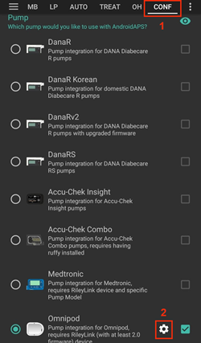 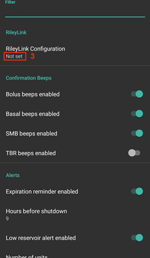

 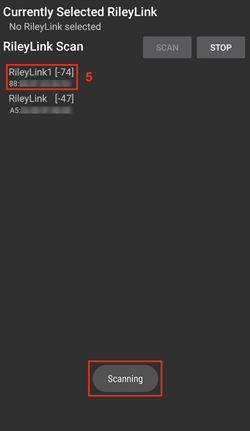

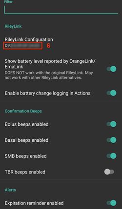

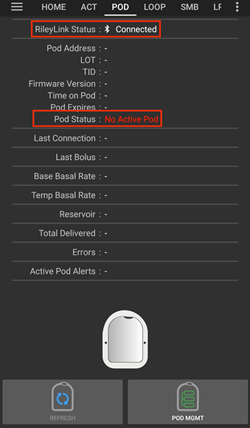

```{admonition} Older screenshot
:class: note
De sex skärmbilderna ovan (efter steg 6) är från en tidigare version av **AAPS**. I **AAPS** 4 parkopplar du RileyLink med knappen **Parkoppla RileyLink** på pumpskärmen för Omnipod i stället för med **RileyLink Configuration** i Omnipod-inställningarna, och sökningen startar automatiskt.
```

```{note}
Om du vill byta till en annan RileyLink (till exempel en reservenhet), tryck på **Parkoppla RileyLink** igen och välj den nya enheten. Den ersätter den som var parkopplad tidigare. Du behöver inte ta bort den gamla enheten först.
```

(OmnipodEros-activating-a-pod)=

### Aktivera en pod

Innan du kan aktivera en pod, se till att din RileyLink är parkopplad och att **RileyLink-status** visar **Ansluten**. Knappen **Aktivera pod** är inaktiv tills RileyLink är redo.

*PÅMINNELSE: Av säkerhetsskäl fungerar kommunikationen med podden bara på kort avstånd när podden aktiveras och parkopplas. Före parkopplingen är poddens radiosignal svagare, men när den har parkopplats arbetar den med full signalstyrka. Under dessa steg, se till att podden är* [nära](#OmnipodEros-optimal-omnipod-and-rileylink-positioning) *(cirka 30 cm eller mindre), men inte ovanpå eller precis bredvid RileyLink.*

01. Öppna pumpskärmen för Omnipod (**Hantera** > **Pump**) och tryck på **Aktivera pod**.

    Om du aldrig har aktiverat en profil visas först steget **Profil krävs**. Välj den profil som ska användas vid aktiveringen.

    >   
    > 
    > ```{admonition} Older screenshot
    >     :class: note
    >     Skärmbilderna ovan är från en tidigare version av **AAPS**. I **AAPS** 4 är **Aktivera pod** en knapp på pumpskärmen för Omnipod i stället för i menyn **POD MGMT**.
    > ```

02. Skärmen **Fyll Pod** visas. Fyll en ny pod med tillräckligt med insulin för 3 dagar och lyssna efter två pip. De betyder att minimimängden 80 U har fyllts på. Töm påfyllningssprutan helt, även efter att du hört de två pipen. När du räknar ut hur mycket insulin du behöver för 3 dagar: tänk på att förfyllningen av podden använder 12 till 15 U. Ta inte bort poddens nålskydd ännu.

    > 
    > 
    > Se till att den nya podden och RileyLink är nära varandra (cirka 30 cm eller mindre) och tryck på **Nästa**.

03. **Välj insulin** (visas bara om du har mer än ett insulin konfigurerat): välj det insulin som du fyller podden med och tryck på **Nästa**. Ett profilbyte med detta insulin görs efter aktiveringen.

04. På skärmen **Initiera Pod** börjar podden förfyllas (du hör ett klick och sedan en serie tickande ljud när podden förfyller sig själv). Om RileyLink är utom räckhåll för podden som aktiveras får du felmeddelandet **Inget svar från pod**. Om detta händer, [flytta RileyLink närmare](#OmnipodEros-optimal-omnipod-and-rileylink-positioning) podden (cirka 30 cm eller mindre), men inte ovanpå eller precis bredvid den, och tryck på **Försök igen**.

    > 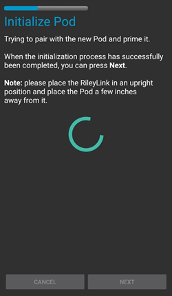 

05. När förfyllningen har lyckats visas en grön bock och knappen **Nästa** blir aktiv. Tryck på **Nästa**.

    > 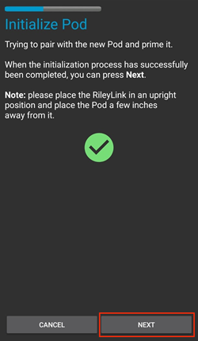

06. **Plats** (visas bara om **Hantera pumpplatsrotation** är aktiverat i [Platsrotation](#Aapsscreens-site-rotation)): välj var på kroppen du sätter podden och tryck på **Nästa**.

07. Skärmen **Fäst Pod** visas. Förbered infusionsplatsen för den nya podden. Ta bort poddens nålskydd av plast och det vita skyddspappret från häftytan och fäst podden på det ställe på kroppen som du har valt. Om kanylen sticker ut, tryck på **Avbryt** och kassera podden. När du är klar, tryck på **Nästa**.

    > 

08. En bekräftelsedialog visas: "När du trycker på OK skjuts kanylen in". **Tryck BARA på OK om du är redo att skjuta in kanylen**.

    > 

09. På skärmen **Skjut in kanylen** kan det ta en stund innan Omnipod svarar och skjuter in kanylen (högst 1–2 minuter), så ha tålamod.

    > Om RileyLink är utom räckhåll för podden som aktiveras får du felmeddelandet **Inget svar från pod**. Om detta händer, flytta RileyLink närmare podden (cirka 30 cm eller mindre), men inte ovanpå eller precis bredvid den, och tryck på **Försök igen**.
    > 
    > Om RileyLink är utom Bluetooth-räckhåll eller inte har en aktiv anslutning till telefonen får du felmeddelandet **RileyLink svarar inte**. Om detta händer, flytta RileyLink närmare telefonen och tryck på **Försök igen**.
    > 
    > *OBS: Innan kanylen skjuts in är det bra att nypa ihop huden nära insättningsstället. Det gör att nålen går in lättare och minskar risken för ocklusioner.*
    > 
    > 
    > 
    >  

10. En grön bock visas och knappen **Nästa** blir aktiv när kanylen har skjutits in. Tryck på **Nästa**.

    > 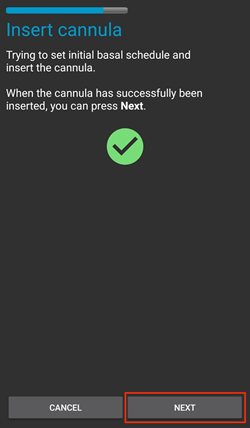

11. Skärmen **Pod aktiverad** visas. Kontrollera att kanylen har skjutits in rätt, och byt pod om du tror att den inte har det. Tryck på **Slutför**. Grattis! Du har nu startat en ny aktiv pod-session.

    >  
    > 
    > ```{admonition} Older screenshot
    >     :class: note
    >     Skärmbilderna i steg 2 till 11 är från en tidigare version av **AAPS** och kan se annorlunda ut i **AAPS** 4. Stegen **Välj insulin** och **Plats** visas inte på bilderna.
    > ```

12. Du kommer tillbaka till pumpskärmen för Omnipod. Knappen **Aktivera pod** ersätts av **Inaktivera pod**, eftersom du inte kan aktivera en ny pod utan att först inaktivera den aktiva.

    Pumpskärmen visar nu information om din aktiva pod, bland annat aktuell basaldos, reservoarnivå, levererat insulin, podfel och varningar. Mer information finns i avsnittet [Pumpskärmen för Omnipod](#OmnipodEros-omnipod-pod-tab).

    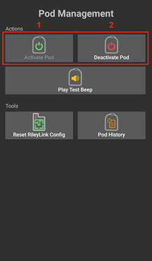 

    ```{admonition} Older screenshot
    :class: note
    Skärmbilderna ovan är från en tidigare version av **AAPS**. I **AAPS** 4 finns ingen meny Podhantering: du kommer direkt tillbaka till pumpskärmen för Omnipod, där **Inaktivera pod** ersätter **Aktivera pod**.
    ```

```{note}
Om aktiveringen avbröts efter förfyllningen (till exempel för att appen stängdes), tryck på **Aktivera pod** igen. Guiden fortsätter från stegen för att skjuta in kanylen.
```

### Inaktivera en pod

Normalt ska en pod hålla i tre dagar (72 timmar) och ytterligare 8 timmar efter varningen om att podden går ut, alltså totalt 80 timmar.

Så här inaktiverar du en pod (när den har gått ut eller vid ett pod-fel):

1. Öppna pumpskärmen för Omnipod (**Hantera** > **Pump**) och tryck på **Inaktivera pod**.

   >  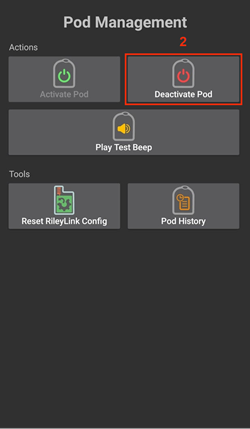 
   > 
   > ```{admonition} Older screenshot
   >    :class: note
   >    Skärmbilderna ovan är från en tidigare version av **AAPS**. I **AAPS** 4 är **Inaktivera pod** en knapp på pumpskärmen för Omnipod i stället för i menyn **POD MGMT**.
   > ```

2. På skärmen **Inaktivera pod**, se först till att RileyLink är nära podden, men inte ovanpå eller precis bredvid den. Tryck sedan på **Nästa**. En dialog frågar *En inaktiverad Pod kan inte användas igen. Inaktivera denna Pod nu?* Tryck på **OK** för att börja inaktivera podden, eller på **Avbryt** för att behålla den. Inaktiveringen pausar all insulinleverans och kan inte ångras.

   > 

3. Skärmen **Inaktiverar Pod** visas, och podden piper för att bekräfta att inaktiveringen lyckades.

   > 
   > 
   > **OM inaktiveringen misslyckas** och du inte hör något bekräftelsepip kan du få meddelandet **RileyLink svarar inte** eller **Inget svar från pod**. Tryck på **Försök igen** för att försöka inaktivera igen. Om inaktiveringen fortsätter att misslyckas, tryck på **Kassera pod** och bekräfta. **AAPS** glömmer då podden. Insulinleveransen har **inte** pausats, så ta bort podden från kroppen. Om podden larmar oavbrutet kan du behöva tysta den manuellt (med en nål eller ett gem), eftersom **Kassera pod** inte tystar den.
   > 
   > > 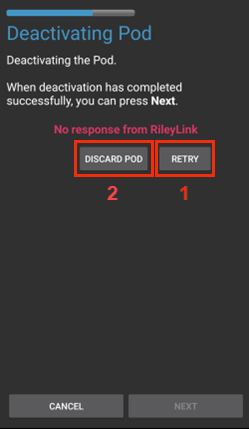  

4. En grön bock visas när inaktiveringen har lyckats. Tryck på **Nästa** för att visa skärmen **Pod inaktiverad**. Du kan nu ta bort podden, eftersom den aktiva sessionen har inaktiverats.

   > 

5. Tryck på **Slutför** för att gå tillbaka till pumpskärmen för Omnipod.

   >  
   > 
   > ```{admonition} Older screenshot
   >    :class: note
   >    Skärmbilderna i steg 2 till 5 är från en tidigare version av **AAPS** och kan se annorlunda ut i **AAPS** 4.
   > ```

6. På pumpskärmen för Omnipod, kontrollera att **RileyLink-status** visar **Ansluten** och att **Pod-status** visar **Ingen aktiv pod**.

   >    
   > 
   > ```{admonition} Older screenshot
   >    :class: note
   >    Skärmbilderna ovan är från en tidigare version av **AAPS**. I **AAPS** 4 tar **Slutför** dig direkt tillbaka till pumpskärmen för Omnipod; det finns ingen meny Podhantering och ingen flik **Omnipod (POD)**.
   > ```

### Pausa och återuppta insulinleverans

Här nedan visas hur du pausar och återupptar insulinleveransen.

*OBS – om du inte ser knappen **Pausa*** beror det på att den är dold som standard. Enable **Show Suspend Delivery button in Omnipod tab** in the [Omnipod settings](#OmnipodEros-omnipod-settings) under **Other**.

#### Pausa insulinleverans

Använd detta kommando för att pausa den aktiva podden. När podden är pausad levererar den inget insulin alls. Kommandot gör samma sak som pausfunktionen i den ursprungliga Omnipod PDM.

1. Öppna pumpskärmen för Omnipod (**Hantera** > **Pump**) och tryck på **Pausa**. Kommandot för paus skickas via RileyLink till den aktiva podden.

2. När podden har pausat all insulinleverans visar **Pod-status** **Pausad**, och knappen **Pausa** ersätts av **Återuppta insulintillförsel**.

   > 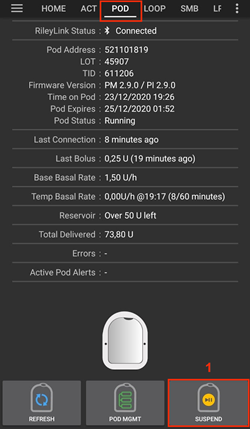 
   > 
   > 
   > 
   >  
   > 
   > ```{admonition} Older screenshot
   >    :class: note
   >    Skärmbilderna ovan är från en tidigare version av **AAPS**. I **AAPS** 4 görs dessa steg på pumpskärmen för Omnipod i stället för på fliken **Omnipod (POD)**, och resultatet visas i **Pod-status**.
   > ```

Om kommandot misslyckas visar dialogrutan **Varning** "Det gick inte att pausa leveransen" och orsaken. Kontrollera anslutningen till RileyLink och försök igen.

#### Återuppta insulinleveransen

Använd detta kommando för att få den aktiva, pausade podden att återuppta insulinleveransen. När kommandot har utförts återupptas den normala insulinleveransen med den basaldos som gäller för aktuell tid enligt den aktiva basalprofilen. Podden tar då åter emot kommandon för bolus, tillfällig basal och SMB.

1. Öppna pumpskärmen för Omnipod och kontrollera att **Pod-status** visar **Pausad**. Tryck på **Återuppta insulintillförsel**.

2. När kommandot lyckas visar **Pod-status** **Körs** igen, och knappen **Återuppta insulintillförsel** försvinner (knappen **Pausa** visas igen om du har aktiverat den).

   >  
   > 
   > 
   > 
   >  
   > 
   > ```{admonition} Older screenshot
   >    :class: note
   >    Skärmbilderna ovan är från en tidigare version av **AAPS**. I **AAPS** 4 görs dessa steg på pumpskärmen för Omnipod i stället för på fliken **Omnipod (POD)**, och resultatet visas i **Pod-status**.
   > ```

Om kommandot misslyckas visar dialogrutan **Varning** "Misslyckades återuppta leveransen" och orsaken. Kontrollera anslutningen till RileyLink och försök igen.

### Kvittera podvarningar

*OBS – Knappen **Kvittera larm** visas bara på pumpskärmen för Omnipod när podden har en aktiv varning (till exempel varningen om att podden går ut eller om låg reservoar), och bara om **Kvittera podlarm automatiskt** är inaktiverat.*

Här nedan visas hur du tystar poddens pip, som börjar när podden når varningstiden innan den går ut. Varningstiden ställs in med **Varning vid timmar före avstängning (80 timmar)** i Omnipod-inställningarna under **Varningar**. En pod kan användas i högst 80 timmar (3 dagar och 8 timmar), men Insulet rekommenderar att du inte går över gränsen på 72 timmar (3 dagar).

*OBS – Om du har aktiverat **Kvittera podlarm automatiskt** i Omnipod-inställningarna under **Varningar** kvitterar **AAPS** varningen automatiskt vid nästa kommunikation med podden, och du behöver INTE göra det manuellt.*

1. När varningstiden nås piper podden för att tala om att den snart går ut och behöver bytas. På pumpskärmen för Omnipod visar **Pod går ut** exakt när podden går ut (72 timmar efter aktiveringen); texten blir **gul** 4 timmar innan. **Pod stängs av** visar när podden slutar leverera insulin. **Aktiva pod-varningar** visar **Pod löper snart ut**, och knappen **Kvittera larm** visas. **AAPS** visar också en avisering om att podden snart går ut.

   >   
   > 
   > ```{admonition} Older screenshot
   >    :class: note
   >    Skärmbilderna ovan är från en tidigare version av **AAPS**. I **AAPS** 4 heter knappen **ACK ALERTS** nu **Kvittera larm** och finns på pumpskärmen för Omnipod.
   > ```

2. Tryck på **Kvittera larm**. RileyLink skickar kommandot till podden för att stoppa varningspipen om att podden går ut.

   > 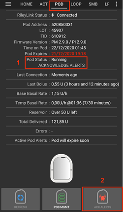 
   > 
   > ```{admonition} Older screenshot
   >    :class: note
   >    Skärmbilden ovan är från en tidigare **AAPS**-version. I **AAPS** 4 heter knappen **Kvittera larm**.
   > ```

3. När varningarna har kvitterats piper podden två gånger. **Aktiva pod-varningar** visar inte längre varningen, knappen **Kvittera larm** försvinner och podden slutar med varningspipen om att den går ut.

   >  
   > 
   > ```{admonition} Older screenshot
   >    :class: note
   >    Skärmbilden ovan är från en tidigare **AAPS**-version. I **AAPS** 4 visas resultatet på pumpskärmen för Omnipod: varningen försvinner från **Aktiva pod-varningar**.
   > ```

Om kommandot misslyckas (till exempel om RileyLink är utom räckhåll för podden) visar dialogrutan **Varning** "Det gick inte att kvittera larm" och orsaken. Flytta RileyLink närmare podden och försök igen.


```{admonition} Older screenshot
:class: note
Skärmbilden ovan är från en tidigare **AAPS**-version. I **AAPS** 4 visar dialogrutan **Varning** "Det gick inte att kvittera larm" och orsaken.
```

(OmnipodEros-view-pod-history)=

### Visa podhistorik

Det här avsnittet visar hur du granskar historiken för den aktiva podden och filtrerar på olika kategorier av åtgärder. I pod-historiken kan du se de åtgärder och resultat som har skickats till den aktiva podden under dess livslängd på tre dagar (72–80 timmar).

Funktionen är användbar för att kontrollera bolusar, tillfälliga basaler och basaländringar som har getts, när du är osäker på om de slutfördes. De övriga kategorierna är främst användbara vid felsökning och för att se i vilken ordning händelserna skedde före ett fel.

*OBS:* **Osäkra** kommandon visas i pod-historiken, men på grund av sin natur kan du inte vara säker på att de stämmer.

1. Öppna pumpskärmen för Omnipod (**Hantera** > **Pump**) och tryck på **Pod-historik**.

   >   
   > 
   > ```{admonition} Older screenshot
   >    :class: note
   >    Skärmbilderna ovan är från en tidigare version av **AAPS**. I **AAPS** 4 är **Pod-historik** en knapp på pumpskärmen för Omnipod i stället för i menyn **POD MGMT**.
   > ```

2. Skärmen **Pod-historik** visar alla åtgärder för podden och deras resultat, de nyaste först, grupperade per dag. Som standard är **Alla** vald. Tryck på en av filterknapparna högst upp för att bara visa en kategori. Använd bakåtpilen uppe till vänster för att gå tillbaka till pumpskärmen för Omnipod.

   > 

   >  
   > 
   > ```{admonition} Older screenshot
   >    :class: note
   >    Den andra skärmbilden är från en tidigare version av **AAPS** och kan se annorlunda ut i **AAPS** 4.
   > ```

### Visa inställningar och historik för RileyLink

Skärmen **RileyLink-statistik** visar inställningarna för din RileyLink och den aktiva podden, och kommunikationshistoriken för båda. Den har två flikar: **Inställningar** och **Historik**.

Knappen **RileyLink-statistik** är dold som standard. För att visa den på pumpskärmen för Omnipod, aktivera **Visa knappen RileyLink-statistik i menyn Podhantering** i [Omnipod-inställningarna](#OmnipodEros-omnipod-settings) under **Annat**.

#### Återupprätta Bluetooth-anslutningen till pod-kommunikationsenheten manuellt

Om din pod-kommunikationsenhet har varit utom Bluetooth-räckhåll för telefonen en stund kan **RileyLink-status** visa **RileyLink kan inte nås** på pumpskärmen för Omnipod. **AAPS** ansluter normalt igen av sig själv när enheten är inom räckhåll igen. Om det inte händer:

1. Se till att RileyLink är påslagen, laddad och nära telefonen.

2. Tryck på **Återställ RileyLink** på pumpskärmen för Omnipod. Ett meddelande bekräftar **RileyLink-konfiguration återställd**. Se [anteckningarna om Återställ RileyLink](#OmnipodEros-reset-rileylink-config-notes) nedan.

3. Om **Bluetooth-anslutningen** inte återupprättas, försök att stänga **av** Bluetooth på telefonen och sedan slå **på** det igen.

4. Om den fortfarande inte ansluter, tryck på **Parkoppla RileyLink** och välj din RileyLink igen.

5. När anslutningen har lyckats visar **RileyLink-status** **Ansluten**. Du kan också kontrollera **Anslutningsstatus** på fliken **Inställningar** på skärmen **RileyLink-statistik**. Grattis, du har nu anslutit din konfigurerade pod-kommunikationsenhet till AAPS igen!

 

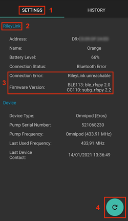


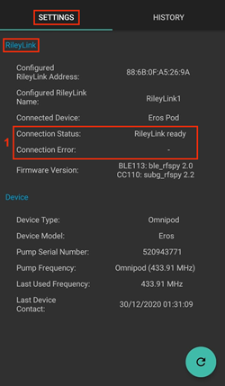

```{admonition} Older screenshot
:class: note
Skärmbilderna ovan är från en tidigare version av **AAPS**. I **AAPS** 4 ansluter du igen med **Återställ RileyLink** eller **Parkoppla RileyLink** på pumpskärmen för Omnipod, i stället för med uppdateringsknappen på skärmen för RileyLink-inställningar.
```

#### Inställningar för pod-kommunikationsenheten och den aktiva podden

Denna skärm visar information och status för både den parkopplade pod-kommunikationsenheten och den aktiva Omnipod Eros-podden. Informationen uppdateras automatiskt.

1. Öppna pumpskärmen för Omnipod (**Hantera** > **Pump**) och tryck på **RileyLink-statistik**. Fliken **Inställningar** visar din parkopplade **RileyLink** och den aktiva podden (**Enhet**).

   > 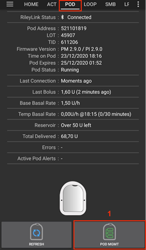 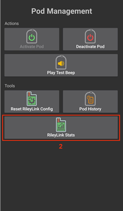 
   > 
   > ```{admonition} Older screenshot
   >    :class: note
   >    Skärmbilderna ovan är från en tidigare version av **AAPS**. I **AAPS** 4 är **RileyLink-statistik** en knapp på pumpskärmen för Omnipod i stället för i menyn **POD MGMT**.
   > ```

   > 

##### Fält för RileyLink

> - **Adress:** MAC-adress för den parkopplade pod-kommunikationsenheten.
> - **Namn:** Bluetooth-namn för den parkopplade pod-kommunikationsenheten.
> - **Batterinivå:** Aktuell batterinivå för den anslutna pod-kommunikationsenheten. Visas bara när **Visa batterinivå som rapporteras av OrangeLink/EmaLink/DiaLink** är aktiverat.
> - **Anslutningsstatus**: Aktuell status för Bluetooth-anslutningen mellan pod-kommunikationsenheten och telefonen med AAPS.
> - **Anslutningsproblem:** Om det finns ett fel i Bluetooth-anslutningen till pod-kommunikationsenheten visas detaljer här.
> - **Firmwareversion:** Den firmwareversion som är installerad på den anslutna pod-kommunikationsenheten.

##### Fält för enheten – med en aktiv pod

> - **Enhetstyp:** Typ av enhet som kommunicerar med pod-kommunikationsenheten (Omnipod (Eros)).
> - **Konfigurerad modell:** Modellen på den enhet som är konfigurerad att kommunicera med pod-kommunikationsenheten.
> - **Ansluten modell:** Modellen på den enhet som just nu kommunicerar med pod-kommunikationsenheten.
> - **Serienummer på pumpen:** Serienummer för den aktiverade podden.
> - **Pumpfrekvens:** Radiofrekvens som används för att kommunicera med podden.
> - **Senast använda frekvens:** Senast kända radiofrekvens som podden använde för att kommunicera med pod-kommunikationsenheten.
> - **Senaste anslutning:** Datum och tid för den senaste kontakten mellan podden och pod-kommunikationsenheten.

(omnipod-eros-rileylink-and-active-pod-history)=
#### Historik för RileyLink och aktiv pod

Denna flik visar, de nyaste först, varje tillstånd eller åtgärd för RileyLink eller den anslutna podden. Historiken finns bara för den aktiva podden. Efter ett podbyte raderas historiken, och bara händelser från den nya podden sparas och visas.

1. Öppna pumpskärmen för Omnipod (**Hantera** > **Pump**), tryck på **RileyLink-statistik** och tryck sedan på fliken **Historik**.

   >  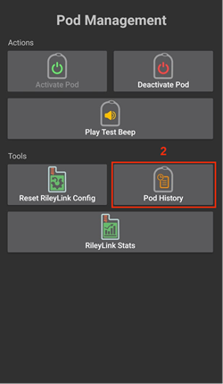 
   > 
   > ```{admonition} Older screenshot
   >    :class: note
   >    Skärmbilderna ovan är från en tidigare version av **AAPS**. I **AAPS** 4 är **RileyLink-statistik** en knapp på pumpskärmen för Omnipod i stället för i menyn **POD MGMT**.
   > ```

   > 

##### Fält

Varje post visar:

> - **Enhet:** Den enhet som åtgärden eller tillståndet gäller.
> - **Tid:** Tidpunkt för händelsen.
> - **Tillstånd eller åtgärd:** Enhetens tillstånd eller den åtgärd som den utförde.

(OmnipodEros-omnipod-pod-tab)=

## Pumpskärmen för Omnipod

Här nedan förklaras statusfälten och knapparna på **pumpskärmen för Omnipod** (**Hantera** > **Pump**, eller **Konfiguration** > **Pump** > **Öppna plugin**).

Kugghjulsikonen uppe till höger öppnar [Omnipod-inställningarna](#OmnipodEros-omnipod-settings).

*OBS: Om något statusfält visar (osäker), tryck på **Uppdatera** för att uppdatera podstatus och ta bort texten.*


```{admonition} Older screenshot
:class: note
Skärmbilden ovan är från en tidigare version av **AAPS**, där denna skärm var fliken **Omnipod (POD)**. I **AAPS** 4 är det pumpskärmen för Omnipod, och vissa fältnamn och knappar är annorlunda.
```

### Fält

- **RileyLink-status:** Visar aktuell anslutningsstatus för RileyLink. Fel visas i rött.

- *Inte startad* – ingen RileyLink är parkopplad än, eller så har anslutningen inte startat.
- *RileyLink kan inte nås* – pod-kommunikationsenheten är utom Bluetooth-räckhåll för telefonen, avstängd eller har ett fel som hindrar Bluetooth-kommunikation.
- *RileyLink redo* – pod-kommunikationsenheten är påslagen och håller på att starta Bluetooth-anslutningen.
- *Ansluten* – pod-kommunikationsenheten är påslagen, ansluten och kan kommunicera via Bluetooth.

- **Unikt ID:** Visar adressen för den aktiva podden.

- **LOT-nummer:** Visar LOT-numret för den aktiva podden.

- **Sekvensnummer:** Visar poddens serienummer (TID).

- **Firmwareversion:** Visar firmwareversionen för den aktiva podden.

- **Tid i Pod:** Visar aktuell tid i den aktiva podden. Den markeras när den skiljer sig från telefonens tid med mer än 5 minuter.

- **Pod går ut:** Visar datum och tid när den aktiva podden går ut. Texten blir gul under de sista 4 timmarna före denna tid. Den blir aldrig röd, eftersom podden fortsätter att leverera insulin efter denna tid.

- **Pod stängs av:** Visar slutet på poddens extra tid (8 timmar efter **Pod går ut**, för en maximal livslängd på 80 timmar). Texten blir gul när tidsfristen börjar (vid **Pod går ut**) och röd under de sista 4 timmarna före avstängningen. Under tidsfristen visas även återstående tid, till exempel *(17 min återstår)*. Podden slutar leverera insulin vid avstängningen och måste bytas.

- **Pod-status:** Visar status för den aktiva podden (till exempel **Ingen aktiv pod**, **Körs** eller **Pausad**).

- **Senaste anslutning:** Visar senaste gången kommunikationen med den aktiva podden lyckades. Texten blir röd när [tröskeln för otillgänglig pump](#OmnipodEros-troubleshooting) har överskridits.

- *nyss* – mindre än 20 sekunder sedan.
- *mindre än en minut sedan* – mer än 20 sekunder men mindre än 60 sekunder sedan.
- *1 minut sedan* – mer än 60 sekunder men mindre än 120 sekunder (2 min) sedan
- *XX minuter sedan* – mer än 2 minuter sedan, där XX är antalet minuter

- **Senaste bolus:** Visar dosen för den senaste bolusen till den aktiva podden och, inom parentes, hur länge sedan den gavs.

- **Profilens basaldos:** Visar basaldosen för aktuell tid enligt basalprofilen.

- **Tillfällig basaldos:** Visas bara medan en tillfällig basal är aktiv. Den visas i följande format:

- U/h @ tid då den tillfälliga basalen startades (minuter som har gått / totalt antal minuter för den tillfälliga basalen)
- *Exempel:* 0,00U/h @18:25 ( 90/120 minuter)

- **Reservoar:** Visar **Mer än 50 U kvar** när det finns mer än 50 U kvar i reservoaren. Under detta värde visas det ungefärliga antalet enheter. Texten blir röd under gränsen för låg reservoar som du ställer in i [inställningarna för varningar](#OmnipodEros-omnipod-settings).

- **Totalt levererat:** Visar totalt antal enheter insulin som har levererats från reservoaren. *Observera att detta är en uppskattning, eftersom förfyllning och påfyllning av podden inte är exakta processer.*

- **Aktiva pod-varningar:** Visar varningar som är aktiva i den aktiva podden just nu. Används normalt när podden har passerat 72 timmar och poddens egna varningspip hörs.

- **Fel:** Visar det senaste felet (i rött). Granska [pod-historiken](#OmnipodEros-view-pod-history), [RileyLink-historiken](#omnipod-eros-rileylink-and-active-pod-history) och loggfilerna för tidigare fel och mer detaljerad information.

### Knappar

Knapparna längst ner på pumpskärmen ändras beroende på situationen. Knappar som inte kan användas just nu är gråa, till exempel när RileyLink inte är ansluten.

**Knappar för podstatus** (visas när en pod är aktiv):

- **Uppdatera:** Skickar ett kommando till den aktiva podden för att uppdatera dess status. Använd den för att uppdatera podstatus och ta bort texten (osäker) från statusfälten. Se [avsnittet Felsökning](#OmnipodEros-troubleshooting) nedan för mer information.

  

  ```{admonition} Older screenshot
  :class: note
  Skärmbilden ovan är från en tidigare version av **AAPS**. I **AAPS** 4 är detta en textknapp som heter **Uppdatera** på pumpskärmen för Omnipod.
  ```

- **Kvittera larm:** Tystar poddens pip och aviseringar om att podden går ut och om låg reservoar. Visas bara när podden har en aktiv varning och **Kvittera podlarm automatiskt** är inaktiverat. När varningarna har kvitterats försvinner knappen.

  

  ```{admonition} Older screenshot
  :class: note
  Skärmbilden ovan är från en tidigare version av **AAPS**. I **AAPS** 4 heter knappen **Kvittera larm**.
  ```

- **Ställ in tid:** Ställer in tiden på podden till telefonens aktuella tid. Visas bara när tiden på podden skiljer sig från telefonens tid med mer än 5 minuter.

  

  ```{admonition} Older screenshot
  :class: note
  Skärmbilden ovan är från en tidigare version av **AAPS**. I **AAPS** 4 är detta en textknapp som heter **Ställ in tid** på pumpskärmen för Omnipod.
  ```

- **Pausa:** Pausar insulinleveransen i den aktiva podden. Only shown if enabled in the settings (**Show Suspend Delivery button in Omnipod tab**).

  

  ```{admonition} Older screenshot
  :class: note
  Skärmbilden ovan är från en tidigare version av **AAPS**. I **AAPS** 4 är detta en textknapp som heter **Pausa** på pumpskärmen för Omnipod.
  ```

- **Återuppta insulintillförsel:** Återupptar insulinleveransen i den aktiva, pausade podden. Visas bara när podden är pausad.

  

  ```{admonition} Older screenshot
  :class: note
  Skärmbilden ovan är från en tidigare version av **AAPS**. I **AAPS** 4 är detta en textknapp som heter **Återuppta insulintillförsel** på pumpskärmen för Omnipod.
  ```

**Knappar för hantering av pod och RileyLink:**


```{admonition} Older screenshot
:class: note
Skärmbilden ovan är från en tidigare **AAPS**-version. I **AAPS** 4 finns ingen meny Podhantering: dessa åtgärder är knappar direkt på pumpskärmen för Omnipod.
```

- **Aktivera pod:** Förfyller och aktiverar en ny pod. Visas när ingen pod är aktiv. Knappen är bara aktiv när RileyLink är ansluten.

  

  ```{admonition} Older screenshot
  :class: note
  Skärmbilden ovan är från en tidigare version av **AAPS**. I **AAPS** 4 är **Aktivera pod** en knapp på pumpskärmen för Omnipod i stället för i menyn Podhantering.
  ```

- **Inaktivera pod:** Inaktiverar den aktiva podden. Visas så snart en pod är parkopplad, även när en aktivering har stoppat halvvägs (till exempel för att podden fick ett fel under aktiveringen). Knappen är bara aktiv när RileyLink är ansluten. **AAPS** ber dig bekräfta innan podden inaktiveras.

- Använd detta kommando för att inaktivera en pod som larmar oavbrutet (fel 49).
- Om inaktiveringen misslyckas erbjuder inaktiveringsguiden alternativet **Kassera pod**.

  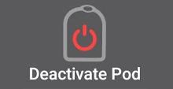

  ```{admonition} Older screenshot
  :class: note
  Skärmbilden ovan är från en tidigare version av **AAPS**. I **AAPS** 4 är **Inaktivera pod** en knapp på pumpskärmen för Omnipod i stället för i menyn Podhantering.
  ```

- **Spela upp testljud:** Spelar upp ett testpip på podden när du trycker på knappen. Visas när en pod är parkopplad.

  

  ```{admonition} Older screenshot
  :class: note
  Skärmbilden ovan är från en tidigare version av **AAPS**. I **AAPS** 4 är **Spela upp testljud** en knapp på pumpskärmen för Omnipod i stället för i menyn Podhantering.
  ```

- **Pod-historik:** Visar aktivitetshistoriken för den aktiva podden. Se [Visa pod-historik](#OmnipodEros-view-pod-history).

  

  ```{admonition} Older screenshot
  :class: note
  Skärmbilden ovan är från en tidigare version av **AAPS**. I **AAPS** 4 är **Pod-historik** en knapp på pumpskärmen för Omnipod i stället för i menyn Podhantering.
  ```

- **Parkoppla RileyLink:** Söker efter din pod-kommunikationsenhet och parkopplar den. Se [Ställ in RileyLink](#OmnipodEros-rileylink-setup).

- **RileyLink-statistik:** Öppnar skärmen RileyLink-statistik med två flikar. Visas bara om det är aktiverat i inställningarna (**Visa knappen RileyLink-statistik i menyn Podhantering**).

- **Inställningar** – visar inställningar för RileyLink och den aktiva podden
- **Historik** – visar kommunikationshistorik för RileyLink och podden

  

  ```{admonition} Older screenshot
  :class: note
  Skärmbilden ovan är från en tidigare version av **AAPS**. I **AAPS** 4 är **RileyLink-statistik** en knapp på pumpskärmen för Omnipod i stället för i menyn Podhantering.
  ```

- **Återställ RileyLink:** Återställer konfigurationen för den anslutna pod-kommunikationsenheten. När kommunikationen startar skickas vissa data till RileyLink och ställs in där:

- Minnesregister ställs in
- Kommunikationsprotokoll ställs in
- Den justerade radiofrekvensen ställs in
  > 
  > Se [fler anteckningar](#OmnipodEros-reset-rileylink-config-notes) nedan.

  

  ```{admonition} Older screenshot
  :class: note
  Skärmbilden ovan är från en tidigare version av **AAPS**. I **AAPS** 4 heter knappen **Återställ RileyLink** och finns på pumpskärmen för Omnipod.
  ```

- **Kassera pod:** Kasserar statusen för en pod som inte svarar, efter en bekräftelse. Visas bara när en pod har startats men inte är helt parkopplad, eftersom en korrekt inaktivering då inte längre är möjlig:

- En **pod är inte helt parkopplad** och ignorerar därför kommandon om inaktivering.
- En **pod har fastnat** mellan två steg i parkopplingen.
- En **pod går inte att parkoppla alls.**
  > 
  > När du har kasserat en pod kan **AAPS** inte längre kommunicera med den. Ta bort podden från kroppen.

  

  ```{admonition} Older screenshot
  :class: note
  Skärmbilden ovan är från en tidigare version av **AAPS**. I **AAPS** 4 är **Kassera pod** en knapp på pumpskärmen för Omnipod i stället för i menyn Podhantering.
  ```

(OmnipodEros-reset-rileylink-config-notes)=

#### *Anteckningar om Återställ RileyLink*

- Den här funktionen används främst när den aktiva pod-kommunikationsenheten inte svarar och kommunikationen har fastnat.
- Om pod-kommunikationsenheten stängs av och slås på igen, tryck på **Återställ RileyLink** så att kommunikationsparametrarna ställs in igen i pod-kommunikationsenheten.
- Om du INTE gör detta måste AAPS startas om efter att pod-kommunikationsenheten har stängts av och slagits på igen.
- Du behöver **INTE** trycka på denna knapp när du byter mellan olika pod-kommunikationsenheter.

(OmnipodEros-omnipod-settings)=

## Omnipod-inställningar

Du öppnar inställningarna för Omnipod-drivrutinen på ett av dessa sätt:

- tryck på kugghjulsikonen uppe till höger på pumpskärmen för Omnipod (**Hantera** > **Pump**), eller
- öppna **menyn** (☰) uppe till vänster > **Konfiguration** > **Pump** och tryck på **Inställningar** på kortet **Omnipod Eros**.

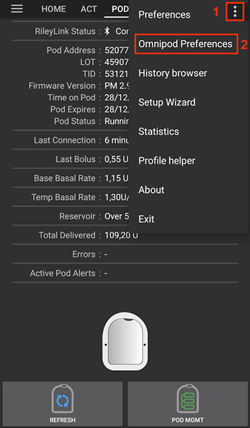

```{admonition} Older screenshot
:class: note
Skärmbilden ovan är från en tidigare **AAPS**-version. I **AAPS** 4 öppnar du inställningarna med **Inställningar** på kortet **Omnipod Eros** eller med kugghjulsikonen på pumpskärmen för Omnipod, i stället för med inställningskugghjulet i **Konfiguration** eller menyn med tre punkter.
```

Inställningarna är grupperade enligt listan nedan. Tryck på en grupp för att öppna den. De flesta poster är reglage som du kan slå på eller av:


*OBS: En asterisk (\*) betyder att inställningen är aktiverad som standard.*

### RileyLink

Inställningar för pod-kommunikationsenheten. Själva enheten parkopplar du med knappen **Parkoppla RileyLink** på pumpskärmen (se [Ställ in RileyLink](#OmnipodEros-rileylink-setup)).

- **Använd sökning:** Gör en sökning innan anslutning till OrangeLink. Det kan förbättra anslutningarna. Den kan också användas med andra RileyLink-kloner om det behövs.

- **Visa batterinivå som rapporteras av OrangeLink/EmaLink/DiaLink:** Visar den verkliga batterinivån för OrangeLink/EmaLink/DiaLink. Vi **rekommenderar starkt** att alla som använder OrangeLink/EmaLink/DiaLink aktiverar denna inställning.

- Fungerar INTE med original-RileyLink.
- Fungerar eventuellt inte med andra RileyLink-alternativ.
- Aktiverad – visar aktuell batterinivå för pod-kommunikationsenheter som stöds.
- Inaktiverad – visar värdet n/a.

- **Aktivera loggning av batteribyte i Åtgärder:** Finns bara när inställningen för batterinivå ovan är aktiverad. Vissa pod-kommunikationsenheter använder vanliga batterier som du kan byta. Med denna inställning aktiverad kan du registrera **Byte av pumpbatteri** som [Careportal-post](#aaps-screens-careportal) för att notera bytet och nollställa batteriets ålder.

### Bekräftelsepip

Ger bekräftelsepip från podden när bolus, basal, SMB och tillfällig basal levereras eller ändras.

- **\*Boluspip aktiverade:** Aktivera eller inaktivera bekräftelsepip när en bolus levereras.
- **Basalpip aktiverade:** Aktivera eller inaktivera bekräftelsepip när en ny basaldos ställs in, när aktiv basaldos avbryts eller när aktuell basaldos ändras.
- **\*SMB-pip aktiverade:** Aktivera eller inaktivera bekräftelsepip när en SMB levereras.
- **Pip för tillfällig basal aktiverade:** Aktivera eller inaktivera bekräftelsepip när en tillfällig basal startas eller avbryts.

### Varningar

Ger varningar i AAPS och meddelanden i Nightscout när podden snart går ut, när den snart stängs av och vid låg reservoar enligt det angivna antalet enheter.

*Observera att AAPS ALLTID visar en avisering för varje varning, efter den första kommunikationen med podden sedan varningen utlöstes. Om du stänger aviseringen tystas INTE varningen, UTOM om **Kvittera podlarm automatiskt** är aktiverat. För att tysta varningen MANUELLT, öppna pumpskärmen för Omnipod och tryck på **Kvittera larm**.*

- **\*Påminnelse för utgångstid aktiverad:** När den är aktiverad piper podden när tiden som anges nedan nås.
- **Varning vid timmar före avstängning (80 timmar):** Antal timmar före poddens avstängning (80 timmar efter aktiveringen) då påminnelsen om att podden går ut utlöses (1 till 8 timmar, standard 8).
- **\*Varning för låg reservoar aktiverad:** Aktivera eller inaktivera en varning när antalet enheter kvar i podden når gränsen för låg reservoar, som du anger i fältet Antal enheter.
- **Antal enheter:** Antal enheter då poddens varning för låg reservoar utlöses (5 till 50, standard 20).
- **Kvittera podlarm automatiskt:** När den är aktiverad visas fortfarande en avisering, men varningen kvitteras automatiskt vid nästa kommunikation med podden efter att varningen startade.

### Aviseringar

Ger aviseringar i AAPS och hörbara larm i telefonen när det är osäkert om en tillfällig basal, SMB eller bolus lyckades.

*OBS: Detta är bara aviseringar, podden piper inte.*

- **\*Ljud för aviseringar om osäker tillfällig basal aktiverat:** Aktivera eller inaktivera denna inställning för att få ett ljudlarm och en avisering när AAPS är osäker på om en tillfällig basal startades.
- **\*Ljud för aviseringar om osäker SMB aktiverat:** Aktivera eller inaktivera denna inställning för att få ett ljudlarm och en avisering när AAPS är osäker på om en SMB levererades.
- **\*Ljud för aviseringar om osäker bolus aktiverat:** Aktivera eller inaktivera denna inställning för att få ett ljudlarm och en avisering när AAPS är osäker på om en bolus levererades.

### Other

Avancerade inställningar som hjälper vid felsökning.

- **Show Suspend Delivery button in Omnipod tab:** Hide or display the **Suspend** button in the Omnipod tab.
- **Visa Pulslogg-knapp i menyn Podhantering:** Denna inställning finns fortfarande i listan, men den nuvarande pumpskärmen har ingen knapp **Pulslogg**.

- **Visa knappen RileyLink-statistik i menyn Podhantering:** Döljer eller visar knappen **RileyLink-statistik** på pumpskärmen för Omnipod.
- **\*Avkänning av sommartid/tidszon aktiverad:** Gör att byte av tidszon upptäcks automatiskt om telefonen används i ett område med sommartid.

### Byta eller ta bort en aktiv pod-kommunikationsenhet (RileyLink)

Det finns många alternativ till den ursprungliga RileyLink (som OrangeLink eller EmaLink), och du kanske har flera enheter eller reservenheter av samma slag. Därför kan du behöva byta till en annan pod-kommunikationsenhet.

För att byta, öppna pumpskärmen för Omnipod (**Hantera** > **Pump**), tryck på **Parkoppla RileyLink** och välj den nya enheten, enligt beskrivningen i [Ställ in RileyLink](#OmnipodEros-rileylink-setup). Den nya enheten ersätter den som var parkopplad tidigare.

 


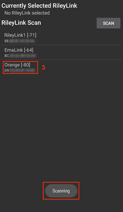 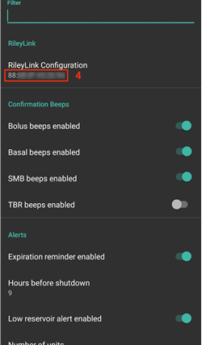

```{admonition} Older screenshot
:class: note
Skärmbilderna ovan är från en tidigare version av **AAPS**. I **AAPS** 4 lägger du till en enhet med **Parkoppla RileyLink** på pumpskärmen för Omnipod i stället för med **RileyLink Configuration** i Omnipod-inställningarna, och sökningen startar automatiskt.
```

Det finns ingen separat knapp för att ta bort en parkopplad enhet. Om du slutar använda en RileyLink, parkoppla bara den nya när du behöver den.


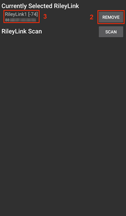

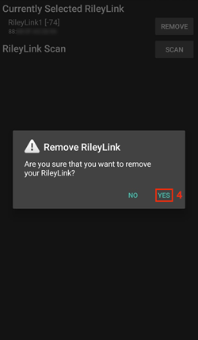


```{admonition} Older screenshot
:class: note
Skärmbilderna ovan är från en tidigare version av **AAPS**. I **AAPS** 4 finns ingen knapp **Ta bort**: när du parkopplar en ny RileyLink ersätter den den tidigare.
```

## Statusrad och Careportal

Det finns några saker som är speciella för Omnipod-podden jämfört med slangpumpar, särskilt efter att du har satt på en ny pod.

Åldern för **insulin** och **kanyl** i [statusraden](#screens-sensor-level-battery) på huvudskärmen **nollställs** till 0 dagar och 0 timmar **efter varje podbyte**. Det beror på hur Omnipod-pumpen är byggd och fungerar. **Pumpbatteriet** och **insulinreservoaren** sitter inbyggda i varje pod. Eftersom podden för in kanylen direkt i huden där podden sitter används ingen vanlig slang i Omnipod-pumpar. *Därför nollställs åldern för dessa värden automatiskt efter ett podbyte.* **Pumpbatteriets ålder** visas inte, eftersom batteriet i podden alltid räcker längre än poddens livslängd (högst 80 timmar).


### Nivåer

**Insulinnivå**

Mängden insulin i en Omnipod Eros-pod rapporteras inte exakt. Det beror på att man inte vet exakt hur mycket insulin som fylldes i podden, bara att minst 80 U har fyllts på när de 2 pipen hörs under påfyllningen. En pod rymmer högst 200 U. Förfyllningen kan också ge variationer, eftersom den inte är en exakt process. Med tanke på båda dessa faktorer är Omnipod-drivrutinen skriven för att ge en så bra uppskattning som möjligt av insulinet som finns kvar i reservoaren.

> - **Över 50 U** – visar värdet 50+U när det finns mer än 50 U kvar i reservoaren.
> - **Under 50 U** – visar ett uppskattat, beräknat värde för insulinet som finns kvar i reservoaren.
> - **SMS** – svarar med värdet eller 50+U i SMS-svar
> - **Nightscout** – laddar upp värdet 50 till Nightscout när det är över 50 U (version 14.07 och äldre).  Nyare versioner visar värdet 50+ när det är över 50 U.

**Batterinivå**

Rapportering av batterinivå är en inställning som du kan aktivera för att visa aktuell batterinivå för pod-kommunikationsenheter som OrangeLink, EmaLink eller DiaLink.  RileyLink-hårdvaran kan inte rapportera sin batterinivå.  Batterinivån rapporteras efter varje kommunikation med podden, så när enheten laddas ser du kanske inte en jämn ökning.  En manuell uppdatering visar aktuell batterinivå.  När en pod-kommunikationsenhet som stöds kopplas från visas värdet 0 %.

> - **RileyLink-hårdvaran kan INTE rapportera batterinivå**
> - **Inställningen "Visa batterinivå som rapporteras av OrangeLink/EmaLink/DiaLink" MÅSTE vara aktiverad i Omnipod-inställningarna för att batterinivån ska visas**
> - **Rapportering av batterinivå fungerar BARA för OrangeLink, EmaLink och DiaLink**
> - **Rapportering av batterinivå KAN fungera för andra enheter (men inte för RileyLink)**
> - **SMS** – svarar med aktuell batterinivå när det finns en verklig nivå. Värdet n/a skickas inte
> - **Nightscout** – batterinivån rapporteras när det finns en verklig nivå. Värdet n/a rapporteras inte

(OmnipodEros-troubleshooting)=

## Felsökning

### Podfel

Poddar går ibland sönder av olika skäl, bland annat på grund av hårdvarufel i själva podden. Det är bäst att inte ringa Insulet om dessa fel, eftersom AAPS inte är en godkänd användning. En lista med felkoder finns [här](https://github.com/openaps/openomni/wiki/Fault-event-codes) och kan hjälpa dig att hitta orsaken.

### Förebygga podfel 49

Detta fel beror på att podden är i fel tillstånd för ett kommando, eller på ett fel under ett kommando för insulinleverans. Vi rekommenderar att du ställer in synkroniseringen med Nightscout på *bara uppladdning*: låt alla alternativ "Ta emot ... från NS" vara avstängda i synkroniseringsinställningarna för Nightscout-klienten (se [Nightscout](../SettingUpAaps/Nightscout.md)) för att undvika möjliga fel.

### Larm om att pumpen inte kan nås

Vi rekommenderar att du ställer in larm för otillgänglig pump på **120 minuter**. Tryck på ikonen **Inställningar** (kugghjul) uppe till höger på huvudskärmen, välj **Lokala larm** > **Tröskel för otillgänglig pump** och ställ in den på **120**.

(OmnipodEros-import-settings-from-previous-aaps)=
### Importera inställningar från tidigare AAPS

```{admonition} Importing settings can end your active Pod
:class: warning
På telefonen som redan styr podden, låt **Byt även pumpinställningar** vara avbockad: podsessionen behålls och bara de andra inställningarna importeras. Markera den bara med en fil som exporterades under den pod som du har på dig nu. Se [Slanglösa pumpar](#ExportImportSettings-tubeless-pumps).
```

Det säkraste sättet att installera om **AAPS** är mellan två poddar:

1. Inaktivera din pod-session. Kontrollera att du inte har någon aktiv pod-session.
2. Exportera dina inställningar och spara en kopia på ett säkert ställe.
3. Avinstallera den tidigare versionen av AAPS och starta om telefonen.
4. Installera den nya versionen av AAPS och kontrollera att du inte har någon aktiv pod-session.
5. Importera dina inställningar och aktivera din nya pod.

### Varningar från Omnipod-drivrutinen

Observera att Omnipod-drivrutinen visar flera olika varningar på **huvudskärmen**. De flesta är bara information och kan stängas, medan vissa talar om vad du ska göra för att åtgärda orsaken till varningen. Här nedan finns en sammanfattning av de viktigaste varningarna som du kan stöta på:

#### Ingen aktiv pod

Ingen aktiv pod-session hittades. Du kan tillfälligt stänga varningen genom att trycka på **SNOOZE**, men den kommer tillbaka så länge ingen ny pod har aktiverats. När en pod har aktiverats tystas varningen automatiskt.

#### Pod pausad

Informationsvarning om att podden har pausats.

#### Det gick inte att ställa in basalprofilen. Leveransen kan vara pausad! Uppdatera podstatus manuellt på pumpskärmen och återuppta leveransen om det behövs.

Informationsvarning om att inställningen av poddens basalprofil har misslyckats. Öppna pumpskärmen för Omnipod och tryck på **Uppdatera**, och sedan på **Återuppta insulintillförsel** om det behövs.

#### Det gick inte att verifiera om SMB bolus lyckades. Om du är säker på att bolus misslyckades, bör du manuellt ta bort posten från Behandlingar.

Varning om att det inte gick att verifiera om SMB-bolusen lyckades. Kontrollera fältet **Senaste bolus** på pumpskärmen för Omnipod för att se om SMB:en lyckades. Om den inte lyckades, ta bort posten från behandlingarna.

#### Osäkert om "bolus/TBR/SMB" slutfördes, kontrollera manuellt om det lyckades.

På grund av hur RileyLink och Omnipod kommunicerar kan det hända att det är *osäkert* om ett kommando har utförts. Därför behövde användaren få veta om denna osäkerhet.

Här är några exempel på när en avisering om osäkerhet kan visas.

- **Bolusar** – osäkra bolusar kan inte kontrolleras automatiskt. Aviseringen visas tills nästa bolus, men en manuell uppdatering av podden tar bort meddelandet. *Som standard är varningspip aktiverade för denna typ av avisering, eftersom användaren måste kontrollera dem manuellt.*
- **Tillfälliga basaler, podstatus, profilbyten, tidsändringar** – en manuell uppdatering av podden tar bort meddelandet.
- **Tidsavvikelse i podden -** När tiden i podden och tiden i telefonen skiljer sig för mycket är det svårt för AAPS loop att fungera och göra korrekta prognoser och dosrekommendationer. Om tidsskillnaden mellan podden och telefonen är mer än 5 minuter visas knappen **Ställ in tid** på pumpskärmen för Omnipod. Tryck på **Ställ in tid** för att synkronisera tiden i podden med tiden i telefonen. Om **Pod-status** visar **Pausad** efteråt, tryck på **Återuppta insulintillförsel** för att fortsätta med normal pod-drift.

## Bästa praxis

(OmnipodEros-optimal-omnipod-and-rileylink-positioning)=

### Bästa placering av Omnipod och RileyLink

Antennen som RileyLink använder för att kommunicera med en Omnipod-pod är en spiralantenn (helixantenn) för 433 MHz. På grund av sin konstruktion sänder den en rundstrålande signal, formad som en tredimensionell munk, där z-axeln är den stående antennen. Det betyder att det finns bästa lägen för RileyLink, särskilt när podden aktiveras och inaktiveras.


> *(Fig. 1. Grafisk bild av en spiralantenn med rundstrålande mönster*)

Av säkerhetsskäl måste *aktiveringen* av podden göras på *kortare avstånd (cirka 30 cm eller mindre)* än andra åtgärder, som att ge en bolus, starta en tillfällig basal eller bara uppdatera podstatus. På grund av hur signalen sänds från RileyLinks antenn rekommenderas det INTE att lägga podden direkt ovanpå eller precis bredvid RileyLink.

Bilden nedan visar hur du bäst placerar RileyLink när du aktiverar och inaktiverar podden. Podden kan aktiveras i andra lägen också, men du lyckas oftast med läget på bilden nedan.

*OBS: Om kommunikationen misslyckas trots att podden och RileyLink är rätt placerade kan det bero på lågt batteri, som minskar räckvidden för RileyLinks antenn. Undvik detta genom att se till att RileyLink är fulladdad eller ansluten direkt till en laddkabel under tiden.*


## Var du kan få hjälp

Allt utvecklingsarbete för Omnipod-drivrutinen görs av communityn på frivillig basis. Vi ber dig att visa hänsyn och följa dessa riktlinjer när du ber om hjälp:

- **Nivå 0:** Läs det relevanta avsnittet i den här dokumentationen så att du förstår hur funktionen som du har problem med ska fungera.
- **Nivå 1:** Om du fortfarande har problem som du inte kan lösa med hjälp av detta dokument, gå till kanalen *#androidaps* på **Discord** med [denna inbjudningslänk](https://discord.gg/4fQUWHZ4Mw).
- **Nivå 2:** Sök bland befintliga ärenden för att se om ditt problem redan har rapporterats. Om inte, skapa ett nytt [ärende](https://github.com/nightscout/AndroidAPS/issues) och bifoga dina [loggfiler](../GettingHelp/AccessingLogFiles.md).
- **Ha tålamod – de flesta i vår community är vänliga frivilliga, och att lösa problem kräver ofta tid och tålamod från både användare och utvecklare.**
