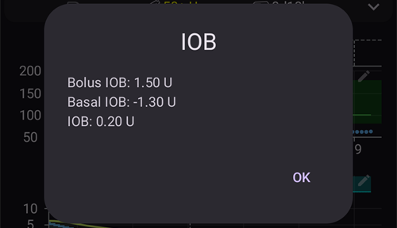
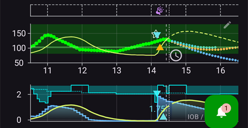
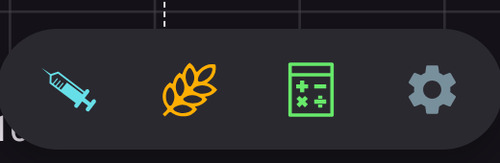
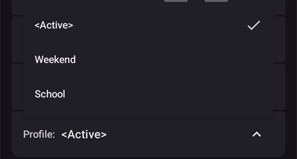
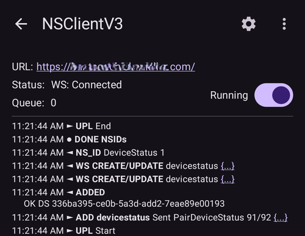
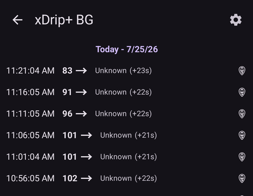

# AAPS-skärmar

```{contents}
:backlinks: entry
:depth: 2
```

(the-homescreen)= (AapsScreens-the-homescreen)=

## Huvudskärmen


Detta är den första skärmen du ser när du öppnar **AAPS**, och den innehåller det mesta av den information du behöver i vardagen.

### Avsnitt A – Övre fältet

* **Menyn** (☰) till vänster öppnar navigeringsmenyn med **Behandlingshistorik**, **Historikläsare**, **Statistik**, **Profilguide**, **Underhåll**, **Installationsguide**, **Konfiguration** och mer.
* **Sökfältet** hittar inställningar, dialogrutor och dokumentation – börja bara skriva (se [Global sökning](../DailyLifeWithAaps/GlobalSearch.md)).
* Ikonen **Inställningar** (kugghjulet) till höger öppnar alla [inställningar](../SettingUpAaps/Preferences.md).

(aaps-screens-profile--target)=

### Avsnitt B – Statusblocket

#### Nuvarande blodsocker

Det senaste blodsockervärdet från din CGM visas i den stora cirkeln till vänster, tillsammans med skillnaden mot föregående värde (delta) och hur gammalt värdet är.

Färgen på BG-värdet visar läget i förhållande till det angivna [intervallet](#Preferences-range-for-visualization).

* grönt = inom målområdet
* rött = under målområdet
* gult = över målområdet

  

(loop-status)= (AapsScreens-loop-status)=

#### Loopstatus


Bredvid BG-cirkeln visar en ikon loopens körläge (uppifrån och ner i bilden):

1. Grön cirkel = [sluten loop](#KeyAapsFeatures-ClosedLoop), loopen körs
2. Lila cirkel med prickad linje = [paus vid lågt blodsocker (LGS)](#KeyAapsFeatures-LGS)
3. Blå cirkel med prickad linje = [öppen loop](#KeyAapsFeatures-OpenLoop)
4. Röd cirkel med kryss = loopen inaktiverad (fungerar inte, permanent)
5. Röd pausikon = loopen pausad (tillfälligt pausad, men basalinsulin ges) – återstående tid visas bredvid ikonen
6. Grå cirkel med kontakt = pumpen frånkopplad (tillfälligt ingen insulindosering alls) – återstående tid visas bredvid ikonen

Tryck på ikonen för att öppna dialogrutan för loopen. Vad dialogrutan innehåller beror på det nuvarande läget:

* När loopen **körs** (sluten, öppen eller LGS) kan du byta körläge (Sluten loop, Paus vid lågt blodsocker, Öppen loop eller Inaktivera loop), **pausa** loopen eller **koppla ifrån** pumpen under en vald tid.
* När loopen är **inaktiverad** kan du aktivera den igen genom att välja ett körläge, eller koppla ifrån pumpen.
* När loopen är **pausad** kan du **återuppta** den, koppla ifrån pumpen eller välja en ny tid under **Pausa loop** för att förlänga pausen.
* När pumpen är **frånkopplad** kan du **återansluta** pumpen, eller välja en ny tid under **Koppla från pumpen** för att förlänga frånkopplingen.

När du förlänger en paus eller en frånkoppling **börjar den nya tiden nu**: den ersätter den återstående tiden, den läggs inte till den. Du behöver inte återuppta eller återansluta först.

Dialogrutan när loopen körs i sluten loop:


Dialogrutan när loopen är pausad, med **Återuppta** och tiderna för att förlänga pausen:


Dialogrutan när pumpen är frånkopplad, med **Återanslut pump** och tiderna för att förlänga frånkopplingen:


Dialogrutan i Paus vid lågt blodsocker, i öppen loop och när loopen är inaktiverad skiljer sig bara i vilka körlägen den erbjuder:


Så här ser huvudskärmen ut i varje läge. Färgbandet överst i grafen ändras vid tidpunkten för bytet.

Paus vid lågt blodsocker:


Öppen loop:


Loopen inaktiverad:


Loopen pausad – den återstående tiden visas bredvid ikonen:


Pumpen frånkopplad – den återstående tiden visas bredvid ikonen. Behandlingsknapparna finns kvar i verktygsfältet Snabbstart, så du kan fortfarande registrera insulin som du har gett med penna, eller kolhydrater:


Efter varje val måste du bekräfta.

```{admonition} Larm: pumpen godkände inte den tillfälliga nollbasalen :class: warning Medan pumpen är frånkopplad håller **AAPS** en tillfällig basal på noll i pumpen och ställer in den igen om den saknas. Om detta fortfarande misslyckas efter 10 minuter ger **AAPS** ett brådskande larm: *"Pumpen godkände inte den tillfälliga nollbasalen. Det är möjligt att den fortfarande ger basalinsulin. Kontrollera pumpen."* Larmet upprepas var 15:e minut tills den tillfälliga nollbasalen är inställd eller frånkopplingen slutar. Om du ser larmet, kontrollera din pump: den kan ge basalinsulin även om **AAPS** visar den som frånkopplad.

    <br />Obs: vilka lägen som erbjuds beror på hur långt du har kommit i [Mål](../SettingUpAaps/CompletingTheObjectives.md) – Sluten loop och LGS blir tillgängliga först när du klarar dem.
    
    (aaps-screens-bg-warning-sign)=
    #### Varningstecken för BG
    
    Om **AAPS** upptäcker ett problem med de BG-värden som kommer in visas en genväg till din BG-källa (med dess namn, till exempel **xDrip+ BG**) i det nedre fältet på huvudskärmen, med en röd varningsbricka. Tryck på den för att öppna [skärmen för BG-källan](#aaps-screens-bg-source).
    
    ##### Dubbla BG-data
    
    Det röda varningstecknet säger att du måste agera direkt: du tar emot **dubbla BG-data**, och det hindrar loopen från att fungera rätt. **AAPS** kan inte beräkna din BG-trend på ett säkert sätt från dubbla värden, så den slutar korrigera.
    
    Om din loop var sluten byter **AAPS** till läget [Paus vid lågt blodsocker (LGS)](#KeyAapsFeatures-LGS): loopikonen blir lila.
    
      
    
    Tryck på loopikonen: kortet **Begränsningar** överst talar om varför: "BgQualityCheck: LGS-läge på grund av dubblerade värden från BG-källan".
    
      
    
    ```{admonition} Din loop körs i Paus vid lågt blodsocker
    :class: note
    Din loop fortsätter att köra, men bara för att skydda dig mot låga värden: **AAPS** kan fortfarande sänka eller pausa din basal, men den ger inget korrigeringsinsulin förrän du har löst problemet!
    

Du måste ta reda på varför du får dubbla BG-värden:

* Är Dexcom bridge aktiverat på din Nightscout-webbplats? Stäng av bridge i administrationspanelen för din Nightscout-instans: redigera variabeln "enable" och ta bort delen "bridge" där. (För Heroku [finns mer information här](https://nightscout.github.io/troubleshoot/troubleshoot/#heroku).)
* Laddar flera källor upp ditt BG till Nightscout? Om du använder BYODA-appen, aktivera uppladdningen i **AAPS**, men aktivera den inte i xDrip, om du använder den.
* Har du följare som tar emot ditt BG men som också laddar upp det igen till din Nightscout-webbplats?
* Sista utväg: I [NSClient-inställningar](#Preferences-nsclient), välj inställningarna för Synkronisering och stäng av alternativet "Ta emot CGM-data från NS".

För att ta bort varningen direkt och få loopen att korrigera igen, radera de dubbla värdena på skärmen för BG-källan: tryck på genvägen i det nedre fältet. Det dubbla värdet är markerat i rött. Tryck länge på ett värde för att börja markera, kryssa i dubbletterna och tryck på papperskorgsikonen uppe till höger.


Om det finns många dubbletter kan det dock vara enklare att

* [säkerhetskopiera dina inställningar](../Maintenance/ExportImportSettings.md),
* återställa din databas i underhållsmenyn och
* [importera dina inställningar](../Maintenance/ExportImportSettings.md) igen

    {admonition} Byt själv tillbaka till Sluten loop
    :class: important
    **AAPS** går inte tillbaka till **Sluten loop** av sig själv när dubbletterna är borta. Tryck på loopikonen på huvudskärmen och välj **Sluten loop** igen.

##### Platta BG-data

Med vissa BG-källor (Libre 1, AiDEX, Glutec, Medtronic och källor som inte rapporterar sin sensortyp) kontrollerar **AAPS** också om värdena inte ändras: om ditt BG har ändrats mindre än 2 mg/dl (0,1 mmol/l) under 45 minuter anses data vara fel. Genvägen till BG-källan visar då en röd bricka för platt trend, och loopen stoppar all hög tillfällig basal och ger inget korrigeringsinsulin förrän värdena ändras igen. Kontrollera din sensor och den app som skickar värdena.

##### Oregelbundna BG-data

När värden kommer med oregelbundna intervall eller när några saknas räknar **AAPS** om 5-minutersvärden från de värden den har. Detta händer till exempel efter ett sensorbyte, eller med Libre-sensorer, vars tidpunkt glider en minut eller två med några timmars mellanrum. Loopen fortsätter att fungera och du behöver inte göra något. **AAPS** 4 visar inte längre något gult varningstecken för detta.

#### Nuvarande profil

Den nuvarande profilen visas bredvid stjärnikonen.

Tryck på profilnamnet för att öppna [skärmen Profil](#aaps-screens-profile). Där kan du se detaljerna i profilen och [byta mellan olika profiler](../DailyLifeWithAaps/ProfileSwitch-ProfilePercentage.md).

För att **ändra profilens procent** (och dess varaktighet), tryck på profilnamnet och sedan på den runda knappen **▶** (Aktivera) nere till höger på skärmen Profil. I **AAPS** 3.x öppnades den här skärmen med ett långt tryck på profilnamnet. I **AAPS** 4 händer ingenting vid ett långt tryck. Steg för steg: [Ändra profilens procent](#ProfileSwitch-change-percentage).


1. Vanlig visning med en vanlig profil aktiverad.
2. Profilbyte med en viss procent på 90 % och en återstående tid på 9 minuter – profilnamnet blir gult medan ett tillfälligt profilbyte pågår.
3. Profilbyte med en tidsförskjutning på 1 timme och en återstående tid på 9 minuter.

#### Målvärde


Det nuvarande målvärdet för blodsockret visas under profilnamnet.

Tryck kort på målvärdet för att öppna skärmen **[Tillfälligt målvärde](../DailyLifeWithAaps/TempTargets.md)**.

1. Vanlig visning: det målintervall som anges i din profil.
2. Om ett tillfälligt målvärde är inställt blir målvärdet gult/orange med ikonen för den förinställning som används, och den återstående tiden i minuter visas inom parentes.

(AapsScreens-visualization-of-dynamic-target-adjustment)=

#### Visning av dynamisk justering av målvärdet

När du använder [SMB-algoritmen](#Config-Builder-aps) och funktionen [Autosens](#Open-APS-features-autosens) kan **AAPS** justera ditt målvärde dynamiskt utifrån känsligheten.

Aktivera ett av eller båda följande alternativ i [inställningarna för OpenAPS SMB](#Preferences-openaps-smb-settings):

* "Känslighet höjer målvärdet" och/eller
* "Insulinresistens sänker målvärde"

Om **AAPS** upptäcker resistens eller känslighet ändras målvärdet från det som är inställt i profilen, och det visade målvärdet byter färg för att visa justeringen.

(aaps-screens-iob-cob-basal-sens)=

#### IOB, COB, basal och känslighet


1. **Spruta**: aktivt insulin (IOB) – mängden insulin som fortfarande verkar i din kropp  
    Värdet för aktivt insulin skulle vara noll om bara din vanliga basal kördes och det inte fanns något insulin kvar från tidigare bolusar. 
    * IOB kan vara negativ om du nyligen har haft perioder med sänkt basal.
    * Tryck på chipet för att se uppdelningen i bolusinsulin och basalinsulin (första dialogrutan i bilden – här med negativ IOB efter en period med sänkt basal)
2. **Sädesax**: [aktiva kolhydrater (COB)](../DailyLifeWithAaps/CobCalculation.md) – kolhydrater som du har ätit tidigare och som ännu inte tagits upp
3. Den blågröna knappen till höger visar den **nuvarande basalleveransen**: en rak linje när profilens basal körs, en ändrad ikon när en tillfällig basal är aktiv
4. **Procentraden** visar den nuvarande känsligheten ([Autosens](#Open-APS-features-autosens) / [DynamicISF](../DailyLifeWithAaps/DynamicISF.md)). När loopen ändrar din ISF visar raden också profilens ISF, en pil och den ISF som loopen använder nu, till exempel "80% 2,0 ↗ 2,5". Tryck på den för att se Autosens-värdet och den effektiva ISF (andra dialogrutan i bilden). Om loopen arbetar med ett annat värde än det senaste Autosens-resultatet (till exempel för att ett tillfälligt målvärde ändrar din känslighet) visar dialogrutan också det värdet som **Autosens i algoritm**. När Autosens är avstängt behåller loopen profilens ISF och ingen effektiv ISF visas.

Dialogrutan för IOB, som öppnas när du trycker på IOB-chipet:



Tryck på den blågröna knappen för att se den tillfälliga basal som körs, när den startade och hur länge den har körts:


(aaps-screens-carbs-required)=

#### Kolhydrater behövs


Förslag om kolhydrater ges när referensdesignen upptäcker att du behöver kolhydrater.

Detta händer när oref-algoritmen bedömer att den inte kan rädda dig med tillfällig basal på noll, och du behöver kolhydrater för att rätta till det.

Aviseringarna om kolhydrater är mycket mer avancerade än kalkylatorns. Du kan se ett förslag om kolhydrater även om kalkylatorn inte visar några saknade kolhydrater.

Aviseringar om att kolhydrater behövs kan skickas till Nightscout om du vill. Då visas och sänds ett meddelande.

### Avsnitt C – Statusraden


Statusraden ger en visuell varning för

* Kanylålder
* Insulinålder (antal dagar reservoaren har använts) och reservoarnivå (enheter)
* Sensorålder
* Pumpbatteriets ålder och nivå (%)

Om varningströskeln överskrids visas värdena i gult.

Om den kritiska tröskeln överskrids visas värdena i rött.

Åldern visas alltid i kort form, oavsett skärmstorlek: *4h* första dagen, *3d4h* senare.

Trösklarna kan ändras med den lilla ikonen **Inställningar** som visas när statusraden är **utfälld** (vinkelpilen till höger) – se [Statuslampor](#Preferences-status-lights).

Den utfällda statuspanelen har också en knapp i slutet av vissa rader för att registrera ett byte, vilket nollställer motsvarande ålder: **Lägg till** på raden **Sensor** registrerar en sensorinsättning. Om din pump stöder det visas **Förfyllning** på raderna **Kanyl** (eller **Slanglös pump**) och **Insulin**, och **Lägg till** på raden **Pumpbatteri**.


Beroende på vilken pump du använder har du kanske inte alla de här ikonerna.

(screens-sensor-level-battery)=

#### Sensornivå (batteri)

Fungerar för CGM med en extra sändare, till exempel MiaoMiao 2. (Tekniskt sett måste sensorn skicka information om batterinivån till xDrip.)

Trösklarna kan ställas in i [Statuslampor](#Preferences-status-lights).

(aaps-screens-main-graph)=

### Avsnitt D – Huvudgrafen


Grafen visar ditt blodsocker (BG) så som det läses från din glukosmätare (CGM).

Använd skrollning och nypzoomning i grafen för att ändra det synliga tidsintervallet.

Det gröna området visar ditt målområde.

Den här informationen visas också i grafen:

* Manuella bolusar: blå triangel strax ovanför BG-kurvan, som pekar nedåt mot värdet vid den tidpunkten, med insulinmängden
* Kolhydratposter: orange triangel strax under BG-kurvan, som pekar uppåt mot värdet, med kolhydratmängden. En måltid som läggs in med sin bolus ser ut som en enda markering, delad av värdet.
* Trianglarna finns i tre storlekar (liten, mellan, stor), efter mängden jämfört med den största under dagen. Om det inte finns något BG-värde vid den tidpunkten (lucka i sensordata) ritas triangeln längst ner i grafen.
* BG-kontroller och kalibreringar: ritas vid sitt eget uppmätta värde, så att du kan jämföra dem med sensorkurvan
* Målvärde enligt profilen eller ändrat av ett tillfälligt målvärde: grön linje
* Profilbyten: stjärnikoner överst i grafen
* Loopstatus: färgband överst i grafen när [körläget](#AapsScreens-loop-status) är något annat än sluten loop: blått = öppen loop, lila = LGS, rött = loopen inaktiverad, gult = loopen pausad, grått = pumpen frånkopplad, orange = superbolus (i skärmbilden: först lila, sedan gult). Historiken över dessa ändringar finns i [Körläge](#AapsScreens-running-mode)
* [SMB:er](#Open-APS-features-super-micro-bolus-smb) ritas inte i BG-grafen (det skulle bli en med några minuters mellanrum): de visas i [IOB-grafen](#aaps-screens-iob).

Tryck på en **BG-kontroll** i grafen för att se dess värde och din anteckning, om du har skrivit en.

(aaps-screens-graph-press-and-hold)=

#### Se värdena vid en viss tidpunkt

**Tryck och håll** en stund på BG-grafen för att se värdena vid ett värde. En punkt markerar det närmaste värdet, en streckad linje ritas vid den tidpunkten i alla grafer, och en ruta överst i grafen visar:

* tiden och BG-värdet
* IOB, COB (bara när det är över 0 g) och basaldosen vid den tidpunkten – basalikonen visar om en tillfällig basal kördes, som på huvudskärmen
* eventuell bolus, SMB eller kolhydrater vid den tidpunkten, med samma trianglar som i graferna

Håll kvar fingret på skärmen och flytta det åt vänster eller höger för att gå från ett värde till nästa. Du känner en lätt vibration vid varje värde, och grafen skrollar inte medan du gör detta. Rutan finns kvar i 2 sekunder efter att du har lyft fingret.

Det fungerar på samma sätt i de [extra graferna](#aaps-screens-additional-graphs) under BG-grafen (IOB, COB ...): tryck och håll på någon av dem.


(aaps-screens-graph-clock-change)=

#### Klockändringar

När telefonens klocka hoppade, vid byte till eller från sommartid eller i en ny tidszon, markerar en streckad lodrät linje det ögonblicket i BG-grafen, med en liten klockikon längst ned. Samma streckade linje går också genom de [extra graferna](#aaps-screens-additional-graphs) nedanför.



(AapsScreens-activate-optional-information)=

#### Aktivera extra information

Tryck på **penn**ikonen i grafens övre högra hörn för att öppna grafinställningarna:


* **Grafhöjd** ändrar hur hög grafen ritas.
* **AKT** lägger till insulinets aktivitetskurva: en heldragen gulgrön linje <span style="background:#141218;color:#D3F166;padding:0 0.3em;border:1px solid #141218;border-radius:4px">━━━━</span> (blanda inte ihop den med den prickade gula UAM-prognosen)
* **PRED** lägger till [prognoslinjerna](#aaps-screens-prediction-lines) (se nedan)

(aaps-screens-prediction-lines)=

#### Prognoslinjer

När **PRED** är på ritar AAPS sina prognoser som **prickade linjer** till höger om linjen för ”nu”. Varje prognos har sin egen färg. Det mörka temat använder ljusare nyanser av samma färger, och en linje inom det gröna målområdet kan se lite grönare ut.

| Linje                   | Ljust tema                                                                                                                        | Mörkt tema                                                                                                                         | Vad den förutsäger                           |
| ----------------------- | --------------------------------------------------------------------------------------------------------------------------------- | ---------------------------------------------------------------------------------------------------------------------------------- | -------------------------------------------- |
| **IOB** (blå)           | <span style="background:#FFFFFF;color:#1E88E5;padding:0 0.3em;border:1px solid #CCCCCC;border-radius:4px">●●●●</span>             | <span style="background:#141218;color:#64B5F6;padding:0 0.3em;border:1px solid #141218;border-radius:4px">●●●●</span>              | bara insulin                                 |
| **COB** (orange)        | <span style="background:#FFFFFF;color:#FB8C00;padding:0 0.3em;border:1px solid #CCCCCC;border-radius:4px">●●●●</span>             | <span style="background:#141218;color:#FFB74D;padding:0 0.3em;border:1px solid #141218;border-radius:4px">●●●●</span>              | aktiva kolhydrater                           |
| **UAM** (gul)           | <span style="background:#FFFFFF;color:#C9BD60;padding:0 0.3em;border:1px solid #CCCCCC;border-radius:4px">●●●●</span>             | <span style="background:#141218;color:#E6D39A;padding:0 0.3em;border:1px solid #141218;border-radius:4px">●●●●</span>              | oannonserad måltid                           |
| **ZT** (cyan)           | <span style="background:#FFFFFF;color:#00D2D2;padding:0 0.3em;border:1px solid #CCCCCC;border-radius:4px">●●●●</span>             | <span style="background:#141218;color:#4DD4D4;padding:0 0.3em;border:1px solid #141218;border-radius:4px">●●●●</span>              | tillfällig basal på noll (insulinet stoppat) |
| **aCOB** (blekt orange) | <span style="background:#FFFFFF;color:rgba(251,140,0,0.5);padding:0 0.3em;border:1px solid #CCCCCC;border-radius:4px">●●●●</span> | <span style="background:#141218;color:rgba(255,183,77,0.5);padding:0 0.3em;border:1px solid #141218;border-radius:4px">●●●●</span> | bara den äldre AMA-algoritmen                |

När två prognoser ger samma värden överlappar deras prickar och du ser bara en av färgerna (till exempel UAM ovanpå IOB när BG är stabilt).

* **COB**-linjen (orange): [aktiva kolhydrater](CobCalculation.md) (orange används i hela AAPS för COB och kolhydrater)
    
    Den här prognoslinjen visar vart ditt BG (inte COB självt!) kommer att gå utifrån de nuvarande inställningarna i **Profil**, om man antar att avvikelserna från kolhydratupptaget förblir konstanta. Den här linjen visas bara om det finns kända COB.

* **IOB**-linjen (blå): aktivt insulin (blått används i hela AAPS för IOB och insulin)
    
    Den här prognoslinjen visar vad som skulle hända om bara insulin påverkade. Till exempel om du gav lite insulin och sedan inte åt några kolhydrater.

* **ZT**-linjen (cyan): tillfällig basal på noll (förväntat BG om en tillfällig basal på 0 % skulle ställas in)
    
    Den här prognoslinjen visar hur BG-kurvan skulle ändras om pumpen stoppade all insulinleverans (tillfällig basal på 0 %). Linjen slutar när den stiger över ditt målvärde.
    
    *Den här linjen visas bara när [SMB](#Config-Builder-aps)-algoritmen används.*

* **UAM**-linjen (gul): [oannonserade måltider](#SensitivityDetectionAndCob-sensitivity-oref1)
    
    Oannonserade måltider betyder att en tydlig ökning av glukosnivån upptäcks, på grund av måltider, adrenalin eller annat. Prognoslinjen liknar den **orange COB-linjen**, men den antar att avvikelserna minskar i jämn takt (genom att fortsätta den nuvarande minskningstakten).
    
    *Den här linjen visas bara när [SMB](#Config-Builder-aps)-algoritmen används, **Aktivera UAM** är på i inställningarna för OpenAPS SMB och BG stiger mer än insulinet ensamt kan förklara.*

* **aCOB**-linjen (blek, genomskinlig orange): accelererat kolhydratupptag
    
    Liknar COB, men antar ett fast kolhydratupptag på 10 mg/dl/5m (0,555 mmol/l/5m). Föråldrad och till liten nytta.
    
    *Den här linjen visas bara när den äldre [AMA](#Config-Builder-aps)-algoritmen används.*

Oftast hamnar din verkliga glukoskurva mitt emellan de här linjerna, eller nära den linje vars antaganden bäst stämmer med din situation.

(aaps-screens-how-predictions-become-a-dosing-decision)=

#### Hur AAPS gör prognoser till ett beslut om dosering

AAPS doserar inte insulin bara utifrån ditt nuvarande BG – vid varje loopcykel (ungefär var 5:e minut) tittar den på alla prognoslinjerna ovan tillsammans och räknar ut det säkraste sättet att agera.

Grundregeln är **säkerheten först**: om *någon* prognoslinje, inom någon tidsram, går under din nedre säkerhetströskel ger AAPS en tillfällig basal på noll (tillfällig basal på 0 %) och håller inne med mer insulin, även om ditt nuvarande BG är högt. Först när alla prognoslinjer ligger över den tröskeln överväger AAPS att ge mer insulin.

När det är säkert att ge mer insulin tittar AAPS på var BG till slut förväntas hamna (det **slutliga BG**) i de sammanvägda prognoserna, och räknar ut hur mycket korrigering som behövs för att få tillbaka det slutliga BG till målvärdet – antingen som en höjd tillfällig basal eller (om algoritmen oref1/[SMB](#Open-APS-features-super-micro-bolus-smb) är aktiverad) som en liten omedelbar bolus. Om BG är högt nu men redan sjunker tillräckligt av sig självt väntar AAPS, eller kan till och med sänka basaldosen, i stället för att ge insulin som bara skulle göra ett senare lågt värde ännu lägre.

Exempel på den här beslutslogiken med riktiga skärmbilder finns i [doseringsexemplen i guiden för vårdpersonal](#clinicianguide-dosing-scenarios) – de är skrivna för vårdpersonal men gäller alla som använder AAPS.

*En fullständig teknisk beskrivning av hur prognoserna och doseringsbeslutet beräknas finns i [OpenAPS dokumentation om determine-basal](https://openaps.readthedocs.io/en/latest/docs/While%20You%20Wait%20For%20Gear/Understand-determine-basal.html).*

#### Basaldoser

En **heldragen blå** linje visar pumpens basalleverans och visar den faktiska leveransen över tid.

Den **prickade blå** linjen visar vad basaldosen skulle vara utan tillfälliga basaljusteringar (tillfälliga basaler, TBR).

När den vanliga basaldosen ges visas ytan under kurvan i mörkblått. När basaldosen tillfälligt justeras (höjs eller sänks) visas ytan under kurvan i ljusblått.

#### Aktivitet

Den **tunna gula** linjen visar insulinets aktivitet.

Den bygger på den förväntade sänkningen av BG från insulinet i din kropp, om inga andra faktorer (som kolhydrater) fanns.

(AapsScreens-section-g-additional-graphs)= (aaps-screens-additional-graphs)=

### Avsnitt E – Extra grafer

Du kan aktivera extra grafer under huvudgrafen. I [Enkelt läge](#preferences-simple-mode) är de extra graferna förinställda och kan inte ändras. Stäng av **Enkelt läge** om du vill ställa in de extra graferna själv.

De extra graferna följer huvudgrafen: när du skrollar eller zoomar BG-grafen flyttas de med. Om du drar i sidled i en extra graf skrollas också alla grafer. De har inga egna tidsetiketter – läs av tiden i BG-grafen.

För att ställa in en extra graf, tryck på **penn**ikonen i grafens övre högra hörn:


Välj de chip som motsvarar de data du vill se i den här grafen. Knappen **Ta bort** raderar grafen.

För att skapa en graf till, tryck på **Lägg till graf** under den sista grafen och välj dess chip på samma sätt:


Den nya grafen läggs till under de andra – här en andra extra graf med **SENS%** och **AVVIK**:


De flesta användare tycker att följande inställning av extra grafer räcker:

* Graph 1 with IOB, BAS
* Graph 2 with COB, Sensitivity change
* Graph 3 with Deviations and BGI.

#### Absolut insulinmängd (ABS)

Aktivt insulin inklusive bolusar **och basal**.

(aaps-screens-iob)=

#### Aktivt insulin (IOB)

Visar ditt aktiva insulin (IOB, = insulin som fortfarande verkar i kroppen). Det omfattar insulin från bolus och tillfällig basal (**men inte basaldoserna i din profil**).

Om det inte fanns några [SMB:er](#Open-APS-features-super-micro-bolus-smb), inga bolusar och ingen tillfällig basal under DIA-tiden skulle detta vara noll.

SMB:er visas i den här grafen som blå trianglar, i tre storlekar efter mängden jämfört med dagens största SMB.

IOB kan bli negativ om du inte har någon bolus kvar och har haft tillfällig basal på noll eller låg nivå under en längre tid.

Minskningen beror på dina [inställningar för DIA och insulintyp](#Config-Builder-insulin-dia).

#### Aktiva kolhydrater (COB)

Visar dina aktiva kolhydrater (COB, = kolhydrater i kroppen som ännu inte tagits upp).

Minskningen beror på de [avvikelser som algoritmen upptäcker](../DailyLifeWithAaps/CobCalculation.md).

Om den upptäcker ett högre kolhydratupptag än väntat ges insulin, och då ökar IOB (mer eller mindre, beroende på dina säkerhetsinställningar).

#### Känslighetsändring (SENS%)

Visar den känslighet som [Autosens](#Open-APS-features-autosens) har upptäckt.

Känslighet är en beräkning av insulinkänsligheten, som påverkas av träning, hormoner osv.

Observera att du måste vara på [Mål 8](#objectives-objective8) för att känslighetsdetektering/[Autosens](#Open-APS-features-autosens) ska kunna justera mängden insulin som ges automatiskt. Innan du når det målet visas linjen i grafen bara som information.

### Variabel känslighet (DISF)

Visar känsligheten så som den beräknas av [DynamicISF](../DailyLifeWithAaps/DynamicISF.md). Fylls bara i om du använder den här funktionen.

(screen-heart-rate-steps)=

#### Puls (PULS) & steg

Dessa data kan finnas när du använder en [Wear-klocka](../WearOS/WearOsSmartwatch.md). Aktivera dem i Wear-appen för **AAPS** och ge behörighet för hälsodata.

Steg visas som staplar, och pulsen som en böjd linje som bryts där klockan inte skickade några data.

#### Avvikelser (AVVIK)

* **Grå** staplar visar en avvikelse som beror på kolhydrater.
* **Gröna** staplar visar att BG är högre än algoritmen väntade sig. Gröna staplar används för att öka resistensen i [Autosens](#Open-APS-features-autosens).
* **Röda** staplar visar att BG är lägre än algoritmen väntade sig. Röda staplar används för att öka känsligheten i [Autosens](#Open-APS-features-autosens).
* **Gula** staplar visar en avvikelse som beror på UAM.
* **Svarta** staplar visar små avvikelser som inte räknas med för känsligheten

#### Blodglukospåverkan (-BGI)

Den här linjen visar hur mycket BG ”borde” stiga eller sjunka enbart utifrån insulinaktiviteten.


Det är bra att visa den här linjen tillsammans med avvikelsestaplarna. De har samma skala, men den skiljer sig från skalan för övriga extra data. Därför är det bra att visa dem i en egen graf, som ovan. Att jämföra BGI-linjen med avvikelsestaplarna är ett annat sätt att förstå hur **BG** varierar. Här, vid tidpunkten markerad **1**, ligger avvikelsestaplarna en bra bit över BGI-linjen: BG stiger mer än insulinaktiviteten ensam kan förklara (till exempel efter kolhydrater). Vid tidpunkten markerad **2** ligger avvikelsestaplarna under noll (röda): BG är lägre än algoritmen väntade sig.

### Avsnitt F – Verktygsfältet Snabbstart



Det flytande verktygsfältet längst ner på skärmen innehåller dina åtgärder för **[Snabbstart](../DailyLifeWithAaps/QuickLaunch.md)**. Det lilla **kugghjulet** öppnar inställningarna för Snabbstart, där du väljer vilka knappar som visas (behandlingar, Careportal-poster, CGM-åtgärder, skärmarna i panelen **Hantera**, knappar för [Snabbknapp](../DailyLifeWithAaps/QuickWizards.md), [Scener](../DailyLifeWithAaps/Scenes.md) och mer).

En vanlig inställning visas ovan: **Insulin**, **Kolhydrater** och **Kalkylator**.

Medan pumpen är **frånkopplad** finns behandlingsknapparna kvar i verktygsfältet, till exempel för att registrera insulin som du har gett med penna (se [Insulin](#aaps-screens-buttons-insulin) nedan). Samma åtgärder finns också i [panelen Behandlingar](#aaps-screens-treatments-sheet) i den nedre navigeringen.

(aaps-screens-buttons-insulin)=

#### Insulin


För att ge en viss mängd insulin utan att använda [kalkylatorn](#aaps-screens-bolus-wizard).

Om du aktiverar **Starta "Äta snart"** kan du automatiskt starta ditt [tillfälliga målvärde Äta snart](#TempTargets-eating-soon-temp-target).

Om du inte vill ge bolus via pumpen utan bara registrera en insulinmängd (t.ex. insulin som du har gett med penna), aktivera "**Bolus kommer bara att loggas (inte levereras av pumpen)**". En extra rad **Tid**, inställd på **Nu**, låter dig registrera en insulininjektion som du har gjort tidigare: använd **-** / **+** för att ändra den, eller tryck på vinkelpilen för att skriva in minuterna eller välja datum och tid.

 

Du kan använda knapparna **+0,5 / +1,0 / +2,0** för att snabbt öka insulinmängden. Stegen kan ändras i [inställningarna för kalkylatorn](#Preferences-deliver-this-part-of-bolus-wizard-result).

Dialogrutan Insulin kan också användas när pumpen är pausad eller frånkopplad, t.ex. för att registrera insulin som du har injicerat med penna. I så fall är "**Bolus kommer bara att loggas (inte levereras av pumpen)**" alltid på (visas i rött) och extra fält visas där du kan välja insulintyp och en förskjutning för **Tid** för en injektion som du har gjort tidigare:


#### Kolhydrater


För att registrera kolhydrater utan bolus.

Vissa [förinställda tillfälliga målvärden](#TempTargets-hypo-temp-target) (Hypo, Äta snart, Träning) kan startas direkt med reglagen överst.

**KH-tid**: När du ska äta eller har ätit kolhydraterna.

**Varaktighet**: Används för [”förlängda kolhydrater”](ExtendedCarbs.md). Den här raden är hopfälld så att du inte skriver in grammen i den av misstag: använd **-** / **+** för att ändra den, eller tryck på vinkelpilen för att öppna den och skriva ett värde.

Du kan använda knapparna **+5 / +10 / +20** för att snabbt öka kolhydratmängden.

#### Snabbknapp

Ange enkelt mängden kolhydrater och grunderna för beräkningen med en enda förinställd knapp.

Detaljerna ställs in i [Snabbknapp](../DailyLifeWithAaps/QuickWizards.md).

(aaps-screens-treatments-sheet)=

### Avsnitt G – Nedre navigeringen

Det nedre navigeringsfältet ger tillgång till:

* **Behandlingar** – en panel med snabbåtgärder för dina behandlingar:
    
    

* **Scener** – visas bara när du har minst en [scen](../DailyLifeWithAaps/Scenes.md) eller en regel i **Automation** som är markerad som **Användaråtgärd**. Den öppnar en panel där du kan starta dem. En bricka visar hur många du kan starta just nu. **Pennan** överst i panelen öppnar **Hantera → Scener**.

* **Hantera** – navet för allt du hanterar i **AAPS**: Profil, Insulininställningar, Tillfälligt målvärde, Snabbknappar, Scener, Automation, Matdatabas, Platsrotation, Pump och Auktoriserade klienter. Under dem finns åtgärder för enheter och basal, som Sensorinsättning och Tillfällig basal. Vissa poster visas bara när de gäller din utrustning – till exempel beror Förfyllning och batteribyte på din pump, och Tillfällig basal, Förlängd bolus och Careportal-posterna är dolda i [Enkelt läge](#preferences-simple-mode):
    
    

* **Mål** – hur långt du har kommit i [Mål](../SettingUpAaps/CompletingTheObjectives.md). En bricka visar hur många som är klara. Den här posten försvinner när alla mål är klara, och finns inte i **AAPSClient**.

(aaps-screens-notifications)=

#### Aviseringar

En **aviseringsbubbla** kan visas ovanför det nedre fältet, till höger. Den samlar de aktiva aviseringarna från **AAPS**. Den lilla siffran visar hur många de är. Dess färg följer den viktigaste aviseringen: röd för ett brådskande meddelande, grön för en enkel information.


Tryck på bubblan för att öppna panelen **Avisering**. Varje meddelande visar när det kom. Tryck på **Avfärda** under ett meddelande för att ta bort det. Vissa meddelanden har i stället en annan knapp som tar dig till den inställning som behöver din uppmärksamhet.


(bolus-wizard)= (aaps-screens-bolus-wizard)=

## Kalkylator


Det är härifrån du normalt ger en måltidsbolus.

### Avsnitt I

Rubriken **Beräkning** visar den beräknade bolusen. Om det aktiva insulinet redan är större än den beräknade bolusen visas bara mängden kolhydrater som fortfarande behövs.

Kalkylatorn kan användas oavsett ditt nuvarande **BG**, även när det är för högt eller för lågt. Om **BG** är över målvärdet läggs en korrigering till måltidsbolusen. Om **BG** är under målvärdet minskas bolusen. Om det aktiva insulinet är mer än vad som behövs talar kalkylatorn om hur mycket kolhydrater som fortfarande behövs, i stället för att föreslå insulin.

Ikonraden under rubriken visar vilka värden som tas med i beräkningen (BG, trend, IOB, tillfälligt målvärde, COB). Om du trycker på en ikon tas värdet med i eller bort från beräkningen. Ikonen **(i)** visar de detaljerade siffrorna bakom beräkningen.

#### Kombinationer av COB och IOB och vad de betyder

* Av säkerhetsskäl kan IOB inte stängas av när COB är på, eftersom du då riskerar att få för mycket insulin när **AAPS** inte räknar med det som redan har getts.
* Om du aktiverar COB och IOB räknas kolhydrater som inte tagits upp och inte redan täcks av insulin med, plus allt insulin som har getts som tillfällig basal eller SMB.
* Om du aktiverar IOB utan COB räknar **AAPS** med redan givet insulin, men drar inte av det mot kolhydrater som ännu inte tagits upp. Detta leder till ett meddelande om ”saknade kolhydrater”.
* Om du ger bolus för **extra mat** strax efter en måltidsbolus (t.ex. en extra efterrätt) kan det vara bra att **stänga av alla värden**. På det här sättet läggs bara de nya kolhydraterna till. Huvudmåltiden tas inte nödvändigtvis upp direkt, så IOB och COB stämmer inte exakt överens strax efter en måltidsbolus.
* Av säkerhetsskäl tas ett **tillfälligt målvärde** bara med i beräkningen om du aktiverar det värdet manuellt.

(AapsScreens-section-j)=

### Avsnitt J – Inmatningsfält

I fältet **Kolhydrater** anger du din uppskattning av mängden kolhydrater, **i gram**, som du vill ge bolus för. Knapparna **+** under fältet lägger snabbt till kolhydrater. **AAPS** arbetar bara med gram: om du räknar i brödenheter eller utbyten (*t.ex.* DAFNE "CHO"-utbyten), räkna om dem till gram innan du anger dem. Se [anmärkningen om brödenheter](#your-aaps-profile-insulin-to-carbs-ratio) på sidan om profilen.

#### Måltidstyp: bröd, tårta eller pizza

Under fältet **Kolhydrater** talar knapparna **Bröd**, **Tårta** och **Pizza** om för **AAPS** hur snabbt måltiden tas upp. Med **Tårta** och **Pizza** täcker bolusen bara en del av kolhydraterna nu, och resten läggs till senare som eCarbs. Se [Måltidstyp: bröd, tårta eller pizza](#AapsScreens-carbs-type) på sidan om förlängda kolhydrater för procentsatser och tider.

Raden **Korrektion** används om du av någon anledning vill ändra den slutliga dosen.

Bara fältet **Kolhydrater** är alltid öppet. De andra raderna (**Korrektion**, **KH-tid**, **BG** och **Använd procentandel**) är hopfällda: de visar sitt värde med knapparna **-** / **+**, så att du kan ändra det i små steg. Tryck på vinkelpilen för att öppna en rad och skriva ett värde, och tryck på den igen för att stänga raden. Detta gör att du inte skriver in gram i fältet **Korrektion** av misstag.


Tryck var som helst på raden **Profil** för att öppna listan över dina profiler, och tryck sedan på ett namn för att använda den profilen för den här beräkningen.



Fältet **KH-tid** är till för förbolus: där kan du tala om för systemet att kolhydraterna kommer att dröja. Du kan skriva ett negativt tal i det här fältet om du ger bolus för kolhydrater som du redan har ätit.

**Ställ in alarm** (påminnelse om att äta): när en KH-tid i framtiden anges visas reglaget "**Ställ in alarm**" så att du får en påminnelse vid den angivna tiden om när du ska äta de kolhydrater som du har angett i **AAPS**:


Påminnelsen startar när bolusen har levererats. Medan den pågår räknar ett fält **Dags att äta** på huvudskärmen ned, med **Stoppa** och **+5 min**. **+5 min** flyttar slutet av väntan fem minuter senare, och fältet visar den totala väntetiden. När tiden är inne ringer påminnelsen med ett eget ljud, en mjuk äggklocka. Förutom **Tysta larm** (skärmen förblir öppen) och **Tysta och stäng** har larmskärmen **+5 min**, som startar en ny väntan på fem minuter. När den har ringt visar fältet *Tiden är ute* med **+5 min** och **Avfärda**; **Tysta och stäng** tar också bort fältet. Fältet och larmet visas också i **AAPSClient** och på [klockan](#WearOsSmartwatch-wizard-carb-time). Påminnelsen skapar ingen timer i telefonens klockapp. Om Android inte låter **AAPS** ställa in alarm ber kalkylatorn dig att tillåta *Alarm och påminnelser* för **AAPS** i Android-inställningarna. Klocksymbolen visas inte för en kolhydrattid bakåt i tiden.


Fältet **BG** är normalt redan ifyllt med det senaste värdet från din CGM. Om du inte har en fungerande CGM är fältet tomt. När värdet är nytt förblir raden **BG** hopfälld. Fältet följer nya mätvärden medan kalkylatorn är öppen, tills du själv ändrar det.

Resultatknappen längst ner visar den föreslagna bolusen. När du trycker på den måste du bekräfta innan något insulin ges. Medan bekräftelsen väntar ger loopen ingen SMB, så den bolus som du bekräftar är fortfarande rätt. Om en SMB levereras just då väntar **OK** tills den är klar.

Bra att veta:

* Om den beräknade bolusen är större än din **[Maximal bolus](#Preferences-maximum-bolus)** sänks den till maxbolusen, och bekräftelsen visar varningen "Bolusbegränsning tillämpad". En [Snabbknapp](../DailyLifeWithAaps/QuickWizards.md) nekas i stället.
* När bolusen bara registreras (till exempel medan pumpen är frånkopplad) står varningen "**Bolus kommer bara att loggas (inte levereras av pumpen)**" kvar överst i dialogrutan, även när du skrollar.
* En bolus som du ger själv går före en [SMB](#Open-APS-features-super-micro-bolus-smb) som väntar på att ges: SMB:n tas bort och loopen räknar om. Om en SMB ges just nu nekas din bolus med meddelandet "En SMB levereras just nu. Försök igen när den är färdig." Inget insulin ges, och kolhydrater som angavs med den bolusen sparas inte: vänta en stund och ange dem igen.

(AapsScreens-wrong-cob-detection)=

#### Felaktig COB-detektering


Om du ser varningen ovan efter att ha använt kalkylatorn har **AAPS** upptäckt att det beräknade COB-värdet kan vara fel. Så om du vill ge en ny bolus efter en tidigare måltid med COB, var försiktig så att du inte överdoserar!

Mer information finns i tipsen på [sidan om COB-beräkning](#CobCalculation-detection-of-wrong-cob-values).

Letar du efter fliken **Åtgärder** från **AAPS** 3.x? Dess funktioner har flyttats till huvudskärmen, panelen **Hantera** och verktygsfältet Snabbstart: se [Var finns fliken Åtgärder nu?](#screens-action-tab).

(aaps-screens-careportal)=

## Careportal-poster

Åldrarna och nivåerna som visas på [statusraden](#screens-sensor-level-battery) (sensor, insulin, kanyl, pumpbatteri) bygger på Careportal-poster: **Förfyllning** (registrerar byte av infusionsställe och insulinreservoar), **Sensorinsättning** och **Byte av pumpbatteri**.

Du kan registrera dem från den utfällda statuspanelen på huvudskärmen, från panelen **Hantera** eller med knappar i [Snabbstart](../DailyLifeWithAaps/QuickLaunch.md).

**Förfyllning** registrerar ett byte av infusionsställe och/eller ett byte av insulinreservoar, och kan ge en mängd för förfyllning:


**Sensorinsättning** och **Byte av pumpbatteri** frågar bara efter tidpunkten för händelsen:


 Posterna Träning, Meddelande, Fråga och Anteckning motsvarar Careportal i Nightscout och är särskilda typer av anteckningar.

I panelen **Hantera**, skrolla ner och tryck på **Careportal** för att visa de här posterna: **BG-kontroll**, **Anteckning**, **Träning**, **Fråga** och **Meddelande**.


**BG-kontroll**, **Fråga** och **Meddelande** låter dig ange ett glukosvärde (från en mätare, sensorn eller en annan källa), en anteckning och tidpunkten för händelsen. I **Fråga** och **Meddelande** är glukosraden hopfälld och visar mätartypen bredvid värdet: om du ändrar värdet ändras typen från **Sensor** till **Mätare**.


**Anteckning** och **Träning** låter dig ange en varaktighet (en hopfälld rad: använd **-** / **+**, eller tryck på vinkelpilen för att skriva den), en anteckning och tidpunkten för händelsen:


I alla dessa dialogrutor (**Förfyllning**, **Sensorinsättning**, **Byte av pumpbatteri** och Careportal-posterna) använder tidpunkten för händelsen samma rad **Tid** som [dialogrutan Insulin](#aaps-screens-buttons-insulin) och kalkylatorn: använd **-** / **+** för att flytta tiden i steg om 5 minuter (upp till en vecka bakåt och 12 timmar framåt), eller tryck på vinkelpilen för att välja valfritt datum och tid.

## Platsrotation

**Hantera → Platsrotation** registrerar var varje kanyl och sensor har satts på en kroppskarta, så att du kan rotera dina platser: se [Platsrotation](#Aapsscreens-site-rotation) på sidan om pumpar och kanyler.

**TDD** (total daglig dos) och tumregeln för förhållandet mellan basal och bolus förklaras under [fliken Insulin i Statistik](#reviewing-tdd).

(AapsScreens-insulin-profile)=

## Insulin


**Hantera → Insulininställningar** visar och hanterar dina insulinkonfigurationer. Varje konfiguration visas på ett kort med sin **tid till insulintopp** och **[DIA](#Config-Builder-insulin-dia)**. Den som används är markerad med **AKTIV**. Under kortet ser du aktivitetskurvan. Du kan redigera smeknamn, topp och DIA för alla konfigurationer utom den aktiva: för att byta det insulin du använder, [lägg till en ny konfiguration och aktivera den](#Config-Builder-insulin-change-active).

Se [Insulinets verkningstid](#Config-Builder-insulin-dia) för att lära dig mer om vad det är och hur du ställer in det.

## Pumpstatus


**Hantera → Pump** (eller **Konfiguration → Pump → Öppna plugin**) visar status för din pump: senaste anslutning, profilens basaldos, batteri, reservoar ...

* Den information som visas beror på din pumpmodell.
* Se [sidan om pumpar](../Getting-Started/CompatiblePumps.md) för mer information.

## Loop, AMA / SMB

**Konfiguration → Loop → Öppna plugin** (och **Konfiguration → APS → Öppna plugin**) visar detaljer om algoritmens beräkningar och varför **AAPS** gör som den gör: senaste körning, den begäran som blev resultatet och begränsningarna. Skärmen **Loop** visar bara de begränsningar som faktiskt begränsade den givna tillfälliga basalen eller SMB:n (och varför sluten loop inte är tillåten, om så är fallet). Skärmen **APS** visar alla begränsningar som ingick i beräkningen.

Beräkningarna görs varje gång systemet får ett nytt värde från CGM.

Mer information finns i [avsnittet APS på sidan om Konfiguration](#Config-Builder-aps).

(aaps-screens-profile)=

## Profil


**Hantera → Profil** (eller ett tryck på profilnamnet på huvudskärmen) öppnar skärmen Profil: dina profiler som en karusell med kort som du sveper mellan, med knappar för att lägga till, redigera, klona, radera och **aktivera** en profil.

Profilen innehåller information om dina personliga diabetesinställningar. Mer information finns på sidan **[Profil](../SettingUpAaps/YourAapsProfile.md)**.

## Automation


**Hantera → Automation** visar dina automationsregler. Se den särskilda sidan [här](../DailyLifeWithAaps/Automations.md).

## NSClient



**Konfiguration → Kommunikation → NSClientV3 → Öppna plugin** visar status för anslutningen till din Nightscout-webbplats: URL, websocket-status, kö och en logg över synkroniseringen.

Inställningar kan ändras i [NSClient-inställningar](#Preferences-nsclient).

För felsökning, se den här [sidan](../GettingHelp/TroubleshootingNsClient.md).

(aaps-screens-bg-source)=

## BG-källa – xDrip, BYODA ...



**Konfiguration → BG-källa → Öppna plugin** visar historiken över CGM-värden och ger möjlighet att ta bort värden vid fel (t.ex. falskt låga värden av tryck mot sensorn, ”compression low”) eller dubbla värden.

## Behandlingshistorik

Öppna **menyn** (☰) och välj **Behandlingshistorik** för att se, kontrollera och rätta allt som **AAPS** har registrerat: kolhydrater och bolusar, tillfälliga basaler, tillfälliga målvärden, profilbyten, Careportal-poster, ändringar av loopläge och användarposter. Se [Behandlingshistorik](#aaps-screens-treatments) på sidan Granska dina data.

## Historikläsare


Öppna **menyn** (☰) och välj **Historikläsare**.

Låter dig gå tillbaka i historiken i **AAPS**. Se den särskilda sidan [Granska dina data > Historikläsare](../Maintenance/Reviewing.md).

(aaps-screens-statistics)=

## Statistik


Öppna **menyn** (☰) och välj **Statistik**.

Ger dig statistik om din totala dagliga dos, tid i målområdet, din glukosprofil över dygnet (AGP) och ditt insulinmönster, på fyra flikar. Se den särskilda sidan [Granska dina data > Statistik](#reviewing-statistics).

(aaps-screens-profile-helper)=

## Profilguide

Öppna **menyn** (☰) och välj **Profilguide**.


Profilguiden låter dig jämföra profiler och skapa startprofiler för barn. Se [Din AAPS-profil](../SettingUpAaps/YourAapsProfile.md) – avsnitten [Skapa en profil från början för ett barn](#your-aaps-profile-profile-from-scratch-for-a-kid) och [Jämför två profiler](#your-aaps-profile-compare-profiles).

(aaps-screens-widgets)=

## Widgets på hemskärmen

**AAPS** har fem widgets som du kan lägga till på telefonens hemskärm, så att du ser dina data utan att öppna appen. Se den särskilda sidan [Widgets på hemskärmen](../DailyLifeWithAaps/Widgets.md).

