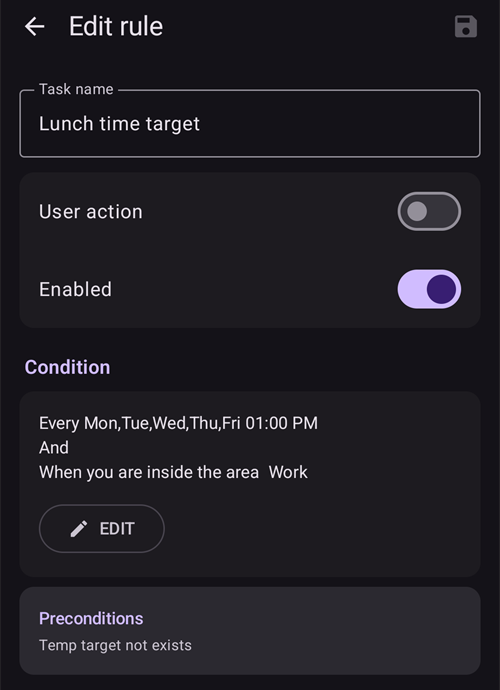
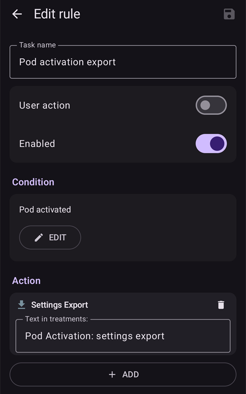

# Automation

```{contents} In this page
:backlinks: entry
:depth: 2
```

## Vad är Automation?

"**Automation**" är en funktion som kan automatisera uppgifter i AAPS.

Automation utför vissa åtgärder utifrån ett eller flera villkor eller utlösare. Utlösare kan vara oregelbundna händelser som lågt eller högt blodsocker (BG), eller en viss mängd negativt aktivt insulin (IOB). Automatiseringar kan också hantera återkommande händelser, som måltider eller träning vid vissa tider på dagen, eller när användaren är inom ett visst avstånd från en GPS-plats eller inom räckvidd för ett wifi-nätverk (SSID). Automation kan säkerhetskopiera AAPS-inställningarna enligt ett schema eller vid varje podbyte.

Automationsregler skapas och ändras på skärmen **Automation** (**Hantera → Automation**). Varje regel består av två delar:

- Ett eller flera villkor eller ‘utlösare’ som startar en åtgärd.

    Tänk på ett visst tidsschema, en händelse eller ett värde i AAPS

- En eller flera åtgärder som ska utföras.

    Till exempel ett larm, att ställa in procent av profil eller att exportera AAPS-inställningarna vid podbyte.


Det finns många alternativ för Automation. Vi rekommenderar att du studerar dem i AAPS-appen, i avsnittet Automation. Du kan också söka i AAPS-användargrupperna på [**Facebook**](https://www.facebook.com/groups/AndroidAPSUsers) och [**Discord**](https://discord.gg/4fQUWHZ4Mw) efter exempel på automatiseringar från andra användare.

## Så kan Automation hjälpa dig

1. **Automatisera återkommande uppgifter:** Programmerade åtgärder körs automatiskt utan att användaren behöver göra något.

1. **Minskad beslutströtthet:** Den största fördelen med **automatiseringar** är att användaren slipper göra manuella ingrepp i **AAPS**. [Forskning](https://www.ncbi.nlm.nih.gov/pmc/articles/PMC6286423/#ref4) uppskattar att personer med typ 1-diabetes i genomsnitt måste fatta 180 extra beslut varje dag. **Automatiseringar** kan minska den mentala belastningen och frigöra energi för andra delar av livet.

1. **Möjligen bättre glukoskontroll:** till exempel kan **automatiseringar** se till att **tillfälliga målvärden** alltid ställs in när de behövs, även när det är mycket att göra eller när man glömmer. Ett exempel: ett barn med diabetes har idrott i skolan på tisdagar kl. 10 och torsdagar kl. 14 och behöver ett högt tillfälligt målvärde ('TT') som startar 30 minuter före aktiviteten. Då kan det **tillfälliga målvärdet** aktiveras med en **automatisering**.

1. **AAPS kan anpassas i hög grad** och bli mer eller mindre aggressiv i vissa situationer, efter användarens önskemål. Till exempel att tillfälligt sänka **profilen** i % under en viss tid om negativ **IOB** uppstår mitt i natten, vilket tyder på att den nuvarande **profilen** kan vara för stark.

Exemplet nedan visar hur en **automatisering** kan ta bort steg som du annars måste göra själv.

Användaren tränar varje morgon kl. 06: han måste komma ihåg att manuellt ställa in "Tillfälligt målvärde – Träning" i AAPS kl. 05, före träningen.


Användaren har ställt in en **automatisering** som startar ‘Tillfälligt målvärde – Träning’ kl. 05 så att **BG** och **IOB** är optimala inför träningen kl. 06:


## Viktigt att tänka på innan du börjar med automatiseringar

1. Innan du ställer in vissa automatiseringar bör du ha rimligt bra **BG**-kontroll med **AAPS**. Automatiseringar ska inte användas för att kompensera för dåligt inställda värden för basal, **ISF** eller **KH-kvot** (mer om detta nedan). Undvik automatiska **profilbyten** för att kompensera för **BG**-höjningar som beror på _t.ex._ mat. Dessa hanteras bättre med andra strategier (SMB:er osv.).

1. Precis som all teknik kan **CGM:er**, **pumpar** och telefoner sluta fungera: tekniska problem eller sensorfel kan störa **automatiseringens** åtgärder, och du kan behöva ingripa manuellt.

1. **Behoven av automatiseringar ändras troligen när rutinerna ändras**. När du byter mellan arbete, skola och semester, lägg in en påminnelse i kalendern om att se över vilka **automatiseringar** som är aktiva (de är lätta att aktivera och inaktivera). Till exempel om du åker på semester och inte längre behöver en automatisering för skolidrott eller daglig träning, eller om du behöver ändra tiderna.

1. **Automatiseringar** kan krocka med varandra. Det är bra att noga granska inställningarna för nya **automatisering(ar)** i en säker miljö och förstå varför en **automatisering** har utlösts eller inte på det sätt du förväntar dig.

1. Om du använder Autosens, försök använda **tillfälliga målvärden** i stället för **profilbyten**. **Tillfälliga målvärden** återställer inte Autosens till 0. **Profilbyten** återställer Autosens.

1. De flesta **automatiseringar** bör bara gälla under en **begränsad tid**. Efter den tiden kan **AAPS** utvärdera på nytt och upprepa **automatiseringen** om det behövs och om villkoret fortfarande är uppfyllt. Till exempel "starta tillfälligt målvärde 7,0 mmol/l i 30 min" eller "starta **profil** 110 % i 10 min" _och_ "starta tillfälligt målvärde 5,0 mmol/l i 10 min". Om du använder **automatiseringar** för permanenta ändringar (t.ex. till en starkare %-profil) ökar risken för hypoglykemi.

## När kan jag börja använda Automation?

Du kan börja använda **automatiseringar** i **mål 10**.

## Var finns automatiseringarna i AAPS?

Öppna **Hantera** i navigeringsfältet längst ned på huvudskärmen och välj **Automation**.

## Hur ställer jag in en automatisering?

För att ställa in en **automatisering**, tryck på knappen **+** på skärmen Automation för att skapa en ‘regel’:


* ge din ‘regel’ ett namn (Uppgiftsnamn);
* tryck på "**ÄNDRA**" under **Villkor**. På skärmen **Villkor** väljer du hur utlösarna kombineras (**och**, **eller**, **exklusivt eller**) och trycker på "**Lägg till utlösare**":


* lägg till minst en utlösare:


* tryck på "**LÄGG TILL**" under **Åtgärd** och välj en åtgärd:


* spara regeln med knappen **Spara** och se till att kryssrutan till vänster om regelns namn är ‘markerad’ så att **automatiseringen** aktiveras:


Om du vill inaktivera en **automationsregel**, avmarkera rutan till vänster om namnet på **automatiseringen**. Exemplet nedan visar en **automatisering** som antingen är aktiverad (‘markerad’) eller inaktiverad (‘avmarkerad’):


När du ställer in en **automatisering** kan du först testa den genom att välja alternativet ‘Avisering’ under "Åtgärder". Då visar **AAPS** först en avisering i stället för att faktiskt utföra en åtgärd automatiskt. När du är säker på att aviseringen visas vid rätt tid och under rätt villkor kan du ändra **automationsregeln** och ersätta ‘Avisering’ med en ‘Åtgärd’.


```{admonition} Important note
:class: note

**Automatiseringar** är aktiva även när loopen är inaktiverad!
```


## När reglerna kontrolleras

**AAPS** kontrollerar alla **automationsregler** varje gång ett nytt glukosvärde har bearbetats. Reglerna utvärderas alltså i samma takt som din CGM skickar värden, även när telefonens skärm är avstängd. Reglerna kontrolleras också när telefonen börjar laddas, när nätverket eller platsen ändras och när en Bluetooth-enhet ansluts. Bara en kontroll körs åt gången, så en regel vars åtgärder tar en stund (till exempel ett pumpkommando) kan inte köras två gånger.

## Säkerhetsgränser

Det finns säkerhetsgränser för **automatiseringar**:

* Ett **tillfälligt målvärde** som ställs in av en **automatisering** måste vara mellan 72 och 180 mg/dl (eller 4 och 10 mmol/l).
* **Procent av profil** måste vara mellan 50 % och 130 %.
* Det måste gå minst 5 minuter mellan två körningar av **Automation** (även före den första körningen).

## Rätt användning av negativa värden

```{admonition} Warning
:class: warning

Var försiktig när du väljer ett negativt värde i **Automation**
```

Var försiktig när du väljer ett ‘negativt värde’ i ett ‘Villkor’, till exempel "är mindre än", i **automatiseringar**. Till exempel:


**Exempel 1:** Ett villkor **"är mindre än"** "-0,1mmol/l" (eller "-2mg/dl") kommer att:

Utlösa en **automatisering** för alla tal som är **strikt mindre än** -0,1 (-2). Det gäller tal som -0,2; -0,3; -0,4 (-4; -6; -8) och så vidare. Kom ihåg att -0,1 (-2) i sig **inte** ingår i detta villkor. (Villkoret "är samma eller mindre än -0,1mmol/l (-2 mg/dl)" _skulle_ inkludera -0,1 mmol/l eller -2 mg/dl).

**Exempel 2:** Ett villkor "är större än" -0,1mmol/l (-2mg/dl) kommer att:

Utlösa en **automatisering** för alla tal som är **större än** -0,1mmol/l (-2mg/dl). Det gäller tal som 0; 0,2; 0,4mmol/l (0; 4; 8mg/dl) och alla andra positiva tal.

Det är viktigt att du noga tänker igenom exakt vad din **automatisering** ska göra när du väljer dessa villkor och värden.

(automations-automation-triggers)=
## Utlösare för Automation


Skrolla nedåt för att se resten av listan:


Det finns olika ‘utlösare’ som användaren kan välja. Utlösare är de villkor som måste vara uppfyllda för att automatiseringen ska köras. Listan nedan är inte fullständig:

**Utlösare:** koppla ihop villkor

**Alternativ:**

Flera villkor kan kopplas ihop med
* “och”
* “eller”
* “exklusivt eller” (det betyder att åtgärden eller åtgärderna utförs om ett – och bara ett – av villkoren gäller)

**Utlösare:** tid jämfört med återkommande tid

**Alternativ:**

* tid = en enstaka händelse vid en viss tidpunkt
* återkommande tid = något som händer regelbundet (t.ex. en gång i veckan, varje arbetsdag osv.)

**Utlösare:** plats

**Alternativ:**

* i [Inställningar > Automation](#preferences-maintenance-settings) kan användaren välja vilken platstjänst som ska användas.

**Utlösare:** platstjänst

**Alternativ:**

* Använd passiv plats: **AAPS** hämtar bara platsen när andra appar begär den.
* Använd nätverksplats: platsen för ditt wifi.
* Använd GPS-plats (Observera! Det kan ladda ur batteriet mycket snabbt!)

**Utlösare**: pump- och sensordata

* Utlösaren Kanylålder: finns för alla pumpar
* Utlösaren Insulinålder: finns för pumpar som stöder den
* Utlösaren Pumpbatteriets ålder: finns för pumpar som stöder den
* Utlösaren Sensorålder: finns alltid
* Utlösaren Podaktivering: finns för pod-pumpar

Observera att jämförelsen ”är lika med” sällan utlöses för utlösare som gäller ålder. Använd därför två utlösare för att skapa ett intervall

* Utlösaren Reservoarnivå: finns för alla pumpar. Jämförelsen "NOT\_AVAILABLE" ("är inte tillgänglig") fungerar inte för den här utlösaren, eftersom värdet alltid är ifyllt i **AAPS**
* Utlösaren Pumpbatterinivå: finns för pumpar som stöder den. Jämförelsen "NOT\_AVAILABLE" ("är inte tillgänglig") fungerar inte för den här utlösaren, eftersom värdet alltid är ifyllt i **AAPS**

(automations-automation-action)=
## Action


Skrolla nedåt för att se resten av listan:


**Åtgärder:** starta **tillfälligt målvärde**

**Alternativ:**

* **BG** måste vara mellan 72 mg/dl och 180 mg/dl (4 mmol/l och 10 mmol/l)
* **TT** fungerar bara om det inte redan finns ett tillfälligt målvärde — **AAPS** lägger automatiskt till detta som en rad "**Förutsättningar: Tillfälligt målvärde finns inte**" i regeln

**Åtgärder:** avbryt **tillfälligt målvärde**

**Alternativ:**

inga

**Åtgärder:** **Procent av profil**

**Alternativ:**

* **Profilen** måste vara mellan 50 % och 130 %
* fungerar bara om den tidigare procentsatsen är 100 %

**Åtgärder:** **Ändra utjämning** (i gruppen **Loop & insulin**)

**Alternativ:**

* välj den [utjämningsmetod](../CompatibleCgms/SmoothingBloodGlucoseData.md) som ska användas. Listan är densamma som under **Konfiguration** > **Utjämning**, och åtgärden gör exakt samma sak som en ändring där: den nya metoden sparas, synkas till parkopplade klienter och BG-data utjämnas på nytt direkt.
* körs bara om den utjämningsmetoden inte redan är aktiv — **AAPS** lägger automatiskt till detta som en rad "**Förutsättningar: Utjämning … är ej aktiv**" i regeln. När den valda utjämningen redan är aktiv hoppas regeln över utan meddelande.
* Exempel: en ny sensor ger ofta brusiga värden under den första dagen. Två regler med utlösaren **Sensorålder** ger starkare filtrering medan sensorn stabiliseras, och utjämning utan fördröjning efter det:
  * **Sensorålder** mindre än 24 h: **Ändra utjämning** till **Unscented Kalman Filter**
  * **Sensorålder** mer än 24 h: **Ändra utjämning** till **Genomsnittlig utjämning**

**Åtgärder:** **Anteckning** (i gruppen **Varningar** i listan)

**Alternativ:**

* välj händelsen som ska registreras: **Anteckning**, **Träning**, **Fråga**, **Meddelande** eller **Pump/nålbyte**, och en valfri anteckning. Åtgärdens namn ändras till den händelse du väljer.
* **Varaktighet**: används för **Anteckning**, **Träning** och **Pump/nålbyte**. **Fråga** och **Meddelande** har ingen varaktighet: de registrerar i stället ditt aktuella BG.
* **Pump/nålbyte** nollställer kanylåldern, som om du hade registrerat ett kanylbyte för hand. Exempel: vissa pumpar (som Combo) registrerar själva ett reservoarbyte, men inte kanylbytet. Om du alltid byter båda samtidigt kan en regel med **Insulinålder** mindre än 1 timme och **Kanylålder** mer än 24 timmar registrera kanylbytet åt dig.

 

**Åtgärder:** **Skicka SMS till alla nummer** (i gruppen **Varningar**)

**Alternativ:**

* skriv texten i meddelandet. Det skickas till alla telefonnummer som är tillåtna i inställningarna för [SMS-kommunikation](../RemoteFeatures/SMSCommands.md). Pluginet SMS-kommunikation måste vara aktiverat.

**Åtgärder:** **Byt profil till** (i gruppen **Profil**)

**Alternativ:**

* välj den **profil** som ska aktiveras. Den aktiveras med 100 %, utan tidsförskjutning. Om profilen redan är aktiv gör åtgärden ingenting.

**Åtgärder:** **Aktivera/inaktivera SMB** (i gruppen **Loop & insulin**)

**Alternativ:**

* välj **På** eller **Av**. Detta ändrar inställningen **Aktivera SMB** i OpenAPS SMB, precis som om du hade ändrat den i **Inställningar**. Ändringen gäller tills du eller en annan regel ändrar tillbaka den.

**Åtgärder:** **Kör Autotune** (i gruppen **Loop & insulin**)

**Alternativ:**

* välj profilen som ska justeras och antal dagar: se [Köra Autotune med en automationsregel](#autotune-run-autotune-with-an-automation-rule).

**Åtgärder:** **Sluta bearbeta** (i gruppen **Loop & insulin**)

**Alternativ:**

* inga. Så länge villkoren för en regel med den här åtgärden är uppfyllda kontrollerar **AAPS** inte reglerna under den i listan. Så snart villkoren inte längre är uppfyllda kontrolleras reglerna nedanför som vanligt. Lägg till den i en regel som ska gå före reglerna under den (se [ordningen för automatiseringarna](#Automations-the-order-of-the-automations-in-the-list-matters)).

**Åtgärder:** **Kör scen**, **Aktivera scen**, **Inaktivera scen** (i gruppen **Scener**)

**Alternativ:**

* välj den [scen](Scenes.md) som ska köras, aktiveras eller inaktiveras.

När ‘Åtgärden’ har lagts till måste du ändra standardvärdena till de värden du vill ha. Klicka på standardvärdena och justera dem.


(Automations-the-order-of-the-automations-in-the-list-matters)=
## Ordningen på **automatiseringarna** i listan spelar roll
 **AAPS** kör reglerna i prioritetsordning, med början högst upp i **Automation**-listan. Om till exempel **automatiseringen** ‘Låg’ är den viktigaste **automatiseringen**, före alla andra regler, ska den här **automatiseringen** ligga högst upp i användarens **Automation**-lista, som visas nedan:


För att ändra prioriteringen av **automationsreglerna**, tryck och håll på handtaget **=** till höger om regeln. Ändra ordningen på **automatiseringarna** genom att flytta reglerna uppåt eller nedåt.


## Så tar du bort automationsregler

Tryck på papperskorgsikonen för att ta bort en **automationsregel**.


## Exempel på automatiseringar

Nedan finns exempel på **automatiseringar**. Mer diskussion om **automatiseringar** och om hur användare har anpassat sina **automatiseringar** finns i diskussionsgrupper på Facebook eller på Discord. Kopiera inte exemplen nedan om du inte förstår väl hur **automatiseringen** kommer att fungera.

(automations-low-glucose-temp-target)=
### Tillfälligt målvärde vid lågt blodsocker

Den här **automatiseringen** startar automatiskt ett **tillfälligt målvärde** när **BG** sjunker under en viss gräns — här startas ett målvärde på 110 mg/dl i 30 minuter när glukos är lägre än 70 mg/dl:


### Tillfälligt målvärde vid lunch (med ‘Plats’)



Den här **automatiseringen** har skapats för en användare som äter lunch på jobbet ungefär samma tid varje vardag. Den utlöses bara om användaren befinner sig på en viss ‘plats’.  Så om användaren inte är på jobbet en dag aktiveras inte den här **automatiseringen**.

Den här **automatiseringen** ställer in ett lågt **tillfälligt målvärde** (Äta snart) kl. 13:00 för att få ned BG till 90 mg/dl (eller 5 mmol/l) inför lunchen.

Utlösaren ‘Plats’ har ett namn, en position (tryck på **Välj från karta** eller använd din nuvarande plats) och en radie i meter. Den utlöses när du är inne i (eller utanför) området:


På grund av ‘och’-kopplingen körs **automatiseringen** bara under den ‘valda tiden’ och om användaren är på den valda platsen.

**Automatiseringen** utlöses inte vid någon annan tid på den här platsen, och inte heller vid den här tiden utanför radien på 50 meter runt den valda positionen.

### Automatisering med plats via wifi-SSID

Ett wifi-SSID är ett bra sätt att utlösa en **automatisering** när du är inom räckvidd för ett visst wifi-nätverk (jämfört med GPS): det är ganska exakt, drar mindre batteri och fungerar inomhus där GPS och andra platstjänster kanske inte är tillgängliga.

Här är ett annat exempel där ett **tillfälligt målvärde** ställs in före frukost (1), bara på arbetsdagar.


**Automatiseringen** utlöses kl. 05:30 bara måndag–fredag (2)  
och medan telefonen är ansluten till ett wifi-nätverk hemma (3).


Den ställer sedan in ett **tillfälligt målvärde** på 75 mg/dl i 30 minuter (4). En fördel med att ta med platsen är att den inte utlöses om användaren till exempel är ute och reser på semester.


Scrolla ned för att se åtgärden: ett **tillfälligt målvärde** på 75 mg/dl i 30 minuter (4).


Här är skärmbilden som visar utlösarna för **automatiseringen**:

1) Under huvudvillkoret ”OCH” (båda villkoren måste vara uppfyllda för att regeln ska utlösas) 1) Återkommande tid = M,T,O,T,F kl. 05:30  
1) WiFi SSID = My_Home_WiFi_Name


(automating-preference-settings-export)=

## Automatisera export av inställningar

### Automatisk export: schemalagd (dagligen)

Skärmbilder som visar utlösarna för Automation:

1) Villkor: Återkommande tid = M,T,O,T,F kl. 08:00 1) Åtgärd: Export av inställningar (skriv "Daglig" i "Text i behandlingar")


Obs! Exporten loggas i Careportal

### Automatisk export: Podaktivering (endast pod-pumpar)

Skärmbilder som visar utlösarna för Automation:

1) Villkor: Podaktivering 1) Åtgärd: Export av inställningar (skriv "Podaktivering: export av inställningar" i "Text i behandlingar")



Obs! Exporten loggas i Careportal. Obs! Automation utlöses **inte alls** om du inte har gjort en manuell export av inställningarna tidigare. Se [Inställningar → Underhåll](#preferences-maintenance-settings) för hur du aktiverar automatisk export av inställningar på rätt sätt.


## Logg för Automation

**AAPS** visar en logg över de senaste händelserna för **Automation** längst ned på skärmen **Automation**, under reglerna. Använd den för att kontrollera att dina regler utlöstes när du väntade dig det.

I exemplet nedan är regeln **Low glucose temp target** (1) aktiverad (se [Tillfälligt målvärde vid lågt blodsocker](#automations-low-glucose-temp-target) ovan). Loggen (2) visar att glukos sjönk under 70 mg/dl kl. 15:09 (03:09 PM) och att regeln utlöstes:
* åtgärden var "Starta tillfälligt målvärde: 110mg/dL@30 min": ett **tillfälligt målvärde** på 110 mg/dl i 30 minuter;
* **OK** i slutet betyder att åtgärden utfördes.


(automations-troubleshooting)=

## Felsökning

* Problem: __Mina automatiseringar utlöses inte av AAPS?__

Kontrollera att rutan till vänster om namnet på **automatiseringen** är ‘markerad’ så att regeln är aktiverad:


* Problem: __Mina automatiseringar utlöses i fel ordning.__

Kontrollera prioritetsordningen för dina regler, som beskrivs ovan.

* Problem: __Ett villkor visar "Okänd utlösare … - inträffar aldrig".__

Regeln innehåller en utlösare som den här versionen av **AAPS** inte kan läsa, till exempel efter att du har gått tillbaka till en äldre version eller importerat inställningar från en nyare. En sådan utlösare är aldrig sann, så regeln körs inte. Den sparas oförändrad, så att en nyare version fortfarande kan använda den. Redigera regeln och byt ut utlösaren, eller uppdatera **AAPS**.

## Alternativ till automatiseringar

För avancerade användare finns det andra sätt att automatisera uppgifter, med IFTTT eller med en Android-app från tredje part som heter Automate. 
