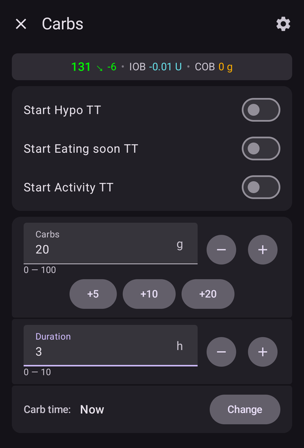
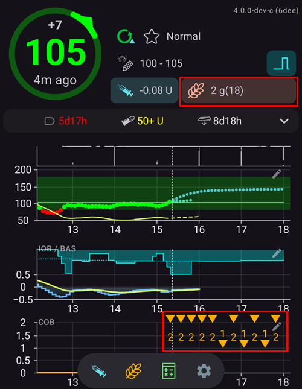
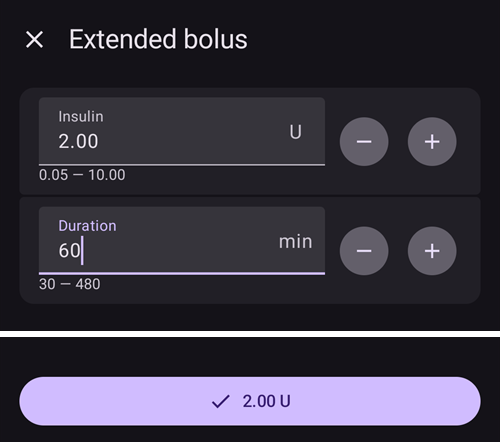
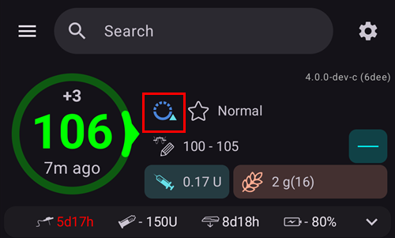
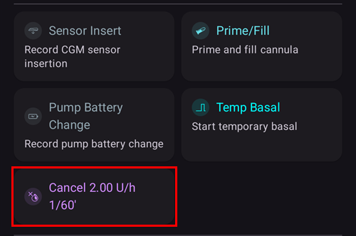

(Extended-Carbs-extended-carbs-ecarbs)=
# Förlängda kolhydrater / "eCarbs"

## Vad är eCarbs och när är de användbara?

Vid vanlig pumpbehandling är förlängda bolusar ett bra sätt att hantera feta måltider eller andra måltider som tas upp långsamt och höjer blodsockret längre än insulinet verkar. I en loop är förlängda bolusar dock inte lika vettiga (och de ger tekniska problem). De är i princip en fast, hög tillfällig basal, och det går emot hur loopen fungerar: loopen justerar basaldosen dynamiskt. Mer information finns i [förlängd bolus](#extended-bolus-and-why-they-wont-work-in-closed-loop-environment) nedan.

Men behovet av att hantera sådana måltider finns fortfarande kvar. Därför har AAPS stöd för så kallade förlängda kolhydrater eller eCarbs.

eCarbs är kolhydrater som delas upp över flera timmar. För vanliga måltider med mer kolhydrater än fett/protein räcker det oftast att ange kolhydraterna direkt (och minska den första bolusen om det behövs) för att undvika att insulinet ges för tidigt.  Men för måltider som tas upp långsammare, där alla kolhydrater angivna direkt ger för mycket IOB från SMB, kan du använda eCarbs. De visar mer exakt hur kolhydraterna (och de kolhydratekvivalenter du anger för andra makronäringsämnen) tas upp och påverkar blodsockret. Med denna information kan loopen ge SMB:er mer gradvis för att hantera kolhydraterna. Det kan ses som en dynamisk förlängd bolus (det bör också fungera utan SMB:er, men är troligen mindre effektivt).

**Obs:** eCarbs är inte bara för måltider med mycket fett/protein: de kan också hjälpa i alla situationer där något höjer blodsockret, t.ex. andra läkemedel som kortikosteroider.

## Så använder du eCarbs

För att ange eCarbs öppnar du dialogen **Kolhydrater** (**Behandlingar** → **Kolhydrater**), anger den totala mängden kolhydrater, ställer in **Varaktighet** och flyttar vid behov starten med **KH-tid** (*siffrorna nedan är bara exempel, du måste prova dina egna värden för att få en bra blodsockerkurva i dina situationer*):

eCarbs på huvudskärmen: talet inom parentes i fältet **COB** visar de kolhydrater som ännu ska komma, och **COB**-grafen visar varje framtida eCarbs-post som en orange markering. Om du inte ser någon **COB**-graf, lägg till en med **Lägg till graf** under graferna (se [AAPS-skärmar](../DailyLifeWithAaps/AapsScreens.md)).

(AapsScreens-carbs-type)=
## Typ av kolhydrater i kalkylatorn: bröd, tårta eller pizza

I [kalkylatorn](#aaps-screens-bolus-wizard) finns tre knappar under fältet **Kolhydrater**. Med dem väljer du hur snabbt din måltid tas upp. Välj en innan du bekräftar. Beroende på typen tar **AAPS** en del av de kolhydrater du skrev in som vanliga kolhydrater, och lägger till [förlängda kolhydrater ("eCarbs")](#Extended-Carbs-extended-carbs-ecarbs) senare för långsamma, mäktiga måltider. Tryck på ikonen **(i)** bredvid knapparna för att se typiska livsmedel för den valda typen och vad den gör med dina kolhydrater.

| Typ                 | Typiska livsmedel (exempel från appen)                                                                               | Kolhydrater nu, används för bolusen | Tillagda eCarbs                                         |
| ------------------- | -------------------------------------------------------------------------------------------------------------------- | ----------------------------------- | ------------------------------------------------------- |
| **Bröd** (standard) | Bröd, bakverk, yoghurt, frukt, potatis, ris, havregryn, grönsaker                                                    | 100 %                               | Ingen                                                   |
| **Tårta**           | Dumplings, pasta, asiatiska rätter med mycket kolhydrater och fett, söta bakverk och jästbröd, flingor, honung, sylt | 90 %                                | 20 %, startar 60 minuter senare, fördelat över 2 timmar |
| **Pizza**           | Lasagne, pizza, hamburgare, pommes frites, bakad potatis, chips                                                      | 80 %                                | 35 %, startar 60 minuter senare, fördelat över 3 timmar |

**Exempel**: du skriver 100 g och väljer **Pizza**. Bolusen beräknas för 80 g, som registreras nu. 35 g eCarbs startar 1 timme senare och fördelas över 3 timmar.

Bra att veta:
* Det är ingen enkel uppdelning: med **Tårta** och **Pizza** blir de registrerade kolhydraterna sammanlagt **mer än du skrev** (110 % och 115 %). Det extra finns bara i eCarbs.
* Bolusen täcker bara de kolhydrater som äts nu. **AAPS** ger ingen bolus i förväg för eCarbs: loopen tar hänsyn till dem när de startar, precis som andra [eCarbs](#Extended-Carbs-extended-carbs-ecarbs).
* Om du ställer in **KH-tid** startar eCarbs 60 minuter efter den tiden.
* Bekräftelsedialogen visar eCarbs på en egen rad, _t.ex._ "eCarbs 35 g / 3 h (+60 min)".
* Gram avrundas nedåt till heltal.
* Procentsatser, fördröjningar och varaktigheter är fasta. De kan inte ändras i inställningarna.
* Valet sparas inte: kalkylatorn öppnas med **Bröd** varje gång.

______________________________________________________________________

Ett sätt att hantera fett och protein med denna funktion beskrivs här (på engelska): [https://adriansloop.blogspot.com/2018/04/page-margin-0.html](https://adriansloop.blogspot.com/2018/04/page-margin-0.html)

______________________________________________________________________

## Rekommenderad inställning, exempel och viktiga anmärkningar

Den rekommenderade inställningen är att använda APS-pluginen OpenAPS SMB, med SMB:er aktiverade och inställningen *Aktivera SMB med COB* aktiverad.

Ett exempel för en pizza kan vara att ge en (del)bolus direkt via *Kalkylator* och sedan använda dialogen *Kolhydrater* för att ange resten av kolhydraterna med en varaktighet på 4–6 timmar, med start efter 1 eller 2 timmar.

För en snabbare start kan *Kalkylator* lägga till eCarbs åt dig: välj [typ av kolhydrater](#AapsScreens-carbs-type) **Tårta** eller **Pizza** under fältet **Kolhydrater** (se ovan). Mängderna och tiderna är fasta, så använd dialogen *Kolhydrater* i stället om du vill ha andra värden.

**Viktigt:** Du måste förstås prova dig fram till vilka konkreta värden som fungerar för dig. Du kan också försiktigt justera inställningen *Max antal minuter med basal som kan bli SMB* för att göra algoritmen mer eller mindre aggressiv. Vid måltider med lite kolhydrater och mycket fett/protein kan det räcka att bara använda eCarbs utan manuella bolusar (se blogginlägget ovan). När eCarbs skapas görs också en Careportal-anteckning med alla inmatningar. Då är det lättare att prova igen och förbättra inmatningarna.

(extended-bolus-and-why-they-wont-work-in-closed-loop-environment)=
## Förlängda bolusar och varför de inte fungerar i en sluten loop

Som nämnts ovan fungerar förlängda bolusar och multiwave-bolusar inte riktigt i en sluten loop. [Se nedan](#why-extended-boluses-won-t-work-in-a-closed-loop-environment) för mer information

(Extended-Carbs-extended-bolus-and-switch-to-open-loop-dana-and-insight-pump-only)=
### Förlängd bolus och byte till öppen loop - bara för Dana- och Insight-pumpar

Några personer bad ändå om ett alternativ för att använda förlängd bolus i AAPS, eftersom de ville behandla vissa måltider på det sätt de är vana vid.

Därför har **AAPS** en förlängd bolus för användare av Dana- och Insight-pumpar: öppna **Hantera** och välj **Förlängd bolus**.

**AAPS** varnar dig först om att den slutna loopen stoppas medan den förlängda bolusen pågår. Tryck på **OK** för att fortsätta:

Ange **Insulin** (mängd) och **Varaktighet**, tryck sedan på bekräftelseknappen längst ner och på **OK**:

På Insight-pumpen är förlängd bolus *inte tillgänglig* om [emulering av tillfällig basal](#Accu-Chek-Insight-Pump-settings-in-aaps) används.

Medan den förlängda bolusen pågår körs loopen i läget **Öppen loop** (loopikonen på huvudskärmen ändras). Sluten loop slås på igen automatiskt när den förlängda bolusen är slut:

Menyn **Hantera** visar en knapp **Avbryt** med doshastigheten och förfluten / total tid (till exempel **Avbryt 2,00 U/h 1/60'**). Tryck på den för att stoppa den förlängda bolusen i förtid:

(why-extended-boluses-won-t-work-in-a-closed-loop-environment)=
### Varför förlängda bolusar inte fungerar i en sluten loop

1. Loopen bestämmer att 1,55 U/h ska ges nu. För algoritmen spelar det ingen roll om detta ges som förlängd bolus eller som tillfällig basal (TBR). Vissa pumpar använder faktiskt den förlängda bolusen. Vad ska hända då? De flesta pumpdrivrutiner stoppar då den förlängda bolusen -> Du hade inte ens behövt starta den.

2. Om du hade den förlängda bolusen som indata, vad ska då hända i modellen?

   1. Ska den räknas som neutral tillsammans med basaldosen (BR) och loopas på den? Då borde loopen också kunna minska bolusen om du till exempel blir för låg och all ”neutral” insulin tas bort?
   2. Ska den förlängda bolusen bara läggas till? Ska loopen alltså bara få fortsätta? Även vid den värsta hypon? Jag tycker inte att det är så bra: En hypo förutses men får inte förhindras?

3. Den IOB som den förlängda bolusen bygger upp syns efter 5 minuter vid nästa körning. Därför skulle loopen ge mindre basal. Så inte mycket ändras... förutom att möjligheten att undvika en hypo försvinner.
