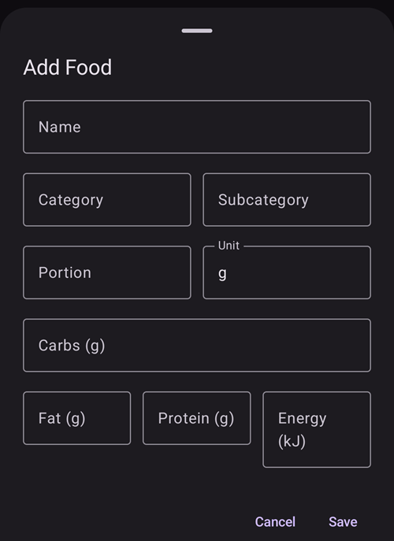

(food)=
# Mat (din matdatabas)

**Matdatabasen** är din personliga lista med sparade livsmedel. Varje post sparar ett livsmedels **kolhydrater** (och om du vill även fett, protein, energi och en kategori). Då kan du ha det du ofta äter på ett ställe och starta en bolus från ett sparat livsmedel där kolhydraterna redan är ifyllda.

```{contents} Table of contents
:depth: 2
:local: true
```

---

## Öppna matdatabasen

Öppna skärmen **Hantera** (navigeringen längst ner) och välj **Matdatabas** (*”Hantera matdatabasposter”*). I **AAPS** v4 är matdatabasen **inte längre en plugin**. Det finns inget att aktivera; det är en egen skärm som du når från [menyn Hantera](#v4changes-manage).

---

## Listan med livsmedel

Dina livsmedel visas i en lista som du kan rulla. Varje rad visar livsmedlets **namn**, dess **portion / enhet / kategori** och dess **kolhydrater**:


- **🔍 Sök** (överst) - filtrera listan efter **namn** (skiftlägesokänsligt).
- **Kategorifilter** - med knappar (chips) kan du begränsa listan till en **kategori**. När du har valt en kategori visas knappar för dess **underkategorier**. (Tryck på en vald knapp igen för att ta bort valet.)
- **➕** (nere till höger) - lägg till ett nytt livsmedel (se nedan).
- Tryck på en rad för att **redigera** livsmedlet.

Om listan (eller det aktuella filtret) inte har några poster visar skärmen **Inga data**.

---

## Lägga till och redigera ett livsmedel

Tryck på **➕** för att lägga till, eller tryck på en befintlig rad för att redigera. En redigerare öppnas som ett ark längst ner (**Lägg till mat** / **Redigera mat**):



Fälten är:

- **Namn** - krävs (du kan inte spara utan det).
- **Kategori** och **Underkategori** - valfria, används för att gruppera/filtrera livsmedel.
- **Portion** och **Enhet** - den vanliga portionsstorleken. **Enhet** är **g** som standard.
- **Kolhydrater (g)** - mängden kolhydrater i livsmedlet.
- **Fett (g)**, **Protein (g)**, **Energi (kJ)** - valfria näringsvärden.

Tryck på **Spara** för att spara, eller på **Avbryt** för att slänga ändringarna. När du redigerar ett befintligt livsmedel har redigeraren också knappen **Radera**.

```{admonition} Deleting is undoable
:class: note
När du raderar ett livsmedel visas meddelandet **”Matvara borttagen”** med åtgärden **Ångra**, så du kan lätt ångra en radering av misstag.
```

---

## Använda ett livsmedel för en bolus

Varje rad med livsmedel har en knapp för **kalkylatorn**. Om du trycker på den öppnas **kalkylatorn** med livsmedlets **kolhydrater** redan ifyllda och livsmedlets **namn** som anteckning för behandlingen. Du bekräftar och ger bolusen utan att skriva kolhydraterna igen.

```{admonition} The carbs value is used as-is
:class: note
Det sparade antalet **kolhydrater** skickas direkt till kalkylatorn. **AAPS** multiplicerar det inte med portionen eller med hur mycket du åt. Om du har en annan mängd, justera kolhydraterna i kalkylatorn innan du bekräftar. (Det finns inget val av livsmedel *inne i* kalkylatorn eller dialogen för kolhydrater; du startar från raden med livsmedlet här.)
```

---

## Var livsmedlen kommer ifrån (synkronisering med Nightscout)

Matdatabasen delas via **Nightscout**, men **bara i en riktning**:

- **Hämta:** **AAPS** **läser** livsmedel från **matdatabasen** på din Nightscout-sida och håller den lokala listan synkroniserad med den. Detta körs som en del av synkroniseringen i NSClient, så en parkopplad **klient/följare** får också samma livsmedel.
- **Ladda upp:** **AAPS** skickar **inte** livsmedel **till** Nightscout. NSClient har inget stöd för att ladda upp livsmedelsposter. Livsmedel som du skapar eller redigerar **i AAPS** stannar därför **på den enheten** och skickas inte vidare till Nightscout eller till dina andra enheter.

```{admonition} Maintain your shared list in Nightscout
:class: important
Eftersom matdatabasen **bara hämtas**, är sättet att dela en lista med livsmedel mellan din telefon, din följare/[klient](../RemoteFeatures/ClientMasterControl.md) och resten av ditt system att sköta den i **Nightscout** (dess inbyggda redigerare för mat). **AAPS** hämtar sedan dessa poster. Ett livsmedel som bara har lagts till i **AAPS** finns bara på den enheten, och det ligger kvar: en hämtning matchar Nightscout-poster med deras Nightscout-ID. Den lägger alltså till och uppdaterar dessa poster, men skriver aldrig över eller tar bort ett livsmedel som du har skapat lokalt (ett livsmedel tas bara bort när dess kopia i Nightscout raderas i Nightscout).

Observera att matdatabasen **inte** heller är en del av den signerade kontrollkanalen mellan huvudenhet ↔ klient. Den skickas bara som Nightscout-data.
```

---

## Inte på klockan

Matdatabasen är en funktion i **telefonen**. Det finns ingen bläddring bland livsmedel, ingen bricka (tile) och ingen meny på en **Wear OS-klocka**.

---


<!-- =====================================================================
     Screenshots captured from a real master device:
       - food_list.png    (Manage → Food: list row, search, add button)
       - food_editor.png  ("Add Food" editor: name/category/subcategory/portion/unit/carbs/fat/protein/energy)
     No food was created or deleted (the editor was cancelled).
     Sync facts code-verified: download via LoadFoodsWorker.getFoods(); upload disabled
     (DataSyncSelectorV3 processChangedFoods() commented out — "NSCv3 doesn't support food update").
     Maintainers: relocate page + images and fix cross-links as needed.
     ===================================================================== -->
