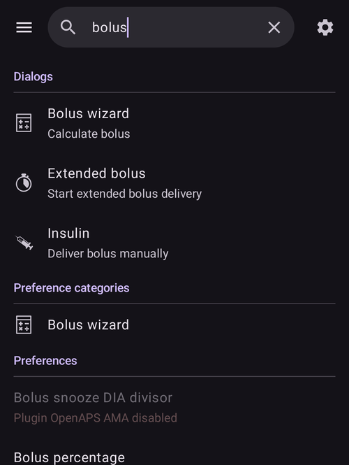

(global-search)=
# Global sökning

**AAPS** v4 har en ruta för **global sökning** överst på huvudskärmen. Skriv ett ord, så söker den i hela appen på en gång (plugins, dialoger, inställningsskärmar och enskilda inställningar) och, om du är online, även i **AndroidAPS-dokumentationen**. Det är det snabbaste sättet att gå till en inställning eller skärm utan att komma ihåg var den finns.

```{contents} Table of contents
:depth: 2
:local: true
```

---

## Öppna sökningen

Tryck på fältet **🔍 Sök** överst på **huvudskärmen** (bredvid menyn ☰). Börja skriva. Resultaten visas medan du skriver (efter en kort paus), grupperade efter kategori:



Töm rutan med **✕**, eller stäng sökningen med enhetens **bakåtknapp**.

---

## Sök på engelska *eller* på ditt eget språk

Detta är bra att veta: sökningen matchar mot **både** texten på ditt **valda språk** **och** den ursprungliga **engelska** texten.

- Om din app till exempel är på tyska eller tjeckiska kan du skriva det **översatta** ordet **eller** det **engelska** ordet. Båda hittar inställningen.
- En träff på den **översatta** titeln rankas högst, sedan den **engelska** titeln och sedan de översatta och engelska **beskrivningarna**.
- Matchningen bryr sig inte om **accenter/diakritiska tecken** (så *ů* matchar *u* och *é* matchar *e*) och är **skiftlägesokänslig**.

Det betyder att en guide eller ett foruminlägg på engelska ändå leder dig till rätt inställning, även när din telefon visar allt översatt.

---

## Vad sökningen omfattar

Resultaten grupperas i dessa kategorier:

- **Insticksprogram** - alla plugins som finns i din version (samma som visas under [Konfiguration](../SettingUpAaps/ConfigBuilder.md)). Varje rad med en plugin har sin **på/av-knapp**, så du kan aktivera eller inaktivera en plugin direkt från resultaten. Om du trycker på raden för en inaktiverad plugin (som går att slå på) aktiveras den.
- **Dialoger** - skärmarna för behandlingar/åtgärder och hantering (Kalkylator, Insulin, Förlängd bolus, Kalibrering, Tillfälligt målvärde, Profil, …). Skärmar som inte gäller för din version visas inte (till exempel *Parkoppla med huvudenheten* på en huvudenhet, *Auktoriserade klienter* på en klient).
- **Inställningskategorier** - inställningarnas **skärmar** och underskärmar, både inbyggda (Generellt, Utseende, Skydd, Larm, Underhåll, …) och från plugins, och även de små grupperna av inställningar som du når från dialoger (Fyll-knappar, steg för knapparna Insulin/Kolhydrater, gränser för statuslampor, inställningar för kalkylatorn, …).
- **Inställningar** - varje **enskild inställning** som har en titel. De filtreras efter din version/ditt läge, så du ser bara inställningar som faktiskt gäller (APS / NSClient / styrning av pump).
- **Dokumentation** - sidor från den online-baserade **AndroidAPS-dokumentationen** (se nedan).

```{admonition} Settings that belong to a disabled plugin
:class: note
En inställning vars plugin för närvarande är **inaktiverad** visas ändå, **gråmarkerad** och inte tryckbar, med anteckningen *”Insticksprogram … inaktiverat”*. Då ser du att inställningen finns och vilken plugin du ska aktivera för att nå den.


```

---

## Resultat från dokumentationen (online)

Medan den lokala sökningen körs söker **AAPS** samtidigt i den officiella **AndroidAPS-dokumentationen** (som finns på ReadTheDocs). Matchande sidor visas i gruppen **Dokumentation** längst ner, var och en med en 📖-ikon, avsnittets titel och ett kort utdrag:


- Om dokumentationen är översatt till appens språk söker **AAPS** i de översatta sidorna och i de engelska sidorna samtidigt. Sidor på ditt språk visas först, sedan de engelska sidor som inte redan har hittats.
- Om du trycker på ett resultat från dokumentationen öppnas sidan i din **webbläsare**.
- Sökning i dokumentationen kräver **internet**. När du är offline får du i stället meddelandet *”Dokumentationssökning kräver internetanslutning”*, och de lokala resultaten (i appen) fungerar som vanligt.

---

## Öppna ett resultat

Tryck på ett resultat för att gå direkt dit:

- **Insticksprogram** → öppnar den pluginen.
- **Dialog** → öppnar den skärmen eller dialogen.
- **Inställningskategori** → öppnar den inställningsskärmen.
- **Inställning** → öppnar inställningen **på plats** (hoppar till den på dess skärm).
- **Dokumentation** → öppnar sidan i din webbläsare.

När du öppnar inställningar och skyddade åtgärder gäller ditt **[skydd](#Preferences-protection)** (PIN/lösenord) ändå, precis som om du hade gått dit för hand. När du har använt ett resultat kan du trycka på **bakåtknappen** för att komma tillbaka till sökresultaten.

---

## Genvägar för erfarna användare

Två särskilda sökningar listar en hel kategori på en gång:

- `%PLUGINS%` - visar **alla** plugins.
- `%DIALOGS%` - visar **alla** dialoger/åtgärdsskärmar.

---

```{admonition} The index stays current
:class: note
Sökindexet byggs första gången du söker och hålls sedan redo. Det byggs om automatiskt när du **aktiverar/inaktiverar en plugin** eller **byter språk i appen**, så resultaten visar alltid din aktuella konfiguration.
```

---


<!-- =====================================================================
     Screenshots captured from a real master device (query "bolus"):
       - search_results.png        (categorized local results: Dialogs / Preference categories / Preferences)
       - search_disabled_plugin.png (greyed-out preference from a disabled plugin)
       - search_documentation.png   (online ReadTheDocs results with 📖 icon + snippets)
     Maintainers: relocate page + images and fix cross-links as needed.
     ===================================================================== -->
