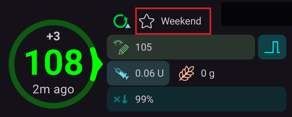
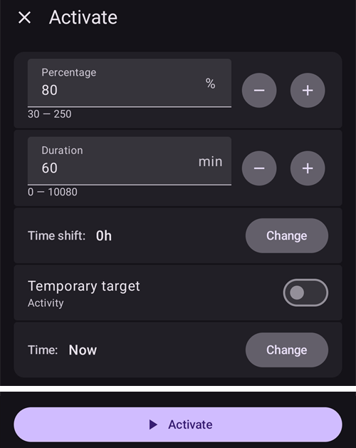
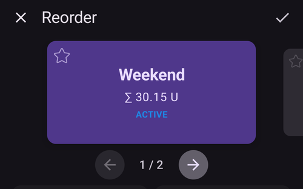
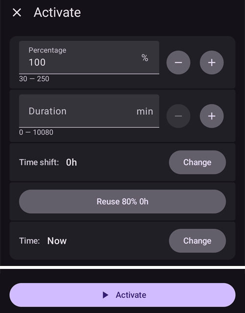

# Profilbyte och procent av profil

Det här avsnittet förklarar vad **Profilbyte** och **Procent av profil** är. Hur du skapar en **Profil** kan du läsa i [Din AAPS-profil](#your-aaps-profile-create-and-edit-profiles).

När du börjar använda **AAPS** behöver du skapa en **Profil**, förstå hur du gör ett **Profilbyte** och lära dig hur **Procent av profil** påverkar **AAPS**. **Profilbyte** och **Procent av profil** kan vara särskilt användbara för:

- Menstruationscykeln – en procentjustering av en **Profil** kan ställas in i **Automation** så att **AAPS** kan anpassa sig till hormoncykelns olika faser och den förväntade insulinresistensen.

- Träning – en procentjustering av en **Profil** kan ställas in i **Automation** för träning, så att mindre basal ges.

- Personer som arbetar natt eller skift – en tidsförskjutning av **Profil** kan ställas in för skiftarbetare. Antalet timmar i **Profil** ändras då efter hur mycket senare/tidigare användaren går och lägger sig eller vaknar.

Varför använda **Procent av profil** i stället för en tillfällig justering av basalen? **Procent av profil** är mer effektivt eftersom det minskar eller ökar basal, ISF och I:C i samma proportion. Det gör att **AAPS** räknar på ett balanserat sätt när det ger användaren insulin. Att bara minska basalen i användarens **Profil** i **AAPS** ger liten nytta om algoritmen fortsätter att använda samma kvoter för ISF och I:C.

(ProfileSwitch-change-percentage)=

## Ändra procent av profil från huvudskärmen

Du behöver minst en sparad **Profil**. **Procent av profil** används alltid genom ett **Profilbyte**: du aktiverar en **Profil** igen, den här gången med en procentsats.

```{admonition} Kommer du från AAPS 3? :class: note Ett långt tryck på profilnamnet öppnar inte längre dialogrutan för profilbyte. **Tryck** på profilnamnet och tryck sedan på den runda knappen **▶** nere till höger: den öppnar samma inställningar (procent, varaktighet, tillfälligt målvärde för träning).

    <br />1. På huvudskärmen **trycker du på profilnamnet** (bredvid stjärnikonen). [Skärmen Profil](#ProfileSwitch-manage-v4) öppnas på kortet för den **Profil** som körs, märkt **AKTIV**.
    
       
    
    2. Om du vill behålla samma **Profil** låter du kortet **AKTIV** vara valt. Om du samtidigt vill byta **Profil** sveper du till ett annat kort.
    3. Tryck på den runda knappen **▶** (**Aktivera**) nere till höger. Skärmen **Aktivera** öppnas.
    4. Ställ in **Procent** med **−** / **+** (steg om 5 %), eller skriv in värdet (30 till 250 %). Fältet börjar alltid på **100 %**: det visar inte den procent som körs nu. Ange till exempel **80** för 20 % mindre insulin, eller **120** för 20 % mer.
    5. Ställ in **Varaktighet** i minuter:
       * **0** behåller den nya procenten tills du gör ett nytt **Profilbyte**;
       * alla andra värden avslutar bytet efter den tiden, och **AAPS** går tillbaka till den **Profil** som kördes innan.
    
       
    
    6. Tryck på **▶ Aktivera** längst ner på skärmen. Kontrollera sammanfattningen i dialogrutan **Profilbyte** och tryck på **OK**.
    
       
    
    Tillbaka på huvudskärmen visar profilnamnet procenten och den återstående tiden, till exempel *Normal (80%) (59')*, och det blir gult så länge ett byte med varaktighet pågår. En stjärna markerar bytet i glukosgrafen. Se [huvudskärmen](#aaps-screens-profile--target).
    
    
    
    För att **gå tillbaka till 100 %** innan tiden har gått ut upprepar du stegen och behåller **Procent** på 100 och **Varaktighet** på 0.
    
    ```{admonition} Procent med ett tryck
    :class: tip
    Om du ofta använder samma procent (sport, sjukdom) kan du lägga till en [profilgenväg](#profile-shortcuts) i verktygsfältet Snabbstart, eller skapa en [scen](Scenes.md). Båda använder en profil med förinställd procent och varaktighet med ett enda tryck.
    

(ProfileSwitch-manage-v4)=

## Hantera och aktivera profiler (Hantera → Profil)

I **AAPS** v4 hanteras och aktiveras profiler från skärmen **Hantera** (nedre navigeringen) → **Profil** (*”Hantera och aktivera profiler”*).

Skärmen Profil visar dina profiler som en **karusell med kort som du kan svepa mellan**. Kortet för profilen som körs är märkt **AKTIV** och visar profilens totala basal per dygn (t.ex. *∑ 30,15 U*). Under det valda kortet ser du profilens detaljer – typ av **Insulin** samt scheman för **IC**, **ISF**, **basal** och **målvärde** med grafer.

När ett tillfälligt profilbyte pågår visar kortet **AKTIV** dess procent och tidsförskjutning med återstående tid, till exempel *110% +2 h · 2 h 40 min*, ovanför en förloppsindikator. Båda uppdateras var 30:e sekund. Detaljerna nedan har då två kolumner: profilens värden i blått och värdena som används med procenten i rött.


Knapparna längst ner gäller den **valda** profilen: **➕ Lägg till**, **✏️ Redigera**, **⧉ Klona** och **‘️ Radera**, och den runda knappen **▶ Aktivera** till höger. Hur du fyller i de fyra schemana i redigeraren (IC / ISF / BAS / TARG) beskrivs i [Skapa och redigera profiler](#your-aaps-profile-create-and-edit-profiles).

**⧉ Klona** använder ikonen med två rutor som ofta betyder *kopiera*, men det finns inget att klistra in: den skapar kopian i ett enda steg. Bekräfta *Klona profil "Normal"?* så läggs en ny profil med namnet *Normal kopia* till sist i karusellen och väljs, redo för **✏️ Redigera** (där du också kan byta namn på den). Det är inte samma sak som att klona ett tidigare **Profilbyte** från behandlingshistoriken, vilket skapar en ny profil *där procenten och tidsförskjutningen redan är inräknade*. Se [Spara ett profilbyte för senare användning](#ProfileSwitch-keep-for-later).

(ProfileSwitch-read-only-mode)= **Bara knappen ▶ Aktivera?** Dina inställningar är skyddade, så skärmen öppnas skrivskyddad. Tryck på **✏️ pennan** i det övre fältet och ange ditt lösenord för inställningar. Se [Skydd för inställningar låser nu också hanteringsskärmarna](#v4changes-read-only-management).

### Ändra ordning på profiler

Om du har mer än en profil kan du välja i vilken ordning de visas i karusellen: tryck på ikonen **Ändra ordning** (⇅, två pilar som pekar upp och ner) i det övre fältet. Sidindikatorn ersätts av **◀ / ▶ flyttknappar** och en visning av *position / totalt* – flytta det mittersta kortet framåt eller bakåt och bekräfta sedan med **✓** (eller avbryt med **✕**). Den nya ordningen sparas en gång, när du bekräftar.



### Aktivera en profil

Välj en profil och tryck på **▶ Aktivera**. På skärmen **Aktivera** kan du anpassa hur **Profilbyte** används:


- **Procent** (30–250 %, börjar på 100 % varje gång) – skalar hela profilen. 100 % använder profilen som den är. Till exempel minskar 70 % basalen och den beräknade insulindosen (både måltidsbolusar och korrektioner) med 30 %. Det ändrar inte dina målvärden för glukos eller kolhydratupptagningen. Hela effekten beskrivs i [Procent av profil](#ProfileSwitch-profile-percentage).
- **Varaktighet** (0–10080 minuter, alltså upp till 7 dagar) – hur länge bytet varar. **0 = obegränsad** (tills du byter igen). Ett värde som inte är noll gör att den föregående profilen används igen när tiden är slut.
- **Tillfälligt målvärde / Träning** – visas bara när du har ställt in en **Varaktighet** och en **Procent** under 100 %. Slå på det för att också starta ett [tillfälligt målvärde för träning](#TempTargets-activity-temp-target) med samma varaktighet, som du skulle göra före träning.
- **Tidsförskjutning** – visar *0h*. Tryck på **Ändra** för att flytta schemat framåt eller bakåt med upp till 23 timmar (praktiskt vid skiftarbete eller resor). Se [Tidsförskjutning](#ProfileSwitch-ProfilePercentage-time-shift-of-the-circadian-percentage-profile).
- **Återanvänd** – visas när bytet som körs har en annan procent än 100 % eller en tidsförskjutning, till exempel **Återanvänd 80% 0 tim**. Tryck på den för att fylla i samma procent och tidsförskjutning, till exempel för att förlänga ett byte som snart tar slut.
    
    

- **Tid** – *Nu* som standard. Du kan välja en annan tid, upp till 24 timmar före eller efter nu. Ett byte som ställs in i framtiden startar vid den tiden. Ett tillfälligt målvärde för träning som ställs in samtidigt startar då också vid den tiden.
    
    

- **Anteckning** – visas bara om [Visa anteckningar i dialogrutor](#Preferences-show-notes-field-in-treatments-dialogs) är på.

Om basaldoserna med den valda procenten inte passar din pump visas en varning högst upp och **▶ Aktivera** förblir inaktiverad: välj en annan procent.

Tryck på **▶ Aktivera** och sedan på **OK** i bekräftelsedialogen. Profilen som körs har sedan brickan **AKTIV** på sitt kort.

```{admonition} Din pump kan avrunda basaldoserna :class: note Varje pump kan bara ge basaldoser i sina egna steg (till exempel 0,05 U/h), så den avrundar doserna i din **Profil**. **AAPS** använder sedan den basal som pumpen verkligen ger, så att IOB och TDD blir rätt. Om pumpen ger lite mer eller mindre insulin per dygn än din **Profil** visar meddelandet *”Basalprofilen i pumpen är uppdaterad”* hur mycket, till exempel *”den ger 10,00 U per dag istället för 10,12 U”*.

Om pumpen rapporterar en basal som skiljer sig mycket från din **Profil** behåller **AAPS** basalen i **Profil** och ber dig kontrollera basaldoserna i pumpen.

    <br />```{admonition} Med procent och tidsförskjutning räcker en profil långt
    :class: note
    I stället för att bygga många liknande profiler kan du ha en grundprofil och använda den med en annan **procent** eller **tidsförskjutning** i situationer som återkommer (sjukdom, träning, resor). Det är precis det som [scener](Scenes.md) automatiserar.
    

Ett profilbyte kan göras på fler ställen än den här skärmen. Samma byte kan också startas från en **Wear OS-klocka**, en parkopplad **klient** (se [Styrning huvudenhet ↔ klient](../RemoteFeatures/ClientMasterControl.md)), en **[scen](Scenes.md)** eller en regel i **Automation**.

(ProfileSwitch-profile-percentage)=

## Procent av profil

Det är viktigt att användaren förstår de viktigaste egenskaperna hos **Procent av profil**. När du ökar eller minskar procenten vid ett **Profilbyte** höjs eller sänks användarens inställningar i **Profil** med samma procent.

Exempel: ett **Profilbyte** till 130 % (betyder att användaren är 30 % mer insulinresistent) gör att **AAPS**

- **höjer** basaldosen med 30 %; 
- **sänker** **ISF**: genom att dividera med 1,3;
- **sänker** **I:C** genom att dividera med 1,3.

Kom ihåg att ett lägre **ISF** eller **I:C** betyder en starkare kvot och att mer insulin ges. Nya användare av **AAPS** missar lätt detta.

När procenten har valts justerar **AAPS** standardbasaldosen, och **AAPS** (öppen eller sluten loop) fortsätter att arbeta utifrån den valda procenten av **Profil**.

Effekten av procent av **Profil** sammanfattas i tabellen nedan:

| Profilbyte  
Procent |    Effekt    |     I:C  
g/U     | Exempel  
15 g |          ISF  
mmol/l/U  
mg/dl/U          | U för att sänka  
2 mmol/l  
40 mg/dl |
|:--------------------:|:------------:|:-----------------:|:--------------:|:------------------------------------------:|:-------------------------------------:|
|         90%          |   Svagare    | 5/0,9  
=**5,55** |     2,7 U      | 2,2/0,9  
=**2,4**  
  
40/0,9  
=**44,4** |                 0,8 U                 |
|       **100%**       | **Standard** |       **5**       |    **3 U**     |                **2,2  
40**                |               **0,9** U               |
|         130%         |   Starkare   | 5/1,3  
=**3,85** |     3,9 U      | 2,2/1,3  
=**1,7**  
  
40/1,3  
=**30,8** |                 1,2 U                 |

(ProfileSwitch-ProfilePercentage-time-shift-of-the-circadian-percentage-profile)=

## Tidsförskjutning av den dygnsbaserade procentprofilen

En ”tidsförskjutning” i användarens **Profil** flyttar inställningarna i användarens **Profil** längs dygnet (”dygnsrytmen”) med det antal timmar som anges. Det kan vara till hjälp för:

- **personer som arbetar natt eller skift**: för nattskift ändrar du antalet timmar i **Profil** efter hur mycket senare/tidigare användaren går och lägger sig eller vaknar; 
- **användare som byter tidszon när de reser**; eller
- **barn med typ 1-diabetes**: som har fasta rutiner vid sänggåendet och där insulinresistensen är inlagd i deras **Profil**. Om barnet av någon anledning väntas gå och lägga sig senare kan vårdgivaren lägga in en ”tidsförskjutning” i barnets **Profil**, så att **AAPS** kan reagera på insulinresistensen under den tidsperiod som användaren har ställt in.

Frågan är alltid vilken timmes inställningar i **Profil** som ska ersätta inställningarna för den aktuella tiden. Den här tiden ska förskjutas med x timmar. Var därför noga med riktningarna, som beskrivs i följande exempel:

- Aktuell tid: 12:00
- **Positiv** tidsförskjutning 
    - 2:00 **+10 h** -> 12:00
    - Inställningarna från 2:00 används i stället för de inställningar som normalt används klockan 12:00, eftersom tidsförskjutningen är positiv.
- **Negativ** tidsförskjutning 
    - 22:00 **-10 h** -> 12:00
    - Inställningarna från 22:00 används i stället för de inställningar som normalt används klockan 12:00, eftersom tidsförskjutningen är negativ.


Den här metoden, där en ögonblicksbild av **Profil** sparas, gör att det förflutna beräknas mycket mer exakt, och det går att följa ändringar i **Profil**.

(ProfileSwitch-keep-for-later)=

## Spara ett profilbyte för senare användning

När du har gjort ett profilbyte med procent och/eller tidsförskjutning kan du kopiera den här tillfälliga profilen till en ny profil.

Gör så här: öppna menyn (☰) → **Behandlingar** och gå till fliken **Profilbyte**, se [Klona ett profilbyte till en ny profil](#your-aaps-profile-clone-profile-switch).