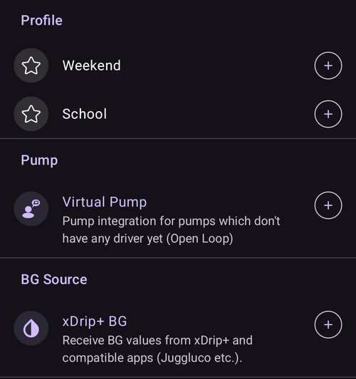

(quicklaunch)=
# Snabbstart (verktygsfält för snabbåtgärder på huvudskärmen)

**Snabbstart** är det lilla **verktygsfältet för snabbåtgärder** som ligger längst ner på huvudskärmen i **AAPS**, precis ovanför den nedre navigeringen. Det är en rad med knappar som du kan anpassa och som fungerar med ett enda tryck: du bestämmer vilka åtgärder som finns där och i vilken ordning, så att det du gör oftast alltid bara är ett tryck bort på huvudskärmen.

```{contents} Table of contents
:depth: 2
:local: true
```


---

## Använda verktygsfältet

Verktygsfältet sitter på **huvudskärmen**, mellan graferna och den nedre navigeringen:


- **Tryck** på en ikon för att utföra åtgärden – precis som om du hade öppnat den från dess vanliga skärm (en bolus eller behandling visar fortfarande först sin vanliga bekräftelse).
- **Tryck länge** på en ikon för att se ett **verktygstips** med åtgärdens namn och en kort beskrivning.
- Om du lägger till **fler knappar än det får plats** på skärmen flyttas de extra knapparna till en **extrameny** (knappen **⋮** i slutet av verktygsfältet).
- Varje ikon behåller åtgärdens **färg** (t.ex. insulin, kolhydrater, tillfälligt målvärde), så att du känner igen den direkt.

```{admonition} The toolbar is always there
:class: note
Den sista knappen är alltid **Konfigurera Snabbstart** (kugghjulet **⚙️**). Den kan inte tas bort, så du kommer alltid till konfigurationsskärmen direkt från verktygsfältet. Från början innehåller verktygsfältet bara två knappar – **Kalkylator** och det här kugghjulet.
```

---

## Konfigurera Snabbstart

Tryck på kugghjulet **⚙️** i verktygsfältet (eller öppna **[Konfiguration](../SettingUpAaps/ConfigBuilder.md) → … → Konfigurera Snabbstart**) för att öppna skärmen **Konfigurera Snabbstart** (*”Anpassa snabbåtgärdsknappar på huvudskärmen”*).


Skärmen har två delar:

- **Valda åtgärder** (högst upp) – knapparna som just nu finns i ditt verktygsfält, i samma ordning som i verktygsfältet.
- En **katalog** nedanför – alla åtgärder som du kan lägga till, grupperade i kategorier. Varje post i katalogen har en knapp **➕** för att lägga till den.

### Valda åtgärder – ändra ordning, redigera, ta bort

Varje vald åtgärd har:

- ett **⠿ draghandtag** – tryck och dra för att **ändra ordning** på knapparna (ordningen här är ordningen i verktygsfältet),
- en knapp **−** – **tar bort** den från verktygsfältet,
- och, bara för en genväg för **Profil**, en knapp **✏️** för att ändra procent/varaktighet (se [Profilgenvägar](#profile-shortcuts)).

Ändringar gäller **direkt** – det finns ingen separat knapp *Spara*. En åtgärd som du lägger till hamnar sist i verktygsfältet. Flytta den sedan dit du vill.

---

## Kategorierna av åtgärder

Katalogen grupperar allt som du kan lägga till i följande kategorier, i den här ordningen. Kategorier som inte har något att erbjuda (t.ex. om du inte har några scener) visas helt enkelt inte.

### Behandling

De vanliga dialogrutorna för behandling och CGM:

- **Insulin** – ge en bolus manuellt.
- **Kolhydrater** – registrera kolhydrater utan insulin.
- **Kalkylator** – öppna boluskalkylatorn.
- **Behandling** – registrera insulin och kolhydrater tillsammans.
- **CGM** – öppna din CGM-app (t.ex. xDrip).
- **Kalibrering** – kalibrera CGM-sensorn.

### Careportal

Händelserna i Careportal och registreringar av underhåll av enheter:

- **BG-kontroll**, **Anteckning**, **Träning**, **Fråga**, **Meddelande**,
- **Sensorinsättning**, **Byte av pumpbatteri**, **Pump/nålbyte**, **Förfyllning**, **Platsrotation**.

**Förfyllning** och **Byte av pumpbatteri** erbjuds bara när din pump använder dem. Pod-pumpar fyller till exempel på insulin och byter batteri i sina egna aktiveringssteg, så dessa poster visas inte för dem (precis som i panelen **Hantera**).


Det här är samma poster som du annars når via panelerna **[Behandlingar](#v4changes-treatments)** och **[Hantera](#v4changes-manage)** – Snabbstart lägger bara de poster du använder på huvudskärmen.

### Hantera

Skärmarna i panelen **[Hantera](#v4changes-manage)**, i samma ordning, så att du kan öppna den du använder mest från verktygsfältet:

- **Profil**, **Insulininställningar** (hantera och aktivera insulinkonfigurationer – heter med avsikt något annat än **Insulin**, eftersom den knappen ger en bolus), **Tillfälligt målvärde**, **Snabbknappar**, **Scener**, **Automation**, **Matdatabas**,
- **Körläge** – stäng eller öppna loopen, pausa den eller koppla från pumpen,
- **Auktoriserade klienter** – bara på en huvudenhet eller en parkopplad klient.

Dessa knappar öppnar skärmen. De startar inget av sig själva. Om du vill starta en scen eller en snabbknapp med ett enda tryck lägger du till den från kategorin **Scener** eller **Snabbknapp** nedan.

 

### Snabbknapp

Var och en av dina förinställningar för **[Snabbknapp](QuickWizards.md)** kan läggas till som en knapp, så att en återkommande måltid bara är ett tryck bort på huvudskärmen. Knappen har förinställningens namn och visar mängden kolhydrater/insulin. När du trycker på den körs snabbknappen med sin vanliga bekräftelse.

Snabbknappar som bara ska visas på klockan erbjuds inte. En snabbknapp i verktygsfältet följer samma regler som i panelen **Behandlingar**: den döljs utanför sitt [giltiga tidsintervall](#quickwizard_validity) och en kort tid efter att den har använts. Den finns kvar i konfigurationen för ditt verktygsfält och kommer tillbaka när snabbknappen kan användas igen.

### Scener

Varje aktiverad **[scen](Scenes.md)** kan läggas till som en knapp. När du trycker på den får du först bekräfta, sedan aktiveras scenen (samma grupp av åtgärder som du skulle få från skärmen Scener). Den här kategorin visas bara om du har minst en scen.

Verktygstipset och katalogen visar samma sammanfattning som **Hantera → Scener**, till exempel *”3 åtgärder, 2 h → Nedvarvning”*, där namnet efter pilen är den scen som följer efteråt.

### Automation

Dina automationsregler av typen **Användaråtgärd** (de som du startar för hand) kan läggas till som knappar. När du trycker på en sådan knapp får du först bekräfta, sedan körs regelns åtgärder.

```{admonition} Automation buttons run on the master
:class: note
Automation körs på **huvudenheten**, så genvägar för automation erbjuds och körs bara på huvudenheten. De är inte tillgängliga på en parkopplad **[klient](../RemoteFeatures/ClientMasterControl.md)**.
```

### Förvalda tillfälliga målvärden

Var och en av dina förinställningar för **[Tillfälligt målvärde](TempTargets.md)** kan läggas till som en knapp (namnet, målvärdet och varaktigheten visas, till exempel *”Äta snart – 5,0 mmol/l, 45 min”*). När du trycker på den får du först bekräfta, sedan startar det tillfälliga målvärdet.


(profile-shortcuts)=
### Profil

Varje **[profil](ProfileSwitch-ProfilePercentage.md)** kan läggas till som en **genväg** som gör ett **profilbyte** med ett enda tryck. Till skillnad från de flesta genvägar har en profilgenväg sin egen **procent** och **varaktighet**, som du ställer in efter att du har lagt till den, med knappen **✏️**:

- **Procent** (30–250 %, i steg om 5 %) – skalar profilen när den används. 100 % använder profilen som den är.
- **Varaktighet** (0–10080 min, alltså upp till 7 dagar, i steg om 10 min) – hur länge profilbytet varar. **0 = Tillsvidare** (tills du byter igen).



Du kan alltså ha flera knappar för **samma** profil med olika styrka – till exempel *”Profil 100 %”* och *”Profil 70 % i 2 h”* – och använda vilken som helst med ett enda tryck. (Du kan lägga till samma profil flera gånger med olika inställningar.)

### Plugins


Till sist kan alla **aktiverade plugins** som har en egen skärm läggas till som en genväg som öppnar skärmen direkt. De är grupperade efter typ av plugin – **Pump**, **BG-källa**, **APS**, **Loop**, **Känslighetsdetektering**, **Utjämning**, **Kalibrering**, **Begränsningar**, **Kommunikation** och **Generellt** – så att du till exempel kan gå direkt från huvudskärmen till skärmen för din pump eller loop.

---

## Snabbstart och huvudenhet/klient

Till skillnad från de flesta av dina inställningar **konfigureras verktygsfältet Snabbstart per enhet** – det sparas **lokalt och synkroniseras inte** mellan din huvudenhet och parkopplade klienter, så varje enhet har sin egen uppsättning knappar. (Det *ingår* däremot i en **säkerhetskopia/export** av inställningarna, så när du återställer den kommer det tillbaka på samma enhet.)

Vad varje enhet kan lägga i sitt verktygsfält beror ändå på vad den har: snabbknappar, scener, förvalda tillfälliga målvärden och profiler synkroniseras alla, så katalogen på en klient erbjuder samma poster – du väljer dem bara per enhet. Några detaljer att känna till:

- Knappar vars mål inte längre finns (en raderad snabbknapp, scen eller förinställning, en inaktiverad regel) **hoppas över automatiskt**.
- Genvägar för **Automation** erbjuds och körs bara på **huvudenheten** (automation körs på huvudenheten). Knappar för scener, snabbknappar, tillfälliga målvärden och profiler är tillgängliga på en klient.
- När du trycker på en knapp på en klient och åtgärden måste köras på huvudenheten (en bolus, ett tillfälligt målvärde, ett profilbyte eller en scen) är det **huvudenheten** som utför den och skickar bekräftelsen. Se [Styrning huvudenhet ↔ klient](../RemoteFeatures/ClientMasterControl.md).

---


<!-- =====================================================================
     Screenshots captured from a real master device:
       - quicklaunch_toolbar.png    (cropped close-up of the overview toolbar pill)
       - quicklaunch_overview.png   (full overview showing the toolbar in place)
       - quicklaunch_config.png     (Configure QuickLaunch: Selected actions + Treatment + start of Manage)
       - quicklaunch_dynamic.png    (catalog: Quick Wizard / Scenes / Automation / Temp Target Presets)
       - quicklaunch_categories.png (catalog: Profile shortcuts + plugin categories)
     No QuickLaunch action was actually run (nothing delivered; only scrolled).
     Maintainers: relocate page + images and fix cross-links as needed.
     ===================================================================== -->
