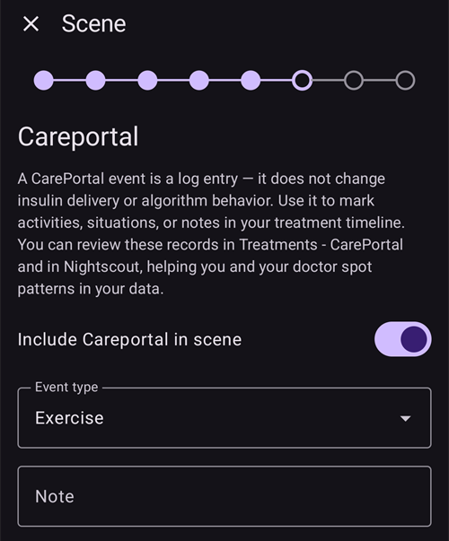
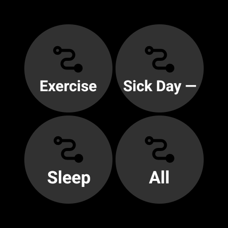

(scenes)=
# Scener (förinställningar för olika situationer)

En **scen** är en förinställning med ett namn som utför **flera åtgärder på en gång**. Det kan till exempel vara en förinställning för *Sömn*, *Träning* eller *Sjukdag* som byter profil, ställer in ett tillfälligt målvärde, slår på eller av SMB och lägger till en Careportal-anteckning med ett enda tryck, om du vill under en bestämd tid.

```{contents} Table of contents
:depth: 2
:local: true
```

---

## Vad är en scen

I stället för att ändra flera saker för hand varje gång en situation återkommer, ställer du in dem en gång som en scen och aktiverar den med ett tryck. En scen kan innehålla alla dessa åtgärder:

- **Profilbyte** – byt profil och/eller ändra den med en procentsats (t.ex. 70 %).
- **Tillfälligt målvärde** – ställ in ett tillfälligt målvärde (t.ex. *Träning*, *Äta snart* eller ett eget värde).
- **SMB på/av** – aktivera eller inaktivera SMB (super-micro-bolus) medan scenen är aktiv.
- **Körläge** – ändra körläget (t.ex. till ett mer försiktigt läge).
- **Careportal-anteckning** – registrera en händelse (t.ex. *Träning*, *Sjukdom*) så att den visas i grafen och i Nightscout.

En scen har också en **varaktighet** – en fast tid (minuter/timmar/dagar) eller *Obegränsad (avsluta manuellt)* – och en **slutåtgärd** som körs när scenen slutar: antingen en **avisering**, eller så kan den **länkas** till en annan scen (till exempel *Sjukdag → Träning*).

---

## Hantera scener

Öppna **Hantera → Scener** för att se, skapa, redigera, aktivera/inaktivera och ändra ordning på dina scener.


Varje scenkort visar:

- en **kryssruta** för att aktivera/inaktivera scenen,
- en **ikon** och ett **namn**,
- en sammanfattning – *”N åtgärder, varaktighet”* – och den **→ länkade scenen** om scenen leder vidare till en annan scen,
- och tre knappar: **▶ aktivera**, **✏️ redigera**, **🗑️ radera**.

Tryck på knappen **+** för att skapa en ny scen.

---

## Skapa eller redigera en scen

### Börja från en mall

För att **skapa** en scen trycker du på knappen **+** på skärmen Scener. Första steget är **Börja från en mall**: välj en färdig scen för en vanlig situation – *Träning*, *Sjukdag*, *Sjukdag — Kräkningar*, *Sömn*, *Natt efter träning*, *Innan måltid*, *Alkohol*, *Bilkörning*, *Bad*, *Lutealfas*, *Varmt väder*, *Medicinskt ingrepp* – eller börja från en *Tom* scen. Varje mall **fyller i de rekommenderade åtgärderna i förväg**, och du kan justera allt i nästa steg.


När du har valt en mall förklaras dess syfte – *när* och *varför* du ska använda den – innan du går vidare:


### Gå igenom åtgärderna steg för steg

Resten av redigeraren är en kort guide **steg för steg**. Varje steg är en typ av åtgärd med ett reglage *”Inkludera … i scenen”*. Slå bara på det för de åtgärder som scenen ska utföra, och låt resten vara avslagna.


Gå igenom stegen med **Nästa**/**Tillbaka**: *Profilbyte*, *Tillfälligt målvärde*, *SMB*, *Körläge*, *Careportal-anteckning*, sedan **varaktigheten**, **slutåtgärden** (avisering eller länk till en annan scen) och till sist scenens **namn och ikon**. Spara när du är klar. (För att **redigera** en befintlig scen trycker du på dess knapp **✏️** – då kommer du direkt till dessa steg.)

Varje steg börjar med en kort förklaring av vad åtgärden gör. Så här ser stegen ut, här med mallen *Träning*:

**Tillfälligt målvärde** – välj en av dina förinställningar för tillfälligt målvärde:


**SMB** – aktivera eller inaktivera SMB medan scenen är aktiv:


**Körläge** – ändra körläget om du vill:


**Careportal** – händelsetypen och anteckningen som ska registreras:



**Varaktighet** – hur länge scenen är aktiv; 0 betyder tills du själv avslutar den:


**Uppföljningsscen** – om du vill, den scen som startar när denna scen slutar:


**Scen** – namnet och ikonen. Tryck på **Slutför** för att spara:


---

## Aktivera en scen

Aktivera en scen från listan **Scener** (knappen **▶**) eller från **Scener** i den nedre navigeringen. I panelen **Scener** i den nedre navigeringen visar varje scen samma sammanfattning som i listan Scener. **Pennan** högst upp i panelen öppnar **Hantera → Scener**, där du skapar eller redigerar dina scener.


Om [bolusskydd](#Preferences-protection) är på frågar **AAPS** efter det innan en scen startar eller avslutas. För att ändra en scen krävs i stället [skydd för inställningar](#Preferences-settings-protection).

Innan något utförs får du en **bekräftelse** som visar exakt vad scenen kommer att göra, så att du kan kontrollera det:


Om scenen leder vidare till en annan scen slutar bekräftelsen med **→** och namnet på uppföljningsscenen, på samma sätt som i listan Scener.

När du startar scenen från **Scener** i den nedre navigeringen är bekräftelsen en enklare dialogruta med samma lista över åtgärder. Tryck på **OK** för att aktivera:


När du har bekräftat utförs åtgärderna, och den **aktiva scenen** visas högst upp på huvudskärmen med knappen **Avsluta scen**. Om scenen leder vidare till en annan scen visar banderollen också namnet på uppföljningsscenen:


Scenens åtgärder gäller tills:

- dess **varaktighet** tar slut (**slutåtgärden** körs – en avisering, eller nästa scen startar), eller
- du trycker på **Avsluta scen** för att avsluta den manuellt. Om scenen leder vidare till en annan scen får du två val: **Hoppa till** uppföljningsscenen (den aktiva scenen avslutas och uppföljningsscenen startar nu), eller **Avsluta scen** (den aktiva scenen avslutas och uppföljningsscenen startar inte).

En scen utan uppföljningsscen ber dig bara att bekräfta:


När en scen avslutas **återställs** ändringarna som den gjorde (till exempel profilbytet och det tillfälliga målvärdet som den startade).

Medan en scen är aktiv visar profilen och målvärdet på huvudskärmen en liten scenikon om scenen har ställt in dem. Panelen **Scener** i den nedre navigeringen finns kvar, så att du kan starta en annan scen:


När varaktigheten tar slut av sig själv återställs ändringarna direkt, och banderollen ändras till **Scen avslutad** med knappen **Avfärda**. Avfärda tar bara bort banderollen från skärmen – själva scenen är redan slut, så automationsregler och en länkad scen fortsätter utan att vänta på den.

---

## Starta scener från Automation

Du behöver inte starta en scen för hand – **Automation** kan köra den åt dig. När du lägger till en åtgärd i en automationsregel (**Hantera → Automation**) finns kategorin **Scener** i listan med åtgärder:

- **Kör scen** – aktiverar en scen när regelns utlösare gäller (till exempel vid en viss tid, när du kommer fram till en plats eller när blodsockret passerar ett gränsvärde).
- **Aktivera scen** / **Inaktivera scen** – gör en scen tillgänglig (eller inte tillgänglig) utan att aktivera den.


Automation kan också **reagera på** en scen: listan med utlösare har utlösaren **Scen**, så att en regel bara körs medan en viss scen är aktiv. Tillsammans med en scens **slutåtgärd** (återställa, avisera eller länka till en annan scen) kan scener på så sätt starta, följa på varandra och avslutas automatiskt.

---

## Scener med huvudenhet/klient och en klocka

Den **scen som är aktiv just nu synkroniseras** mellan alla dina parkopplade enheter – aktivera den på en telefon så visas den på de andra också.

En parkopplad **klient** (**AAPSClient**) kan också aktivera eller avsluta en scen: begäran skickas till **huvudenheten**, som skapar bekräftelsen och utför scenen på sig själv. Se [Styrning huvudenhet ↔ klient](../RemoteFeatures/ClientMasterControl.md) för hur det fungerar.

(scenes-from-watch)=
### Från en Wear OS-klocka

Scener finns på en **Wear OS-klocka** som brickan **Scen** (tile). Svep till brickan **Scen** bland klockans brickor (lägg först till den från listan över brickor om den inte finns där ännu) och tryck på den scen som du vill starta:



Brickan har fyra platser. Som standard fylls varje plats **automatiskt** med nästa av dina aktiverade scener, i samma ordning som på telefonen. Om du vill välja själv **trycker du länge på brickan** och öppnar dess inställningar: för var och en av de fyra platserna kan du behålla **Automatisk**, fästa en **viss scen** eller välja **Inget** för att lämna platsen tom. En plats som är fäst vid en scen som sedan har raderats eller inaktiverats visar **Ej tillgänglig** – välj en annan scen för den.

Klockan visar sedan en bekräftelse – tryck på **✓** för att aktivera, eller svep tillbaka för att avbryta:


Precis som på en klient är det **huvudenheten som skapar bekräftelsen och kör scenen**. Klockan skickar bara vidare begäran (via klienttelefonen, om klockan är parkopplad med en klient).

Medan en scen körs – eller medan dess banderoll **Scen avslutad** fortfarande visas på telefonen – visar brickan knappen **Avsluta** med scenens namn under. Tryck på den för att avsluta den aktiva scenen, eller för att ta bort banderollen som finns kvar, direkt från handleden.

Om den pågående scenen leder vidare till en annan scen visar brickan också knappen **Hoppa över** med namnet på uppföljningsscenen under. Det är samma två val som på telefonen:

- **Avsluta** – den aktiva scenen avslutas. Bekräftelsen talar om att uppföljningsscenen inte startar.
- **Hoppa över** – den aktiva scenen avslutas och uppföljningsscenen startar nu. Bekräftelsen visar namnen på båda scenerna.

Klockans [skärm Loopstatus](#WearOsSmartwatch-loop-status) visar också den aktiva scenen, hur lång tid som är kvar och dess uppföljningsscen.

---


<!-- =====================================================================
     Screenshots captured from a real master device:
       - scenes_list.png        (Manage → Scenes management list)
       - templates_picker.png   (create: "Start from template" picker)
       - template_explanation.png (create: chosen template's explanation)
       - scene_editor.png       (scene editor, Profile switch step)
       - scene_confirmation.png (scene activation confirmation — also used on the Client/Master page)
       - scene_active_banner.png (overview active-scene banner with the End Scene button)
       - automation_scene_action.png (Automation action picker — Scenes category)
       - scene_watch_tile.png    (Wear OS Scene tile)
       - scene_watch_confirm.png (Wear OS scene confirmation)
     Maintainers: relocate page + images and fix cross-links as needed.
     ===================================================================== -->
