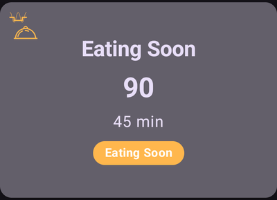
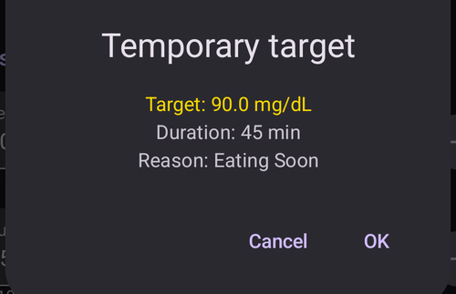
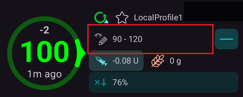

# Tillfälliga målvärden

## Vad är tillfälliga målvärden, och var ställer jag in dem?

Ett **tillfälligt målvärde** (förkortat **TT**, från engelskans temp target) är en funktion i **AAPS** som låter användaren ändra sitt [**BG**-målintervall](#profile-glucose-targets) för planerade aktiviteter. Det gör **AAPS** genom att ändra hur mycket insulin användaren får.

Ett målvärde för glukos, särskilt om det bara gäller en kort tid (kortare än 4 timmar), behöver inte vara det *faktiska värde* som du väntar dig eller vill att din glukosnivå ska nå. Det är i stället ett bra sätt att tala om för **AAPS** att vara mer eller mindre aggressivt, samtidigt som dina glukosnivåer hålls inom intervallet.

Tillfälliga målvärden kan ställas in inom dessa gränser:

|         | Tillfälligt målvärde      |
| ------- | ------------------------- |
| Minimum | 4 mmol/l eller 72 mg/dl   |
| Maximum | 10 mmol/l eller 180 mg/dl |

**AAPS** har tre inbyggda förinställningar för **tillfälligt målvärde**: för träning (**Träning**), för måltider (**Äta snart**) och för förutsagd hypoglykemi (**Hypo**). De finns på skärmen **Tillfälligt målvärde** (**Hantera** → **Tillfälligt målvärde**), som du också kan öppna genom att trycka på **målvärdeschipet** på huvudskärmen.

Användare bör ha realistiska förväntningar på vilka resultat de kan nå när de väljer ett **tillfälligt målvärde** i **AAPS**. Hur väl du når ett önskat **BG**-målvärde beror på många faktorer, till exempel: hur pålitliga användarens inställningar i **AAPS** är, hur stabilt **BG** är i stort, **IOB**, insulinkänslighet, insulinresistens, hur ansträngande träningen är och så vidare.

Det kan ta ungefär 30 minuter eller längre innan ett **tillfälligt målvärde** når det önskade **BG**-målvärdet. **AAPS** kan inte nå ett **BG**-målvärde direkt, och användare bör tänka på detta när de väljer ett **tillfälligt målvärde**.

Avsnitten nedan sammanfattar funktionerna i **Tillfälligt målvärde – Träning**, **Tillfälligt målvärde – Äta snart** och **Tillfälligt målvärde – Hypo**. Värdena som visas är standardvärdena från början – du kan [justera varje förinställning](#TempTargets-change-preset-defaults) efter dina egna behov.

### TT – Träning


**BG-målvärde (standardförinställning, kan justeras)**

AAPS siktar på att nå 140 mg/dl eller 7,8 mmol/l under 1 h 30 min

**Annat som användare kan vilja tänka på när de väljer**:

Beroende på **BG**-nivån kommer **AAPS** att ”minska” insulinet för att nå **BG**-målvärdet. Om **BG**-målvärdet inte ligger inom intervallet (dvs. över det **BG**-målvärde som är valt i användarens **profil**), kan **AAPS** låta basalen vara på.

I läget sluten loop gäller för **SMB**:

- SMB *kan* vara inaktiverat (beskrivs mer nedan); och/eller
- basal kan ges om **AAPS** har negativ **IOB** eller <0.

Användare kan också vilja tänka på att:

- *välja* detta **TT** 1–2 timmar före den planerade träningen för att få lägre IOB (rätt tidpunkt för detta TT är olika för olika personer); och
- *välja* en tillfällig profil (minskning) under den planerade aktiviteten för att få lägre **IOB**;
- *se till* att **TT** är inställt så att det *avslutas* en kort stund före träningen, eftersom **IOB** redan är lägre och vissa användare får en snabb ökning av **BG** efter träningen.

### TT – Äta snart



**BG-målvärde (standardförinställning, kan justeras)**

AAPS siktar på att nå 90 mg/dl eller 5,0 mmol/l under 45 minuter

**Annat som användare kan vilja tänka på när de väljer**:

I läget sluten loop gäller för **SMB**:

- SMB förblir aktiverat; och/eller
- basal kan också ges beroende på inställningarna i användarens **profil**.

Beroende på **BG**-nivån kommer **AAPS** att ”öka” insulinet inom gränserna i användarens inställningar i **AAPS** för att nå det önskade **BG**-målvärdet.

### TT – Hypo


**BG-målvärde (standardförinställning, kan justeras)**

AAPS siktar på att nå 160 mg/dl eller 8,9 mmol/l under 1 timme

**Annat som användare kan vilja tänka på när de väljer**:

I läget sluten loop gäller för **SMB**:

- SMB *kan* vara inaktiverat (beskrivs mer nedan); och/eller
- basal kan ges om **AAPS** har negativ **IOB** eller <0.

(TempTargets-manage-v4)=

## Ställa in och hantera tillfälliga målvärden (Hantera → Tillfälligt målvärde)

I **AAPS** v4 hanterar du dina **förinställningar** för TT och startar ett tillfälligt målvärde från skärmen **Hantera** (nedre navigeringen) → **Tillfälligt målvärde** (*”Hantera och ställ in tillfälliga målvärden”*).


Skärmen har tre delar:

1. **Karusell med förinställningar** (högst upp) – svep mellan dina förinställningar för TT. Varje kort visar förinställningens **namn**, **målvärde** och **varaktighet**; det TT som körs just nu är markerat.
2. **Redigerare** (i mitten) – **Tillfälligt målvärde** och **Varaktighet** som faktiskt kommer att användas, plus datum/tid för **Aktivering**.
3. **Åtgärdsfält** (längst ner) – **➕ lägg till**, **‘️ radera** och knappen **▶ aktivera**.

När du väljer ett kort för en förinställning läses dess **målvärde** och **varaktighet** in i redigeraren.

```{admonition} Inbyggda och egna förinställningar :class: note De inbyggda förinställningarna – **Äta snart**, **Träning** och **Hypo** – finns alltid och **kan inte raderas** (men du kan ändra deras värden och spara). Förinställningar som du skapar själv är **egna** och kan redigeras eller raderas fritt.

    <br />### Aktivera ett tillfälligt målvärde
    
    Svep till den förinställning du vill ha (dess värden läses in i redigeraren), justera vid behov **målvärde**/**varaktighet** i redigeraren och tryck sedan på **▶ Aktivera**. En bekräftelse visar exakt målvärde, varaktighet och orsak innan något startar:
    
    
    
    När du har bekräftat startar det tillfälliga målvärdet direkt (eller vid den valda tiden för **Aktivering**) och gäller under den inställda **varaktigheten**.
    
    ```{admonition} Att ändra siffrorna gäller bara en gång – det ändrar inte förinställningen
    :class: important
    **Målvärde** och **varaktighet** i redigeraren är de värden som **Aktivera** använder *just nu*. Om du ändrar dem är ändringen **tillfällig**: den gäller bara för denna aktivering och **ändrar inte den sparade förinställningen**. På så sätt kan du ”justera och aktivera” ett TT en enda gång (till exempel aktivera *Träning* med ett lite annat målvärde i dag) utan att ändra förinställningen för alltid.
    

### Spara ändringar i en förinställning

Om du *vill* behålla ett ändrat värde ska du **spara** det: när redigeraren skiljer sig från den valda förinställningen visas ikonen **Spara** i det övre verktygsfältet. När du trycker på den sparas aktuellt **målvärde** och **varaktighet** (och namn, för egna förinställningar) i den valda förinställningen. För de inbyggda förinställningarna visas också knappen **Återställ till standardvärden** (↺) i åtgärdsfältet: den tar tillbaka förinställningens standardvärden.


Tumregeln är alltså:

- **Aktivera** → använd siffrorna **en gång** (förinställningen ändras inte).
- **Spara** → gör siffrorna till förinställningens **nya standardvärden**.

För att återställa en inbyggd förinställning till hur den var från början väljer du den och trycker på knappen **↺ Återställ**. Den visas i åtgärdsfältet bara för en **inbyggd** förinställning vars värden just nu skiljer sig från fabriksvärdena, och den återställer förinställningens ursprungliga **målvärde** och **varaktighet**.

### Lägga till och ta bort förinställningar

- **➕ Lägg till** – skapa en **ny egen förinställning** från de aktuella värdena i redigeraren. Det nya kortet visas i karusellen.
- **‘️ Radera** – ta bort den valda **egna** förinställningen. Inbyggda förinställningar (*Äta snart*, *Träning*, *Hypo*) kan inte raderas.

När du har minst två **egna** förinställningar kan du också ändra deras ordning i karusellen: tryck på ikonen **Ändra ordning** (⇅) i det övre fältet, flytta kortet i mitten med **◀ / ▶ flyttknapparna** och bekräfta sedan med **✓**. De inbyggda förinställningarna har kvar sina platser – bara egna förinställningar kan flyttas. (Knapparna ser likadana ut som när du [ändrar ordning på profiler](ProfileSwitch-ProfilePercentage.md).)

Dina förinställningar är en del av den synkroniserade konfigurationen, så de delas mellan din huvudenhet och parkopplade klienter.

### Andra sätt att ställa in ett tillfälligt målvärde

Du kan också ställa in ett tillfälligt målvärde utan att öppna denna skärm:

- med **TT-reglagen i dialogrutan Kolhydrater** – se [nedan](#TempTargets-carbs-dialog),
- med en **knapp för en förinställning i [verktygsfältet Snabbstart](QuickLaunch.md)** – kategorin *Förvalda tillfälliga målvärden* i *Konfigurera Snabbstart* ger dig en knapp för varje förinställning, som fungerar med ett tryck,
- från en **Wear OS-klocka** (menyvalet eller brickan **Tillfälligt målvärde**),
- från en parkopplad **klient** – se [Styrning huvudenhet ↔ klient](../RemoteFeatures/ClientMasterControl.md),
- som en del av en **[scen](Scenes.md)** (åtgärden *Tillfälligt målvärde*), eller
- från en regel i **Automation** (*Starta tillfälligt målvärde* / *Avbryt tillfälligt målvärde*).

* * *

(TempTargets-where-can-i-select-a-temp-target)=

## Var kan jag välja ett tillfälligt målvärde?

Det snabbaste sättet är att trycka på **målvärdeschipet** på huvudskärmen (det visar ditt aktuella målintervall):



Då öppnas skärmen **Tillfälligt målvärde** som beskrivs ovan – svep till en förinställning och tryck på **▶ Aktivera**. Du kommer också till samma skärm via **Hantera** → **Tillfälligt målvärde**.

(TempTargets-carbs-dialog)= När du anger kolhydrater behöver du inte öppna skärmen **Tillfälligt målvärde** alls: **dialogrutan Kolhydrater** (**Behandlingar** → **Kolhydrater**) har reglagen **Starta "Hypo"**, **Starta "Äta snart"** och **Starta "Träning"** högst upp. Slå på ett av dem så aktiveras motsvarande förinställning samtidigt som kolhydraterna registreras:


    {admonition} Automatiskt TT Hypo
    :class: note
    Om du öppnar **dialogrutan Kolhydrater** när din glukos är under 72 mg/dl (4 mmol/l) väljer **AAPS** reglaget **Starta "Hypo"** åt dig (om inte ett högre tillfälligt målvärde med längre tid kvar redan är aktivt).

(TempTargets-change-preset-defaults)=

## Var kan jag ändra standardvärdena för tillfälliga målvärden till mina egna värden?

Varje förinställnings **målvärde** och **varaktighet** redigeras direkt på skärmen **Tillfälligt målvärde** – det finns inte längre någon separat inställning för detta:

1. Öppna skärmen **Tillfälligt målvärde** (tryck på målvärdeschipet, eller **Hantera** → **Tillfälligt målvärde**).
2. Svep till den förinställning som du vill ändra.
3. Justera **Tillfälligt målvärde** och/eller **Varaktighet** i redigeraren.
4. Tryck på ikonen **Spara** som visas i det övre verktygsfältet.


Medan redigeraren skiljer sig från fabriksvärdena för en inbyggd förinställning visas också knappen **↺ Återställ** i åtgärdsfältet – tryck på den för att återställa förinställningens ursprungliga målvärde och varaktighet.

## Hur avbryter jag ett tillfälligt målvärde?

Medan ett tillfälligt målvärde är aktivt visar målvärdeschipet på huvudskärmen målvärdet och hur lång tid som är kvar. Tryck på det – på skärmen **Tillfälligt målvärde** är den aktiva förinställningen markerad som **AKTIV**, och en röd knapp **✗ Avbryt** visas i slutet av verktygsfältet längst ner, precis till vänster om knappen **▶ Aktivera**. Tryck på den och bekräfta:


Ett aktivt tillfälligt målvärde kan också stoppas från en **Wear OS-klocka**, från en parkopplad **klient** eller av en regel i **Automation** (*Avbryt tillfälligt målvärde*).

(TempTargets-hypo-temp-target)=

## Tillfälligt målvärde Hypo

**Tillfälligt målvärde Hypo** gör att **AAPS** kan förhindra lågt blodsocker genom att minska insulinet. Om användaren räknar med att **BG** kommer att bli lågt: oftast bör **AAPS** klara det själv, men mycket beror på hur stabila användarens inställningar i **AAPS** är. Med ett **tillfälligt målvärde Hypo** kan användaren agera före det förutsagda låga värdet och få **AAPS** att minska insulinet.

När användaren äter kolhydrater för att behandla en hypo kan **BG** ibland stiga snabbt, och **AAPS** korrigerar då mot det snabbt stigande **BG** genom att ge **SMB:er**.

Vissa användare vill inte att **SMB:er** ges under ett **tillfälligt målvärde Hypo**. Det gör du genom att inaktivera *'Aktivera SMB vid högt tillfälligt målvärde'* under **Inställningar** → **OpenAPS SMB** (se längre ner):

- Avancerat, mål 9: användaren kan aktivera *”Högt tillfälligt målvärde höjer känsligheten”* för **tillfälliga målvärden** på 100 mg/dl (5,6 mmol/l) eller högre i OpenAPS SMB. Då blir **AAPS** mer känsligt.

- Avancerat, mål 9: användaren kan inaktivera *”Aktivera SMB vid högt tillfälligt målvärde”*. Då ger **AAPS** inga SMB:er medan höga tillfälliga målvärden är aktiva, även om **AAPS** har COB > 0, ”Aktivera SMB vid lågt tillfälligt målvärde” eller ”Aktivera SMB alltid” är på och OpenAPS SMB är aktivt.

Obs: om du öppnar **dialogrutan Kolhydrater** när ditt blodsocker är lägre än 72 mg/dl eller 4 mmol/l väljer **AAPS** reglaget **Starta "Hypo"** automatiskt.

(TempTargets-activity-temp-target)=

## Tillfälligt målvärde Träning

Före och under träning kan användaren behöva ett högre målvärde för att undvika hypoglykemi under aktiviteten.

För att göra **tillfälligt målvärde Träning** enklare kan användaren ställa in ett standardvärde för **Tillfälligt målvärde – Träning** som höjer **BG** genom att minska insulinet. Då sjunker **BG** långsammare och hypoglykemi undviks.

Nya användare av **AAPS** kan behöva prova sig fram och anpassa standardinställningarna för **tillfälligt målvärde Träning** så att funktionen fungerar så bra som möjligt för dem. Alla är olika när det gäller att hålla ett stabilt BG under träning. Se även [avsnittet om sport i Vanliga frågor](#FAQ-sports).

Vissa användare föredrar också att aktivera ett **profilbyte** (en minskning av profilen < 100 % så att **AAPS** ger mindre insulin) före och medan **tillfälligt målvärde Träning** är aktivt. Du kan starta båda i ett steg: tryck på profilnamnet på huvudskärmen, tryck på den runda knappen **▶**, ställ in en **Procent** under 100 % och en **Varaktighet**, och slå sedan på **Tillfälligt målvärde / Träning**. Se [Ändra procent av profilen](#ProfileSwitch-change-percentage).

Avancerat, mål 9: användare kan aktivera *'Högt tillfälligt målvärde höjer känsligheten'* för **tillfälliga målvärden** på 100 mg/dl (5,6 mmol/l) eller högre i OpenAPS **SMB**. Ett målvärde på 99 mg/dl (5,5 mmol/l) är ett normalt målvärde, varken högt eller lågt. Då är **AAPS** mer känsligt.

Om *'Aktivera SMB vid högt tillfälligt målvärde'* dessutom är inaktiverat ger **AAPS** inga **SMB:er**, även med COB > 0, *'Aktivera SMB vid lågt tillfälligt målvärde'* eller *'Aktivera SMB alltid'* på och OpenAPS **SMB** aktivt.

(TempTargets-eating-soon-temp-target)=

## Tillfälligt målvärde Äta snart

**Tillfälligt målvärde – Äta snart** kan hjälpa till att sänka **BG** försiktigt och se till att det finns tillräckligt med **IOB** innan du äter.

Detta kan vara ett viktigt verktyg för användare som inte ger förbolus. Hur bra **Tillfälligt målvärde – Äta snart** fungerar beror dock på flera faktorer, bland annat: användarens inställningar, om de äter lite kolhydrater och om de använder ett snabbverkande insulin (som Fiasp eller Lyumjev) för att slippa ge förbolus. Tills användare har erfarenhet av **AAPS** bör de normalt räkna med att ge en förbolus när de använder **Tillfälligt målvärde – Äta snart**, och det gäller särskilt om de äter mycket kolhydrater.

Du kan läsa mer om läget ”Äta snart” i artikeln ['How to do “eating soon” mode'](https://diyps.org/2015/03/26/how-to-do-eating-soon-mode-diyps-lessons-learned/) (på engelska) eller [här](https://diyps.org/tag/eating-soon-mode/).

Avancerat, [mål 9](#objectives-objective9): Om du använder OpenAPS SMB och har *'Lågt tillfälligt målvärde sänker känsligheten'* på, arbetar **AAPS** lite mer aggressivt. För detta alternativ krävs att det **tillfälliga målvärdet** är 98 mg/dl (5,4 mmol/l) eller lägre.

## Hur stänger jag av SMB under tillfälliga målvärden?

För att göra detta öppnar du **Inställningar** → **OpenAPS SMB** och inaktiverar *'Aktivera SMB vid högt tillfälligt målvärde'*.


Då ger **AAPS** inga **SMB:er**, även med COB > 0, *'Aktivera SMB vid lågt tillfälligt målvärde'* eller *'Aktivera SMB alltid'* på och OpenAPS SMB aktivt.