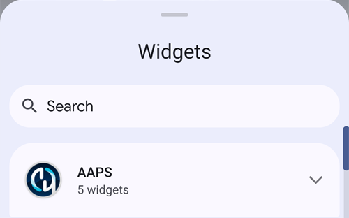

(widgets)=
# Widgets på hemskärmen

**AAPS** har widgets som du kan lägga till på telefonens hemskärm. En widget visar dina aktuella data utan att du behöver öppna appen. Tryck på en widget för att öppna **AAPS**.

```{contents} Table of contents
:depth: 2
:local: true
```

---

## Tillgängliga widgets

Det finns fem widgets. De finns under **AAPS** i Androids widgetväljare:


| Widget                            | Standardstorlek | Vad den visar                                                                                                                                                                                                                                                  |
| --------------------------------- | --------------- | -------------------------------------------------------------------------------------------------------------------------------------------------------------------------------------------------------------------------------------------------------------- |
| **AAPS-widget**                   | 5 × 2           | Statusblocket på huvudskärmen: BG med trend och delta, loopläget som en ikon bredvid profilnamnet, målvärde, känslighet (visas som på huvudskärmen), IOB och COB. Texterna krymper så att de passar den storlek du ger widgeten, i stället för att klippas av. |
| **AAPS glukoscirkel**             | 2 × 2           | BG-cirkeln på huvudskärmen: en ring i BG-färgen, trendbågen, delta, BG-värdet och tiden sedan senaste avläsningen.                                                                                                                                             |
| **AAPS liten**                    | 2 × 2           | Profilnamn, BG med trendpil, tid sedan senaste avläsningen, delta, IOB och COB.                                                                                                                                                                                |
| **AAPS BG + IOB + COB (kompakt)** | 4 × 1           | En rad med BG och trendpil, IOB och COB.                                                                                                                                                                                                                       |
| **AAPS BG-graf**                  | 3 × 1           | BG-värdet med en liten graf över de senaste avläsningarna.                                                                                                                                                                                                     |

**AAPS-widget**, **AAPS glukoscirkel** och **AAPS liten** på en hemskärm:


Widgeten **kompakt** och widgeten **BG-graf**:


BG-värden har samma färger som i **AAPS**: grönt inom målområdet, gult över målområdet, rött under målområdet.

---

## Lägga till en widget

De exakta stegen beror på din telefon och dess hemskärmsapp (launcher). På de flesta telefoner:

1. Tryck länge på ett tomt område på hemskärmen och välj **Widgets**.

   

2. Öppna **AAPS** i listan och tryck på den widget du vill ha.
3. Tryck på **Add** (eller dra widgeten dit du vill ha den).

   

Widgeten placeras på hemskärmen. Direkt efter att du har lagt till den visas den med handtag: dra i ett handtag för att **ändra storlek** på widgeten, eller dra widgeten för att flytta den. Glukoscirkeln kan ändras till valfri storlek.


Om sidan på hemskärmen är full lägger telefonen widgeten på en ny sida.

---

## Widget-konfiguration

Tryck på knappen med en **penna** som visas på widgeten direkt efter att du har lagt till den. Senare kan du trycka länge på widgeten för att få tillbaka handtagen och pennan.

Dialogrutan **Widget-konfiguration** har två inställningar:

- **Konfigurera opacitet** — hur ogenomskinlig widgetens bakgrund är. Ett lågt värde gör att bakgrundsbilden syns igenom.
- **Använd svart färg** — använd en svart bakgrund i stället för standardbakgrunden.


Varje widget har sin egen konfiguration.

---

## Bra att veta

- En widget **visar** bara data. Du kan inte ge bolus eller ändra något från en widget.
- Widgeten uppdateras av **AAPS**. Om **AAPS** inte körs, eller om Android begränsar appen i bakgrunden, kan widgeten visa gamla data. Kontrollera tiden sedan senaste avläsningen och se till att **AAPS** är undantagen från [batterioptimering](#SetupWizard-StoragePermission).
- Med **AAPSClient**, **AAPSClient2** och **AAPSClient3** är widgetens bakgrund gul, blå eller grön, så att du kan skilja apparna åt. Höj opaciteten i widget-konfigurationen om färgen är svår att se. Se [Om AAPSClient, AAPSClient2 och AAPSClient3](#remotecontrol-aapsclient-versions).
