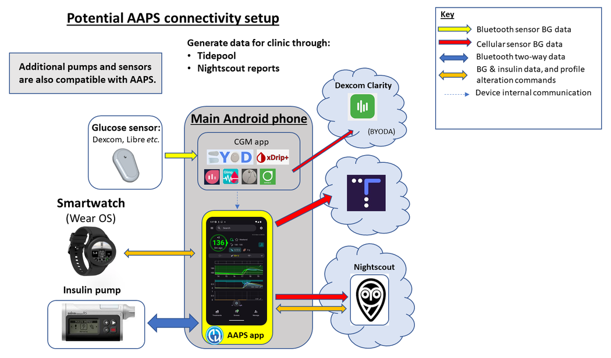
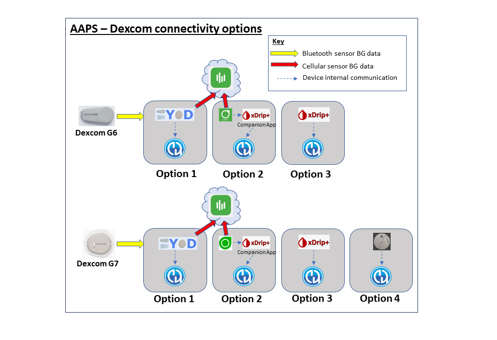
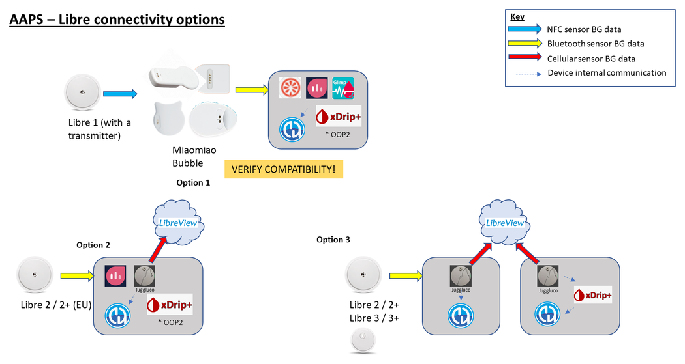
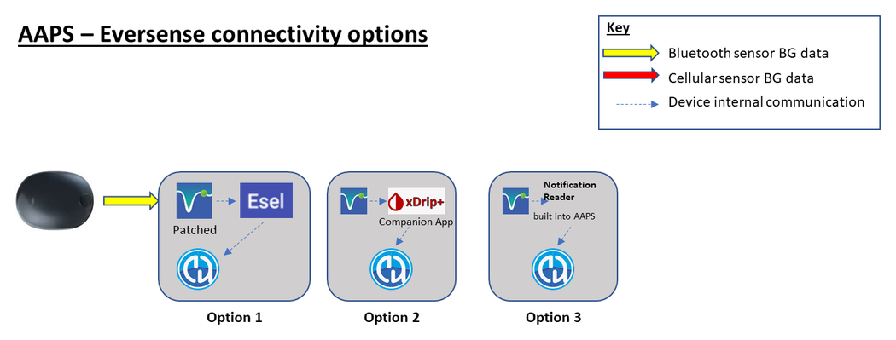

# Förberedelser inför start med AAPS

Välkommen. Den här dokumentationen ska vägleda användare som förbereder sig för att ställa in och börja använda Android Artificial Pancreas System (**AAPS**).

## Hitta i dokumentationen

En **innehållsförteckning** och en förklaring av dokumentationens struktur finns [här](../index.md). Du når den också genom att klicka på symbolen för **AAPS** uppe till vänster i dokumentationen. Där hittar du en översikt över vad dokumentationens olika avsnitt handlar om. Du kan också använda rubrikerna till vänster på den här sidan för att navigera i dokumentationen. Till sist finns en praktisk sökfunktion direkt under symbolen för **AAPS**.

Vi vill göra det enkelt att se både vad **AAPS** kan och vilka begränsningar det har. Det kan vara en besvikelse att först lägga tid på att läsa dokumentationen och sedan upptäcka att du kanske inte har en kompatibel insulinpump eller CGM, eller att **AAPS** har andra funktioner än du hoppades.

Många detaljer i dokumentationen för **AAPS** som bygger på erfarenhet blir tydligare när du faktiskt använder **AAPS** i vardagen. Precis som det är svårt att lära sig en sport bara genom att läsa reglerna, behöver du först lära dig grunderna i reglerna för att använda **AAPS** säkert och sedan lära dig hur du bäst använder dem när du börjar använda **AAPS**.

(preparing-safety-first)=

## Säkerheten först
”Med stor makt följer stort ansvar …”

### Teknisk säkerhet
**AAPS** har många säkerhetsfunktioner. De medför begränsningar som tas bort gradvis när du klarar en serie [mål](../SettingUpAaps/CompletingTheObjectives.md) steg för steg. I målen testar du vissa parametrar och svarar på flervalsfrågor. Funktionerna i **AAPS** låses upp när du klarar målen. Så kan användaren gå säkert, steg för steg, från öppen loop till sluten loop och samtidigt lära sig de olika funktionerna i **AAPS**.

[Målen](../SettingUpAaps/CompletingTheObjectives.md) är utformade för att ge bästa möjliga introduktion till **AAPS**. De tar hänsyn till de vanliga fel och allmänna mönster som utvecklarna av **AAPS** har sett hos nya användare. Misstag kan hända om nybörjaren saknar erfarenhet och är för ivrig att komma igång med **AAPS**, eller har missat viktiga punkter. [Målen](../SettingUpAaps/CompletingTheObjectives.md) ska minska dessa problem.

### Medicinsk säkerhet
```{admonition} Avoid permanent and painful damage to your eyes and nerves
:class: danger
Var försiktig med snabba förbättringar av blodsockerkontrollen och snabb sänkning av HbA1c 
```

En viktig säkerhetsfråga är att en **snabb sänkning av HbA1c och bättre blodsockerkontroll hos personer som har haft förhöjda glukosnivåer en längre tid kan orsaka bestående skador**. Många personer med diabetes känner inte till detta, och alla läkare informerar inte sina patienter om problemet.

Skadorna kan vara **synförlust och bestående neuropati (smärta)**. Det går att undvika sådana skador genom att sänka den genomsnittliga glukosnivån långsammare. Om du nu har ett förhöjt HbA1c och går över till **AAPS** (eller något annat system med sluten loop), _diskutera_ den här möjliga risken med ditt vårdteam innan du börjar, och kom överens med dem om en tidsplan där de säkra glukosmålen sänks gradvis. Du kan enkelt ställa in högre glukosmål i **AAPS** i början (just nu är det högsta målet du kan välja 11,1 mmol/l, men du kan också medvetet använda en svag profil om det behövs) och sedan sänka målet efter hand som månaderna går.

#### Hur snabbt kan jag sänka mitt HbA1c utan att riskera bestående skador?

En retrospektiv [studie](https://pubmed.ncbi.nlm.nih.gov/1464975/) av 76 patienter visade att risken för att retinopatin förvärras ökade 1,6 gånger, 2,4 gånger och 3,8 gånger om HbA1c sjönk med 1 %, 2 % respektive 3 % under en sexmånadersperiod. De föreslog att **”sänkningen av HbA1c under en sexmånadersperiod bör begränsas till mindre än 2 % för att förhindra att retinopatin förvärras....En för snabb sänkning i början av glukoskontrollen kan orsaka en allvarlig eller övergående försämring av retinopatin.”**

OBS! Om du använder andra enheter för HbA1c (mmol/mol i stället för %), klicka [här](https://www.diabetes.co.uk/hba1c-units-converter.html) för ett verktyg som räknar om HbA1c.

I en annan retrospektiv [utvärdering](https://academic.oup.com/brain/article/138/1/43/337923) av 954 patienter såg forskarna att:

**”Vid en sänkning av HbA1c med 2–3 procentenheter under 3 månader fanns en absolut risk på 20 % att utveckla behandlingsinducerad neuropati vid diabetes. Vid en sänkning av HbA1c med >4 procentenheter under 3 månader var den absoluta risken att utveckla behandlingsinducerad neuropati vid diabetes över 80 %.”**

En [kommentar](https://academic.oup.com/brain/article/138/1/2/340563) till den här studien höll med om att **målet bör vara att sänka A1c med <2 % under 3 månader för att undvika komplikationer.** Du kan läsa andra översikter om ämnet [här](https://www.ncbi.nlm.nih.gov/pmc/articles/PMC6587545/pdf/DOM-21-454.pdf) och [här](https://www.mdpi.com/1999-4923/15/7/1791).

Det är allmänt känt att personer med _nyligen_ diagnostiserad typ 1-diabetes (som ofta har mycket högt HbA1c vid diagnosen, innan insulinbehandlingen börjar) verkar kunna sänka sitt HbA1c snabbt direkt efter diagnosen utan att utsättas för dessa risker i samma grad, eftersom de inte har haft förhöjda blodsockernivåer under så lång tid. Det är ändå något som du bör diskutera med din läkare.

(PreparingForAaps-no-sglt-2-inhibitors)=
### Inga SGLT-2-hämmare

```{admonition} NO SGLT-2 inhibitors
:class: danger
SGLT-2-hämmare, även kallade glifloziner, hämmar återupptaget av glukos i njurarna. Glifloziner sänker blodsockret på ett sätt som inte går att beräkna, så du FÅR INTE ta dem när du använder ett system med sluten loop som AAPS! Det skulle innebära en betydande risk för ketoacidos och/eller hypoglykemi! Kombinationen av detta läkemedel med ett system som sänker basaldoserna för att höja BG är särskilt farlig. 

Kort sagt:
- **Exempel 1: risk för hypo**
>Vid lunch använder du **AAPS** för att ge en bolus för 45 g kolhydrater som du äter. Problemet är att hämmarna, utan att AAPS vet om det, får kroppen att göra sig av med en del av kolhydraterna. Då har kroppen för mycket insulin jämfört med de kolhydrater som tas upp, och det leder till hypoglykemi.

- **Exempel 2: risk för ketoacidos**
>Hämmarna gör sig av med en del av kolhydraterna i bakgrunden, och det sänker ditt BG. **AAPS** säger då automatiskt åt pumpen att minska insulintillförseln, även basalen. Med tiden kan det leda till att ditt BG ligger under målvärdet, tills kroppen inte har tillräckligt med bakgrundsinsulin för att ta upp några kolhydrater, och det leder till ketoacidos. Normalt utvecklas ketoacidos hos personer med typ 1-diabetes när pumpen slutar fungera. Det skulle ge larm i telefonen och märkas genom ett högt BG-värde. Faran med glifloziner är dock att AAPS inte skulle ge några larm, eftersom pumpen fortsätter att fungera och BG kanske ligger kvar inom målområdet.

Vanliga varumärken för SGLT-2-hämmare är bland annat Invokana, Farxiga, Jardiance, Glyxambi, Synjardy, Steglatro och Xigduo XR med flera.
```


### Viktiga principer för att loopa med AAPS

Du måste förstå de viktigaste principerna och begreppen för att loopa innan du använder **AAPS**. Det gör du genom att lägga egen tid på att läsa dokumentationen för **AAPS** och genom att klara målen, som ska ge dig en stabil grund för säker och effektiv användning av **AAPS**. Mängden dokumentation för **AAPS** kan verka överväldigande i början, men ha tålamod och lita på processen – med rätt arbetssätt kommer du att lyckas!

Hur snabbt det går beror på personen, men räkna med att det oftast tar 6–9 veckor att klara alla mål. Många börjar bygga, installera och ställa in **AAPS** långt innan de börjar använda det. För att hjälpa dig med detta har systemet en ”virtuell pump” som du kan använda medan du klarar de första målen. Då kan du lära känna **AAPS** utan att använda det för att ge insulin. En detaljerad tidsplan finns nedan. Tänk på att du kör sluten loop med **AAPS** när du har kommit till mål 7. De senare målen lägger till fler funktioner som **SMB** och **automatiseringar**, som är användbara för vissa användare men inte nödvändiga för kärnfunktionen i **AAPS**.

För att lyckas med **AAPS** behöver du vara aktiv, vara beredd att tänka igenom dina BG-data och vara flexibel nog att göra de ändringar i **AAPS** som behövs för att få bättre resultat. Precis som det nästan är omöjligt att lära sig en sport bara genom att läsa reglerna, gäller samma sak för **AAPS**.

#### Räkna med förseningar och mindre problem innan allt är installerat och igång

När du börjar med **AAPS** kan det vara svårt att få alla delar av loopen att kommunicera bra med varandra (och med eventuella följare), och att finjustera dina inställningar. Vissa problem kan inte lösas förrän **AAPS** används i vardagen, men det finns mycket hjälp att få i Facebook-gruppen och på Discord. Planera därför och välj ”bra” tidpunkter för att felsöka och lösa problem, till exempel en lugn morgon under en helg (alltså inte sent på kvällen, när du är trött eller före ett viktigt möte eller en resa).

#### Kompatibel teknik

**AAPS** fungerar bara med vissa typer av insulinpumpar, CGM och telefoner, och viss teknik finns kanske inte i alla länder. Läs avsnitten om [CGM](../Getting-Started/CompatiblesCgms.md), [pumpar](../Getting-Started/CompatiblePumps.md) och [telefoner](../Getting-Started/Phones.md) för att undvika besvikelser eller frustration.

#### Tid för att bygga appen och för att komma fram till full loop

Hur lång tid det tar att bygga appen **AAPS** beror på din erfarenhet och dina tekniska kunskaper. För användare utan erfarenhet kan det ofta ta upp till en halv eller en hel dag (med hjälp från communityn) att bygga **AAPS**. Det går mycket snabbare för nyare versioner av **AAPS** när du har fått mer erfarenhet.

Flera delar av den här dokumentationen hjälper dig genom byggprocessen:

- [Bygga AAPS](../SettingUpAaps/BuildingAaps.md) visar dig steg för steg hur du bygger appen och installerar den på din telefon;

- [Vanliga frågor](../UsefulLinks/FAQ.md) svarar på vanliga frågor och förklarar de fel som oftast uppstår; och

- samlingssidan [Allmän felsökning](../GettingHelp/GeneralTroubleshooting.md) samlar lösningar på de vanligaste problemen, sorterade efter ämne.

Hur lång tid det tar att komma fram till sluten loop beror på personen. En ungefärlig tidsplan för att nå full loop med **AAPS** finns [nedan](#preparing-how-long-will-it-take).


#### Keystore och exportfil för konfigurationsinställningar

En ”keystore” (.jks-fil) är en lösenordskrypterad fil som är unik för din egen kopia av **AAPS**. Din Android-telefon använder den för att se till att ingen annan kan uppgradera din kopia utan din keystore. Kort sagt ska du, som en del av bygget av **AAPS**:

1.  Spara din keystore-fil (.jks-filen som används för att signera din app) på ett säkert ställe;

2.  Anteckna lösenordet till din keystore-fil.

Hur du sparar din keystore beror på hur du bygger:

- **Bygge med Android Studio (dator)**: din keystore skapas under bygget – se [Generate signed APK](#Building-APK-generate-signed-apk) för instruktioner om var du ska spara den.
- **AAPS Builder**: spara säkerhetskopian `aaps-keystore.jks` som installationssidan erbjöd när du skapade din nyckel, tillsammans med lösenordet och aliaset. Om du laddade upp din egen keystore, spara den filen.
- **Bygge i webbläsaren med en fork**: använd det särskilda arbetsflödet [Export keystore](#ci-keystore-export) för att ladda ner en kopia till din Google Drive.

Då kan du använda exakt samma keystore-fil varje gång en ny version av **AAPS** byggs. I genomsnitt behövs 2 uppdateringar av **AAPS** per år.

Dessutom kan du i **AAPS** [exportera alla dina konfigurationsinställningar](../Maintenance/ExportImportSettings.md). Så kan du säkert återställa ditt system när du byter telefon eller uppgraderar/installerar om appen, med så lite störning som möjligt. 

#### Felsökning

Kontakta gärna AAPS-communityn om det är något du känner dig osäker på – det finns inga dumma frågor! Alla användare, oavsett erfarenhet, uppmuntras att ställa frågor. Svaren kommer oftast snabbt eftersom det finns många användare av **AAPS**.

##### [fråga i Facebook-gruppen för AAPS](https://www.facebook.com/groups/AndroidAPSUsers/)

##### [fråga i Discord-kanalen för AAPS](https://discord.gg/4fQUWHZ4Mw)


#### [Var kan jag få hjälp](../GettingHelp/WhereCanIGetHelp.md)?

Det här avsnittet ger nya användare länkar till resurser där de kan få hjälp, bland annat stöd från communityn med både nya och erfarna användare som kan svara på frågor och hjälpa till med de vanliga fallgroparna med AAPS.

#### [Avsnitt för vårdpersonal](../UsefulLinks/ClinicianGuideToAaps.md)

Det här är ett [avsnitt särskilt för vårdpersonal](../UsefulLinks/ClinicianGuideToAaps.md) som vill veta mer om AAPS och teknik för artificiell bukspottkörtel med öppen källkod. Det finns också råd om [hur du pratar med ditt vårdteam](#introduction-how-can-i-approach-discussing-aaps-with-my-clinical-team) i introduktionen.

## Vad ska vi bygga och installera?

Det här diagrammet ger en översikt över de viktigaste komponenterna (både hårdvara och programvara) i **AAPS**-systemet:




Utöver de tre grundläggande hårdvarukomponenterna (telefon, pump, glukossensor) behöver vi också: 1) Appen **AAPS** 2) En rapportserver och 3) En app för kontinuerlig glukosmätning (CGM)

### 1) En app för Android-telefonen: **AAPS**

**AAPS** är en app som körs på Android-smarttelefoner och andra Android-enheter. Du ska själv bygga appen **AAPS** (en apk-fil) med hjälp av en steg-för-steg-guide. Du laddar ner källkoden för **AAPS** från GitHub, installerar de program som behövs (Android Studio, GitHub desktop) på din dator och bygger din egen kopia av appen **AAPS**. Sedan flyttar du appen **AAPS** till din smarttelefon (via e-post, USB-kabel _osv._) och installerar den.

### 2) En rapportserver: Nightscout (Tidepool*)

För att få ut allt av **AAPS** behöver du ställa in en Nightscout-server. Du kan [göra det själv](https://nightscout.github.io/nightscout/new_user/#free-diy) eller betala en liten avgift för en [hanterad Nightscout-tjänst](https://nightscout.github.io/#nightscout-as-a-service) som ställs in åt dig. Nightscout används för att samla in data från **AAPS** över tid och kan skapa detaljerade rapporter som visar sambanden mellan CGM-värden och insulin. Föräldrar och andra anhöriga kan också använda Nightscout för att kommunicera på distans med appen **AAPS** och följa sitt barns diabetesbehandling. Sådana funktioner för fjärrkommunikation är bland annat övervakning av glukos- och insulinnivåer i realtid, fjärrbolus av insulin (via SMS) och registrering av måltider. Att försöka analysera din diabetes genom att titta på CGM-data skilt från pumpdata är som att köra bil när föraren är blind och passageraren beskriver vad som händer. Tidepool finns också som ett alternativ till Nightscout.

### 3) App för CGM-sensorn

Beroende på din glukossensor/CGM behöver du en kompatibel app som tar emot glukosvärden och skickar dem till **AAPS**. De olika alternativen visas nedan, och mer information finns i [avsnittet om kompatibla CGM-system](../Getting-Started/CompatiblesCgms.md):

  

### Underhåll av **AAPS**-systemet

Både **Nightscout** och **AAPS** måste uppdateras ungefär en gång per år, när förbättrade versioner släpps. I vissa fall kan uppdateringen vänta, i andra fall rekommenderas den starkt eller anses nödvändig för säkerheten. Information om dessa uppdateringar ges i Facebook-grupperna och på Discord-servrarna. Versionsinformationen visar tydligt vilket fall det gäller. Vid uppdateringar är det troligen många som ställer liknande frågor som du, och du får stöd när du gör uppdateringarna.

(preparing-how-long-will-it-take)=
## Hur lång tid tar det att ställa in allt?

Som nämnts tidigare är användningen av **AAPS** mer en ”resa” som kräver att du lägger ner egen tid. Det är inte en engångsinstallation. Enligt nuvarande uppskattningar tar det sammanlagt cirka 4 till 6 månader att bygga **AAPS**, installera och konfigurera programvaran för **AAPS** och **CGM** och gå från öppen loop till hybrid sluten loop med **AAPS**. Därför rekommenderar vi att du bygger appen **AAPS** och arbetar igenom de första målen så snart som möjligt, även om du fortfarande använder ett annat system för insulintillförsel (du kan använda en virtuell pump fram till mål 5).

Vissa av målen kräver att ett visst antal dagar har gått, för att säkerställa att du förstår den nya funktionen. Du kan inte hoppa över den här väntetiden. Dessa minsta väntetider finns för din egen säkerhet.

Här är en ungefärlig tidsplan:

| Uppgifter                                                    |          Ungefärlig tid          |
| ------------------------------------------------------------ |:--------------------------------:|
| Första läsningen av dokumentationen                          |            1–2 dagar             |
| Konfigurera GitHub för bygge i webbläsaren                   |            1–4 timmar            |
| Ställa in en rapportserver                                   |             1 timme              |
| Installera en CGM-app (xDrip, BYODA, …)                      |             1 timme              |
| Konfigurera CGM → xDrip → AAPS (första gången)               |             1 timme              |
| Konfigurera AAPS → pump (första gången)                      |             1 timme              |
| Konfigurera AAPS → Nightscout/Tidepool (endast rapportering) |             1 timme              |
| Valfritt: Konfigurera Nightscout ↔ **AAPS** och NSFollowers  |             1 timme              |
| Mål 1: Ställa in visning och övervakning                     |             1 timme              |
| Mål 2: Lär dig hur du styr AAPS                              |             2 timmar             |
| Objective 3: Prove your knowledge                            |        Upp till 14 dagar         |
| Mål 4: Starta med öppen loop                                 |          Minst 7 dagar           |
| Mål 5: Förstå din öppna loop                                 |             7 dagar              |
| Mål 6: Börja stänga loopen (Paus vid lågt blodsocker)        |    Minst 5, upp till 14 dagar    |
| Mål 7: Finjustera den slutna loopen                          |  Minst 1 dag, upp till 7 dagar   |
| Mål 8: Justera basaler och kvoter, aktivera Autosens         | Minst 7 dagar, upp till 14 dagar |
| Mål 9: Aktivera supermikrobolus (SMB)                        |          Minst 28 dagar          |
| Mål 10: Automation                                           |          Minst 28 dagar          |

När **AAPS** är helt i drift behöver du ändå regelbundet finjustera dina inställningar för att förbättra din diabetesbehandling.

## Krav

### Medicinska överväganden

Utöver de medicinska varningarna i [säkerhetsavsnittet](#preparing-safety-first) finns det också olika parametrar beroende på vilket insulin du använder i pumpen.

#### Val av insulin

Beräkningarna i **AAPS** bygger på en insulinkoncentration på 100U/ml (samma som pumpens standard). Du konfigurerar ditt insulin i **Hantera → Insulininställningar**: ställ in **Topp** och **DIA**, eller använd **Ladda topp från** för att fylla i standardtiden till insulintopp från en av förinställningarna:

- **Novorapid** (även för Humalog och NovoLog)
- **Fiasp**
- **Lyumjev**

Erfarna användare kan ange valfri tid till insulintopp (35 till 120 minuter) direkt, till exempel för en blandning av insuliner. Se [Insulininställningar](#Config-Builder-insulin).


### Teknik

Den här dokumentationen försöker minska de tekniska kunskaper som krävs till ett absolut minimum. Du har flera alternativ för att bygga appen **AAPS** – se [Bygga AAPS](../SettingUpAaps/BuildingAaps.md) för en översikt:

- **Bygge i webbläsaren** (rekommenderas): bygg appen direkt från din smarttelefon med GitHub Actions, utan dator eller Android Studio. Med [AAPS Builder](../SettingUpAaps/BrowserBuildAapsBuilder.md) behöver du bara ett GitHub-konto: du laddar ner appen direkt från GitHub. Metoden med fork kräver också ett Google-konto för att spara appen i din Google Drive.
- **Bygge med Android Studio**: bygg appen på din dator med Android Studio. Det används mest av utvecklare som vill ändra i koden.
- **Bygge från kommandoraden**: för användare som vill bygga lokalt utan att installera Android Studio.

Förutom att bygga appen behöver du också ställa in en rapportserver, konfigurera flera appar på Android-telefonen och skaffa kunskap om diabetesbehandling. Det klarar du genom att ta ett steg i taget, ha tålamod och ta hjälp av communityn för **AAPS**. Om du redan kan använda internet och hantera din egen e-post i Gmail kan du också bygga **AAPS**. Ta bara den tid du behöver.

### Smarttelefoner

#### AAPS och Android-versioner

Den aktuella versionen av **AAPS** (4.0) kräver en Android-smarttelefon med Google **Android 12.0 eller senare**. Om du funderar på att köpa en ny telefon (läget i januari 2026) är Android 16 att föredra.<br/> Vi rekommenderar starkt att du håller ditt bygge av **AAPS** uppdaterat av säkerhetsskäl. Om du inte kan använda en enhet med Android 12.0 eller senare finns dock äldre versioner av **AAPS** för äldre Android-versioner fortfarande tillgängliga, se: [Versionsinformation](#maintenance-android-version-aaps-version).

#### Val av telefonmodell
Vilken modell du köper beror på vilka funktioner du vill ha. På sidan [Telefoner](../Getting-Started/Phones.md) hittar du rekommendationer och användarnas erfarenheter av fungerande konfigurationer.

Användare uppmuntras att hålla telefonens Android-version uppdaterad, även säkerhetsuppdateringarna. Men om du är ny med **AAPS** eller inte är tekniskt kunnig kan du vänta med att uppdatera telefonen tills andra har gjort det och bekräftat i våra forum att det är säkert.

```{admonition} Delaying Samsung phone updates
:class: warning
Samsung har tyvärr ofta tvingat fram uppdateringar på sina telefoner, och det kan ge problem med Bluetooth-anslutningen. För att stänga av dessa tvingade uppdateringar behöver du sätta telefonen i ”utvecklarläge”:

1. Gå till **Inställningar** > **Om telefonen** > **Programvaruinformation** och tryck sedan på **Versionsnummer** flera gånger tills telefonen bekräftar att utvecklarläget är upplåst.
2. Gå tillbaka till huvudmenyn **Inställningar**. Där ska du nu se ett nytt menyval: **Utvecklaralternativ**.
3. Öppna **Utvecklaralternativ**, bläddra till **Automatisk systemuppdatering** och stäng av det.
```

```{admonition} Google Play Protect potential issue
:class: warning
Det har kommit flera rapporter om att **AAPS** stängs av utan anledning av Google Play Protect varje morgon. Om detta händer måste du gå till inställningarna för Google Play och stänga av **Google Play Protect**. Alla telefonmodeller och alla Android-versioner påverkas inte.
```

```{admonition} Android developer verification
:class: note
Från september 2026 inför Google stegvis [verifiering av Android-utvecklare (Android developer verification)](#android-developer-verification). Det ändrar hur en app som du har byggt själv installeras på telefonen. Bygget av **AAPS** påverkas inte, och det finns fortfarande kostnadsfria sätt att installera – se den länkade sidan för detaljer.
```

