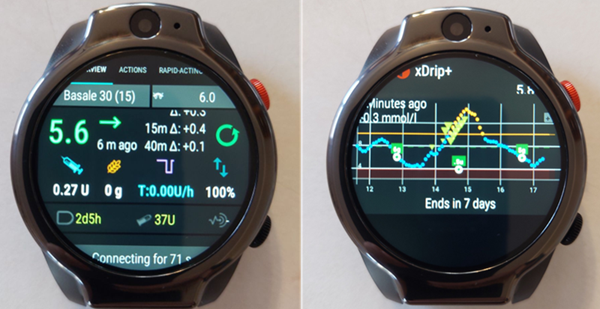
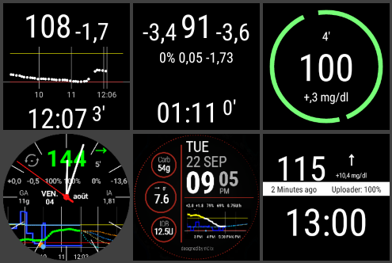
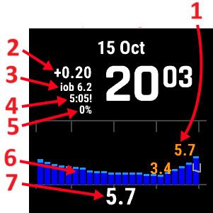
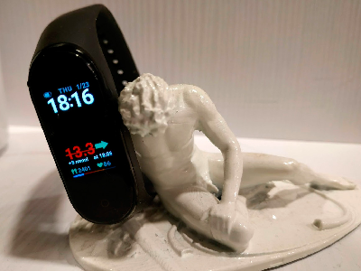
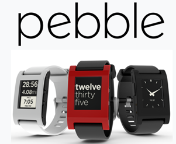

# Smartklockor och AAPS

Olika smartklockor kan visa en del av informationen i **AAPS** eller utföra åtgärder på distans.

För att låta en smartklocka styra **AAPS** (pump och sensor) direkt används fullständiga Android-klockor (som räknas som små [smarttelefoner](./Phones.md)).

Med vissa smartklockor kan du mata in behandlingar och mer, men det är fortfarande telefonen som kör **AAPS**.

Smartklockor används allt oftare med **AAPS**, _både_ av vuxna med diabetes och av anhöriga/föräldrar till barn med diabetes.

## Allmänna fördelar med att använda smartklockor med **AAPS**


Smartklockor kan, beroende på modell, användas på många olika sätt med **AAPS**. De kan användas för att helt eller delvis styra **AAPS**, eller bara för att på distans kontrollera glukosnivåer, aktivt insulin (IOB) och andra värden.

Att koppla en smartklocka till **AAPS** kan vara användbart i många situationer, till exempel när du kör bil eller (motor)cykel och när du tränar. Vissa tycker att det är mer diskret att titta på en klocka (på ett möte, en fest, vid middagsbordet osv.) än att titta på en telefon. Ur säkerhetssynpunkt kan en smartklocka också vara bra när du är på väg någonstans. Du kan ha **AAPS**-telefonen undanstoppad (till exempel i en väska) och ändå använda smartklockan för fjärrstyrning.

## Särskilda fördelar för föräldrar/anhöriga som använder **AAPS**

För ett barn kan en anhörig använda en smartklocka för att övervaka eller göra ändringar utan att behöva använda **AAPS**-telefonen, om barnets **AAPS**-telefon finns i närheten. Detta kan till exempel vara användbart om **AAPS**-telefonen ligger undanstoppad i ett pumpbälte.

En smartklocka kan användas antingen _som tillägg_ till eller _i stället_ för de TELEFON-baserade alternativen för fjärrstyrning eller [att bara följa](../RemoteFeatures/FollowingOnly.md).

Till skillnad från följartelefoner för föräldrar/anhöriga (som behöver mobilnät eller Wi-Fi) kan smartklockor som är anslutna med Bluetooth dessutom vara användbara på avlägsna platser, till exempel i en grotta, i en båt eller halvvägs upp på ett berg. Om båda enheterna (**AAPS**-telefonen och smartklockan) är på samma Wi-Fi-nätverk kan de också använda Wi-Fi.

## Olika sätt som smartklockor och AAPS kan samverka på

Det finns för närvarande fem huvudsakliga sätt att använda smartklockor tillsammans med **AAPS**. De visas i tabellen nedan: 

| Klockans konfiguration | Funktioner                                        | Krav                                                                                                                                                                                                                                                                                                           |
| ---------------------- | ------------------------------------------------- | -------------------------------------------------------------------------------------------------------------------------------------------------------------------------------------------------------------------------------------------------------------------------------------------------------------- |
| Fristående             | AAPS utan telefon                                 | Fullständig Android-smartklocka (kontrollera lägsta Android-version)</br> Kör **app-fullRelease**                                                                                                                                                                                                              |
| Full fjärrstyrning     | De flesta funktioner i AAPS                       | Android-klocka med **Wear OS** (kontrollera Android/API)</br>Kör **wear-fullRelease**                                                                                                                                                                                                                          |
| Fjärrstyrning          | Funktioner som i AAPSClient                       | Android-klocka med **Wear OS** (kontrollera Android/API)</br>Kör **[wear-aapsclientRelease](https://github.com/nightscout/AndroidAPS/releases)**                                                                                                                                                               |
| Fjärrstyrning          | Vissa funktioner som i AAPSClient                 | Garmin-klockor</br>(endast äldre konfigurationer med Samsung Tizen och Fitbit, rekommenderas inte)</br>Se nedan.                                                                                                                                                                                               |
| Visning                | Glukos, trend, IOB, COB, status för loop och pump | Många smartklockor, via en hjälpapp på **AAPS**-telefonen som får data från sändningen [Externa hjälpappar](#watches-external-companion-apps): [WatchDrip+](https://bigdigital.home.blog/) (Xiaomi, Amazfit), [GlucoDataHandler](https://github.com/pachi81/GlucoDataHandler) (Wear OS), G-Watch</br>Se nedan. |

## Innan du köper en smartklocka …

Vilken modell av smartklocka du ska köpa beror på vilka funktioner du vill ha. Du kan hitta användbar information på [sidan Telefoner](#Phones-list-of-tested-phones), bland annat en lista över testade telefoner som också innehåller några smartklockor.

Populära klockmärken är bland annat Samsung Galaxy, Garmin, Fossil och Mi Band. Alternativen som sammanfattas i tabellen ovan förklaras närmare nedan, för att hjälpa dig att välja rätt smartklocka för din situation.

Om du kopplar en smartklocka till **AAPS** på en telefon för att kunna använda **AAPS** på distans, måste du också tänka på om de två enheterna fungerar ihop, särskilt om du har en äldre eller ovanlig telefon.

Om du bara vill följa glukosvärden och inte använda **AAPS** aktivt, finns det i allmänhet ett större utbud av billigare och enklare klockor som du kan använda.

Det bästa sättet att välja en smartklocka är att söka efter inlägg om "watch" i **AAPS**-grupperna på Discord eller Facebook. Läs om andras erfarenheter, och ställ dina egna frågor om du inte hittar svaret i äldre inlägg.

## Fullständig Android

Det låter som ett lockande alternativ, eller hur? Men just nu är det bara några få entusiaster som experimenterar med **AAPS** på en fristående klocka. Det finns bara ett fåtal smartklockor med ett rimligt gränssnitt som också fungerar bra för att köra **AAPS** och din CGM-app fristående. Populära modeller är bland annat LEMFO LEM 15 Pro och 16. Du måste installera **AAPS**-apk:n "full" på klockan (den apk som normalt installeras på en smarttelefon) i stället för **AAPS**-apk:n "wear".

Det finns ingen tydlig specifikation som visar om en klocka fungerar bra för fristående **AAPS**, men följande egenskaper hjälper:

1)  Android 12 eller nyare. 2)  Att kunna stänga av läget “square” för urtavlan så att texten blir större och lättare att läsa. 3)  Mycket bra batteritid. 4)  Bra Bluetooth-räckvidd.

Det mesta som gör fristående **AAPS**-klockor frustrerande kommer från att använda en mycket liten skärm, och att det nuvarande gränssnittet i AAPS-appen "full" inte är gjort för en klocka. Eftersom skärmen är liten kan det vara lättare att använda en pekpenna för att ändra inställningar i **AAPS** på klockan, och vissa knappar i AAPS kanske inte syns på klockans skärm.

Andra svårigheter är att det är svårt att få tillräcklig batteritid, och klockor med tillräckligt batteri är ofta stora och tjocka. Användare berättar om problem med operativsystemet och energisparinställningar, svårigheter att starta sensorer på klockan, dålig Bluetooth-räckvidd (för att hålla anslutningen till både sensor och pump) och osäkert vattenskydd. Exempel visas på bilderna nedan.



Om du vill ställa in en fristående klocka kan du läsa inlägg och kommentarer i **AAPS**-gruppen på Facebook (bra sökord är “standalone” och “Lemfo”) och på Discord för mer information.

## Wear OS

Koden för **AAPS** innehåller ett apptillägg som kan installeras på [smartklockor med **Wear OS**](https://wearos.google.com/#oem-carousel).


Kontrollera att din smartklocka uppfyller [kraven](#maintenance-android-version-aaps-version) för **AAPS**.

### Vad _är_ Wear OS?

De tre första alternativen för smartklockor kräver att smartklockan har **Wear OS** installerat.

**Wear OS** är det operativsystem som körs på vissa moderna Android-smartklockor. Om beskrivningen av smartklockan bara säger att den är _kompatibel_ med Android och iOS betyder det inte att den kör Wear OS. Den kan ha något annat operativsystem från tillverkaren som inte fungerar med **AAPS**. För att kunna installera och använda någon version av **AAPS** eller **AAPSClient** måste smartklockan köra **Wear OS 3.0, 3.2 eller 3.5** (Android 11, API-nivå 30) **eller nyare**. Varje version av Wear OS följer den Android-version som den bygger på: **Wear OS 3** är Android 11 (API-nivå 30), **Wear OS 4** är Android 13 (API-nivå 33), **Wear OS 5** är Android 14 (API-nivå 34) och **Wear OS 6** är Android 16 (API-nivå 36). Klockor med Wear OS 2 kan inte köra **AAPS**.

Om du installerar **AAPS** wear.apk på en klocka med **Wear OS** kan du välja mellan flera olika egna urtavlor för **AAPS**. Du kan också använda en vanlig urtavla och visa din information från **AAPS** i små rutor som kallas “komplikationer” på urtavlan. En komplikation är allt som visas på en urtavla utöver tiden.

```{note}
Nya ändringar i **Wear OS** gör att de egna urtavlorna för **AAPS** fungerar allt sämre (ju högre version av Wear OS, desto värre), men **komplikationer** fungerar fortfarande. Läs [Ändringar av urtavlor i Wear OS](#wearos-watchface-changes) innan du köper eller uppdaterar en klocka.
```


### Hur kan min smartklocka se ut?

När du har [installerat **AAPS** på klockan](../WearOS/WearOsSmartwatch.md) kan du direkt välja den urtavla du vill ha bland dessa urtavlor för **AAPS**. På de flesta klockor trycker du bara länge på startskärmen tills skärmen krymper och sveper åt höger för att välja en annan skärm:



Detta är de grundläggande skärmarna som finns i **AAPS**. Det finns [fler urtavlor](#WearOS_changing-to-AAPS-watchface) och du kan också använda [komplikationer](#Watchfaces-complications).

### Hur använder jag en klocka med Wear OS i vardagen?

Mer information om urtavlorna och användning i vardagen, även hur du gör (och delar) din egen anpassade urtavla, finns i avsnittet [Använda Wear AAPS på en smartklocka](../WearOS/WearOsSmartwatch.md).

(Watchfaces-tizen)= (watches-external-companion-apps)=

## Externa hjälpappar

**AAPS** kan sända sin status till andra appar på samma telefon: glukos och trend, IOB, COB, basal och tillfällig basal, profilnamn, loopstatus, telefonens och pumpens batteri, reservoarnivå och bolusförlopp. Flera hjälpappar för klockor läser denna sändning och visar data på klockor som **AAPS** inte har direkt stöd för. För att skicka data, aktivera **Externa hjälpappar** i **Konfiguration** > **Kommunikation** (se [Externa hjälpappar](#external-companion-apps) på sidan om konfiguration). Sändningen skickas med varje nytt värde och kan inte begäras: en uppdateringsknapp i hjälpappen påverkar inte **AAPS**.


Hjälpappar som man vet använder denna sändning:

- [WatchDrip+](https://bigdigital.home.blog/) för klockor från Xiaomi och Amazfit, se [Klockor från Xiaomi och Amazfit](#watches-xiaomi-amazfit) nedan.
- [GlucoDataHandler](https://github.com/pachi81/GlucoDataHandler) för klockor med Wear OS, som komplikation eller widget. Den är en bra reserv på versioner av Wear OS där urtavlorna för **AAPS** inte fungerar pålitligt, se [Ställ in AAPS på din klocka med Wear OS](../WearOS/WearOsSmartwatch.md). Dess hjälpapp GlucoDataAuto visar samma data i en bil med Android Auto.
- [Appen G-Watch](https://play.google.com/store/apps/details?id=sk.trupici.g_watch) för Samsung-klockor med Tizen, och dess senare version för Wear OS. I tidigare versioner av **AAPS** hette pluginet **Samsung Tizen** efter denna app.

```{warning}
**Appen G-Watch** och dess version för **Wear OS** underhålls inte längre, och Samsung har bytt från Tizen till Wear OS på sina smartklockor. G-Watch är bara aktuell för befintliga, äldre konfigurationer och rekommenderas inte för en ny installation. Se den särskilda [Facebook-gruppen](https://www.facebook.com/groups/gwatchapp) för de senaste nyheterna.
```

(Watchfaces-garmin)=

## Garmin

Det finns några urtavlor för Garmin som är kopplade till [AAPS](https://apps.garmin.com/search?keywords=androidaps) i Garmins ConnectIQ-butik.


[AAPS Glucose Watch](https://apps.garmin.com/apps/3d163641-8b13-456e-84c3-470ecd781fb1) är direkt kopplad till **AAPS**. Den visar data om loopens status (aktivt insulin, tillfällig basal) utöver glukosvärden och skickar pulsvärden till **AAPS**. Den finns i ConnectIQ-butiken. Aktivera pluginet **Garmin** i **Konfiguration → Kommunikation**. 

1. Högsta och lägsta glukosvärde i grafen
2. Glukosändring per minut
3. Aktivt insulin (IOB)
4. Tid sedan senaste glukosvärdet (minuter:sekunder)
5. Tillfällig basaldos, i procent av profilens basaldos
6. Glukosgraf för de senaste 2 timmarna
7. Aktuellt glukosvärde


## Fitbit

```{warning}
Google flyttar Fitbit till Google Health och tar bort appar och urtavlor från tredje part på Fitbit-klockor i EU. Urtavlor för Fitbit är därför **inte längre ett rekommenderat alternativ**, och vi rekommenderar inte att köpa en Fitbit för att använda med **AAPS**.
```

För befintliga Fitbit-klockor listar [Nightscouts webbsidor](https://nightscout.github.io/nightscout/wearable/#fitbit) några alternativ som bara visar data, till exempel [Glance](https://glancewatchface.com/). Även dessa är urtavlor från tredje part, så samma begränsning i EU gäller.

## Bara följa

Dessa smartklockor visar viss information från **AAPS**. Vissa kräver andra appar.

Det finns ett stort utbud av billiga smartklockor som bara kan visa data. Om du använder Nightscout finns en bra översikt över alla alternativ [här](https://nightscout.github.io/nightscout/wearable/#)

Här nedan är några klockor för att bara följa som är populära bland användare av **AAPS**:

(watches-xiaomi-amazfit)=
### Klockor från Xiaomi och Amazfit

**WatchDrip+** är en hjälpapp som utvecklats av communityn. Den visar glukos- och loopdata på olika modeller av smartklockor, mest av märkena Xiaomi (_t.ex._ Mi Band) och Amazfit:



Sedan version 0.5 läser **WatchDrip+** sina data direkt från **AAPS**, utan xDrip+ som mellanled. På **AAPS**-telefonen:

1. Aktivera **Externa hjälpappar** i **Konfiguration** > **Kommunikation**, se [ovan](#watches-external-companion-apps). Den ger aktuellt glukosvärde, delta, trendpil, IOB och pumpstatus.
2. Aktivera pluginet **xDrip** i **Konfiguration** > **Kommunikation** och slå på **Skicka status till xDrip+** i dess inställningar. Den ger statusraden för IOB/COB, och glukosgrafen på klockan fylls i efter några värden.
3. Om xDrip+ är installerat på telefonen, stäng av dess **Broadcast Service API** (xDrip+ > Settings > Inter-app settings) så att klockan inte får data två gånger. Om xDrip+ bara skickade data vidare till klockan kan du avinstallera det.

Uppdateringsknappen i WatchDrip+ påverkar inte **AAPS**: data kommer med varje nytt värde.


Du kan läsa mer om dem, även hur du ställer in dem, på [webbplatsen för WatchDrip+](https://bigdigital.home.blog/). Fördelen med dessa klockor är att de är små och relativt billiga. De är ett populärt val, särskilt för barn och personer med smalare handleder.

### Pebble-klocka




Pebble-klockor ([tillverkas inte längre](https://en.wikipedia.org/wiki/Pebble_(watch))) såldes allmänt från 2013 till 2016 och kan fortfarande finnas begagnade. Fitbit tog över Pebbles tillgångar. Användare av Pebble kan använda urtavlan Urchin för att se data från Nightscout. Data som kan visas är bland annat IOB, aktiv tillfällig basaldos och prognoser. Om du kör öppen loop kan du använda IFTTT för att skapa en applet som skickar ett SMS eller en Pushover-avisering när en avisering har kommit från **AAPS**.

### [Bluejay-klockor](https://bluejay.website/)


Detta är unika tekniska produkter som kan ta emot glukosdata **direkt** från Dexcom-sändaren. Det är inte så känt att Dexcom G6/G7-sändare faktiskt sänder aktuella glukosdata på _två_ separata kanaler: en telefonkanal och en medicinsk kanal. Bluejay-klockorna kan ställas in för att ta emot glukosdata på någon av kanalerna. Om **AAPS** använder telefonkanalen kan Bluejay-klockorna alltså använda den medicinska kanalen.

Den stora fördelen är att klockan är oberoende av både telefonen och loopsystemet. Om du till exempel kopplar från pumpen och lämnar **AAPS**-telefonen på stranden eller i nöjesparken och är utom räckhåll för **AAPS**-telefonen, kan du ändå få värden från din Dexcom direkt till Bluejay-klockan.

Den ursprungliga **Bluejay GTS** tillverkas inte längre och kan inte läsa Dexcom G7. De senare modellerna (U1, och sedan nuvarande **U3**, som när detta skrivs säljs som förhandsversion) är fullständiga Android-klockor som kör xDrip och hämtar data direkt från Dexcom G6 och G7. Tillverkaren beskriver klockan som ett forskningsverktyg, inte för medicinskt bruk. Nackdelar som rapporterats är att den inte alltid får ett värde var 5:e minut och att batteriet ofta behöver laddas. Se [Bluejays webbplats](https://bluejay.website/) för aktuell modell och tillgänglighet.

### Apple Watch

Se [Nightscout på din klocka](https://nightscout.github.io/nightscout/wearable/#).

Apple Watch har nu stöd för direktanslutning till G7 och kan användas samtidigt med **AAPS**.

