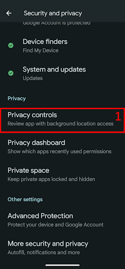
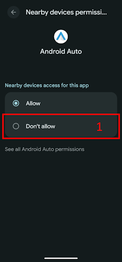
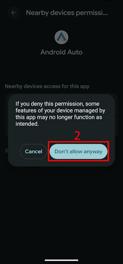
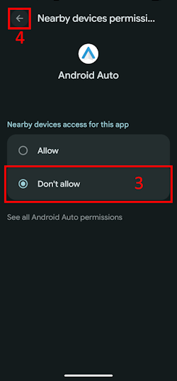
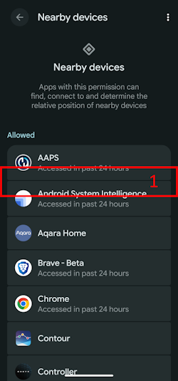

(bluetoothtroubleshooting-bluetooth-related-issues)=

# Problem med Bluetooth

Vissa användare har haft problem med misslyckad aktivering av Omnipod DASH, anslutningsproblem med Medtrum Nano och andra podfel som har med Bluetooth att göra. Många av dessa problem kan spåras till något av följande.

Vissa av dessa problem gäller troligen även andra insulinpumpar med Bluetooth. Medtrum Nano har kända problem med behörigheten Enheter i närheten, precis som Omnipod DASH.

---

(bluetoothtroubleshooting-cannot-start-omnipod-with-android-16)=

## Det går inte att starta Omnipod med Android 16
- Android 16 kräver minst **AAPS** version 3.3.2.1 för att Omnipod DASH ska fungera rätt. Den versionen har rättningar för kända problem med Omnipod som kom med Android 16.

---

(bluetoothtroubleshooting-bluetooth-battery-optimisation)=

## Batterioptimering för Bluetooth

I nyare versioner av Android är batterioptimering påslagen för systemappen Bluetooth. Den är känd för att orsaka vissa problem för pumpar och CGM:er med Bluetooth.

Om du följde [Installationsguiden](../SettingUpAaps/SetupWizard.md) och gjorde inställningarna i avsnittet [Batterioptimering för Bluetooth](#setup-wizard-bluetooth-battery-optimisation) bör denna inställning vara rätt. Men om du följde en äldre version av denna guide kan det hända att du inte har ändrat inställningen.

Kontrollera att detta är rätt inställt om pumpen och CGM:en tappar anslutningen.

---

(bluetoothtroubleshooting-apps-using-nearby-device-permission)=

## Appar som använder Android-behörigheten "Enheter i närheten" kan orsaka avbrott i anslutningen och problem med podaktivering

Med en behörighetsmodell låter Android dig styra vad varje app får göra eller komma åt på din telefon. För varje installerad app kan du tillåta eller neka vissa behörigheter, t.ex. åtkomst till filer på enheten, åtkomst till Bluetooth, sökning efter enheter i närheten osv.

**AAPS** behöver ett antal särskilda behörigheter för att fungera. En av dem, som krävs för att poddar ska fungera, är behörigheten "Enheter i närheten". Det finns många andra appar som också kräver denna behörighet. Communityn har märkt att flera appar som får denna behörighet kan orsaka problem med att aktivera nya poddar på vissa enheter.

(bluetoothtroubleshooting-apps-using-nearby-device-permission-known-apps)=

### Appar som använder behörigheten "Enheter i närheten" och som har orsakat problem:

Apparna i denna lista har på ett eller flera ställen i communityn nämnts som orsak till problem för Omnipod DASH och i vissa fall även för Medtrum Nano.

```{admonition} Updating the list
:class: note
Skriv till @XiTatiON i Discord-kanalen #omnipod-dash om du vill diskutera appar som ska läggas till i listan.
```

- **myBMW** MyBMW störde Medtrum Nano och Omnipod DASH. Appen MyBMW frågar bara en gång om behörigheten "hitta enheter i närheten". Om du inte ger den fungerar appen ändå helt utan problem.

- **Amazon Alexa**  För vissa personer löstes problemet när behörigheten "Enheter i närheten" togs bort för appen Alexa, men då går det inte längre att parkoppla Matter IoT-enheter.

- **MINI app**  Appen verkar bygga på appen myBMW och kan därför bete sig på samma sätt

- **BM2** App för övervakning av solcellsbatterier som används i vissa husbilar och solcellssystem för camping: när appen kördes gick det inte att aktivera en ny pod. En lösning på problemet är att tvångsstoppa appen medan du aktiverar en ny pod. Att köra appen efter det verkade inte störa DASH (på en Pixel 8 Pro med Android 16).

(bluetoothtroubleshooting-revoke-nearby-device-permission)=

### Så tar du bort behörigheten "Enheter i närheten" för andra appar:
Om du har problem med att aktivera en ny pod och du kör rätt version av **AAPS** för din Android-version, kan du behöva ta bort behörigheten för andra appar medan du aktiverar en ny pod.

Följ dessa steg för att ta bort behörigheten "Enheter i närheten" för alla appar utom **AAPS**:

```{admonition} Menus and settings
:class: note
Skärmbilderna och instruktionerna i denna guide kommer från en standardinstallation av Android 16 på en Google Pixel 8 Pro. Andra tillverkare och enheter har troligen inte exakt samma menyer och inställningar. Anpassa stegen till din enhet. Om du kör fast, se avsnittet [Var du kan få hjälp med DASH](#omnipod-dash-where-to-get-help-for-dash) om hur du får hjälp från communityn.
```

1. Öppna Androids inställningar på telefonen, scrolla ned och tryck på **Säkerhet och integritet (1)**.

    

2. Scrolla ned och tryck på **Integritetsinställningar (1)**.

   

3. Tryck på **Behörighetshanteraren (1)**.

   

3. Scrolla ned och tryck på **Enheter i närheten (1)**.

   

4. Bläddra i listan med appar och tryck på den app som du vill ta bort behörigheten **Enheter i närheten** för.

   I denna guide är **Android Auto (1)** den app som vi tar bort behörigheten för.

   För att undvika att fler poddar förstörs rekommenderar vi att alla först tar bort behörigheten för alla appar utom **AAPS**.

```{admonition} Which app to select?
:class: tip
Om du inte vet vilken app som orsakar problemet: stäng av behörigheten för alla (kontrollera också listan med kända problemappar och börja med dem). Om du har råd att förlora några poddar på vägen kan du sedan ge behörigheten till en ny app före varje ny podaktivering, tills du har hittat exakt vilken app som orsakar dina podproblem. Om du hittar nya appar som orsakar problem, berätta det för oss i Discord-kanalen #omnipod-dash.
```

   

5. För att ta bort behörigheten trycker du på **Tillåt inte (1)** och sedan på **Tillåt inte ändå (2)**. Om du har gjort rätt ska **Tillåt inte (3)** vara det valda alternativet. Nu kan du gå tillbaka till menyn **Enheter i närheten** genom att trycka på **bakåtpilen (4)** och ändra inställningen för andra appar om det behövs.

      

(bluetoothtroubleshooting-re-enable-nearby-device-permission)=

### Så ger du behörigheten "Enheter i närheten" igen till systemappar och andra appar:

1. Om det behövs, se avsnittet **"Så tar du bort behörigheten 'Enheter i närheten' för andra appar"** om hur du kommer till appens integritetsinställningar. När du är i inställningen **Enheter i närheten**, fortsätt till steg 2.

2. Bläddra i listan med appar och tryck på den app som du vill ge behörigheten **Enheter i närheten** till.

   I denna guide är **Android Auto (1)** den app som vi ger behörigheten till.

   Du kommer att märka att **Android Auto (1)** saknas i listan med appar efter att behörigheten har tagits bort. Det beror på att appen **Android Auto** är en **systemapp**, och systemappar är dolda som standard.

   

3. För att visa dolda systemappar trycker du på **menyn med tre punkter (⋮) (1)** uppe till höger och sedan på **"Visa system" (2)**. Nu bör du se den dolda systemappen **Android Auto (3)** i listan.

```{admonition} Find your app
:class: tip
Om behörigheten har tagits bort för en app måste du scrolla ned tills du ser listan med appar utan behörighet längre ned i listan.
```

     

5. Följ instruktionerna i **"Så tar du bort behörigheten 'Enheter i närheten' för andra appar"** i omvänd ordning för att ge behörigheten igen till varje app.

---

(bluetoothtroubleshooting-android-15-bluetooth-connection-problems)=

## Android 15: Täta problem med Bluetooth-anslutningen

Efter en uppgradering av Android eller ett byte till en nyare telefon tappar **AAPS** ofta Bluetooth-anslutningen till pumpen. Problemet försvinner tillfälligt när du startar om telefonen. Om du använder en **Omnipod DASH** och din telefon har Android 15 kan inställningen **Bluetooth-bindning (bonding)** göra Bluetooth-anslutningen stabilare. Så slår du på den:

```{admonition} Android 16
:class: warning
Slå bara på **Bluetooth-bindning (bonding)** på Android 15, och bara om du har problem med anslutningen. Slå INTE på bindning (bonding) på Android 16.
```

1. Öppna [DASH-inställningarna](#omnipod-dash-settings): öppna DASH-pumpskärmen med **Hantera** > **Pump** och tryck på ikonen **Inställningar** (kugghjulet) uppe till höger.

   

2. Öppna avsnittet **Avancerade inställningar** och slå på **Bluetooth-bindning (bonding)**.

   

3. Om telefonen visar en begäran om parkoppling, acceptera den.

4. Starta om telefonen.
