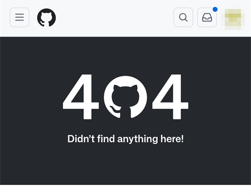
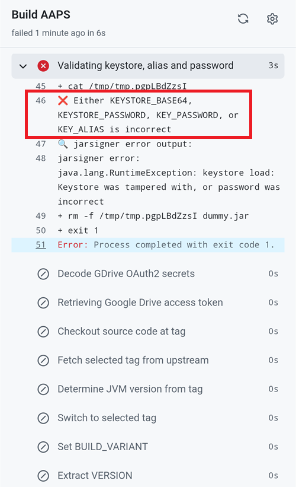

(aaps-ci-troubleshooting)=

# Bygge i webbläsaren: felsökning

```{note}
This page collects troubleshooting tips for the [Browser build](../SettingUpAaps/BrowserBuild.md).
```

(aaps-builder-troubleshooting)=

## AAPS Builder

### Step 1: the repository

(aaps-builder-ts-repo-exists)=

#### "my-aaps already exists in this account"


You already have this repository, for example from an earlier attempt. Close the GitHub tab, keep that name in step 1 of the setup page and go on. If you already did steps 2 and 3 for it, your key is still in it: continue with [step 4](#aaps-builder-step4). If it was made with an earlier version of the setup page, update its workflow once as explained in [Updating AAPS](#aaps-builder-updates). You prefer a fresh start? Type another name, for example `my-aaps-2`, and use the same keystore in step 2.

(aaps-builder-ts-user-not-found)=

#### "No GitHub user with this name"


- **"Det finns ingen GitHub-användare med det här namnet"** i steg 1: skriv ditt användarnamn på GitHub, så som det visas i din GitHub-profil, inte din e-postadress.
- **Ingen knapp "Build AAPS" eller "Run workflow", eller repot är tomt**: repot skapades inte från mallen. Ta bort det (**Settings** → längst ned på sidan → **Delete this repository**) och gör [steg 1](#aaps-builder-step1) igen med knappen **Create my private repository** (skapa mitt privata repo).

### Step 3: the secret

(aaps-builder-ts-404)=

#### "Page not found" (404)



- **"Page not found" (404) när inställningssidan öppnar GitHub**: logga in på github.com i samma webbläsare (GitHub visar 404 för privata repon när du inte är inloggad). Om du är inloggad stämmer inte användarnamnet eller namnet på repot i steg 1 på inställningssidan med ditt repo. Skriv de exakta namnen.

### Step 4: the build

(aaps-builder-ts-workflow-not-found)=

#### "This workflow does not exist"


Right after the repository is created, GitHub may not have read its workflow file yet: **Build AAPS** is missing from the **Actions** tab, and there is no **Run workflow** button. Any small change to the file makes GitHub read it:

1. In your repository, open **Code**, then the folder `.github`, then `workflows`, then the file `build.yml`.
2. Tap the **⋯** menu at the top right of the file, then **Edit file… In place** (on a computer, click the pencil).

   

3. Tap at the very end of the text and add an empty line (Enter). Tap **Commit changes…** at the top.

   

4. Tap **Commit changes** again.

   

5. Open the **Actions** tab again: **Build AAPS** is now in the list of workflows (on a phone, the list opens with the icon at the left of **All workflows**). Tap it, then **Run workflow**.

   

(aaps-builder-ts-build-failed)=

#### The build failed (red cross)

1. On the setup page, tap **Open my builds** and tap the build with the red cross.

   

2. The page of the build shows **Failure**, and which part failed: **AAPS / Check** (the repository, the secret, the version or the variant: nothing was built) or **AAPS / Build AAPS**.

   

3. Scroll down to **Annotations**, with your finger on the text, not on the diagram. The red lines explain the problem: tap **Show more** to read the whole message, then find it below.

   

- **"Secret KEYSTORE_SET is missing"**: gör steg 3 på inställningssidan.
- **Bygget stoppar med "This repository is PUBLIC"**: öppna **Settings** (inställningar) → **General** → **Danger Zone** → **Change visibility** (ändra synlighet) → **Private** (privat) i ditt repo och bygg sedan igen.
- **"Version … does not exist"**: only released versions of **AAPS** can be built, the ones on the [tags page](https://github.com/nightscout/AndroidAPS/tags) of nightscout/AndroidAPS, such as `3.3.2.0`. A branch name such as `dev` doesn't work. Use `latest`, or type a tag exactly as listed.
- **"Variant … is not supported"**: din arbetsflödesfil är en äldre version. Ersätt den enligt [Uppdatera AAPS](#aaps-builder-updates).
- **"The secret is too short"**, **"The secret is not a valid code"** eller **"The secret does not contain a keystore"**: fel text klistrades in i hemligheten, ofta själva ordet `KEYSTORE_SET`, eller bara en del av koden. Öppna **Settings** → **Secrets and variables** → **Actions** i ditt repo, redigera `KEYSTORE_SET` och klistra in den långa koden från **Copy secret** (kopiera hemlighet) igen (gör först om steg 2 på inställningssidan om du har stängt den).
- **"Keystore, password or alias is wrong"**: kontrollera lösenordet och aliaset för din keystore och gör sedan om steg 2 och 3 på inställningssidan.
- **"Google Drive access has expired or was revoked"**: gör om [steg 6](#aaps-builder-google-drive) och uppdatera hemligheten `GDRIVE_OAUTH2`.
- **Another error**: [read the build log](#aaps-ci-read-the-logs), then [run the build again](#aaps-ci-rerun). If it fails again the same way, ask for help with the name of the failed step and the error lines. Dela aldrig innehållet i dina hemligheter.

### Step 5: the app

- **Ingen länk Download, eller GitHub-appen öppnades**: GitHub-appen kan inte ladda ned byggen. Öppna bygget i Chrome enligt [steg 5](#aaps-builder-step5). För att GitHub-länkar inte ska öppnas i appen: Android **Settings** (Inställningar) → **Apps** (Appar) → **GitHub** → **Open by default** (Öppna som standard) → stäng av **Open supported links** (Öppna länkar som stöds).

## Felsökning av AAPS-CI

(aaps-ci-read-the-logs)=
### Först: ta reda på vad som gick fel

När ett bygge misslyckas sparar GitHub en logg över varje steg. Loggen visar vilket steg som misslyckades och varför. Läs den innan du försöker något annat: felmeddelandet är det du ska leta efter på denna sida, och det som hjälpare kommer att fråga efter.

1. Öppna **Actions** i din GitHub-kopia av AndroidAPS. Ett misslyckat bygge har ett rött kryss. Tryck på dess namn.

   

2. Sammanfattningen av körningen visar **Failure** och, nedanför, jobbet som misslyckades (**Build AAPS**, med ett rött kryss).

   

3. Scrolla ned till **Annotations** och tryck på den röda raden **Build AAPS**.

   

4. Jobbet öppnas. Steg med en grå bock fungerade. Steget med det röda krysset är det som misslyckades: GitHub öppnar det åt dig. Stegen efter det hoppades över (grå cirkel).

   

5. Läs raderna precis ovanför `Error: Process completed with exit code 1.`: de förklarar problemet. I detta exempel misslyckades steget **Retrieving Google Drive access token** med `invalid_grant` och `Token has been expired or revoked.`, se [Googles uppdateringstoken har gått ut](#aaps-ci-google-token-expired).

   

```{tip}
Ber du om hjälp? Dela namnet på steget som misslyckades och felraderna (en skärmbild som den ovan går bra). Dela aldrig innehållet i dina hemligheter.
```

(aaps-ci-update-secret)=
#### Uppdatera en hemlighet

Många lösningar innebär att du byter värdet på en hemlighet. Gå till **Settings** → **Secrets and variables** → **Actions** i din GitHub-kopia av AndroidAPS och tryck på pennan bredvid hemligheten.


Skriv in eller klistra in det nya värdet och tryck på **Update secret**. GitHub visar aldrig det gamla värdet: fältet är alltid tomt.


(aaps-ci-rerun)=
#### Kör bygget igen efter en rättning

När du har rättat orsaken behöver du inte börja om från början: öppna den misslyckade körningen, tryck på **...** (uppe till höger) och sedan på **Re-run failed jobs**.


Tryck på **Re-run jobs**. Du kan också starta ett nytt bygge från **Run workflow** som vanligt.


(aaps-ci-preparation-web)=
### Webbsidan aaps-ci-preparation
  - Förberedelsesidan visas av en tillfällig lokal server (till exempel Simple Web Server på en dator), som också tar emot Googles uppdateringstoken.
  - Om du ser skärmen nedan har den lokala servern stoppats eller går inte att nå.
  - Stäng förberedelsesidan, kontrollera att den lokala servern körs och öppna sedan aaps-ci-preparation.html igen på samma sätt som i steg 2 och slutför de återstående stegen. Detta behövs särskilt när du skapar den första anslutningen till Google under installationen.

  

(aaps-ci-google-token-expired)=
### Googles uppdateringstoken har gått ut
  - Uppdateringstoken (refresh token) för Google OAuth2 går ut om de inte används på 6 månader. De kan också bli ogiltiga av andra skäl (t.ex. om du har ändrat lösenordet för ditt Google-konto eller tagit bort åtkomsten manuellt). Mer information finns i [dokumentationen för Google OAuth2](https://developers.google.com/identity/protocols/oauth2).
  - I [byggloggen](#aaps-ci-read-the-logs) misslyckas steget **Retrieving Google Drive access token** med `invalid_grant` och `Token has been expired or revoked.`:

  

  - Om ditt bygge misslyckas på grund av att Googles uppdateringstoken har gått ut eller tagits bort, måste du göra om stegen i [Google Drive Auth](#aaps-ci-google-drive-auth) för att få en ny `GDRIVE_OAUTH2`-token, [uppdatera hemligheten](#aaps-ci-update-secret) i ditt GitHub-repo och sedan [köra bygget igen](#aaps-ci-rerun).
  - Om auktoriseringen misslyckas igen, eller om Google inte längre ber om ditt samtycke, ta först bort den befintliga åtkomsten för AAPS från ditt Google-konto, se [nedan](#aaps-ci-google-remove-access).

(aaps-ci-google-remove-access)=
### Ta bort åtkomsten för AAPS från ditt Google-konto och starta om auktoriseringen
  - Om auktoriseringen för Google Drive fortsätter att misslyckas, eller om du vill börja om från början, ta först bort den åtkomst du tidigare gav till AAPS och gör sedan om auktoriseringen.
  - Öppna [https://myaccount.google.com](https://myaccount.google.com) på telefonen, tryck på **Security** (Säkerhet), scrolla ned till **Your connections to third-party apps & services** (dina kopplingar till tredjepartsappar och tjänster) och öppna listan med länkade appar. Du kan också gå direkt till [https://myaccount.google.com/connections](https://myaccount.google.com/connections).
  - Tryck på **AAPS** i listan.

  

  - Sidan visar den åtkomst du gav till AAPS (filerna i Google Drive som används med appen). Tryck på **Delete all** (Radera alla) för att ta bort kopplingen, eller tryck på **See details** (Visa information) för att först granska den.

  

  - Tryck på **Remove all access** (Ta bort all åtkomst) på informationssidan.

  

  - Tryck på **Confirm** (Bekräfta).

  

  - Google bekräftar att AAPS inte längre har åtkomst. AAPS visas inte längre i listan med länkade appar.

  

  - Starta nu om auktoriseringen från början: stäng **både** förberedelsesidan och filhanterarappen, öppna aaps-ci-preparation.html igen från filhanteraren och gör om stegen i [Google Drive Auth](#aaps-ci-google-drive-auth). Google ber dig att ge åtkomst igen och sidan ger dig en ny `GDRIVE_OAUTH2`-token.
  - [Uppdatera hemligheten `GDRIVE_OAUTH2`](#aaps-ci-update-secret) i ditt GitHub-repo med den nya token, och [kör sedan bygget igen](#aaps-ci-rerun).

(aaps-ci-disable-software)=
### Stäng av program som kan störa OAuth-verifieringen
  - Stäng av alla VPN- och säkerhetsappar (brandvägg, skydd mot skadlig kod ...) på telefonen innan du försöker hämta OAuth-nyckeln.

(aaps-ci-actions-permission)=
### Kontrollera behörighetsinställningarna för GitHub Actions
  - Se till att policyn för GitHub Actions är inställd på “Allow all actions and reusable workflows” (Settings → Actions → General). Om du ändrar det, tryck på **Save** under alternativen.

  

`actions/checkout@v4` and `actions/setup-java@v4` are not allowed to be used in `xxxxx/AndroidAPS`. Actions in this workflow must be: within a repository owned by `xxxxx`

(aaps-ci-workflow-permissions)=
### Kontrollera behörighetsinställningarna för GitHub-arbetsflöden
  - Om bygget misslyckas direkt med ett fel "Invalid workflow file" som liknar det nedan, är standardbehörigheterna för arbetsflöden i ditt repo för begränsade:

```
Invalid workflow file
The workflow is not valid. .github/workflows/aaps-ci.yml (Line: 361, Col: 3):
Error calling workflow 'xxxxx/AndroidAPS/.github/workflows/cleanup-workflow-runs.yml@...'.
The nested job 'cleanup' is requesting 'actions: write', but is only allowed 'actions: none'.
```

  - Se till att Workflow permissions är inställt på “Read and write permissions” (Settings → Actions → General → Workflow permissions). Spara sedan och kör byggarbetsflödet igen.

  

(aaps-ci-password-special-characters)=
### Bygget misslyckas vid kontrollen av keystore-lösenordet
  - I [byggloggen](#aaps-ci-read-the-logs) misslyckas steget **Validating keystore, alias and password** med `Either KEYSTORE_BASE64, KEYSTORE_PASSWORD, KEY_PASSWORD, or KEY_ALIAS is incorrect`, följt av `Keystore was tampered with, or password was incorrect`. Bygget stoppar där: keystore och lösenord kontrolleras innan AAPS byggs.

  

  - Byggarbetsflödet behåller varje tecken i dina lösenord oförändrat. Ange `KEYSTORE_PASSWORD` och `KEY_PASSWORD` exakt som de är, utan att lägga till ett omvänt snedstreck eller något annat escape-tecken. Om du har lagt till omvända snedstreck, [uppdatera hemligheterna](#aaps-ci-update-secret) med lösenordet exakt som det är. Exemplet nedan är fel: lösenordet är `Example2026`, det omvända snedstrecket har lagts till.

  

  - Om bygget fortfarande misslyckas vid signeringen av APK:n fast ditt lösenord är rätt, och lösenordet innehåller `$`, en backtick, `"` eller `\`, är arbetsflödesfilen i din fork äldre än september 2026 och tolkar fortfarande dessa tecken. [Synkronisera din fork](#Update-to-new-version-update-your-repo) med senaste dev, och kör sedan byggarbetsflödet igen.
  - Det lodräta strecket `|` är ett specialfall. Förberedelsesidan i [Alternativ 1](#aaps-ci-option1) slår ihop keystore, lösenord och alias till en enda hemlighet `KEYSTORE_SET`, åtskilda med `|`, och arbetsflödet delar upp den vid det tecknet. Lösenordet som förberedelsesidan skapar innehåller bara bokstäver och siffror, så detta kan inte hända med Alternativ 1. Det kan bara hända om du själv har satt ihop en hemlighet `KEYSTORE_SET` med ett lösenord som innehåller `|`. Radera i så fall `KEYSTORE_SET` och ange i stället de separata hemligheterna från [Alternativ 2](#aaps-ci-option2).
