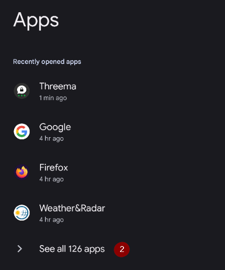
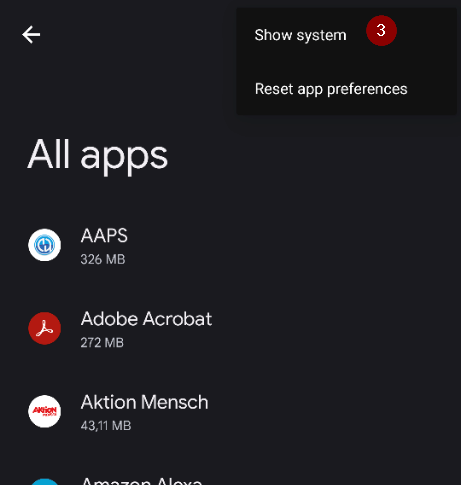
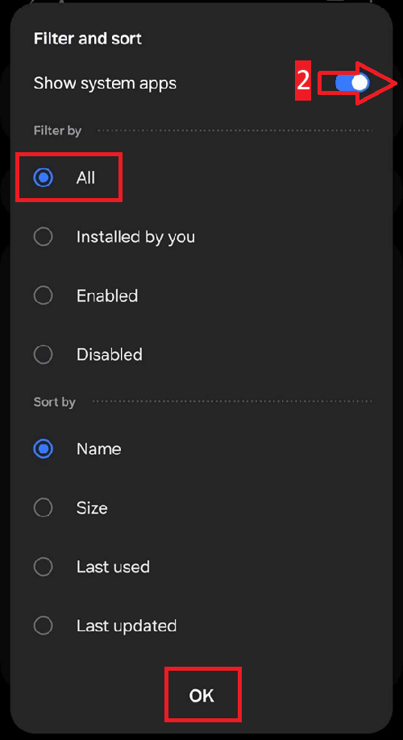

(generaltroubleshooting)=

# Felsökning

**Börja här när något inte fungerar.** Information om felsökning finns på många sidor i dokumentationen. Den här sidan samlar allt på ett ställe: det är en samling länkar, sorterade efter ämne, som hjälper dig att lösa de vanligaste problemen.

Om du inte hittar svaret nedan, titta också i:

* [Vanliga frågor](../UsefulLinks/FAQ.md) för svar på frågor som ofta ställs, och
* guiden [Finjustera AAPS-profilen](ProfileTuning.md) om din loop fungerar men din blodsockerkontroll behöver bli bättre.

```{admonition} Still stuck?
:class: tip
Om ingen av länkarna löser ditt problem, se [Var kan jag få hjälp?](WhereCanIGetHelp.md) för att fråga communityn (Facebook, Discord), eller skicka dina [loggfiler](AccessingLogFiles.md) till utvecklarna.
```

---

(generaltroubleshooting-aaps-app)=

## AAPS-appen

### Bygga och uppdatera

* Om bygget misslyckas, se [Om bygget misslyckas](#building-aaps-troubleshooting): där finns felsökningsavsnittet för varje byggmetod:
  * [AAPS Builder](#aaps-builder-troubleshooting)
  * [Bygge i webbläsaren](#aaps-ci-troubleshooting)
  * [Android Studio](TroubleshootingAndroidStudio.md)
* Förlorad keystore eller ny keystore: [Installera om AAPS](#reinstall-aaps)
* Uppdatera **AAPS**: [med AAPS Builder](#aaps-builder-updates), [med bygge i webbläsaren (fork)](#update-browser-build-troubleshooting), [med Android Studio](#update-computer-build-troubleshooting)

### Installera

* [Varning från Google Play Protect](#transferring-installing-play-protect-warning): appen rapporteras som osäker.
* Installationen **blockeras** med ett meddelande om en overifierad utvecklare: se [verifiering av Android-utvecklare](#android-developer-verification) för de kostnadsfria sätten att installera.

### Settings

* [Profil: "Basaldosen är inte kompatibel med den aktiva pumpen"](#your-aaps-profile-basal-not-compatible)
* [Pump: "Data kommer från en annan pump"](#config-builder-wrong-pump-data)
* [Nightscout-klient](TroubleshootingNsClient.md)
* **”AAPS-inställningarna kan inte läsas”** vid start: inställningarna är krypterade med en nyckel som Android sparar åt **AAPS**, och den nyckeln kan inte längre öppna dem, till exempel efter att telefonens nyckellager har återställts. Medan den här skärmen visas körs inte **AAPS** och styr inte pumpen. Tryck på **Försök igen**: då stängs **AAPS** och startas igen. Om det inte hjälper, starta om telefonen. Använd **Börja om från början** endast när inget annat hjälper: då läggs den oläsbara inställningsfilen åt sidan (den får ett nytt namn och sparas) och **AAPS** startar med tomma inställningar. Importera sedan din senaste [export av inställningar](../Maintenance/ExportImportSettings.md).

### Användning

* [Fel kolhydratvärden (långsam kolhydratupptagning)](#CobCalculation-detection-of-wrong-cob-values)
* [Automatiseringar](#automations-troubleshooting)
* [Helt sluten loop](#full-closed-loop-troubleshooting)

---

(generaltroubleshooting-bluetooth-related-issues)=


## Problem med Bluetooth

För kända problem med Bluetooth-anslutningar, avbrott mot pumpar/poddar eller problem med aktivering och anslutning, se [Felsökning av Bluetooth](../GettingHelp/BluetoothTroubleshooting.md)

---

(generaltroubleshooting-android-related-issues)=

## Problem som rör Android

### Batterioptimering

**AAPS** kan hjälpa dig att hitta rätt inställningar för din telefon: öppna **menyn** (☰) > **Om** och tryck på **Döda inte min app?**. Då öppnas instruktionerna för ditt telefonmärke på [Don't kill my app](https://dontkillmyapp.com/). [Installationsguiden](#setup-wizard-bluetooth-battery-optimisation) ber dig också att stänga av batterioptimering för **AAPS** och Bluetooth.

Android har inbyggda inställningar för batterisparande som är aktiverade som standard. Dessa inställningar stänger av eller pausar automatiskt appar som inte behövs för att systemet ska fungera. Det sparar batteri för appar som inte alltid behöver vara igång.

När den är aktiverad orsakar den mycket troligt problem för **AAPS** och andra stödjande appar som **xDrip**.

Det är viktigt att du stänger av batterioptimering, så att **AAPS** och andra stödjande appar alltid förblir aktiva.

Beroende på telefonens märke och modell kan det finnas mer än ett ställe och en inställning där detta behöver stängas av.

***OBS!** Följ stegen nedan för att stänga av batterioptimering för Bluetooth-tjänsten, om din telefon har det alternativet. Samma steg kan användas för **AAPS** och andra appar, men skärmbilderna visar bara hur du gör för Bluetooth-tjänsten.*

#### Pixel-telefoner (standard-Android)

* Gå till Androids inställningar och välj "Appar".

  

* Välj "Visa alla appar"

  

* I menyn till höger väljer du "Visa system" (systemappar).

  

* Sök nu efter appen "Bluetooth" och välj den.

  

* Tryck på "Appens batterianvändning" och välj "Obegränsad" (heter "Inte optimerad" i vissa äldre Android-versioner).

  


#### Samsung-telefoner

* Gå till Androids inställningar och välj "Appar"

* Tryck på ikonen som ser ut att ändra sorteringen (1) och välj "Visa systemappar" (2).

  

  

* Sök nu efter Bluetooth-appen och välj den för att se dess inställningar.

  

* Välj "Batteri".

  

* Ställ in den på "Obegränsad" (heter "Inte optimerad" i vissa äldre Android-versioner).

  

#### Huawei-telefoner

Se den här guiden för [Bluetooth och batterioptimering på Huawei](../CompatiblePhones/Huawei.md)

---

(generaltroubleshooting-cgm)=

## Kontinuerlig glukosmätare (CGM)

Användbara länkar om kända problem för CGM och hur du löser dem.

* [Allmänt](#general-cgm-troubleshooting)
* [Dexcom G6](#DexcomG6-troubleshooting-g6)
* [Libre 2 med Minimal Looper](#minimallooper-troubleshooting)
* [Libre 3](#libre3-experiences-and-troubleshooting)
* [xDrip - inga CGM-data](#xdrip-identify-receiver)
* [xDrip - felsökning för Dexcom](#xdrip-troubleshooting-dexcom-g5-g6-and-xdrip)

---

(generaltroubleshooting-pumps)=

## Pumpar

Användbara länkar om kända problem för pumpar och hur du löser dem

* [Accu-Chek Combo](#combov2-tips-for-basic-usage)
* [Accu-Chek Insight](#Accu-Chek-Insight-Pump-insight-specific-errors)
* [CareLevo](#carelevo-alarms-and-notifications)
* [DanaRS](#DanaRS-Insulin-Pump-dana-rs-specific-errors)
* [Diaconn G8](#diaconn-g8-bluetooth-troubleshooting)
* [EOPatch2](#eopatch2-alarms-and-warnings)
* [Medtronic + RileyLink](#MedtronicPump-what-to-do-if-i-loose-connection-to-rileylink-and-or-pump)
* [Medtrum Nano](#medtrum-nano-troubleshooting)
* [Omnipod DASH](#omnipod-dash-troubleshooting)
* [Omnipod Eros](#OmnipodEros-troubleshooting)

---

(generaltroubleshooting-phones)=

## Phones

Användbara länkar om kända problem för telefoner och hur du löser dem

* [Lista över testade telefoner och enhetskonfigurationer](https://docs.google.com/spreadsheets/u/1/d/e/2PACX-1vScCNaIguEZVTVFAgpv1kXHdsHl3fs6xT6RB2Z1CeVJ561AvvqGwxMhlmSHk4J056gMCAQE02sAWJvT/pubhtml?gid=683363241&single=true)
* [Jelly](../CompatiblePhones/Jelly.md)
* [Bluetooth och batterioptimering på Huawei](../CompatiblePhones/Huawei.md)

---

(generaltroubleshooting-remote-control)=

## Fjärrstyrning

* [AAPSClient och fjärrstyrning (parkoppling, kommandon tas inte emot)](#client-master-control-troubleshooting)
* [Problem med 'Nightscout åtkomsttoken'](#remotecontrol-nightscout-access-token)
* [SMS-kommandon](#SMSCommands-troubleshooting)
* [Android Auto](#android-auto-troubleshooting)

---

(generaltroubleshooting-smartwatches)=

## Smartklockor

Användbara länkar om kända problem för smartklockor och hur du löser dem

* [Felsökning av Wear-appen](#Watchfaces-troubleshooting-the-wear-app)
* [Klockan och telefonen kommunicerar inte](#wear-os-watch-phone-communication)
* [Wear OS 5](#wear-os-5-troubleshooting)
* [Bygga Wear-appen](#building-aaps-wear-os-troubleshooting)
