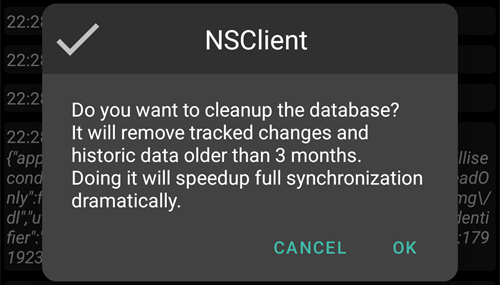
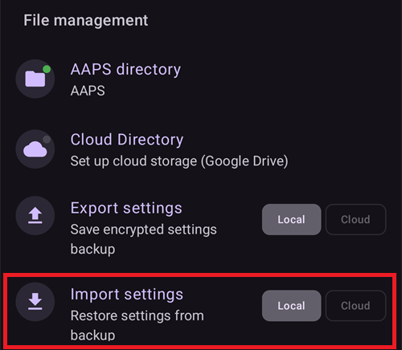

(reinstall-aaps)=
# Installera om AAPS med en ny keystore

Varje apk för **AAPS** är signerad med en **keystore**. En uppdatering installeras bara ovanpå din nuvarande **AAPS** om den är signerad med **samma keystore**: då behålls alla dina inställningar och data. Därför rekommenderas det att du sparar din keystore och dess lösenord på ett säkert ställe.

Om du försöker installera en apk som är signerad med en annan keystore än tidigare får du ett felmeddelande som säger att installationen misslyckades!

(reinstall-aaps-when)=
## När behöver du installera om?

Du behöver avinstallera och installera om **AAPS** när din nya apk är signerad med en annan keystore, till exempel:

- Du hittar inte din gamla keystore eller dess lösenord.
- Du har skapat en ny keystore, till exempel med [alternativ 1 för bygge i webbläsaren](../SettingUpAaps/BrowserBuildKeystore.md) eller med **Create a new key** i [AAPS Builder](../SettingUpAaps/BrowserBuildAapsBuilder.md).
- Du bygger på en ny dator och har inte kopierat din keystore till den.

Om du fortfarande har din keystore behöver du inte den här sidan: använd den igen och [uppdatera **AAPS**](../Maintenance/UpdateToNewVersion.md) ovanpå den gamla.

(reinstall-aaps-before)=
## Innan du börjar

- När du avinstallerar **AAPS** raderas alla dess inställningar, dina [mål](../SettingUpAaps/CompletingTheObjectives.md) och den aktuella pumpanslutningen. Du får tillbaka dem genom att importera din **inställningsfil**, så se till att du har en ny.
- Inställningsfilen innehåller inte din historik med behandlingar och glukosvärden. Om du laddar upp till [Nightscout](../SettingUpAaps/SettingUpTheReportingServer.md) kan du läsa in den igen efter ominstallationen (steg 8).
- Du behöver ditt [**huvudlösenord**](#Preferences-master-password): inställningsfilen är krypterad med det.
- **Användare av Omnipod och Medtrum:** läs [Slanglösa pumpar](#ExportImportSettings-tubeless-pumps) först. Din inställningsfil måste ha exporterats under den pod som du har på dig nu.
- Om det behövs, [ställ in mottagaren för din CGM/BG-källa](../Getting-Started/CompatiblesCgms.md) innan du börjar.

(reinstall-aaps-steps)=
## Steg

Bilderna visar ett byte från **AAPS** 3.4 (steg 1 till 3) till **AAPS** 4 (steg 6 till 8). Andra versioner ser lite annorlunda ut.

(reinstall-aaps-export)=
### 1. Exportera dina inställningar

Exportera dina inställningar med den **AAPS** som är installerad på telefonen nu. Se [Exportera inställningar](#ExportImportSettings-Settings-Export) för detaljer.

I **AAPS** 3.4: öppna **Underhåll** och tryck på **Export options** (exportalternativ). Under **User Settings** (användarinställningar), markera **Local Storage** (lokal lagring) och tryck på **OK**.

*Obs: du kan också använda [molnlagring](#preferences-maintenance-cloud) för att ha en extra säkerhetskopia. Det är en bra idé, men behåll lokal lagring så att du snabbt kan återställa inställningarna.*

Knappen heter nu **Export settings (local)**. Tryck på den.

**AAPS** visar namnet på filen som skapas. Tryck på **OK**, skriv ditt huvudlösenord och tryck på **OK**.

I **AAPS** 4: öppna **Underhåll**, välj chipet **Lokal** bredvid **Exportera inställningar** och tryck på **Exportera inställningar**.

(reinstall-aaps-copy)=
### 2. Kopiera inställningsfilen från telefonen

Filen finns i mappen **preferences** i din [**AAPS**-katalog](#SetupWizard-StoragePermission), med ett namn som `2026-10-13_222735_full.json`. Kopiera eller ladda upp den till en plats utanför telefonen (t.ex. din dator, en molnlagringstjänst ...). Filen ligger normalt kvar på telefonen efter avinstallationen, men spara en kopia någon annanstans för säkerhets skull.

(reinstall-aaps-nightscout-before)=
### 3. Synkronisera med Nightscout

Det här steget är inte obligatoriskt, men det rekommenderas om du använder [DynISF](#Open-APS-features-DynamicISF): då kan du fortsätta direkt med de aktuella inställningarna, i stället för att vänta 5 dagar på att pluginet ska samla in de data det behöver. NSClient V3 måste vara [aktiverad och konfigurerad](../SettingUpAaps/SettingUpTheReportingServer.md).

Se till att Nightscout har alla dina data innan du avinstallerar.

Öppna **NSClient**, tryck på knappen **Full synkronisering** längst ner på skärmen och sedan på **OK**.

*Obs: tiden det tar beror på tjänsten där din Nightscout körs.*

**AAPS** frågar sedan om databasen ska rensas. **OK** tar bort data som är äldre än 3 månader från telefonen, vilket gör synkroniseringen mycket snabbare. **Avbryt** synkroniserar utan att rensa. Telefonens databas raderas ändå när du avinstallerar, så båda fungerar.

Låt **AAPS** vara igång tills synkroniseringen är klar.

(reinstall-aaps-build)=
### 4. Bygg den nya apk:n

[Bygg](../SettingUpAaps/BuildingAaps.md) en ny signerad apk med din nya keystore och för över den till telefonen.

(reinstall-aaps-uninstall)=
### 5. Avinstallera AAPS

I telefonens **Inställningar** > **Appar** > **AAPS**, tryck på **Avinstallera** och bekräfta med **OK**.

(reinstall-aaps-install)=
### 6. Installera och starta den nya AAPS

[Installera](../SettingUpAaps/TransferringAndInstallingAaps.md) den nya apk:n och starta **AAPS**. [Installationsguiden](../SettingUpAaps/SetupWizard.md) frågar efter de behörigheter som **AAPS** behöver: tryck på **Bevilja** för var och en. Det här stänger också av [batterioptimering](#setup-wizard-bluetooth-battery-optimisation) igen.

För **AAPS-katalog**, välj samma **AAPS**-mapp som tidigare (den som innehåller mappen **preferences**), tryck på **Använd den här mappen** och **Tillåt**.

När **AAPS** hittar dina exporterade inställningar visar installationsguiden skärmen [Tidigare sparade inställningar hittade](#setup-wizard-import-settings), där du kan importera dem. Du kan också stänga guiden och importera från **Underhåll** enligt beskrivningen nedan.

(reinstall-aaps-import)=
### 7. Importera dina inställningar

Om inställningsfilen inte längre finns på telefonen, kopiera tillbaka den till mappen **preferences** i din **AAPS**-katalog.

Öppna menyn (☰) > **Underhåll**, välj chipet **Lokal** bredvid **Importera inställningar** och tryck på **Importera inställningar**.

Listan visar varje fil med dess **AAPS**-version och hur gammal den är. Välj filen som du exporterade i steg 1.

Du behöver inte ställa in ett huvudlösenord i den nya **AAPS** först. Skriv huvudlösenordet som du använde vid exporten i **Dekrypteringslösenord** och tryck på **Dekryptera**. **Filen krypterades med ett annat lösenord** är väntat: den nya **AAPS** känner inte till ditt lösenord än. Importen återställer det tillsammans med dina andra inställningar.

Markera **Byt även pumpinställningar**: utan det återställs inte din pump och dess inställningar. Användare av Omnipod och Medtrum: markera det bara om filen exporterades under din nuvarande pod (se [Slanglösa pumpar](#ExportImportSettings-tubeless-pumps)).

Tryck på **Importera**, sedan på **OK** för att tillämpa inställningarna, och på **OK** igen vid **Inställningar tillämpade**.

(reinstall-aaps-nightscout-after)=
### 8. Hämta tillbaka din historik från Nightscout

Öppna menyn (☰) > [**Konfiguration**](../SettingUpAaps/ChangeAapsConfiguration.md) > **Kommunikation** och tryck på **Öppna plugin** under **NSClientV3**. Kontrollera att statusen visar **Ansluten**. Om den inte gör det, se [Felsökning av NSClient](TroubleshootingNsClient.md).

Tryck på knappen **Full synkronisering** längst ner på skärmen och på **OK**. Databasen är ny, så du kan svara vad du vill på frågan om att rensa.

**AAPS** läser in dina data från Nightscout. Loggen visar **Full sync finished** när det är klart.

(reinstall-aaps-check)=
### 9. Kontrollera och fortsätt loopa

Kontrollera att din pump är ansluten och att dina CGM-värden kommer in, och fortsätt sedan att loopa.

(reinstall-aaps-afterwards)=
## Efteråt

Fortsätt alltid att använda din nya keystore från och med nu, och spara den tillsammans med dess lösenord på ett säkert ställe, utanför telefonen. Se [Skapa säkerhetskopior](../Maintenance/ExportImportSettings.md).
