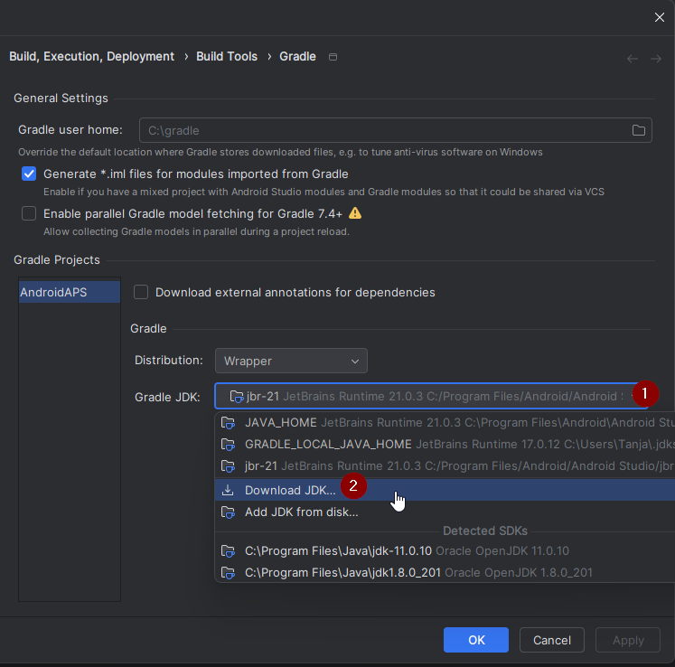
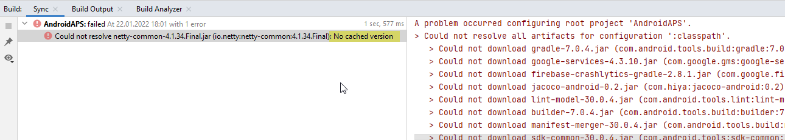

(troubleshooting_androidstudio-troubleshooting-android-studio)=

# Felsökning av Android Studio

```{contents} List of common issues
:depth: 2
:local: true
```

(troubleshooting_androidstudio-lost-keystore)=
## Förlorad keystore
Om du har förlorat din keystore eller dess lösenord kan en apk som är signerad med en ny keystore inte uppdatera din nuvarande **AAPS**: du måste avinstallera och installera om den. Se [Installera om AAPS med en ny keystore](#reinstall-aaps).

## Gradle Sync misslyckades
Gradle Sync kan misslyckas av olika skäl. När du får ett meddelande om att 'gradle sync failed', öppna fliken "Build" (1) längst ner i Android Studio och kontrollera vilket felmeddelande (2) som visas.


```{contents} Likely reasons for gradle sync failures are:
:depth: 1
:local: true
```

*Viktigt*: När du har följt instruktionerna för ditt problem behöver du starta [Gradle Sync](#gradle-resync) igen.

(troubleshooting_androidstudio-uncommitted-changes)=
### Ändringar som inte är committade (Uncommitted changes)

Om du får ett felmeddelande som det här:


```
Build file 'C:\Data\50-Android\AndroidAPS\app\build.gradle.kts' line: 243

There are uncommitted changes.
Klona källkoden igen enligt beskrivningen i wikin och tillåt inte uppdatering av Gradle
```

#### Steg 1 - Kontrollera Git-installationen
  * Öppna fliken Terminal (1) längst ner i Android Studio. Kopiera följande text och klistra in den (eller skriv den) i terminalen (2).
    ```
    git --version
    ```

    

    Obs: Det finns ett mellanslag och två bindestreck mellan git och version!

  * Du ska få ett meddelande som visar vilken Git-version som är installerad, som i skärmbilden ovan. Gå i så fall till [steg 2](#troubleshooting-android-studio-check-for-uncommitted-changes).

  * Om du får ett meddelande som säger
    ```
    Git: command not found
    ```
    är din Git-installation inte korrekt.

  * [Kontrollera Git-installationen](#BuildingAaps-steps-for-installing-git)

  * Om du använder Windows och Git precis har installerats, bör du starta om datorn efter installationen så att Git blir tillgängligt överallt

  * Om Git är installerat, du har startat om (om du använder Windows) och Git ändå inte hittas:

  * Sök efter filen "git.exe" på din dator.

    Anteckna vilken katalog den sparas i.

  * Gå till miljövariablerna i Windows, välj variabeln "PATH" och klicka på redigera. Lägg till katalogen där du hittade din Git-installation.

  * Spara och stäng.

  * Starta om Android Studio.

(troubleshooting-android-studio-check-for-uncommitted-changes)=
#### Steg 2: Kontrollera om det finns ändringar som inte är committade.

  * I Android Studio, öppna fliken 'Commit' (1) på vänster sida. 
  * Du ser antingen "Changes" (heter "Default changeset" i äldre versioner av Android Studio) (2) eller "Unversioned Files" (3):

    * För "Changes" har du troligen uppdaterat 'Gradle' eller ändrat innehållet i några filer av misstag.

    * Högerklicka på "Changes" och välj "Rollback…" (1)

      

    * Filerna hämtas igen från Git-servern. Om det inte finns några andra ändringar i fliken Commit, gå till [steg 3](#gradle-resync).

  * Om du ser "Unversioned Files" kan du av misstag ha sparat filer i katalogen för källkoden. Det kan vara viktiga filer, till exempel din keystore-fil, som bör flyttas någon annanstans. Om du inte vet vad filerna är och inte har skapat dem själv kan du radera dem.

    * Använd den vanliga filhanteraren på datorn för att flytta filen (eller klippa ut och klistra in den) till ett säkert ställe.

    * Gå tillbaka till Android Studio och klicka på knappen Refresh (4) i fliken Commit, för att kontrollera att filen inte längre ligger i **AAPS**-katalogen.

      Om det inte finns några andra ändringar i fliken Commit, gå till [steg 3](#gradle-resync).


#### Steg 3: Synkronisera om Gradle (igen)

Följ instruktionerna i [Synkronisera om Gradle](#gradle-resync).

### Git Pull Failed - Please tell me who you are

Om du ser det här meddelandet behöver Git veta vem du är.


Öppna terminalen och skriv följande två kommandon, ett i taget.

```
git config --global user.name "Your name here"
git config --global user.email your.email@here.com
```

Ditt namn måste skrivas inom citattecken.


(troubleshooting_androidstudio-android-gradle-plugin-requires-java-11-to-run)=

(incompatible-gradle-jvm)=
### Inkompatibel Gradle JVM


```
Your build is currently configured to use incompatible Java 21.0.3 and Gradle 8.2.
Cannot sync the project.

We recommend upgrading to Gradle version 8.9.

The minimum compatible Gradle version is 8.5.

The maximum compatible Gradle JVM version is 19.
```

Eller:

```
Cause: error: invalid source release: 21
```

Om du får felmeddelandet ovan behöver du ladda ner rätt JVM-version innan du kan försöka bygga igen:

1.  Kontrollera i [tabellen med krav](#Building-APK-recommended-specification-of-computer-for-building-apk-file) vilken JVM-version du behöver för den **AAPS**-version du bygger, och anteckna den.

2. Öppna vyn Gradle genom att klicka på elefanten (1) på höger sida i Android Studio, öppna inställningarna (2) och välj **Gradle Settings** (3):


3.  I fältet **Gradle JDK**, kontrollera om rätt version är vald (1). Om inte, klicka på fältet och se om den redan finns i listan. Exemplet nedan visar att JVM 21 heter ”jbr-21”. Om du hittar den, välj den bara, så är du klar. Om den inte finns, välj **Download JDK** (2).




4. I Version (1), välj den JDK som krävs för din **AAPS**-version (den som du antecknade när du kontrollerade tabellen med krav). I Vendor (2), välj valfri leverantör. Location (3): ändra inte. Klicka på **Download** (4).


5.  Stäng dialogrutan **Settings** med **OK**.
6. Nu behöver du starta Gradle Sync igen. Följ instruktionerna i [Synkronisera om Gradle](#gradle-resync).

(incompatible-version-of-android-gradle-plugin)=
### Inkompatibel version av Android Gradle plugin

  Om du får följande felmeddelande

`The project is using an incompatible version (AGP x.x.x) of the Android Gradle plugin. Latest supported version is AGP x.x.x`

  

  Du använder en föråldrad version av Android Studio. Gå i menyn till Help > Check for updates och installera alla uppdateringar av Android Studio och dess plugins som hittas.

(troubleshooting_androidstudio-could-not-resolve-no-cached-version)=
### Could not resolve/No cached version

  Du kan få det här felmeddelandet:



  * Öppna fliken Gradle (1) på höger sida.

    Se till att knappen som visas vid (2) *INTE* är vald.

    

  * Nu behöver du [synkronisera om Gradle](#gradle-resync)

(troubleshooting_androidstudio-unable-to-start-daemon-process)=
### Unable to start daemon process

  Om du ser ett felmeddelande som det nedan använder du troligen ett 32-bitars Windows 10-system. Detta stöds inte av Android Studio 3.5.1 och senare, och tyvärr kan utvecklarna av **AAPS** inte göra något åt det!

  Det finns information på internet om hur du tar reda på om du har ett 32-bitars eller 64-bitars operativsystem, t.ex. [den här](https://support.microsoft.com/en-us/windows/32-bit-and-64-bit-windows-frequently-asked-questions-c6ca9541-8dce-4d48-0415-94a3faa2e13d).

  

(gradle-resync)=
### Synkronisera om Gradle

  Om du fortfarande ser meddelandet att Gradle Sync misslyckades, välj nu länken **Try again** (1). 


  Om du inte ser meddelandet längre kan du ändå starta detta manuellt:

  * Öppna fliken Gradle (1) vid högra kanten av Android Studio.

    

  * Högerklicka på AAPS (2)

  * Klicka på "Reload Gradle Project" (3)

## Generate Signed APK generated successfully with 0 build variants

När du genererar den signerade apk:n kan du få meddelandet att genereringen lyckades men att '0 build variants' genererades:


Det här är en falsk varning. Kontrollera katalogen som du valde som "Destination folder" när du genererade apk:n (steget [Generate Signed APK](#Building-APK-generate-signed-apk)), så hittar du den genererade apk:n där!


## Appen skapades med kompilator-/Kotlin-varningar

Om ditt bygge lyckades men du får kompilator- eller Kotlin-varningar (som visas med ett gult eller blått utropstecken) kan du bara ignorera dessa varningar.

 

Din apk byggdes utan problem och kan föras över till telefonen!


## AAPS tar inte emot några CGM-data

* Om du använder den patchade Dexcom G6-appen: den här appen är föråldrad. Använd appen [BYODA](#DexcomG6-if-using-g6-with-build-your-own-dexcom-app) i stället.

* Om du använder xDrip: identifiera mottagaren enligt beskrivningen på [sidan om xDrip-inställningar](#xdrip-identify-receiver).


## Apk inte installerad


* Se till att du har fört över filen ”app-full-release.apk” till din telefon.
* Det här felet betyder oftast att den nya apk:n är signerad med en annan keystore än din installerade **AAPS**. Om du fortfarande har din tidigare keystore, välj den och bygg igen. Annars, se [Installera om AAPS med en ny keystore](#reinstall-aaps).
* Om "App not installed" (appen har inte installerats) visas på telefonen, följ dessa steg:

1. [Exportera inställningar](../Maintenance/ExportImportSettings.md) (i den AAPS-version som redan är installerad på din telefon)
2. Avinstallera **AAPS** på telefonen.
3. Aktivera flygplansläge och stäng av Bluetooth.
4. Installera den nya versionen (”app-full-release.apk”)
5. [Import settings](../Maintenance/ExportImportSettings.md)
6. Slå på Bluetooth igen och stäng av flygplansläget

## Apk installerad men gammal version

Om du har byggt appen, fört över den till telefonen och installerat den utan problem, men versionsnumret är detsamma, kan du ha glömt att [uppdatera din lokala kopia](#Update-to-new-version-update-your-local-copy)

## Inget av ovanstående fungerade

Om inga av tipsen ovan hjälpte kan du överväga att bygga apk:n från början:

1. [Exportera inställningar](../Maintenance/ExportImportSettings.md) (i den AAPS-version som redan är installerad på din telefon)

2. Ha ditt nyckellösenord (key password) och keystore-lösenord (key store password) redo.

    Eller använd helt enkelt en ny keystore.

3. Bygg apk:n från början enligt beskrivningen [här](#Building-APK-download-AAPS-code).

4. När du har byggt apk:n, radera den befintliga apk:n på telefonen, för över den nya apk:n till telefonen och installera den.
5. [Importera inställningar](../Maintenance/ExportImportSettings.md) igen för att återställa dina mål och inställningar.
6. Du bör kontrollera dina inställningar för batterioptimering och stänga av den igen.

## I värsta fall

Om detta inte löser ditt byggproblem kan du försöka avinstallera Android Studio helt och bygga om från början.  Vissa användare upplever att detta kan lösa deras byggproblem.  När du tar bort Android Studio, ta inte bort Androids användarinställningar och **se till att avinstallera alla filer som hör till Android Studio.** Om du inte tar bort Android Studio helt, med alla dolda filer, kan avinstallationen orsaka nya problem i stället för att lösa dina befintliga. Instruktioner för fullständig avinstallation finns på nätet, t.ex.

[https://stackoverflow.com/questions/39953495/how-to-completely-uninstall-android-studio-from-windowsv10](https://stackoverflow.com/questions/39953495/how-to-completely-uninstall-android-studio-from-windowsv10).

Installera Android Studio från början enligt beskrivningen [här](#Building-APK-install-android-studio).
