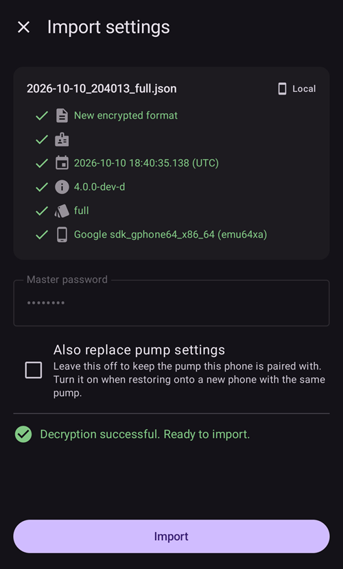
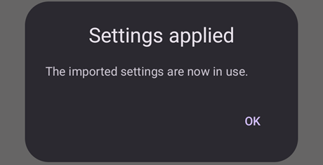

# Skapa och återställa säkerhetskopior

När du installerar AAPS på din telefon blir den en ”medicinteknisk produkt” som du är beroende av varje dag. Vi rekommenderar starkt att du har en reservplan för när din telefon går sönder, blir stulen eller kommer bort. Därför är det viktigt att förbereda dig genom att fråga dig själv: ”Tänk om?”

För att kunna återställa din AAPS-installation på en befintlig eller ny telefon är det viktigt att spara följande saker på en säker plats (alltså inte på din telefon). Bästa praxis är att ha minst två separata säkerhetskopior: på en lokal hårddisk, ett USB-minne och (helst) i molnlagring som Google Drive eller Microsoft 365 OneDrive. Om du sparar dina säkerhetskopior i molnet kan du alltid nå allt du behöver från din telefon och återställa din installation var och när som helst.

Överväg att skaffa en extra reservtelefon och öva på att återställa AAPS, så att du vet att reservtelefonen fungerar som den ska. Det här steget ger dig trygghet att din reservplan fungerar och att du kan fortsätta använda AAPS utan avbrott om din huvudtelefon inte går att använda.

```{admonition} Android backups and phone-transfer tools do not carry your AAPS settings
:class: warning
Sedan **AAPS** 4.0 sparas inställningarna i ett krypterat lager på telefonen, och de tas inte med i Google-säkerhetskopian eller i överföringen från telefon till telefon när du byter till en ny telefon. En export av inställningarna, som beskrivs på den här sidan, är det enda sättet att föra över dem.
```

För att kunna återställa är det viktigt att du har följande till hands:

- Din **keystore-fil från Android Studio** och tillhörande **lösenord**: behövs för att bygga (om) installationsfilen AAPS .APK.
- En aktuell kopia av **installationsfilen AAPS .APK**
- En aktuell fil med **exporterade inställningar**: för att återställa viktiga inställningar (även dina mål!).
- Ditt **huvudlösenord för AAPS**
- Säkerhetskopior av extra verktyg: till exempel BYODA och/eller xDrip.
- Egna anteckningar om din installation.

Här nedan finns de saker som vi rekommenderar att du säkerhetskopierar.

## Skapa säkerhetskopior

### Keystore-fil från datorn som du använde för att bygga APK-filen
När du bygger din installationsfil .APK i Android Studio används **keystore-filen och lösenordet för att signera installationsfilen .APK**. För att uppdatera din nuvarande AAPS-installation måste installationsfilen .APK för uppdateringen vara signerad med samma keystore som vid den första installationen. När du uppdaterar behålls alla inställningar och AAPS-databasen. Observera att du utan detta först måste avinstallera den nuvarande appen och sedan [installera om](#reinstall-aaps) och ställa in AAPS igen.

Om du sparar din keystore och lösenordet blir det mycket enklare att uppdatera APK:n i framtiden, särskilt om du behöver bygga appen på en ny dator. Se avsnittet [Uppdatera AAPS](../Maintenance/UpdateToNewVersion.md) för mer information om hur du använder din keystore när du bygger en ny APK.

**När ska du säkerhetskopiera:** Säkerhetskopiera din keystore när du har byggt installationsfilen .APK för **AAPS** första gången.

**Hur du säkerhetskopierar:** Hitta sökvägen till din keystore. Om du inte kommer ihåg den kan du hitta den i Android Studio genom att välja **Build > APK > Next**. Sökvägen visas i ”Key store path”. Gå till den här sökvägen med din filhanterare och gör en kopia av din keystore-fil (med filändelsen `.jks`). Spara den på en säker plats i molnet, om din dator skulle sluta fungera. Skriv också upp lösenordet för din keystore, nyckelalias (key alias) och nyckellösenord (key password).

### Kopior av den senaste APK-filen
Om din **AAPS**-huvudtelefon kommer bort eller går sönder kan du snabbt börja använda **AAPS** igen på en ny telefon om du har en kopia av APK-filen. Obs: du behöver också en säkerhetskopia av dina inställningar, se nedan.

**När ska du säkerhetskopiera:** Spara alltid en säkerhetskopia av den senaste APK-filen som du har installerat på din **AAPS**-huvudtelefon. Du kan också spara en tidigare version, om du av någon anledning behöver gå tillbaka till den.

**Hur du säkerhetskopierar:** Spara en kopia på datorn som du använde för att bygga APK-filen med Android Studio. Vi rekommenderar också att du sparar en kopia av installationsfilen APK på en molnplattform. Se till att du vet var du hittar båda säkerhetskopiorna när du behöver dem. Överväg att skapa egna mappar för de här säkerhetskopiorna.

### Inställningsfil för AAPS (kallas också ”Preferences”)

```{admonition} Where are preferences stored on my phone?
:class: tip
Du hittar dina inställningar i den **AAPS-katalog** som du valde under [installationsguiden](#SetupWizard-StoragePermission).</br>
Du kan också ändra **AAPS-katalog** på skärmen **Underhåll** (**menyn** (☰) > **Underhåll**), se [Ställa in den lokala AAPS-katalogen](#preferences-maintenance-logdirectory).
```

Med en kopia av installationsfilen APK (se ovan) och din **inställningsfil** kan du snabbt komma igång på en befintlig eller ny telefon.

**Inställningsfilen** används för att anpassa AAPS-appen till just din installation. De innehåller till exempel dina inställningar i **Konfiguration**, status för målen, inställningar för kommunikation med andra tjänster (t.ex. Nightscout, Tidepool), automatiseringar och profiler.

När du exporterar AAPS-inställningarna till en fil kan du återställa konfigurationen till hur den var vid en viss tidpunkt. Som sagt innehåller exportfilen, utöver alla inställningar för konfigurationen, också statusen för dina mål. Den behöver du återställa när du **installerar (om)** AAPS. Utan den måste du göra om alla mål från början för att kunna aktivera sluten loop. Med inställningsfiler kan du också återställa de ”senast kända fungerande” inställningarna för att ångra ändringar i konfigurationen.

**När ska du säkerhetskopiera AAPS-inställningarna:**
* Varje gång du har slutfört ett mål, så att du inte förlorar dina framsteg. _Utan en kopia av dina **inställningar** måste du slutföra alla mål igen om du behöver installera om AAPS eller byta telefon._

* Varje gång du tänker göra stora ändringar i din konfiguration (ändra SMB-inställningar, byta insulintyp, byta pump, ändra automatiseringar) ska du säkerhetskopiera dina **inställningar** före och efter ändringarna. Då har du dina senaste inställningar och även en kopia av hur de var före ändringarna, om du behöver gå tillbaka till dem.

* Endast för användare av slanglösa pumpar (t.ex. Omnipod och Medtrum): **inställningsfilen** innehåller anslutningsuppgifter för din nuvarande pod och kan användas för att återansluta till den podden med en ny telefon. Om du inte har en kopia av dina inställningar som du exporterade efter att du startade din nuvarande pod, måste du starta en ny pod om du behöver byta din nuvarande telefon.

**Så säkerhetskopierar du manuellt:**

1. Om det är första gången du importerar eller exporterar **inställningar** måste du ställa in ett huvudlösenord i [Inställningar > Skydd](#Preferences-master-password). Välj ett lösenord och skriv upp det på en säker plats. _Utan det här lösenordet kan du inte använda säkerhetskopiorna av dina **inställningar**._

2. Öppna **menyn** (☰) > **Underhåll** på huvudskärmen i **AAPS**. Välj var filen ska sparas med chipen **Lokal** och **Moln** bredvid **Exportera inställningar** (se **Exportera eller importera inställningar** nedan) och tryck sedan på **Exportera inställningar**. **AAPS** visar vart filen sparas: filnamnet för **Lokal**, **Google Drive** för **Moln**. Tryck på **OK**.

   

   

   Skriv in huvudlösenordet som du ställde in ovan och tryck på **OK**.

   

   **Inställningar exporterade** (lokalt) eller **Molnexport lyckades** (moln) bekräftar exporten.

   

   

3. Gå till Internt lagringsutrymme > AAPS > preferences med filhanteraren på din telefon (den heter oftast ”Filer” eller ”Mina filer”). Här ser du en kopia av alla exporterade inställningsfiler. Filnamnet ska vara `YYYY-MM-DD_Time_appname.json`. Ladda upp den här filen till den molnplattform du vill använda. Ladda sedan också ner en kopia från molnplattformen till din dator.

(ExportImportSettings-Settings-Export)=

## Export av inställningar

```{admonition} Where are preferences stored on my phone?
:class: tip
Du hittar dina inställningar i den **AAPS-katalog** som du valde under [installationsguiden](#SetupWizard-StoragePermission).</br>
Du kan också ändra **AAPS-katalog** på skärmen **Underhåll** (**menyn** (☰) > **Underhåll**), se [Ställa in den lokala AAPS-katalogen](#preferences-maintenance-logdirectory).
```

Vi rekommenderar att du exporterar inställningarna regelbundet, särskilt före och efter ändringar i konfigurationen. Du kan välja att göra exporten **manuellt eller (helst) med automation**. Se till att du skriver upp ditt huvudlösenord för AAPS och att du säkerhetskopierar dina inställningsfiler genom att kopiera dem från telefonen, till exempel till molnlagring.

**Obs**: _De exporterade inställningarna krypteras med ditt huvudlösenord för AAPS: utan huvudlösenordet som användes vid exporten kan du inte importera inställningsfilen!_

If you forgot your master password, you can [reset it](#FAQ-reset-master-password), but settings files exported with the old password still need the old one.

### Exportera eller importera inställningar
Öppna **menyn** (☰) och välj **Underhåll** för att exportera eller importera inställningar. Under **Filhantering** väljer chipen **Lokal** och **Moln** bredvid **Exportera inställningar** och **Importera inställningar** var inställningsfilen sparas eller läses: **Lokal** är AAPS-katalogen på din telefon, **Moln** går att välja när en [Molnkatalog](#preferences-maintenance-cloud) är inställd. När du trycker på ett chip slås det på eller av. Minst ett är alltid valt, och båda raderna har samma val. Tryck sedan på själva **Exportera inställningar** eller **Importera inställningar** för att starta.


(ExportImportSettings-Automating-Settings-Export)=
### Automatisk export av inställningar

För att automatisera exporten av inställningar [(**se Automation**)](../DailyLifeWithAaps/Automations.md#automating-preference-settings-export) öppnar du [**Inställningar** > **Underhåll**](#preferences-maintenance-settings), fäller ut **Automatisk export av inställningar** och slår på **Aktivera automatisk export av inställningar**.

Du kan nu ställa in [Automation](../DailyLifeWithAaps/Automations.md#automating-preference-settings-export) så att den exporterar inställningarna, antingen regelbundet (_t.ex._ varje vecka) eller efter ett podbyte.

_**Obs:** När du importerar inställningar måste du alltid ange huvudlösenordet för AAPS!_


(ExportImportSettings-restoring-from-your-backups-on-a-new-phone-or-fresh-installation-of-aaps)=
## Återställa från dina säkerhetskopior på en ny telefon eller en ny installation av AAPS

```{admonition} Where are preferences stored on my phone?
:class: tip
Du hittar dina inställningar i den **AAPS-katalog** som du valde under [installationsguiden](#SetupWizard-StoragePermission).</br>
Du kan också ändra **AAPS-katalog** på skärmen **Underhåll** (**menyn** (☰) > **Underhåll**), se [Ställa in den lokala AAPS-katalogen](#preferences-maintenance-logdirectory).</br>
Om **AAPS** förlorar åtkomsten till den katalogen (det kan hända efter en ominstallation eller när appens lagring har rensats) visar appen aviseringen **Behörigheten till AAPS-mappen är borta** och slutar spara inställningar på telefonen tills du [väljer katalogen igen](#preferences-maintenance-logdirectory).
```

Följ de här instruktionerna om du har en säkerhetskopia av din APK och dina **inställningar** som du vill läsa in på en ny telefon, eller om du av någon anledning har behövt radera och installera om APK:n på din befintliga telefon.

_Om du uppdaterar **AAPS** med en APK som är byggd med samma keystore behöver du inte följa de här stegen. Vi rekommenderar ändå att du skapar en säkerhetskopia innan du installerar uppdateringen._

Om du uppdaterar **AAPS** efter att du har förlorat eller bytt din ursprungliga keystore (t.ex. om du använder en ny dator för att bygga utan att flytta över din keystore), se till att du säkerhetskopierar alla inställningar enligt ovan. Avinstallera sedan den befintliga versionen av **AAPS** på din telefon. Se [Installera om AAPS med en ny keystore](#reinstall-aaps) för hela proceduren.

Om det behövs, [ställ in mottagaren för din CGM/BG-källa](../Getting-Started/CompatiblesCgms.md) innan du följer stegen nedan

(ExportImportSettings-tubeless-pumps)=
```{admonition} Tubeless pumps (Omnipod and Medtrum) users
:class: warning
**Inställningsfilen** innehåller sessionen för den pod som var aktiv när du exporterade filen.
- **Exportera direkt efter varje podaktivering** och kopiera filen från telefonen.
- **Samma telefon, podden är fortfarande aktiv:** lämna **Byt även pumpinställningar** omarkerad. Din nuvarande pod behålls och bara de andra inställningarna importeras.
- **Ny telefon tar över podden:** markera **Byt även pumpinställningar** och använd bara en fil som exporterades under den pod som du har på dig nu. En fil från en tidigare pod ersätter din nuvarande pod-session, och då måste du starta en ny pod.
- **En gammal pod-session importerades av misstag:** **AAPS** fortsätter försöka nå den podden och du kan inte aktivera en ny. Inaktivera den. Om det misslyckas, kassera den (se till exempel [Kassera en pod](#omnipod-dash-discard-pod) för Omnipod DASH).
```

```{admonition} Pump settings are kept unless you say otherwise
:class: note
Som standard ändrar en import inte dina pumpinställningar: pumpen som är vald i **Konfiguration**, dess parkoppling och alla andra pumpinställningar förblir som de är på den här telefonen. Markera **Byt även pumpinställningar** på importskärmen bara när du återställer till en ny telefon som ska ta över samma pump. Inställningar som inte finns i filen raderas aldrig av en import.
```

1. Använd säkerhetskopian av din APK från ovan och följ instruktionerna för en [ny installation](../SettingUpAaps/TransferringAndInstallingAaps.md)

2. Starta **AAPS** och ge alla behörigheter som appen ber om

3. Avsluta installationsguiden. Vi importerar alla nödvändiga inställningar från säkerhetskopian av **inställningsfilen**

4. Tryck på **Bevilja** på huvudskärmen i **AAPS** och tillåt alla behörigheter i panelen **Behörigheter krävs** högst upp

5. Ställ in huvudlösenordet i [Inställningar > Skydd](#Preferences-master-password) från huvudskärmen i **AAPS**. Använd samma lösenord som för dina säkerhetskopior.

6. Om du inte har gjort det ännu, [ställ in **AAPS-katalog**](#preferences-maintenance-logdirectory): öppna **menyn** (☰) > **Underhåll** > **AAPS-katalog** på huvudskärmen i **AAPS**.

7. Öppna **menyn** (☰) > **Underhåll** > **Exportera inställningar** > skriv in huvudlösenordet som du ställde in ovan > **OK** på huvudskärmen i **AAPS**. Detta skapar mappen preferences om den inte redan finns på din telefon.

8. Ladda ner säkerhetskopian av din **inställningsfil** från din molnplattform.

9. Använd din filhanterare (den heter oftast ”Filer” eller ”Mina filer”) för att flytta filen från dina nedladdningar till `/internal storage/AAPS/preferences` om din **AAPS-katalog** är inställd på `/internal storage/AAPS`

10. Öppna **menyn** (☰) > **Underhåll** på huvudskärmen i **AAPS** och tryck på **Importera inställningar**. Välj den inställningsfil som du vill återställa från (den senaste ligger överst). Se till att du väljer rätt inställningsfil. Alla .json-filer i mappen preferences (eller i molnkatalogen, med **Moln**) visas.

    

    **AAPS** visar information om filen. Skriv in huvudlösenordet som du ställde in ovan och tryck på **Dekryptera & Granska**.

11. När filen är dekrypterad bestämmer du vad som ska hända med pumpinställningarna. På en ny telefon som tar över samma pump markerar du **Byt även pumpinställningar**, så att parkopplingen och pumpinställningarna hämtas från filen. Lämna rutan omarkerad för att behålla pumpen som den här telefonen redan är parkopplad med. Tryck sedan på **Importera**.

    

12. **AAPS** frågar **Använd de importerade inställningarna?** och visar hur många inställningar som ändras och, om du lämnade rutan omarkerad, hur många pumpinställningar som behålls. Ingenting har skrivits ännu, så **Avbryt** lämnar telefonen precis som den var. Tryck på **OK** för att tillämpa.

    

13. **AAPS** tillämpar de importerade inställningarna direkt, utan omstart. Bara de plugins vars inställningar har ändrats startas om. Under tiden visar **AAPS** **Tillämpar inställningar...**. Om pumpen är upptagen visar appen **Väntar på pump…** och tillämpar inställningarna när pumpen är ledig. Om pumpen fortfarande är upptagen efter en minut erbjuder **AAPS** att försöka igen. Meddelandet **Inställningar tillämpade** bekräftar att de importerade inställningarna används. En behandling som låg i kö medan importen pågick tas bort, och **AAPS** meddelar att den avbröts, så att ingenting skickas två gånger till pumpen.

    

Om filen valde en pump som den här versionen av **AAPS** inte har, byter **AAPS** till **Virtuell pump** och meddelar det. Välj din pump igen i **Konfiguration** och kontrollera pumpens inställningar.

14. Endast för användare av slanglösa pumpar (Omnipod och Medtrum): om du markerade **Byt även pumpinställningar** och din **inställningsfil** inte säkerhetskopierades från samma pod som du använder nu, måste du starta en ny pod för att börja leverera insulin.

**Felsökning:** om du inte kan aktivera en profil, öppna **menyn** (☰) uppe till vänster på huvudskärmen i **AAPS** > **Konfiguration** > **Pump** > byt till **Virtuell pump** > byt sedan tillbaka till din pumptyp

### Information för användare av Dana RS

- Om du markerade **Byt även pumpinställningar** importeras även inställningarna för pumpanslutningen: **AAPS** på din nya telefon ”känner” då redan pumpen och startar därför ingen Bluetooth-skanning.
- Parkoppla den nya telefonen och pumpen manuellt.