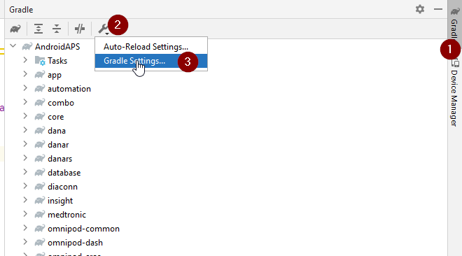
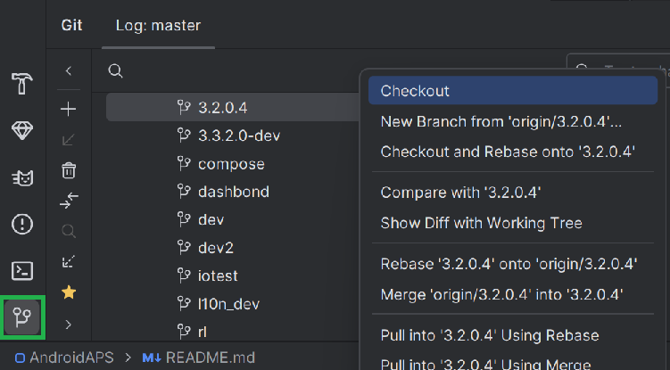
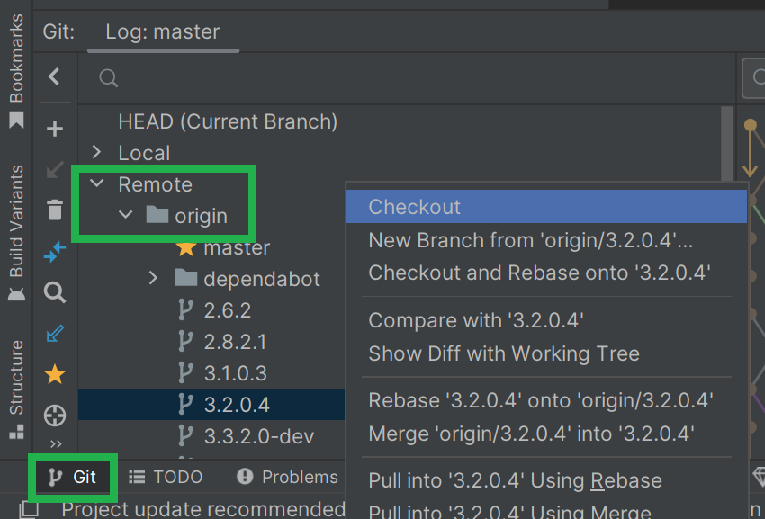
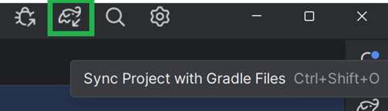
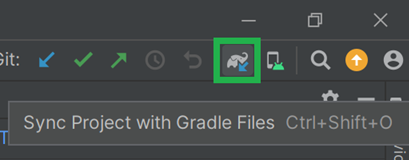

# Uppdatera till AAPS 3.2.0.4

(update-aaps-3204)=

## Bygg själv i stället för att ladda ned

**AAPS-appen (en apk-fil) finns inte att ladda ned, på grund av reglerna för medicintekniska produkter. Det är lagligt att bygga appen för eget bruk, men du får inte ge en kopia till andra!**

Se sidan [Vanliga frågor](../UsefulLinks/FAQ.md) för mer information.

## Krav på dator och programvara för att bygga AAPS 3.2.0.4

* Du kan behöva en viss version av **[Android Studio](https://developer.android.com/studio/)** för att bygga APK:n.

| AAPS-version            | Rekommenderad<br/>version av<br/>Android Studio | Alternativ<br/>version av<br/>Android Studio | Gradle | JVM |
| ----------------------- | ----------------------------------------------------------- | -------------------------------------------------------- | ------ |:--- |
| [3.2.0.4](#version3204) | Hedgehog (2023.1.1)                                         | upp till Meerkat                                         | 8.2    | 17  |

Den "rekommenderade versionen" levereras med rätt JVM-version. Den rekommenderade versionen är också den lägsta version som du kan använda för att bygga **AAPS**. Du kan **INTE** bygga med en version som är äldre än den "rekommenderade". Om du använder en annan version kan du få problem med JVM-versionen. Se sidan [Felsökning av Android Studio](#incompatible-gradle-jvm) för hjälp med att lösa dessa problem. Om din nuvarande version av Android Studio inte finns i tabellen måste du först uppdatera den.

Gradle-versionen hör ihop med källkoden. Du får alltid rätt Gradle-version när du laddar ned eller uppdaterar källkoden. Den nämns här bara som information. Du behöver inte göra något med den.

* [32-bitars Windows](#troubleshooting_androidstudio-unable-to-start-daemon-process) stöds inte av Android Studio. Tänk på att **både 64-bitars processor och 64-bitars operativsystem är ett krav.** Om ditt system INTE uppfyller detta krav måste du byta den maskinvara eller programvara det gäller, eller hela systemet.

<table class="tg">
<tbody>
  <tr>
    <th class="tg-baqh">OS (endast 64-bitars)</th>
    <td class="tg-baqh">Windows 8 eller senare</td>
    <td class="tg-baqh">Mac OS 10.14 eller senare</td>
    <td class="tg-baqh">Alla Linux-distributioner som stöder Gnome, KDE eller Unity DE;&nbsp;&nbsp;GNU C Library 2.31 eller senare</td>
  </tr>
  <tr>
    <th class="tg-baqh"><p align="center">CPU (endast 64-bitars)</th>
    <td class="tg-baqh">x86_64-processorarkitektur; Intel Core av 2:a generationen eller nyare, eller AMD-processor med stöd för <br><a href="https://developer.android.com/studio/run/emulator-acceleration#vm-windows" target="_blank" rel="noopener noreferrer"><span style="text-decoration:var(--devsite-link-text-decoration,none)">Windows Hypervisor</span></a></td>
    <td class="tg-baqh">ARM-baserade chip, eller Intel Core av 2:a generationen eller nyare med stöd för <br><a href="https://developer.android.com/studio/run/emulator-acceleration#vm-mac" target="_blank" rel="noopener noreferrer"><span style="text-decoration:var(--devsite-link-text-decoration,none)">Hypervisor.Framework</span></a></td>
    <td class="tg-baqh">x86_64-processorarkitektur; Intel Core av 2:a generationen eller nyare, eller AMD-processor med stöd för AMD Virtualization (AMD-V) och SSSE3</td>
  </tr>
  <tr>
    <th class="tg-baqh"><p align="center">RAM</th>
    <td class="tg-baqh" colspan="3"><p align="center">8 GB eller mer</td>
  </tr>
  <tr>
    <th class="tg-baqh"><p align="center">Disk</th>
    <td class="tg-baqh" colspan="3"><p align="center">Minst 30 GB ledigt utrymme. SSD rekommenderas.</td>
  </tr>
  <tr>
    <th class="tg-baqh"><p align="center">Upplösning</th>
    <td class="tg-baqh" colspan="3"><p align="center">Minst 1280 x 800 <br></td>
  </tr>
  <tr>
    <th class="tg-baqh"><p align="center">Internet</th>
    <td class="tg-baqh" colspan="3"><p align="center">Bredband</td>
  </tr>
</tbody>
</table>

**Vi rekommenderar starkt (men det är inget krav) att du använder en SSD (Solid State Disk) i stället för en HDD (hårddisk), eftersom det går snabbare att bygga APK-filen för AAPS.**  Du kan ändå använda en HDD när du bygger APK-filen för **AAPS**. Om du gör det kan bygget ta lång tid, men när det väl har startat kan du låta det köra utan tillsyn.

## Hjälp och support när du bygger 3.2.0.4

Om du får problem när du bygger appen **AAPS** finns det ett eget avsnitt [**Felsökning av Android Studio**](https://androidaps.readthedocs.io/en/3.2/GettingHelp/TroubleshootingAndroidStudio.html). Läs det först.

Om du tycker att något i bygginstruktionerna är fel, saknas eller är otydligt, eller om du fortfarande har problem, kontakta andra användare av **AAPS** i gruppen på [Facebook](https://www.facebook.com/groups/AndroidAPSUsers) eller på [Discord](https://discord.gg/4fQUWHZ4Mw). Om du själv vill ändra något (uppdatera skärmbilder _osv._), skicka in en [pull request (PR)](../SupportingAaps/HowToEditTheDocs.md).

```{note}
Denna sida visar exempelbilder både för det nya (**New**) och det gamla (**Classic**) användargränssnittet i Android Studio.
```

## Översikt: uppdatera från 3.2.0.x till 3.2.0.4

```{contents} Steps for updating to 3.2.0.4
:depth: 1
:local: true
```

### Exportera dina nuvarande inställningar

Exportera dina inställningar från den **AAPS**-version som finns på din telefon nu. Du behöver dem kanske inte, men det är bättre att vara på den säkra sidan.

Se sidan [Skapa och återställa säkerhetskopior](ExportImportSettings.md) om du inte kommer ihåg hur du gör.

### Uppdatera din lokala kopia av AAPS

* Öppna ditt befintliga AAPS-projekt i Android Studio. Du kan behöva välja ditt projekt. (Dubbel)klicka på AAPS-projektet.


<br>


* I menyraden i Android Studio väljer du Git -> Fetch


<br>


* Nere till höger ser du ett meddelande om att Fetch lyckades.


<br>


* I menyraden väljer du nu Git -> Pull


<br>


* Ändra inga alternativ (origin/master) och välj Pull


<br>


* Vänta medan nedladdningen pågår. Du ser information om det i fältet längst ned. När den är klar ser du ett meddelande om att det lyckades.

  ```{note}
  Vilka filer som har uppdaterats kan variera! Detta betyder inte att något är fel.
  ```


<br>


* Gradle Sync körs nu för att ladda ned några beroenden. Vänta tills den är klar.


<br>


### Välj JVM-version 17

- Öppna vyn Gradle genom att klicka på elefanten (1) på höger sida i Android Studio, öppna inställningarna (2) och välj **Gradle Settings** (3):


<br>



- I fältet **Gradle JDK** (1) kontrollerar du att rätt version är vald: **jbr-17**. Om den inte är det, klicka på fältet och se om den redan finns i listan. Om den inte finns i listan (skärmbilden nedan visar en dator där bara **jbr-21** finns), välj **Download JDK...** (2).


- Under Version (1) väljer du **17**. Under Vendor (2) väljer du JetBrains Runtime eller valfri leverantör. Location (3): ändra inte.


- Stäng dialogrutan **Settings** med **OK**.

### Välj grenen AAPS 3.2.0.4

- Längst ned till vänster väljer du Git-symbolen, högerklickar på 3.2.0.4 och väljer Checkout.



<br>



### Synkronisera projektet med Gradle

```{admonition} WARNING!
:class: warning
**Uppdatera aldrig Gradle.** Synkronisera den alltid med projektet.
```

I det nya gränssnittet använder du elefantikonen och Sync Project with Gradle Files (eller följ [detta](#gradle-resync)).



Eller ([detta](https://androidaps.readthedocs.io/en/3.2/GettingHelp/TroubleshootingAndroidStudio.html#gradle-resync)) för det klassiska gränssnittet.



### Bygg den signerade APK:n för 3.2.0.4

Din källkod är nu den aktuella släppta versionen och alla förutsättningar har kontrollerats. Nu är det dags att bygga den signerade APK:n enligt [avsnittet om att bygga en signerad APK](#Building-APK-generate-signed-apk).

### Överför och installera APK:n för 3.2.0.4

Du måste överföra APK:n till din telefon så att du kan installera den.

```{note}
Om du har byggt med samma keystore som tidigare i Android Studio behöver du inte ta bort den befintliga appen på telefonen. När du installerar APK:n följer du anvisningarna för att installera uppdateringen.
I andra fall, till exempel om du har skapat en ny keystore i Android Studio för din signerade APK, måste du ta bort den gamla appen innan du installerar APK:n. **Glöm inte att exportera dina inställningar!**
```

Se instruktionerna för att [överföra och installera AAPS](../SettingUpAaps/TransferringAndInstallingAaps.md)

### Kontrollera AAPS-version 3.2.0.4 på telefonen

När du har installerat den nya APK:n kan du kontrollera AAPS-versionen på telefonen: tryck på menyn med tre punkter uppe till höger och sedan på Om. Du bör se den aktuella versionen.

