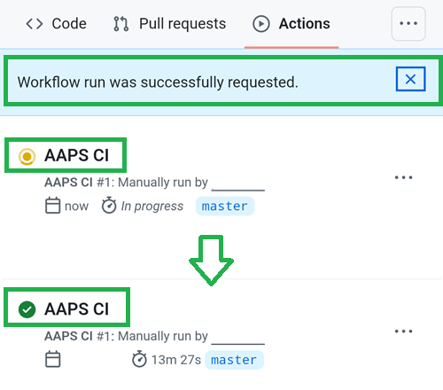

# Uppdatera med bygge i webbläsaren (fork)

```{tip}
Har du byggt AAPS med **AAPS Builder**? Då behöver du inte denna sida: se [Uppdatera AAPS med AAPS Builder](#aaps-builder-updates).
```

## Bygg själv i stället för att ladda ned

**AAPS** kan inte laddas ned, på grund av regler för medicintekniska produkter. Det är lagligt att bygga appen för eget bruk, men du får inte ge en kopia till andra! Se sidan [Vanliga frågor](../UsefulLinks/FAQ.md) för mer information.

```{note}
Om du vill uppdatera **AAPS** i webbläsaren för första gången: kopiera säkerhetskopian av din keystore-fil till din Google Drive. Följ sedan [instruktionerna för bygge av **AAPS** i webbläsaren](../SettingUpAaps/BrowserBuild.md) i stället för denna guide. I stället för att skapa en ny keystore måste du välja den som du har kopierat från din dator.
Detta behöver du bara göra första gången. Vid senare uppdateringar kan du följa denna guide.
```

```{tip}
**Byter du till AAPS Builder?** [AAPS Builder](../SettingUpAaps/BrowserBuildAapsBuilder.md) är det enklare sättet att bygga i webbläsaren: ingen fork att synkronisera, och du laddar ned appen direkt från GitHub. Du behöver inte byta: denna guide fungerar fortfarande. Om du byter, hämta först en kopia av din keystore från din fork, enligt [Om du kommer från det tidigare bygget i webbläsaren](#aaps-builder-from-fork). Annars kan det nya bygget inte uppdatera AAPS på din telefon.
```

## Översikt: uppdatera till en ny version av AAPS i webbläsaren

```{contents} Steps for updating to a new version of AAPS
:depth: 1
:local: true
```

Om du får problem, se den separata sidan [Bygge i webbläsaren: felsökning](../GettingHelp/BrowserBuildTroubleshooting.md).

### Exportera dina inställningar

Exportera dina inställningar från den **AAPS**-version som finns på din telefon nu. Du behöver dem kanske inte, men det är bättre att vara på den säkra sidan.

Se sidan [Skapa och återställa säkerhetskopior](ExportImportSettings.md) om du inte kommer ihåg hur du gör.

(Update-to-new-version-update-your-repo)=
### Uppdatera ditt repo på GitHub

[Logga in på GitHub](https://github.com/login).

1. Välj Repositories.
2. Scrolla ned och välj ditt eget AndroidAPS-repo.


3. Kontrollera att du använder din egen kopia av AndroidAPS (Forked from nightscout/AndroidAPS)
4. Tryck på Sync Fork för att uppdatera den (antalet commits som saknas kan vara ett annat än på bilden)


5. Tryck på Update Branch


Obs: om du av misstag har ändrat din kopia av AndroidAPS ser du denna skärm. Ta bort alla ändringar (commits) för att gå tillbaka till den släppta versionen.


Nu har du synkroniserat (uppdaterat) din egen kopia med den senaste versionen av **AAPS**. Bra jobbat.


### Kör arbetsflödet för att bygga den signerade APK:n

1. I din kopia av AndroidAPS på GitHub väljer du Actions.
2. Fäll ut All Workflows.
3. Välj AAPS-CI


4. Scrolla ned och tryck på Run Workflow.


5. Låt grenen vara master. Kontrollera i **Select AAPS Version** att **4.0.0**, den nyaste versionen högst upp i listan, är vald. Om din fork inte är uppdaterad är en äldre version förvald: om du kör arbetsflödet med formuläret som det öppnas bygger du om den äldre versionen, och din app uppdateras inte. Välj [variant](#browserbuild-variant) (fullRelease) och tryck sedan på Run workflow.

   ```{note}
   Listan med versioner är en del av arbetsflödet i din fork. Om **4.0.0** saknas är din fork inte synkroniserad än: gå tillbaka till [Uppdatera ditt repo på GitHub](#Update-to-new-version-update-your-repo).
   ```


6. Du ser meddelandet Workflow run was successfully requested. Uppdatera sidan i webbläsaren, så kan du följa hur bygget går. När körningen är klar visar AAPS CI en grön bock. Nu har du byggt den uppdaterade versionen av **AAPS**. Det betyder att APK:n för Master och Wear nu sparas direkt i din Google Drive (se nedan). APK:n för AAPSClient kan laddas ned från Github > nightscout > AndroidAPS [här](https://github.com/nightscout/AndroidAPS/releases)





### Installera AAPS-APK:n

1. Öppna din Google Drive
2. Gå till mappen AAPS och välj mappen för den nya versionen. Där hittar du både telefonversionen och versionen för Android Wear.


```{note}
Från september 2026 kan Googles [verifiering av Android-utvecklare](#android-developer-verification) blockera installationen av APK-filen när du trycker på filen, beroende på vilket land du bor i. Kostnadsfria sätt att komma runt detta förklaras på den sidan.
```

Fortsätt [här](#Update-to-new-version-check-aaps-version-on-phone)

(update-browser-build-troubleshooting)=

## Felsökning

Om något går fel: få inte panik.

Andas lugnt!

Kontrollera sedan om ditt problem redan är beskrivet: se [Felsökning av AAPS Builder](#aaps-builder-troubleshooting) om du bygger med **AAPS Builder**, annars [Bygge i webbläsaren: felsökning](#aaps-ci-troubleshooting).

Om du behöver mer hjälp, kontakta andra användare av **AAPS** på [Facebook](https://www.facebook.com/groups/AndroidAPSUsers) eller [Discord](https://discord.gg/4fQUWHZ4Mw).
