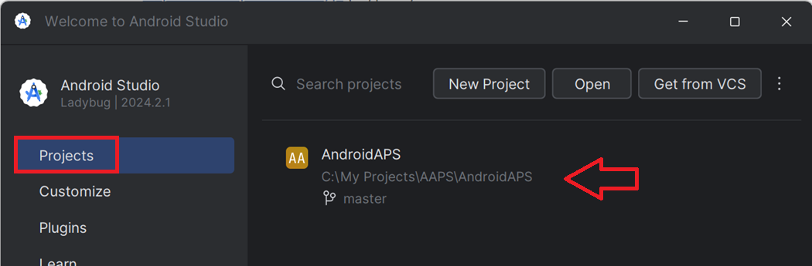

# Uppdatera med Android Studio

## Bygg själv i stället för att ladda ned

**AAPS** kan inte laddas ned, på grund av regler för medicintekniska produkter. Det är lagligt att bygga appen för eget bruk, men du får inte ge en kopia till andra! Se sidan [Vanliga frågor](../UsefulLinks/FAQ.md) för mer information.

```{note}
Om du vill bygga **AAPS** på en ny dator: kopiera säkerhetskopian av din keystore-fil till den nya datorn. Följ sedan [instruktionerna för det första bygget av **AAPS**](../SettingUpAaps/BuildingAaps.md) i stället för denna guide. Den enda skillnaden är att du, i stället för att skapa en ny keystore, kan välja den som du har kopierat till den nya datorn.
```

## Översikt: uppdatera till en ny version av AAPS med Android Studio

```{contents} Steps for updating to a new version of AAPS
:depth: 1
:local: true
```

Om du får problem, se den separata sidan [Felsökning av Android Studio](../GettingHelp/TroubleshootingAndroidStudio.md).

### Exportera dina inställningar

Exportera dina inställningar från den **AAPS**-version som finns på din telefon nu. Du behöver dem kanske inte, men det är bättre att vara på den säkra sidan.

Se sidan [Skapa och återställa säkerhetskopior](ExportImportSettings.md) om du inte kommer ihåg hur du gör.

### Kontrollera din version av Android Studio

Den lägsta version som krävs beskrivs i [bygginstruktionerna](#Building-APK-recommended-specification-of-computer-for-building-apk-file). Om din version är äldre, [uppdatera Android Studio först](#Building-APK-install-android-studio)!

(Update-to-new-version-update-your-local-copy)=
### Uppdatera din lokala kopia

* Öppna ditt befintliga AAPS-projekt i Android Studio. Du kan behöva välja ditt projekt. (Dubbel)klicka på AAPS-projektet.

  

* I menyraden i Android Studio väljer du Git -> Fetch

   

* Nere till höger ser du ett meddelande om att Fetch lyckades.

   

* I menyraden väljer du nu Git -> Pull

   

* Ändra inga alternativ (origin/master) och välj Pull

   

* Vänta medan nedladdningen pågår. Du ser information om det i fältet längst ned. När den är klar ser du ett meddelande om att det lyckades.

  ```{note}
  Vilka filer som har uppdaterats kan variera! Detta betyder inte att något är fel.
  ```

   

* Gradle Sync körs nu för att ladda ned några beroenden. Vänta tills den är klar.

  

### Kontrollera JVM-versionen

Denna kontroll är särskilt viktig om du redan har byggt en tidigare version av **AAPS** på samma dator.

Se i [bygginstruktionerna](#Building-APK-recommended-specification-of-computer-for-building-apk-file) vilken JVM-version som krävs för den **AAPS**-version som du bygger nu. Följ sedan stegen i [Inkompatibel Gradle JVM](#incompatible-gradle-jvm) för att se till att du använder rätt version.

(Update-to-new-version-build-the-signed-apk)=
### Bygg den signerade APK:n

Din källkod är nu den aktuella släppta versionen och alla förutsättningar har kontrollerats. Nu är det dags att bygga den signerade APK:n enligt [avsnittet om att bygga en signerad APK](#Building-APK-generate-signed-apk).

(Update-to-new-version-transfer-and-install)=

### Överför och installera APK:n
Du måste överföra APK:n till din telefon så att du kan installera den.

```{note}
Om du har byggt med samma keystore som tidigare i Android Studio behöver du inte ta bort den befintliga appen på telefonen. När du installerar APK:n följer du anvisningarna för att installera uppdateringen.
I andra fall, till exempel om du har skapat en ny keystore i Android Studio för din signerade APK, måste du ta bort den gamla appen innan du installerar APK:n. **Glöm inte att exportera dina inställningar!**
```

Se instruktionerna för att [överföra och installera AAPS](../SettingUpAaps/TransferringAndInstallingAaps.md). Där Googles [verifiering av Android-utvecklare](#android-developer-verification) tillämpas (från september 2026, beroende på land) installerar du med [ADB](#android-developer-verification-adb) i stället för att trycka på APK-filen.

Fortsätt [här](#Update-to-new-version-check-aaps-version-on-phone).

(update-computer-build-troubleshooting)=

## Felsökning

Om något går fel: få inte panik.

Andas lugnt!

Kontrollera sedan om ditt problem redan är beskrivet på den separata sidan [Felsökning av Android Studio](../GettingHelp/TroubleshootingAndroidStudio.md).

Om du behöver mer hjälp, kontakta andra användare av **AAPS** på [Facebook](https://www.facebook.com/groups/AndroidAPSUsers) eller [Discord](https://discord.gg/4fQUWHZ4Mw).