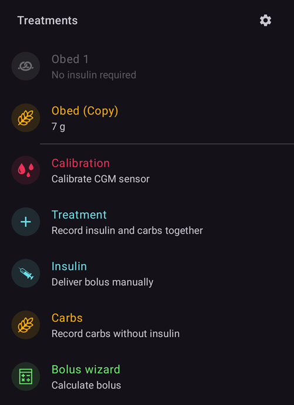
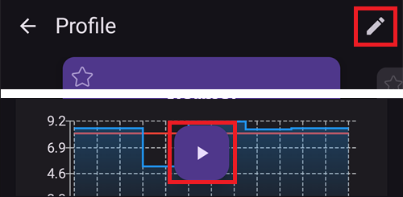

(v4-changes)=
# Vad har ändrats i AAPS v4

Här finns de viktigaste **ändringarna i beteende** mellan **AAPS** v3 och v4 – saker som fungerar på ett annat sätt, har flyttats eller har tagits bort – så att du som redan använder AAPS vet vad du kan vänta dig när du uppdaterar. Se även [Versionsinformation](ReleaseNotes.md) och [guiden för uppdatering](UpdateToNewVersion.md).

```{contents} Table of contents
:depth: 2
:local: true
```

---

## NSClient v1 har tagits bort

**AAPS** v3 hade **två** plugins för synkronisering med Nightscout:

- **NSClient** – den gamla klienten (det gamla Nightscout-API:t med REST / socket.io, även kallat *”v1”*), och
- **NSClientV3** – klienten för det nyare Nightscout **API v3**.

I **AAPS** v4 har det gamla pluginet **NSClient (v1)** **tagits bort**. Bara **NSClientV3** finns kvar för synkronisering med Nightscout.

```{admonition} What you need to do
:class: important
Om du (eller din följare i **AAPSClient**) fortfarande synkroniserade med det gamla pluginet **NSClient (v1)**, byt till **NSClientV3** före eller efter uppdateringen:

- Öppna **[Konfiguration](../SettingUpAaps/ConfigBuilder.md) → Kommunikation → NSClientV3**.
- Ange din **Nightscout-URL** och en **åtkomsttoken** (NSClientV3 använder en åtkomsttoken, *inte* den gamla API-hemligheten – se [skapa en token](https://nightscout.github.io/nightscout/security/#create-a-token)).
- Din Nightscout-webbplats måste ha stöd för **API v3** (Nightscout 15 eller nyare).
- Om du använder **websockets** ska du aktivera eller inaktivera dem på **både** huvudenheten och följaren – aldrig bara på den ena.
```

Detta påverkar bara hur appen kommunicerar med Nightscout. Dina data i Nightscout ändras inte.

---

## Den nedre navigeringen: Behandlingar, Scener och Hantera

I **AAPS** v3 rörde du dig i appen med en rad **flikar** (Översikt, Åtgärder, Behandlingar, …), och flera funktioner var **plugins** som du aktiverade i Config Builder (**Åtgärder**, **Automation**, **Mat**, …).

I **AAPS** v4 finns flikarna inte längre, och inte heller kryssrutan med ögat i Config Builder som visade ett plugin som en flik. Huvudskärmen är **Översikt**, och den **nedre navigeringen** ger dig tre paneler. **Åtgärder, Automation och Mat är inte längre plugins** – det finns inget att aktivera i [Konfiguration](../SettingUpAaps/ConfigBuilder.md) (det nya namnet på Config Builder). Deras funktioner finns nu i dessa paneler.

(v4changes-treatments)=
### Behandlingar – ange och ge

I panelen **Behandlingar** loggar eller ger du en behandling: **Kalkylator**, **Insulin** (manuell bolus), **Kolhydrater**, **Behandling** (insulin och kolhydrater tillsammans), **Kalibrering**, **CGM** (öppnar din CGM-app, om en sådan är inställd) och dina **[Snabbknappar](../DailyLifeWithAaps/QuickWizards.md)**.



På en **klocka med Wear OS** anger du samma behandlingar i klockans **AAPS-meny** (Kalkylator, eCarbs, Behandling, …):


### Scener

Dina förinställningar för olika situationer – se [Scener](../DailyLifeWithAaps/Scenes.md).

(v4changes-manage)=
### Hantera – hantera och aktivera

I panelen **Hantera** hanterar och aktiverar du allt annat: **[Profil](../DailyLifeWithAaps/ProfileSwitch-ProfilePercentage.md)**, **Insulininställningar** (dina insulinkonfigurationer), **[Tillfälligt målvärde](../DailyLifeWithAaps/TempTargets.md)**, förinställningar för **[Snabbknappar](../DailyLifeWithAaps/QuickWizards.md)**, **[Scener](../DailyLifeWithAaps/Scenes.md)**, **Automation**, **Matdatabas**, **Platsrotation**, **Pump**, **[Auktoriserade klienter](../RemoteFeatures/ClientMasterControl.md)** – och dessutom de pumpåtgärder som tidigare fanns på fliken *Åtgärder* (**Förlängd bolus**, **Avbryt tillfällig basal**, **Förfyllning**, **Sensorinsättning**, **Byte av pumpbatteri**).


Alla dina befintliga automationsregler och livsmedel i matdatabasen finns kvar. Det är bara vägen till dessa funktioner som har ändrats.

(screens-action-tab)=
#### Var tog fliken Åtgärder vägen?

**AAPS** 3.x hade fliken ”Åtgärder”. I **AAPS** 4 finns dess funktioner på andra ställen:

* **Profilbyte** och **Procent av profil**: tryck på [profilnamnet](#aaps-screens-profile--target) på huvudskärmen, eller **Hantera → Profil**. Se [Ändra procent av profilen](#ProfileSwitch-change-percentage).
* **Tillfälligt målvärde**: tryck på [målvärdet](#aaps-screens-profile--target) på huvudskärmen, eller **Hantera → Tillfälligt målvärde**.
* **Förfyllning**, **Sensorinsättning**, **BG-kontroll** och de andra Careportal-posterna: i den utfällda [statuspanelen](#aaps-screens-careportal), i **Hantera** eller som knappar i [Snabbstart](../DailyLifeWithAaps/QuickLaunch.md).
* **Historikläsare**, **Statistik** (TDD): i **menyn** (☰).

```{admonition} Profile switch and profile percentage
:class: note
I **AAPS** v3 öppnade ett långt tryck på profilnamnet dialogrutan för profilbyte (procent, varaktighet, tillfälligt målvärde för träning). I **AAPS** v4 **trycker** du på profilnamnet (eller **Hantera → Profil**) och sedan på den runda knappen **▶** längst ned till höger för att öppna samma inställningar. Se [Ändra procent av profil](#ProfileSwitch-change-percentage).
```

---

(v4changes-read-only-management)=
## Skydd för inställningar låser nu även hanteringsskärmarna

I **AAPS** v3 frågade [Skydd för inställningar](#Preferences-settings-protection) efter ditt lösenord bara när du öppnade inställningarna. Du kunde ändå lägga till eller redigera profiler på fliken **Local Profile** utan lösenord.

I **AAPS** v4 gäller Skydd för inställningar även redigering på hanteringsskärmarna: **Profil**, **Insulininställningar**, **Tillfälligt målvärde** och **Snabbknappar**. Om dina inställningar är låsta öppnas dessa skärmar **skrivskyddade**:

- Du kan bläddra bland posterna och **▶ Aktivera** eller använda dem.
- Knapparna **Lägg till / Redigera / Klona / Radera** är **dolda**. Bara **✏️ pennan** i det övre fältet visar att du kan låsa upp redigeringen.



```{admonition} What you need to do
:class: important
Om du vill lägga till, redigera, klona eller radera en post trycker du på **✏️ pennan** i det övre fältet och anger lösenordet för dina inställningar (eller använder biometri). Knapparna visas.

Om du inte behöver skydda dina inställningar kan du stänga av Skydd för inställningar i **Inställningar → Skydd**.
```

---

(v4changes-active-insulin)=
## Insulinet som används kan inte redigeras

I **AAPS** v3 kunde du när som helst ändra DIA för insulinet som du använde.

I **AAPS** v4 är insulinet som är markerat **AKTIV** i **Hantera → Insulininställningar** nedtonat: du kan inte redigera eller radera det.

När du uppgraderar behåller **AAPS** det insulin och den DIA som dina profilbyten i v3 redan har sparat. Om AAPS hittar äldre poster där insulinet är känt men inte DIA, används en standard-DIA för dem och ett meddelande visas en gång, till exempel *Äldre poster saknade insulinets verkningstid, så 9,0 timmar användes för Lyumjev. Kontrollera dina insulininställningar — redan migrerade poster uppdateras inte efteråt.* Kontrollera dina insulininställningar när du ser meddelandet.

```{admonition} What you need to do
:class: important
Om du vill ändra DIA eller topp lägger du till ett nytt insulin med **+**, justerar det, sparar det och trycker på **▶ Aktivera**. Se [Byta insulinet som används](#Config-Builder-insulin-change-active).
```

---

(v4changes-remote-control)=
## Fjärrstyrning med AAPSClient kräver parkoppling

I **AAPS** v3 styrde **AAPSClient** **AAPS** genom att skriva Careportal-behandlingar till Nightscout, och kunde inte ge en bolus.

I **AAPS** v4 **parkopplas** klienten och huvudtelefonen en gång, och varje kommando signeras. Huvudtelefonen kontrollerar och bekräftar varje kommando, och en klient kan nu även ge en bolus.

- Varje klient har en **[roll](#client-master-control-roles)** som begränsar vad den får göra.
- När klientstyrning är på är huvudtelefonen i **[härdat läge](#client-master-control-hardened-mode)**: behandlingar och ändringar som skrivs in direkt i Nightscout (på webbplatsen eller i andra appar) används inte längre.
- Varje klient får en **[egen Nightscout-token](#client-master-control-own-token)** med bara de rättigheter den behöver.

```{admonition} What you need to do
:class: important
Parkoppla varje **AAPSClient** med huvudtelefonen: se [Styrning huvudenhet ↔ klient](#client-master-control). Om huvudtelefonen har en administratörstoken visar den en QR-kod som ställer in och parkopplar klienten med en enda skanning. Om du tidigare angav behandlingar på Nightscout-webbplatsen ska du i stället ange dem på en parkopplad klient.
```

---

## Dubbla BG-data växlar nu loopen till Paus vid lågt blodsocker

När **AAPS** får samma BG-värde två gånger (en röd varningsbricka på genvägen till BG-källan i det nedre fältet), kan AAPS inte beräkna din trend på ett säkert sätt och slutar därför ge korrektionsinsulin.

I **AAPS** v3 hände detta tyst i bakgrunden: din loop visades fortfarande som **Sluten loop**, fast den inte längre kunde korrigera.

I **AAPS** v4 syns ändringen. En sluten loop växlas till läget **Paus vid lågt blodsocker**, och dialogrutan för loopen visar varför: *”LGS-läge på grund av dubblerade värden från BG-källan”*. **AAPS** kan fortfarande sänka eller pausa din basal för att skydda dig mot låga värden.

```{admonition} What you need to do
:class: important
Hitta och ta bort de dubbla värdena – se [Varningstecken för BG](#aaps-screens-bg-warning-sign).

När de är borta stannar **AAPS** i **Paus vid lågt blodsocker**. AAPS går inte tillbaka till **Sluten loop** av sig själv: tryck och håll på loopikonen och välj **Sluten loop** igen.
```

---

(v4changes-tidepool)=
## Tidepool: data visas nu under enhetsnamnet AAPS

I **AAPS** v3 visades data som laddades upp till [Tidepool](../SettingUpAaps/Tidepool.md) under ett annat enhetsnamn i Tidepool.

I **AAPS** v4 visas data under enhetsnamnet **AAPS**. Efter uppdateringen startar **AAPS** en ny datamängd i Tidepool. Dina äldre data finns kvar i Tidepool under det gamla enhetsnamnet.

```{admonition} What you need to do
:class: important
Oftast behöver du inte göra något: nya data visas helt enkelt under **AAPS**.

Kör **inte** ”**Full synkronisering**” medan de gamla data fortfarande finns i Tidepool: då skulle samma data finnas där två gånger. Om du vill ha alla dina data under det nya namnet använder du först knappen ”**Rensa all data**” på [Tidepool-skärmen](#tidepool-menu) (den raderar även de gamla data som **AAPS** har laddat upp) och kör sedan ”**Full synkronisering**”. Bara de data som fortfarande finns sparade i **AAPS** på din telefon kan laddas upp igen.
```

---


<!-- =====================================================================
     This page is a growing list of v4 behavioral changes.
     Add new changes as their own "## " section, newest grouping as agreed.
     Maintainers: relocate page + images and fix cross-links as needed.
     ===================================================================== -->
