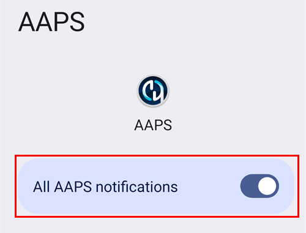
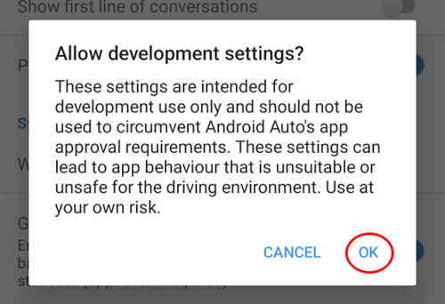
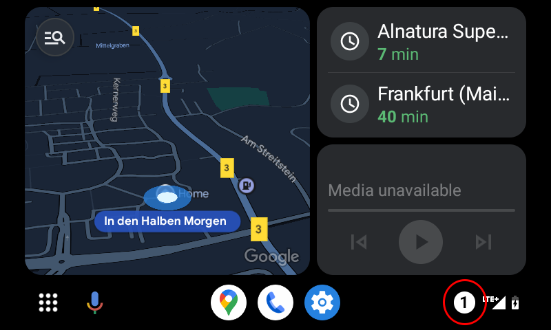

# Android Auto

**AAPS** kan skicka information om din aktuella status som ett meddelande direkt till Android Auto i din bil.

## Krav

**AAPS** använder en funktion i Android Auto som skickar meddelanden från appar på telefonen till skärmen på bilens ljudsystem.

Det betyder att:

* Android måste tillåta **AAPS** att visa aviseringar och
* Eftersom **AAPS** inte är en officiell app måste du tillåta ”okända källor” i Android Auto.

(androidauto-check-that-aaps-can-show-notifications)=

## Kontrollera att AAPS kan visa aviseringar

**AAPS** visar alltid en statusavisering med ditt aktuella glukosvärde, IOB och COB. Det är den aviseringen som Android Auto visar i bilen. Du behöver inte slå på något i **AAPS**, men Android måste tillåta **AAPS** att visa aviseringar.

Öppna **Inställningar** > **Appar** > **AAPS** > **Aviseringar** på telefonen och kontrollera att **Alla aviseringar från AAPS** är på.

Skrolla ner och kontrollera att **Pågående status** är på: det är kanalen för statusaviseringen.

Kontrollera nu att du ser statusaviseringen från **AAPS** på telefonen innan du går till bilen!

(androidauto-allow-the-use-of-unknown-sources-with-android-auto)=

## Tillåt ”okända källor” i Android Auto.

Eftersom **AAPS** inte är en officiell app för Android Auto måste aviseringar aktiveras för ”okända källor” i Android Auto. Det görs med hjälp av utvecklarläget, som vi visar här.

Gå till din bil och anslut telefonen till bilens ljudsystem.

Du ser nu en skärm som liknar den här.

Tryck på ikonen för **inställningar** för att starta konfigurationen.

Skrolla ner till slutet av sidan och välj **se mer på telefonen**.

Nu aktiverar vi utvecklarläget på telefonen.

Den första skärmen ser ut så här. Skrolla ner till slutet av sidan.

Där ser du vilken version av Android Auto du har. Tryck 10 gånger (tio gånger) på versionen av Android Auto. Med den här dolda kombinationen har du nu aktiverat utvecklarläget.

Bekräfta i dialogrutan ”Vill du tillåta utvecklarinställningar?” att du vill aktivera utvecklarläget.

Aktivera ”Okända källor” i **utvecklarinställningarna**.

Nu kan du stänga utvecklarläget om du vill. Det gör du med menyn med tre punkter uppe till höger.

## Visa aviseringar i bilen

Tryck på **sifferikonen** nere till höger i Android Auto i bilen.

Dina CGM-data visas så här:

(android-auto-troubleshooting)=

## Felsökning:

* Om du inte ser aviseringen, kontrollera att du har [tillåtit AAPS att visa aviseringar](#androidauto-check-that-aaps-can-show-notifications) i Android och att [Android Auto har behörighet till aviseringar](#androidauto-allow-the-use-of-unknown-sources-with-android-auto).