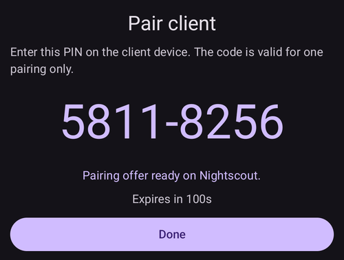
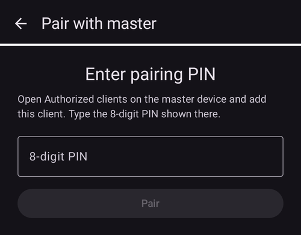
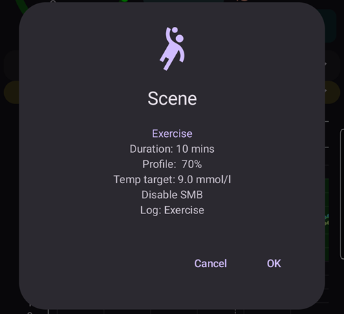

(client-master-control)=
# Styrning huvudenhet ↔ klient (signerad fjärrstyrning)

Från **AAPS** version 4 kan en följartelefon med **AAPSClient** göra mycket mer än att *meddela* behandlingar via Nightscout: när den har **parkopplats** med huvudtelefonen kan den skicka **signerade kommandon** som huvudtelefonen (**huvudenheten**) kontrollerar, bekräftar och utför — även att ge en **insulinbolus** med huvudenhetens pump.

Den här sidan förklarar hur det fungerar och hur du ställer in och använder det.

```{contents} Table of contents
:depth: 2
:local: true
```

```{admonition} Wording used on this page
:class: note
- **Huvudenhet** (master) = huvudtelefonen med **AAPS** som har pumpen och kör loopen (appen `full`).
- **Klient** = en telefon med **AAPSClient** utan pump som följer huvudenheten och nu också *styr* den.
- Båda telefonerna måste vara anslutna till **samma Nightscout**-webbplats. All kommunikation går fortfarande via Nightscout — telefonerna behöver ingen direkt anslutning till varandra.
```

---

## Hur det fungerar

```{admonition} Coming from AAPS v3?
:class: note
I **AAPS** v3 kunde **AAPSClient** bara skriva osignerade Careportal-behandlingar till Nightscout och kunde inte ge en bolus. Fjärrstyrning kräver nu en [parkoppling](#client_master_master_setup) som görs en gång. Se även [Vad har ändrats i AAPS v4](#v4changes-remote-control).
```

**AAPS** v4 använder en egen kanal för **klientstyrning** (Client-Control). Den går fortfarande via din Nightscout-webbplats (i samlingen `settings`), men varje meddelande är **kryptografiskt signerat** med en hemlighet som bara de två telefonerna känner till. Hemligheten lämnas över en gång, vid **parkopplingen**, och byts direkt efteråt ut mot en ny, så den skickas aldrig i klartext.

Grundprincipen är att **huvudenheten bestämmer**:

1. Klienten skickar en *avsikt* (”bolus 2 U”, ”starta scenen Träning”, ”ställ in det här tillfälliga målvärdet” …).
2. **Huvudenheten** räknar om och **begränsar** åtgärden utifrån sina **egna** aktuella data (profil, IOB, COB, aktuellt tillfälligt målvärde, pump) och **skriver den exakta bekräftelse** som användaren ser.
3. Klienten (eller klockan) visar **huvudenhetens** bekräftelsetext — den skapar aldrig en egen.
4. När du bekräftar **utför huvudenheten åtgärden en gång** och rapporterar resultatet tillbaka till klienten.

Vad det betyder för dig:

- **Signerade kommandon**: bara klienter som du har parkopplat kan skicka kommandon (en parkopplingshemlighet och signatur för varje klient). Gamla eller upprepade kommandon avvisas.
- **En roll för varje klient**: du bestämmer vad varje klient får göra, från *Skrivskyddad* till *Administratör* — se [Klientroller](#client-master-control-roles).
- **Insulinbolus från en klient**: huvudenheten ger den med sin pump, och klienten visar hur leveransen går.
- **Huvudenheten bestämmer**: den begränsar varje åtgärd utifrån sina egna begränsningar och skriver bekräftelsen som visas på klienten.
- **Bara parkopplade klienter ändrar behandlingen**: när klientstyrning är på tar huvudenheten inte längre emot behandlingar eller ändringar som skrivs in direkt i Nightscout — se [Härdat läge](#client-master-control-hardened-mode).
- **Varje klient får en egen Nightscout-token** med bara de rättigheter som en klient behöver — se [Klientens egen Nightscout-token](#client-master-control-own-token).
- **Huvudenheten offline**: åtgärder blockeras med ett tydligt meddelande.
- **Att återkalla en klient** kräver ett tryck (för varje klient), eller så använder du huvudenhetens brytare för att stoppa alla klienter.

Åtgärder som kan startas från en klient: **bolus**, **kolhydrater / eCarbs**, **tillfälligt målvärde** (sätta & avbryta), **profilbyte**, byte av **loop / körläge**, **tillfällig basal** (sätta & avbryta), **förlängd bolus** (sätta & avbryta), **val av insulin** och **[scener](../DailyLifeWithAaps/Scenes.md)**. En del **inställningar** hålls också synkroniserade åt båda hållen mellan huvudenheten och klienterna.

---

## Roller och förutsättningar

```{admonition} Before you start
:class: important
- **Huvudenheten** kör det vanliga `full`-bygget av **AAPS** och är ansluten till din pump.
- **Huvudenheten** använder **NSClientV3** med din Nightscout och visar *Ansluten*. Ge den en **administratörstoken** för din Nightscout: med den kan huvudenheten skapa en egen token för varje klient och visa den för klienten som en QR-kod.
- **Klienten** kör **[AAPSClient](AapsClient.md)** (eller **AAPSClient2** / **AAPSClient3** för fler personer med diabetes — se [Om AAPSClient, AAPSClient2 och AAPSClient3](#remotecontrol-aapsclient-versions)). Den måste använda **samma** Nightscout. Om du ställer in den med huvudenhetens QR-kod får klienten sin Nightscout-adress och token från huvudenheten; annars ställer du först in **NSClientV3** på den själv.
- **Websockets** behövs på båda telefonerna: kommandon når bara huvudenheten via websocket-anslutningen. När klientstyrning är på håller **AAPS** websockets påslagna, både på huvudenheten och på parkopplade klienter.
```

Parkoppling och synkronisering är två olika saker:

- **Synkronisering** (data: BG, behandlingar, profil) ställs in som tidigare — se [Synkronisering](#RemoteControl_aapsclient). Huvudenhetens QR-kod kan göra det åt dig på klienten.
- **Parkoppling** (styrning: den signerade kommandokanalen som beskrivs här) är det nya steget nedan.

---

## Ställa in

(client_master_master_setup)=
### 1. På huvudenheten — aktivera styrning och lägg till en klient

Öppna skärmen **Hantera** på huvudenheten och välj **Auktoriserade klienter**.

Slå på **Tillåt klientstyrning** (den är **av** som standard). Det här är huvudbrytaren: när den är av kan ingen klient skicka kommandon, men dina parkopplade klienter finns kvar så att du kan slå på den igen senare. När du slår på den slås även [Härdat läge](#client-master-control-hardened-mode) på. Det visas som ”*Härdat läge på*” med ett **(i)** som förklarar det. I [Enkelt läge](#preferences-simple-mode) är klientstyrning alltid på, så brytaren visas inte.


Tryck på knappen **+** (nere till höger) för att lägga till en klient. I dialogrutan **Ny klient**:

1. Ange ett **enhetsnamn** så att du känner igen den i listan.
2. Välj **hur telefonen ställs in** (se tabellen nedan).
3. Välj dess **[roll](#client-master-control-roles)**. Inget är förvalt: rätt roll beror på vem som använder telefonen.


| Sätt                                   | Vad den nya telefonen får                                                             | Använd det när                                                                                                      |
| -------------------------------------- | ------------------------------------------------------------------------------------- | ------------------------------------------------------------------------------------------------------------------- |
| **QR-kod: Nightscout och parkoppling** | Nightscout-adressen, en egen Nightscout-token och parkopplingen, med en enda skanning | den nya telefonen har en kamera: det snabbaste sättet, inget att skriva in                                          |
| **QR-kod: Endast Nightscout**          | Nightscout-adressen och en egen Nightscout-token, ingen parkoppling                   | telefonen ska bara **visa** data och aldrig skicka kommandon                                                        |
| **PIN-kod**                            | bara parkopplingen; den behåller sina Nightscout-inställningar                        | telefonen har ingen kamera (eller huvudenheten kan inte skapa token); den måste redan vara ansluten till Nightscout |

De två sätten med QR-kod kräver en **administratörstoken** i huvudenhetens inställningar för **NSClientV3**, eftersom huvudenheten skapar klientens token i Nightscout. Utan en sådan visas alternativen med QR-kod men kan inte väljas, och dialogrutan förklarar varför; **PIN-kod** fungerar alltid.

#### Med en QR-kod

Tryck på **OK**: huvudenheten skapar klientens Nightscout-token och visar en **QR-kod**. En kod som också parkopplar gäller i ungefär **två minuter**; skärmen räknar ner och stängs av sig själv när klienten har parkopplats. Skanna den på den nya telefonen enligt beskrivningen i [På klienten](#client_master_client_setup).

```{admonition} The QR code is a secret
:class: warning
Den som ser QR-koden kan läsa din Nightscout, och en kod som parkopplar innehåller också parkopplingen. Visa den bara för den nya telefonen. **AAPS** blockerar skärmbilder medan koden visas på skärmen.
```


#### Med en PIN-kod

Tryck på **OK**: huvudenheten visar en 8-siffrig **PIN-kod för parkoppling** i två grupper med fyra siffror (till exempel `1234 5678`). PIN-koden kan bara **användas en gång** och **går ut efter ungefär två minuter**. Precis som med QR-koden godtar huvudenheten inte ett klientnamn som redan finns i dess lista: varje klient får sin egen Nightscout-token under sitt namn.



```{admonition} The pairing PIN is a secret
:class: warning
PIN-koden skyddar parkopplingshemligheten som utbyts via Nightscout. Dela den bara med enheten som du parkopplar, publicera den inte och låt den gå ut om du inte använder den. Du kan alltid skapa en ny PIN-kod genom att trycka på **+** igen.
```

(client_master_client_setup)=
### 2. På klienten — parkoppla med huvudenheten

#### Skanna QR-koden

Du kan skanna huvudenhetens QR-kod på två ställen:

- i klientens **Installationsguide**, i steget ”**Ställ in från huvudenheten**”, som kommer före steget Nightscout. En enda skanning ställer då in Nightscout och, med en kod som parkopplar, även parkopplingen, så installationen är klar: guiden stängs och huvudskärmen öppnas;
- när som helst senare via **Hantera → Parkoppla med huvudenheten → Skanna QR-kod**.

Första gången ber **AAPSClient** om behörighet till **kameran**. Om du nekar visar skärmen att kameran behövs, och du kan tillåta den med **Försök igen** eller parkoppla med PIN-koden i stället.

Rikta kameran mot koden. Klienten visar vad koden gör — Nightscout-adressen och, för en kod som parkopplar, huvudenheten som den parkopplas med — och frågar ”**Använd denna kod?**”. Tryck på **Använd**: klienten slår på **NSClientV3**, ersätter sin Nightscout-adress och token med dem från koden och slår på websockets. En kod som parkopplar parkopplar också telefonen; den hälsar på huvudenheten så snart den har anslutit till Nightscout.


```{admonition} Scanning is available on Android
:class: note
A computer without camera: use the PIN there.
```

#### Ange PIN-koden

Öppna **Hantera → Parkoppla med huvudenheten** på klienten (eller steget **Parkoppla med huvudenheten** i installationsguiden, efter steget Nightscout), **ange den 8-siffriga PIN-koden** som visas på huvudenheten och tryck på **Parkoppla**. Klienten använder PIN-koden för att hämta parkopplingserbjudandet på ett säkert sätt via Nightscout, frågar sedan ”**Parkoppla med denna huvudenhet?**” och visar huvudenhetens identifierare. Tryck på **Parkoppla** för att bekräfta (se [Parkoppla med huvudenheten](#aapsclient-pairing-with-the-master) för en skärmbild).



#### Efter parkopplingen

När en klient är parkopplad skickar den ett **Hello** (hälsning) till huvudenheten och visas i huvudenhetens lista **Auktoriserade klienter** som **Aktiv**, med tiden *”Sågs senast”*. Klienten känner till sin [roll](#client-master-control-roles) från parkopplingen, så den visar rätt knappar direkt. En parkoppling som görs i installationsguiden avslutar guiden. I samma steg byter de två telefonerna ut parkopplingshemligheten mot en ny som aldrig har skickats (se [Säkerhet](#client-master-control-security)), och en klient som ställdes in med PIN-koden får en egen Nightscout-token (se [Klientens egen Nightscout-token](#client-master-control-own-token)). En klient kan vara parkopplad med **en** huvudenhet åt gången; för att parkoppla med en annan huvudenhet väljer du först **Ta bort parkoppling**.


### 3. Hantera klienter

På huvudenhetens skärm **Auktoriserade klienter** kan du när som helst:

- **Ändra rollen** för en klient med raden med fyra knappar under dess namn. Den nya rollen gäller direkt, utan att du behöver parkoppla igen.
- **Se vilken Nightscout-token** en klient skriver med: ”*Egen Nightscout-token*” är det du vill se. En röd rad ”*Använder Nightscout-token …, som har fler rättigheter än klienten behöver*” betyder att klienten fortfarande använder en token med fler rättigheter, oftast din administratörstoken — se [Klientens egen Nightscout-token](#client-master-control-own-token).
- **Återkalla** en enskild klient — tryck på ikonen **papperskorg** bredvid den. Klienten kan inte längre skicka kommandon förrän den har parkopplats igen. Dess egen Nightscout-token raderas också, så den kan inte heller längre läsa din Nightscout.
- **Stoppa all styrning** utan att förlora parkopplingarna — stäng av **Tillåt klientstyrning**.

Telefoner som har ställts in med **QR-kod: Endast Nightscout** visas under klienterna, under ”**Enbart läsning av Nightscout**”. För var och en av dem kan du visa QR-koden igen (för att ställa in samma telefon igen) eller radera dess token, vilket tar bort dess åtkomst till din Nightscout.


---

(client-master-control-roles)=
## Klientroller

Varje parkopplad klient har en **roll**. Huvudenheten kontrollerar den för varje kommando, och klienten visar bara det som dess roll tillåter. En ny roll gäller direkt, utan att du behöver parkoppla igen. Rollerna bygger på varandra: varje roll kan göra allt som rollen före den kan.

| Roll              | Klienten får                                                                                                                                                                                                                                                            |
| ----------------- | ----------------------------------------------------------------------------------------------------------------------------------------------------------------------------------------------------------------------------------------------------------------------- |
| **Skrivskyddad**  | bara visa data. Den förblir parkopplad, så den är redo när du ger den en högre roll.                                                                                                                                                                                    |
| **Måltider**      | ge en bolus, använda kalkylatorn och Snabbknapp, ange kolhydrater och stoppa en pågående bolus. Kolhydrater som anges här kan göra att loopen ger mer insulin.                                                                                                          |
| **Vårdgivare**    | göra allt som en användare gör i **AAPS**: tillfälliga målvärden, profil- och insulinbyten, loopläge, tillfällig basal, förlängd bolus, scener, Careportal-händelser, kalibreringar och borttagning av poster. Den kan inte ändra inställningar eller förinställningar. |
| **Administratör** | göra allt, även inställningar och förinställningar (Snabbknapp, förinställda tillfälliga målvärden, scener, profiler, automation, insulin).                                                                                                                             |

**(i)** högst upp på skärmen **Auktoriserade klienter** visar samma förklaring. På klienten visar **Hantera → Parkoppla med huvudenheten** telefonens egen roll.

---

(client-master-control-hardened-mode)=
## Härdat läge

När **Tillåt klientstyrning** är på är huvudenheten i **härdat läge**: den tar bara emot ändringar från parkopplade klienter. Den tar **inte** emot behandlingar, tillfälliga målvärden, profilbyten, ändringar av körläge eller borttagningar som görs direkt i Nightscout, till exempel på Nightscout-webbplatsen eller i andra appar.

- Inställningarna för att ta emot data från Nightscout (**NSClientV3 → Synkronisering**) är dolda medan härdat läge är på; **AAPS** använder dem som om de vore avstängda.
- Huvudenheten **laddar fortfarande upp** alla sina data till Nightscout, även BG, och håller **websockets** påslagna.
- Om huvudenheten får sitt **BG från Nightscout** tar den fortfarande BG därifrån.
- För att läsa in historiken på en **ny** huvudenhet använder du **Full synkronisering** i **NSClientV3**: den hämtar allt som finns i Nightscout, även profiler.
- [SMS-kommandon](SMSCommands.md) påverkas inte.

En parkopplad klient följer huvudenhetens härdade läge: den håller websockets påslagna, och samma Nightscout-inställningar är dolda på den. En klient som inte är parkopplad behåller sina egna inställningar.

[Enkelt läge](#preferences-simple-mode) slår alltid på härdat läge. För att stänga av det lämnar du Enkelt läge och stänger av **Tillåt klientstyrning** på huvudenheten.

```{admonition} Why hardened mode
:class: note
Allt som en parkopplad klient skickar är signerat, kontrollerat och bekräftat av huvudenheten. En behandling som skrivs in på Nightscout-webbplatsen är inte det: vem som helst med skrivrättighet till din Nightscout skulle kunna lägga till den. I härdat läge kan bara signerade kommandon ändra vad huvudenheten gör.
```

---

(client-master-control-own-token)=
## Klientens egen Nightscout-token

En klient behöver ingen administratörstoken. Den läser bara din Nightscout och skickar sina kommandon till huvudenheten via den; själv laddar den inte upp något. Därför ger huvudenheten varje klient en egen Nightscout-token med bara dessa rättigheter:

- läsa allt,
- skriva till samlingen `settings`, kanalen till huvudenheten,
- snooza Nightscout-larm.

Token hör till en Nightscout-roll som heter **`aaps-client`**, som huvudenheten skapar första gången den behöver den. Du kan se rollen och token (som heter `aaps-` och klientens namn) i **Admin tools** (administrationsverktyg) på din Nightscout-webbplats. Om rollen ändras där återställer huvudenheten den nästa gång den skapar en token eller när du öppnar **Auktoriserade klienter**.

Så får en klient sin token:

- **Inställd med en QR-kod**: token finns i koden.
- **Parkopplad med PIN-koden** (eller parkopplad innan den här funktionen fanns): efter parkopplingen skickar huvudenheten klientens egen token till klienten via den parkopplade kanalen, krypterad. Klienten kontrollerar först att inloggning med den fungerar och använder den sedan i stället för den token den hade. Det kräver en administratörstoken på huvudenheten; utan en sådan behåller klienten sin token, och dess kort på huvudenheten visar den röda raden.

**En klient behåller sin egen token.** När huvudenheten har sett att en klient skriver med sin egen token tar den bara emot den klientens kommandon med den token. Ett kommando som skrivs med en annan token (till exempel en administratörstoken som senare har skrivits in i klienten, eller en annan klients token) avvisas, även om klienten är parkopplad, och klienten visar ”*Huvudenheten avvisade förfrågan: den här telefonen skriver till Nightscout med en annan token än sin egen*”. Dess kort på huvudenheten visar det med rött. Klienten visas fortfarande som online, så att du kan se vad som är fel. För att rätta det tar du bort klienten på huvudenheten och lägger till den igen.

Huvudenheten raderar eller ändrar aldrig en Nightscout-token som den inte har skapat själv (en med andra roller än `aaps-client`): de är dina. Den raderar en klients egen token när du tar bort klienten.

---

## Använda fjärrstyrning

### Starta en åtgärd från klienten

Använd klienten precis som du skulle använda huvudtelefonen: öppna **Kolhydrater**, **Insulin**, **Tillfälligt målvärde**, **Profil**, **Scener**, panelen **Hantera** osv. och fyll i värdena.

När du bekräftar visar klienten kort **”Kontaktar huvudenheten…”**, **huvudenheten** beräknar och begränsar åtgärden, och klienten visar sedan **huvudenhetens egen bekräftelse** — exakt de rader, värden och färger som huvudenheten skulle visa på sin egen skärm. Granska dem och tryck på **OK** för att fortsätta.



Samma sak gäller för en enkel inmatning av kolhydrater — mängden som visas för bekräftelse är den som huvudenheten har beräknat:


När du har bekräftat utför huvudenheten åtgärden en gång och resultatet visas sedan på klienten.

### Insulinbolus från en klient

Det här är den viktigaste nya funktionen i v4. En bolus som startas på en klient **ges av huvudenheten med dess pump**; huvudenheten begränsar den utifrån sina egna begränsningar, och klienten visar **leveransen i realtid** medan den pågår (och ett larm om pumpen rapporterar ett fel).

```{admonition} Boluses are always confirmed and capped on the master
:class: note
En klient bestämmer aldrig själv vilken mängd som ges. Huvudenheten räknar om och begränsar den, du bekräftar mängden som huvudenheten har angett, och först då ges den.
```

(clientmastercontrol-when-the-master-is-offline)=
### När huvudenheten är offline

Om huvudenheten inte kan nås (telefonen är avstängd/i viloläge, inte ansluten till Nightscout eller websockets fungerar inte) **blockeras styråtgärder på klienten innan något skickas**, och du får ett tydligt meddelande. Inget blir halvvägs utfört.


Klienten kontrollerar automatiskt igen om huvudenheten kan nås och aktiverar styrningen igen när huvudenheten är online igen.

(clientmastercontrol-wear-os-on-a-client)=

### Wear OS (klocka) på en klient

En klocka som är parkopplad med en **klient**telefon skickar sina åtgärder via klienten till huvudenheten (klocka → klient → huvudenhet). Klockan visar **huvudenhetens** bekräftelserader och det verkliga resultatet, precis som telefonen. Klockan ställs in på samma sätt som tidigare — se [Wear OS](../WearOS/WearOsSmartwatch.md).


<!-- 📷 SCREENSHOT NEEDED (optional): watch confirmation screen relayed from the master,
     and/or the "Contacting master" state on the watch. Requires a paired Wear OS device. -->

---

(client-master-config-prefs)=
## Ändra konfiguration och inställningar

Parkopplingen gör mer än att skicka vidare enstaka åtgärder — den håller också **konfigurationen** och många **inställningar** lika mellan huvudenheten och dess klienter.

### Konfiguration (vilka plugins som är aktiva)

De aktiva **plugins** (APS-algoritm, känslighet, utjämning …) väljs på **huvudenheten** och **speglas** till varje parkopplad klient. På en klient är dessa val markerade med en liten **mobilikon** på skärmen [Konfiguration](#configuration_sync_icon) — ändra dem på huvudenheten så följer klienterna automatiskt, och tvärtom.

På en klient visas mobilikonen vid *Utjämning*, *Kalibrering*, *Känslighetsdetektering* och *APS* (synkroniseras från huvudenheten), men inte vid *Kommunikation*:


Anslutningsuppgifter som är unika för varje enhet — framför allt **NSClient Nightscout-URL / åtkomsttoken** — synkroniseras *inte*. Varje telefon har sina egna; på en klient kommer de från huvudenhetens QR-kod, eller så ställer du in dem själv.

### Profiler

Din **profillista** hålls också synkroniserad mellan huvudenheten och dess parkopplade klienter. På en parkopplad klient visar **Hantera → Profil** samma profiler som huvudenheten; du kan **redigera** en profil eller **aktivera** en, och — precis som alla andra kommandon — skickas ändringen till **huvudenheten**, tillämpas där och synkroniseras tillbaka.

Första gången du aktiverar en profil på en nyinstallerad klient kan klienten visa ”*Inget insulin används än*” och be dig att **välja insulin**. Välj det insulin som är aktivt på huvudenheten (**Hantera → Insulininställningar** på huvudenheten visar det).

På en klient som **inte är parkopplad** finns skärmen Profil fortfarande, men den är **skrivskyddad**: klienten visar profilerna som den tar emot via Nightscout (den behöver dem för sina egna beräkningar), men det finns ingen knapp för att redigera eller aktivera — det finns ingen huvudenhet att skicka ändringen till.

### Preferences

En del **inställningar** är **dubbelriktade**: du kan ändra dem på **huvudenheten eller på en parkopplad klient**, och ändringen synkroniseras till den andra sidan. När du ändrar en sådan inställning på en klient skickas den till huvudenheten via den signerade kanalen, tillämpas där, och det gällande värdet skickas tillbaka — så det du ser på klienten är alltid det som huvudenheten har sparat. Om samma inställning ändras på två enheter nästan samtidigt **gäller den senaste ändringen**. För en inställning med ett skjutreglage skickas det nya värdet när du lyfter fingret.

Inne i inställningarna markerar samma lilla **mobilikon** de enskilda inställningar som synkroniseras. I exemplet nedan synkroniseras *Absorptionsgräns* (mobilikon), medan inställningar utan ikonen bara gäller på enheten:


```{admonition} The master must be online to change synced settings from a client
:class: note
Eftersom huvudenheten bestämmer det sparade värdet måste huvudenheten **kunna nås** när du ändrar en konfiguration som styrs av huvudenheten eller en dubbelriktad inställning från en klient. När huvudenheten är offline är de kontrollerna inaktiverade på klienten (se [När huvudenheten är offline](#clientmastercontrol-when-the-master-is-offline)).
```

---

(client-master-control-security)=
## Säkerhet

```{admonition} How the channel is protected
:class: tip
- **Parkopplingshemlighet**: huvudenheten lämnar över den till klienten en gång — skyddad av PIN-koden i ett Nightscout-dokument, eller inne i QR-koden — och båda sparar den krypterad.
- **En ny hemlighet direkt efter parkopplingen**: klientens första meddelande efter parkopplingen startar ett nyckelutbyte, och från och med då använder båda telefonerna en hemlighet som aldrig har skickats. En hemlighet som någon kan ha sett (en fotograferad QR-kod, ett PIN-erbjudande som har lästs från Nightscout) är inte till någon nytta efteråt. Telefoner som parkopplades innan den här funktionen fanns gör samma sak en gång efter uppdateringen.
- **Varje kommando är signerat** (HMAC). Huvudenheten avvisar allt vars signatur inte stämmer med en parkopplad klient.
- **Upprepade kommandon (replay) förhindras** med en räknare för varje klient som bara kan öka, och varje kommando **går ut** efter en kort livslängd (time-to-live).
- **Minsta möjliga rättigheter i Nightscout**: varje klient har en [egen Nightscout-token](#client-master-control-own-token) som bara kan läsa och skriva till kanalen för klientstyrning. När klienten har använt den tar huvudenheten bara emot dess kommandon med den token. När klienten tas bort raderas den.
- **Bara signerade ändringar**: i [härdat läge](#client-master-control-hardened-mode) ignorerar huvudenheten ändringar av behandlingen som skrivs in direkt i Nightscout.
- **Huvudenheten signerar det den delar**: inställningarna, klientlistan och tecknet ”huvudenheten är aktiv” som huvudenheten lägger i Nightscout för sina klienter har huvudenhetens signatur. En klient tar bara emot dem när signaturen är huvudenhetens, så en annan klients token kan inte ändra dem. Klienten får huvudenhetens nyckel när den parkopplas, eller från QR-koden för en telefon som bara läser Nightscout. Ett avvisat dokument visas i NSClient-loggen som ”*✕ SETTINGS … refused*”.
- **Du har kontrollen**: ge varje klient den [roll](#client-master-control-roles) den behöver, återkalla en klient med ett tryck eller stäng av allt med **Tillåt klientstyrning**.
```

```{admonition} After restoring a backup
:class: warning
Om en klient återställs från en säkerhetskopia som flyttar dess kommandoräknare bakåt kommer huvudenheten att avvisa dess nästa kommandon som upprepningar. **Ta bort parkopplingen och parkoppla igen** för att lösa det.
```

---

(client-master-control-troubleshooting)=

## Felsökning

| Symptom                                                                                                                      | Vad du ska kontrollera                                                                                                                                                                                                                                                                                                                                                |
| ---------------------------------------------------------------------------------------------------------------------------- | --------------------------------------------------------------------------------------------------------------------------------------------------------------------------------------------------------------------------------------------------------------------------------------------------------------------------------------------------------------------- |
| Klienten säger att **huvudenheten är offline**                                                                               | Huvudtelefonen är vaken och kör **AAPS**; båda telefonerna är anslutna i **NSClientV3**; **websockets** är aktiverade på båda; samma Nightscout-webbplats.                                                                                                                                                                                                            |
| Klienten säger att den **inte är parkopplad**                                                                                | Parkoppla igen via **Hantera → Parkoppla med huvudenheten**. Kontrollera att klienten är **Aktiv** i huvudenhetens lista **Auktoriserade klienter**.                                                                                                                                                                                                                  |
| Kommandot **avvisas** av huvudenheten                                                                                        | Huvudenheten kontrollerar igen mot sitt aktuella läge — t.ex. finns den valda profilen inte längre, eller så stämmer inte pumptypen. Kontrollera igen på huvudenheten.                                                                                                                                                                                                |
| Kommandon fungerar men är **långsamma**                                                                                      | Aktivera **websockets** på båda telefonerna (annars går apparna över till långsammare regelbunden hämtning).                                                                                                                                                                                                                                                          |
| Parkopplingen avbryts med *”Parkopplingshemligheten kunde inte sparas”*                                                      | Inget har ändrats. Starta parkopplingen igen; om det fortsätter att misslyckas, starta om **AAPSClient** och försök en gång till.                                                                                                                                                                                                                                     |
| Inget händer efter parkopplingen                                                                                             | Kontrollera att **Tillåt klientstyrning** är PÅ på huvudenheten och att huvudenheten är ansluten till Nightscout.                                                                                                                                                                                                                                                     |
| Alternativen med QR-kod kan inte väljas i dialogrutan **Ny klient**                                                          | Dialogrutan förklarar varför. *Inte en administratörstoken*: ge huvudenheten en administratörstoken för din Nightscout, eller lägg till klienten med **PIN-kod**. *Inte ansluten*: vänta tills huvudenheten visar *Ansluten* i **NSClientV3**.                                                                                                                        |
| *”Nightscout har en token med detta namn och andra rättigheter”*                                                             | En av dina egna Nightscout-token heter `aaps-` plus det här namnet. Välj ett annat namn för klienten.                                                                                                                                                                                                                                                                 |
| *”En klient med detta namn finns redan i listan”*                                                                            | Välj ett annat namn, eller ta bort den klienten först.                                                                                                                                                                                                                                                                                                                |
| Klienten säger *”Denna kod är från en annan AAPS-version”*                                                                   | Huvudenheten och klienten måste köra **samma** version av **AAPS**. Uppdatera den äldre.                                                                                                                                                                                                                                                                              |
| Klienten säger *”Denna kod har löpt ut”*                                                                                     | En kod som parkopplar gäller i ungefär två minuter. Lägg till klienten igen på huvudenheten för att få en ny kod.                                                                                                                                                                                                                                                     |
| Klienten säger *”Den här telefonen är redan parkopplad”*                                                                     | Ta först bort parkopplingen (**Hantera → Parkoppla med huvudenheten → Ta bort parkoppling**) och skanna sedan igen. En kod för **Endast Nightscout** fungerar också på en parkopplad telefon.                                                                                                                                                                         |
| Klienten säger *”Huvudenheten avvisade förfrågan: den här telefonen skriver till Nightscout med en annan token än sin egen”* | Klienten använde sin egen Nightscout-token tidigare och skriver nu med en annan, till exempel efter att en token har skrivits in i dess Nightscout-inställningar. Ta bort klienten på huvudenheten och lägg till den igen (se [Klientens egen Nightscout-token](#client-master-control-own-token)).                                                                   |
| NSClient-loggen på klienten visar *”✕ SETTINGS … refused”* och klientens inställningar följer inte längre huvudenheten       | Någon annan har skrivit huvudenhetens inställningsdokument, eller så har huvudenheten en ny nyckel (till exempel efter att dess data har rensats). En parkopplad klient tar själv emot en ny nyckel nästa gång den ansluter till Nightscout. En telefon som bara läser Nightscout behöver huvudenhetens QR-kod igen (**Enbart läsning av Nightscout → Visa QR-kod**). |
| Klientens kort visar *”Använder Nightscout-token …”* med rött                                                                | Klienten skriver fortfarande med en token som har fler rättigheter än den behöver. Huvudenheten skickar klientens egen token efter parkopplingen, men bara om huvudenheten har en administratörstoken. Kontrollera huvudenhetens token, eller ställ in klienten igen med en QR-kod.                                                                                   |
| En klient kan inte längre läsa Nightscout                                                                                    | Dess token har raderats, till exempel för att klienten har tagits bort på huvudenheten. Lägg till den igen.                                                                                                                                                                                                                                                           |
| Behandlingar som anges på Nightscout-webbplatsen tillämpas inte                                                              | Det är väntat i [härdat läge](#client-master-control-hardened-mode): ange dem på en parkopplad klient i stället.                                                                                                                                                                                                                                                      |

För problem med Nightscout / synkronisering, se först [Felsökning av NSClient](../GettingHelp/TroubleshootingNsClient.md).

---


<!-- =====================================================================
     SCREENSHOTS STILL TO ADD:
       1. (optional) Wear OS confirmation relayed from the master
     Already included:
       - authorized_clients_master.png       (master: Allow client control, hardened mode, client card, + button)
       - authorized_clients_roles.png        (master: client card with roles, Read Nightscout only section)
       - new_client_master.png               (master: New client dialog, three ways and role row)
       - qr_code_master.png                  (master: pairing QR code with countdown, code blurred; console screenshot)
       - aapsclient_wizard_from_master.png   (client: Set up from the master wizard step)
       - pair_with_master_unpaired.png       (client: pairing screen, unpaired PIN entry)
       - pairing_pin_master.png              (master: one-time pairing PIN — expired demo PIN)
       - pair_with_master_client.png         (client: pairing screen, paired state)
       - confirmation_master_authored.png    (client: master-authored scene confirmation)
       - carbs_confirmation_client.png       (client: master-authored carbs confirmation)
       - master_offline_error.png            (client: master-offline message)
     Maintainers: relocate page + images and fix cross-links as needed.
     ===================================================================== -->
