# Följa AAPS (utan att påverka AAPS-systemet)

Utöver de många möjligheterna att fjärrstyra _och_ följa **AAPS** som beskrivs under [fjärrstyrning](../RemoteFeatures/RemoteControl.md), har communityn tagit fram flera andra appar och enheter för att bara följa värden (glukosnivåer och annan information), utan att påverka **AAPS**.

En bra översikt över de många möjligheterna att följa **AAPS** finns på webbsidan [Nightscout follower](https://nightscout.github.io/nightscout/downloaders/#).

```{contents} Table of contents
:depth: 1
:local: true
```

De vanligaste sätten som används tillsammans med **AAPS** förklaras mer i detalj nedan.

## Appar för smarttelefoner

```{contents} These are some of the main “follower” apps used by **AAPS** users. All of these apps are “free”: 
:depth: 1
:local: true
```

### Dexcom Follow ([Android](https://play.google.com/store/apps/details?id=com.dexcom.follow.region2.mgdl) och [iOS](https://apps.apple.com/fr/app/dexcom-follow-mg-dl-dxcm2/id1032203080))

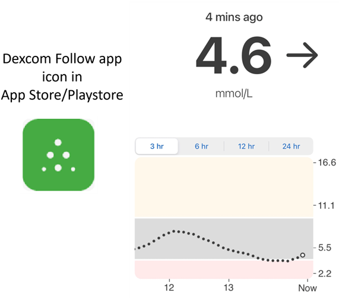

* Dexcom Follow fungerar på många olika telefoner (både Android och iPhone). Dexcom Follow kan användas även om du inte använder den officiella Dexcom-appen för att ta emot sensordata.

* Många anhöriga känner till Dexcom Follow och föredrar dess tydliga gränssnitt framför något mer komplicerat.

* Dexcom Follow passar mycket bra för lärare, morföräldrar och farföräldrar och personer som vet mycket lite om diabetes och blodsockernivåer. Den har anpassningsbara larm (BG-nivå, vilket ljud som ska spelas upp osv.). Larmen kan stängas av helt vid behov. Det är mycket användbart om du har en sensor som fortfarande håller på att stabiliseras och ger många falskt låga värden.

#### Ställa in Dexcom Follow: steg-för-steg-guide

Om du använder den inofficiella Dexcom-appen BYODA för att ta emot sensordata kan du kanske skicka inbjudningar till följare direkt från BYODA-appen.

Det går inte längre att skicka inbjudningar via e-post till Dexcom-följare från appar från tredje part. I xDrip leder en begäran om inbjudan bara till meddelandet ”invite not sent”.

Du måste installera den officiella Dexcom-appen, skicka inbjudan och sedan avinstallera den officiella appen.

Så här gör du:

1)  Installera den officiella appen ”Dexcom” på _valfri_ smarttelefon (Android/iPhone). Det kan vara följartelefonen, om det är enklare. 2)  Logga in med ditt användarnamn och lösenord för Dexcom. Det är samma inloggning som du använder för Dexcom Clarity, om du redan är kund hos Dexcom/Clarity. Om du inte har någon Dexcom-inloggning kan du skapa en ny inloggning här.   
3)  Svep igenom introduktionsmenyerna. 4)  Ange ”no code” som sensorkod. 5)  Under Transmitter SN väljer du ”enter manually” och anger en giltig sändarkod (använd koden från en av dina gamla sändare om du har en, så att den inte stör din nuvarande sändare. Koderna följer ett visst format med siffror och bokstäver: ”NLNNNL”, och bara vissa kombinationer är giltiga, så det är enklast att använda en kod som du vet är giltig). 6)  När appen försöker hitta sändaren och sensorn kan du bjuda in följare: välj de tre små prickarna uppe till vänster i appen och lägg till en ny följare. Du kan också använda detta om en av dina följare har bytt telefon och behöver en ny inbjudan. Här kan du ta bort följaren från listan och skicka en ny inbjudan via e-post, som följaren kan använda på sin nya telefon. 7)  Installera Dexcom Follow på följartelefonen. Ladda ned appen från App Store (iPhone) eller Play (Android). Ställ in appen Dexcom Follow. Du blir då ombedd att öppna din e-post och leta upp inbjudan att bli följare.    
8)  Nu kan du ta bort den officiella Dexcom G6-appen.

För Dexcom Follow exporteras sedan sensordata från **AAPS**-telefonen, antingen direkt från BYODA eller från xDrip, beroende på vilken app du använder.


### [Nightguard](https://apps.apple.com/fr/app/nightguard/id1116430352) (iOS)

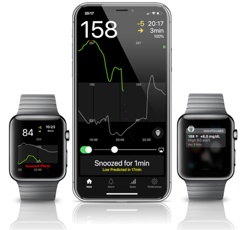

Fördelar (enligt användare):

* Finns i [App Store](https://apps.apple.com/us/app/nightguard/id1116430352). Enkelt och lättanvänt gränssnitt.

* Svep på knappen eller skaka telefonen för att snooza larm i olika intervall, från 5 min till 24 timmar

* Anpassa larm (varningar för högt och lågt, uteblivna värden när data saknas i 15–45 minuter).

* Snabb ökning/minskning över 2–5 värden i rad (du väljer). Du kan också välja deltat mellan två enskilda värden

* Smart snooze, så att appen inte larmar om nivåerna rör sig åt rätt håll

* Det finns en flik Care som verkar låta dig ställa in ett nytt tillfälligt målvärde under en viss tid, ta bort det tillfälliga målvärdet eller ange kolhydrater.

Nackdelar (enligt användare)

* Finns bara för iOS

* Det tillfälliga målvärdet (TT) visas som 5 mmol oavsett vilken nivå som är inställd

* Visar aldrig tillfällig basaldos, trots att den visar TB

### [Nightwatch](https://play.google.com/store/apps/details?id=se.cornixit.nightwatch) (Android)

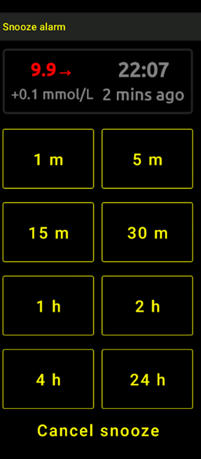


* Nightwatch beskriver sig själv som en Nightscout-klient. Den övervakar användarens glukosnivåer i Nightscout på en Android-telefon eller surfplatta.

* Appen kan laddas ned från [Google Play](https://play.google.com/store/apps/details?id=se.cornixit.nightwatch) och visar BG-data i realtid.

* Användaren kan få larm med anpassade, ljudliga larm för lågt och högt.

* BG-data kan visas antingen i mmol/l eller mg/dl.

* Den kräver Android 5.0 eller senare.

* Den har ett mörkt gränssnitt med stora värden och knappar, gjort för användning på natten.

### xDrip (Android)

Du kan använda xDrip som följare.

#### Med Nightscout

Ställ in xDrip som Nightscout-följare (Nightscout Follower). Du får BG och behandlingar, men inte basal.

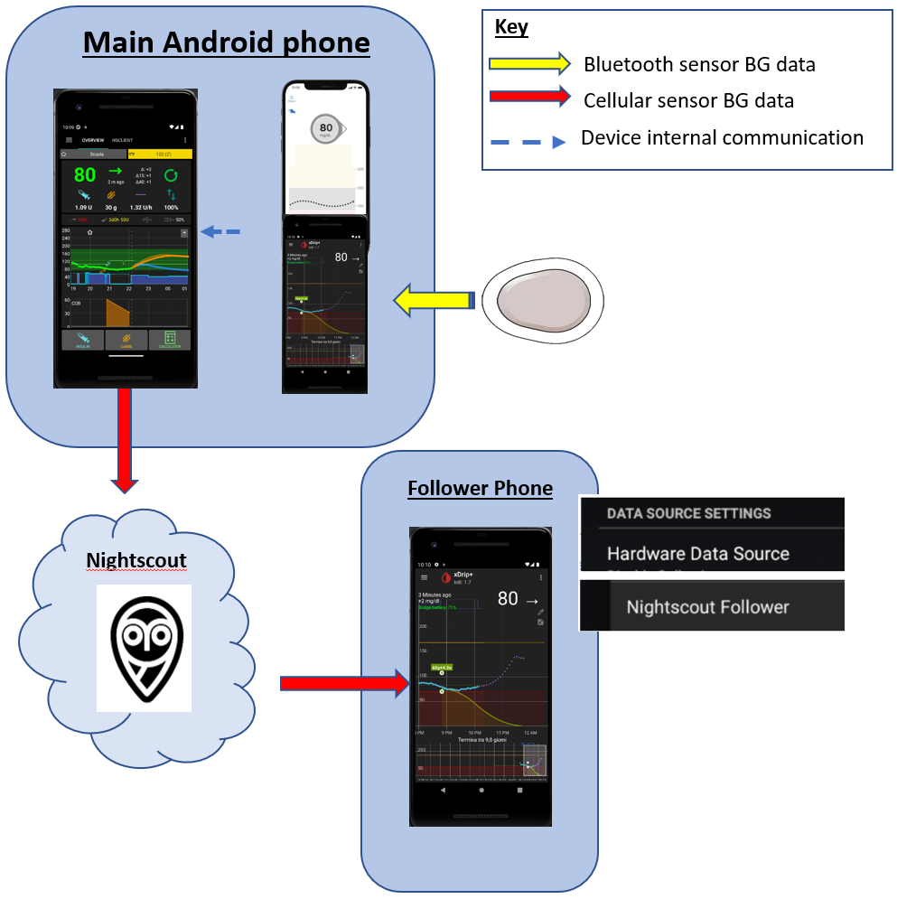

#### Utan Nightscout – xDrip som BG-källa

Om din BG-källa i **AAPS** är xDrip (eller om xDrip också kan ta emot BG från en annan app som BYODA, Juggluco ...) kan du använda den på huvudtelefonen för att dela data med xDrip-följare. De ser då BG, behandlingar och basaldoser.

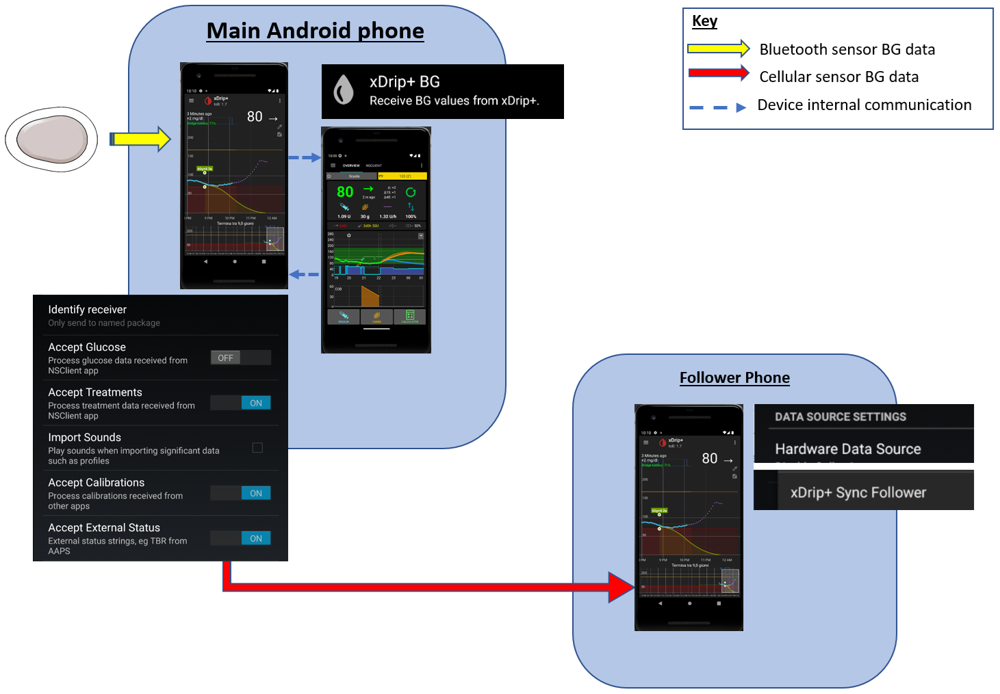

#### Utan Nightscout – xDrip som följeslagarapp för BG (Companion App)

Om din BG-källa i **AAPS** inte är xDrip, men du kan visa BG-data från datakällan Companion App, kan du använda den på huvudtelefonen för att dela data med xDrip-följare. De ser då BG, behandlingar och basaldoser.

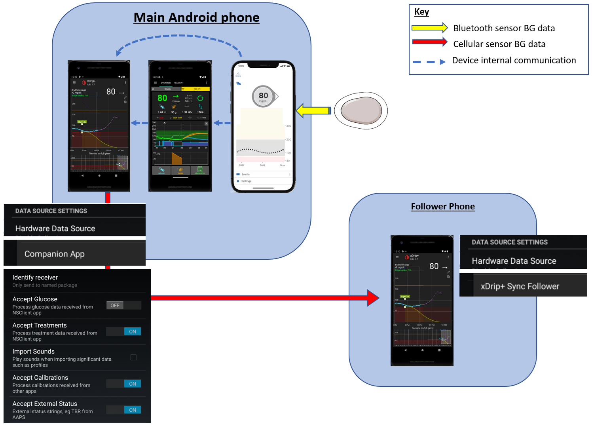

### xDrip4iOS (iOS)


xDripSwift skapades genom att den ursprungliga xDrip-appen fördes över till iOS. Den utvecklades sedan till ”xDrip for iOS”, som skrivs **xDrip4iOS**.

```{admonition} Further detail about how to attempt to obtain the original **xDrip4iOS** app
:class: dropdown
[Facebookgruppen för xDrip4iOS](https://www.facebook.com/groups/853994615056838/announcements) är den viktigaste platsen för hjälp från communityn för xDrip4iOS och Shuggah. **xDrip4iOS** kan ansluta till många olika CGM-system och sändare och visa blodsockervärden, grafer och statistik. Den kan också ge larm. Den kan också ladda upp till Nightscout eller fungera som [följarapp för Nightscout](https://xdrip4ios.readthedocs.io/en/latest/connect/follower/). 

”Hur får jag **xDrip4iOS** på min iPhone?”
Det finns två alternativ:

1. Om du har en Mac och ett Apple Developer-konto (99 EUR/USD per år) kan du bygga din egen xDrip4iOS genom att [följa instruktionerna](https://xdrip4ios.readthedocs.io/en/latest/install/build/).

Om du vill kan du sedan bli ”releaser” och [dela en personlig Testflight-version av xDrip4iOS](https://xdrip4ios.readthedocs.io/en/latest/install/personal_testflight/) med upp till 100 andra personer för att hjälpa dem.

2. Gå med i [Facebookgruppen för xDrip4iOS](https://www.facebook.com/groups/853994615056838/announcements) och läs de fästa inläggen för att se hur du får appen just nu. **Be inte om en inbjudan till appen** (läs gruppens regler).
```


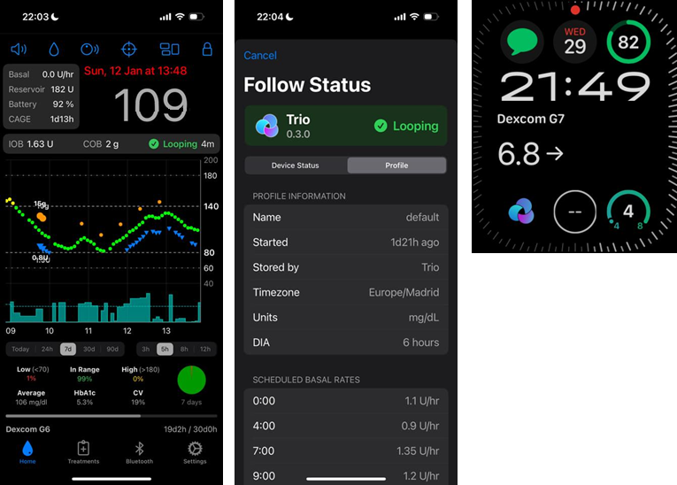

”Vad är **Shuggah**?” En grupp ukrainska utvecklare kopierade koden för xDrip4iOS (som är offentligt delad på GitHub) och släppte den i App Store under ett företagskonto. Shuggah-versionen hanteras inte på något sätt av utvecklarna av xDrip4iOS.

[Facebookgruppen för xDrip4iOS](https://www.facebook.com/groups/853994615056838/announcements) ger support för xDrip4iOS och de tillhörande apparna för Apple Watch.

### [Sugarmate](https://apps.apple.com/fr/app/sugarmate/id1111093108) (iOS)

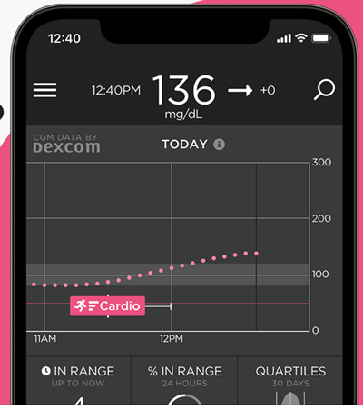

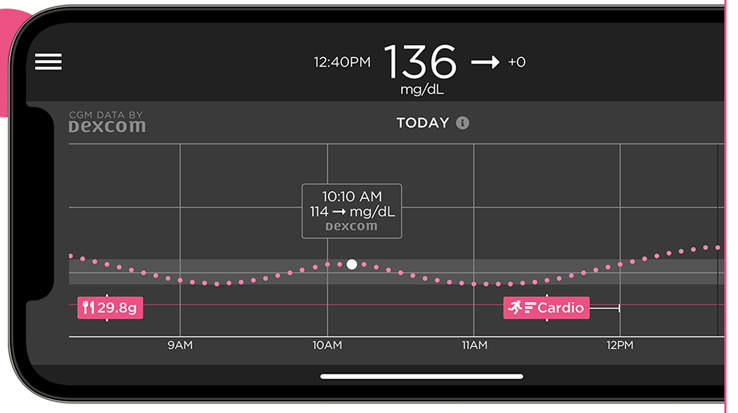


[Sugarmate](https://sugarmate.io/) kan laddas ned till iPhone från App Store. Sugarmate fungerar med:
* Apple iPhone (kräver programvaruversion 13.0 eller senare)
* Apple iPad (kräver programvaruversion 13.0 eller senare)
* Google Android (spara webbappen på hemskärmen)

Användare av Sugarmate har rapporterat att den kan användas med Apple CarPlay i USA för att visa glukosvärden under bilkörning. Det är ännu inte känt om detta fungerar i andra länder än USA. Om du vet mer om detta, lägg gärna till information här i dokumentationen genom att skapa en [pull request](../SupportingAaps/HowToEditTheDocs.md). Det går snabbt och är enkelt.


### [Spike](https://spike-app.com/) (iOS)

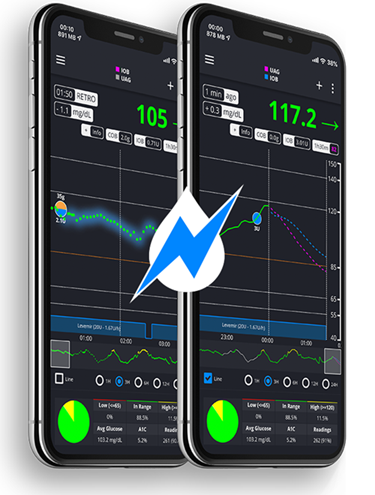

Spike kan användas som huvudmottagare eller som följarapp och visar BG, larm, IOB med mera.

Webbplatsen och appen utvecklas inte längre. Du kan få hjälp på [Facebook](https://www.facebook.com/groups/1973791946274873) och [Gitter](https://gitter.im/SpikeiOS/Lobby).

## Smartklockor för **övervakning av AAPS** (alla profildata eller bara glukos) när **AAPS** körs på en telefon.

Se [här](../Getting-Started/Watches.md).


## Enheter för att följa AAPS

```{contents} Devices include:
:depth: 1
:local: true
```

### M5Stack

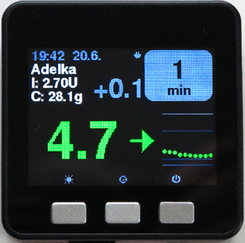

M5Stack är en liten låda som kan programmeras för många olika ändamål. Martins projekt [M5Stack NightscoutMon](https://github.com/mlukasek/M5_NightscoutMon/wiki) visar sensorns glukosvärden och trender, IOB och COB. Den sitter i en plastlåda och har en färgskärm, plats för micro SD-kort, 3 knappar, högtalare och ett inbyggt batteri. Det är en utmärkt blodsockermonitor och den är relativt enkel att ställa in om du har ett Nightscout-konto. Användare kör den oftast via sitt Wi-Fi hemma, men vissa använder den som display på motorcykeln genom att ansluta den till en Wi-Fi-surfzon i telefonen.

### SugarPixel

SugarPixel är en extra skärm med larm för kontinuerlig glukosmätning (CGM). Den ansluter till Dexcom-appen eller Nightscout-appen på användarens smarttelefon. Enheten visar blodsockervärden i realtid. Denna CGM-monitor har ljudlarm med slumpvisa toner (som är extremt höga), vibrationslarm för personer med nedsatt hörsel, anpassningsbara visningsalternativ och inbyggt stöd för flera följare.

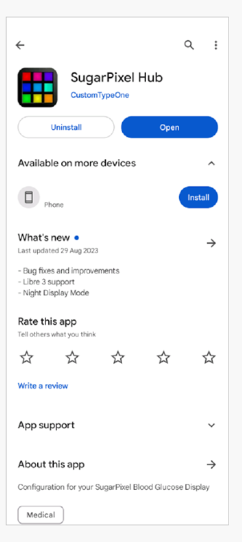

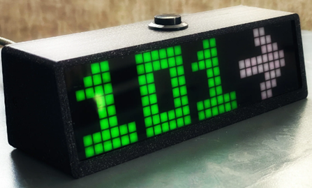

* SugarPixel har flera visningsalternativ i mg/dl och mmol/l som passar användarens behov, med färgkodade glukosvärden.
* Standardvyn visar BG, trendpil och delta. Delta är ändringen (+ eller -) sedan föregående värde.
* SugarPixel kan anpassas för svagt ljus med vyn BG and Time, som visar användarens BG-värde och aktuell tid på nattduksbordet.
* SugarPixels färgvy använder hela skärmen för att visa en enda färg som motsvarar BG-värdet. Användaren kan då se BG-värden på avstånd genom fönstret, till exempel när barnet leker ute på gården, på uteplatsen eller i poolen.
* Vyn Big BG är användbar på nattduksbordet för den som använder glasögon eller kontaktlinser.

### Nightscout Clock på Ulanzi TC001

**Nightscout Clock** är programvara med öppen källkod som körs på enheten **Ulanzi TC001**. Den ansluter till Dexcoms servrar eller till Nightscout och visar blodsockervärden i realtid.

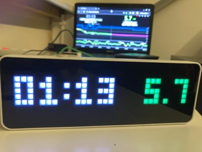

* Klockan stöder både mmol/l och mg/dl och har ljudlarm.
* Flera vyer finns, se [Github nightscout-clock](https://github.com/ktomy/nightscout-clock?tab=readme-ov-file#more-information-for-people-who-needs-it) för en översikt.
* Det krävs bara några enkla steg för att ställa in och konfigurera enheten. När den väl är inställd behöver den bara ström och Wi-Fi för att fungera.
* Enheten Ulanzi TC001 är mycket billigare att köpa än SugarPixel.
* Programvaran och installationsanvisningar finns på [Github nightscout-clock](https://github.com/ktomy/nightscout-clock?tab=readme-ov-file).
* Den utvecklas och underhålls av Artiom Kenibasov, som ger support i [Facebookgruppen för AAPS-användare](https://www.facebook.com/groups/cgminthecloud/posts/8776932509094594/).

### PC (TeamViewer)
Vissa användare tycker att ett verktyg för full fjärråtkomst, som [TeamViewer](https://www.teamviewer.com/), är till hjälp vid avancerad felsökning på distans.
