# Fjärrstyrning av AAPS

```{contents} In this page
:backlinks: entry
:depth: 2
```

Det finns fyra mycket effektiva verktyg för att hantera **AAPS** på distans:

1) [SMS commands](#RemoteControl_SMS-Commands) (follower phone can be either Android or iOS), 2) [AAPSClient](#RemoteControl_aapsclient) (follower device is an Android phone or tablet, or a Windows, Mac or Linux computer; on an iPhone you [build the app yourself](#aapsclient-iphone)) 3) [Nightscout](#RemoteControl_nightscout) (Android, iOS or other computer/device), mainly for following: see the note on [client control](#client-master-control) in that section.  
4) [Smartwatches](#RemoteControl_smartwatches) (Android)

De tre första passar främst för anhöriga/föräldrar, men smartklockor är mycket användbara för anhöriga/föräldrar **och** för vuxna med diabetes själva.

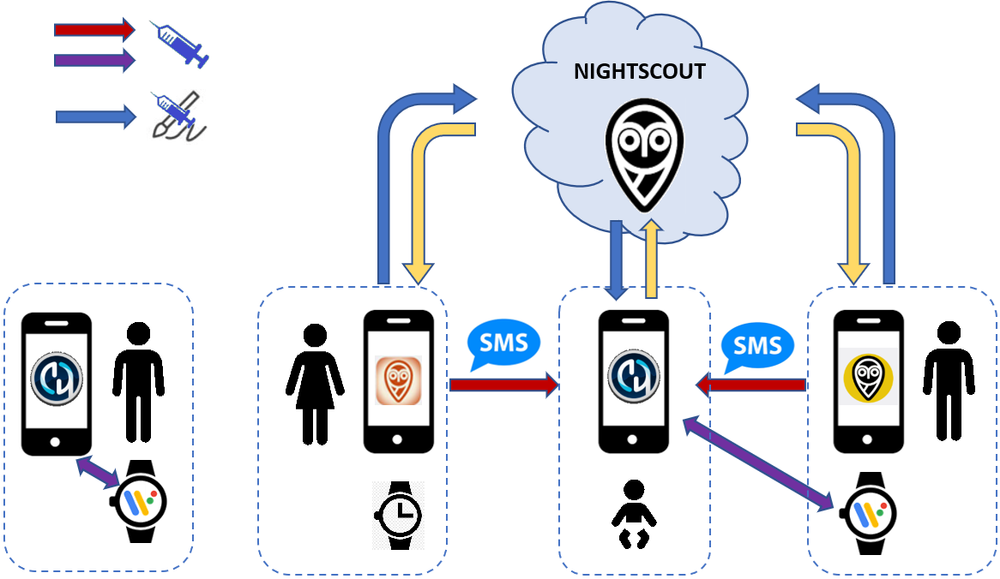

(RemoteControl_SMS-Commands)=

## 1) SMS-kommandon

Se sidan [SMS-kommandon](../RemoteFeatures/SMSCommands.md).

(RemoteControl_aapsclient)=
## 2) AAPSClient

**AAPSClient** ser ut nästan som **AAPS** och ger den anhöriga samma skärmar och knappar för att skicka kommandon till **AAPS** på distans:


(remotecontrol-aapsclient-versions)=
### Om AAPSClient, AAPSClient2 och AAPSClient3

Det finns 3 versioner av klientappen: **AAPSClient**, **AAPSClient2** och **AAPSClient3**. De fungerar på samma sätt. Den enda skillnaden är att de kan installeras sida vid sida på samma följartelefon.

En anhörig som följer en person behöver bara **AAPSClient**. För att följa och fjärrstyra en andra person (med en egen **Nightscout**-webbplats och en egen **AAPS**-telefon) installerar du även **AAPSClient2**, och **AAPSClient3** för en tredje person. Varje app ställs in och [parkopplas](#aapsclient-pairing-with-the-master) för sig, med **Nightscout**-webbplatsen och **AAPS**-telefonen för den person som appen följer.

För att du ska kunna skilja apparna åt har vissa delar olika färg: gul för **AAPSClient**, blå för **AAPSClient2** och grön för **AAPSClient3**. Dessa delar är appikonen, widgetens bakgrund och statusavsnittet för **AAPS** på appens huvudskärm. <br/> Obs! Genomskinligheten för widgetens bakgrund kan ställas in i widgetens konfiguration. Om bakgrunden är mycket genomskinlig är färgen svår att se.


### Hämta och installera

**AAPSClient** kan installeras på en enda telefon eller på flera följartelefoner (t.ex. förälder 1:s och förälder 2:s följartelefoner), så att båda anhöriga får åtkomst och kan fjärrstyra en patients **AAPS**-telefon.

För att ladda ned **AAPSClient**, gå till [GitHub-repot](https://github.com/nightscout/AndroidAPS/releases/) och klicka på filen **”app-AAPSClient-release_x.x.x.x”** (det kan vara en nyare version än den som visas i skärmbilden nedan):

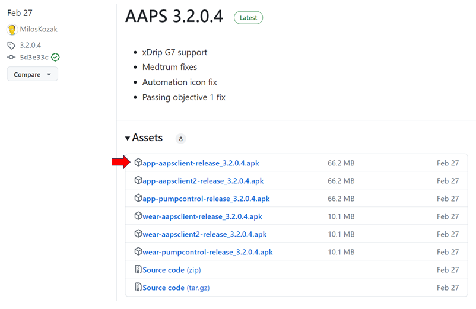

Gå sedan till _Hämtade filer_ på datorn. I Windows visas _Hämtade filer_ i fältet till höger:

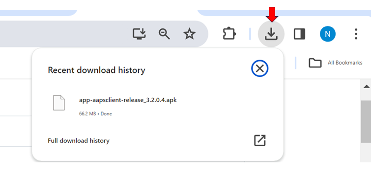

När filen är nedladdad, klicka på _Visa i mapp_ för att hitta filen.

**AAPSClient**-apk:n kan nu antingen:

överföras med en USB-kabel till följartelefonen, eller dras till en mapp på Google Drive och sedan läggas till på följartelefonen genom att trycka på filen ”app-AAPSClient-release”.

Om du behöver **AAPS** för dig själv och **AAPSClient** för att övervaka någon annan, måste du bygga **AAPSClient** själv i stället för att ladda ned den från GitHub-repot som beskrivs ovan. Anledningen är att du inte kan installera både **AAPS** och **AAPSClient** på samma telefon om de är signerade med olika nycklar. <br/> För att bygga **AAPSClient** själv följer du samma process som för [ett vanligt AAPS-bygge](../SettingUpAaps/BuildingAaps.md). På sidan **Generate signed App Bundle or APK** väljer du **aapsclientRelease** i stället för **fullRelease**.

Samma regel gäller när du installerar flera klientappar (**AAPSClient**, **AAPSClient2**, **AAPSClient3**) på en följartelefon: alla måste vara signerade med **samma nyckel**. Annars vägrar Android att installera den andra appen (fel `INSTALL_FAILED_DUPLICATE_PERMISSION`).

### Synkronisering: inställning av AAPSClient och AAPS

När __AAPSClient__-apk:n är installerad på följartelefonen, se till att **NSClientV3** är inställd på samma sätt på båda telefonerna för Nightscout 15 (se [uppdateringsanvisningarna](../Maintenance/UpdateToNewVersion.md)). Exemplet nedan visar inställningen av synkroniseringen med NSClientV3 och Nightscout 15. Andra datakällor finns i __AAPS__ (t.ex. xDrip).

I **Konfiguration** > **Kommunikation** synkroniserar användaren sina data med Nightscout via __NSClientV3__ (med v3 API), inställt på samma sätt både för __AAPS__ och för följartelefonen.


Användaren måste se till att __både__ AAPS-telefonen och AAPSClient-telefonen synkroniseras med varandra genom att ställa in NSClientV3 på båda. På följartelefonen kan du i stället skanna en QR-kod som visas av **AAPS**, se [Parkoppla AAPSClient med AAPS](#remotecontrol-pairing) nedan:

- Ange din **Nightscout-URL** i **Inställningar** för NSClientV3

- Ange din **Nightscout åtkomsttoken** i samma inställningar. Följ anvisningarna [här](https://nightscout.github.io/nightscout/security/#create-a-token). Använd en **administratörstoken** på **AAPS**-telefonen: med den skapar **AAPS** en egen token för varje följartelefon.

- Aktivera **Använd websockets** på **båda** telefonerna. På **AAPS**-telefonen **krävs** websockets för fjärrstyrning: utan dem kan **AAPS** inte ta emot kommandon från **AAPSClient**. På båda telefonerna gör de också synkroniseringen snabbare, men förbrukar lite mer batteri.


Användaren ska se till att både __AAPSClient__ och __AAPS__ visar ”Ansluten” på skärmen **NSClientV3** på respektive telefon. Nu följer **AAPSClient** **AAPS** (BG, behandlingar, profil), men kan ännu inte styra den: parkoppla de två telefonerna enligt beskrivningen nedan.

(remotecontrol-pairing)=
### Parkoppla AAPSClient med AAPS (fjärrstyrning)

Från och med **AAPS** version 4 styr **AAPSClient** **AAPS** via en säker, **parkopplad** anslutning. Synkronisering räcker inte: tills telefonerna är parkopplade visar **AAPSClient** bara **Hantera** med en skrivskyddad **Profil** och **Parkoppla med huvudenheten**.

1. Öppna **Hantera → Auktoriserade klienter** på **AAPS**-telefonen och slå på **Tillåt klientstyrning** (det är av som standard och alltid på i Enkelt läge).
2. Tryck på **+**, ange ett namn för följartelefonen, välj hur den ska ställas in och välj dess **roll**:
   - **QR-kod: Nightscout och parkoppling** — **AAPS** visar en QR-kod som ställer in Nightscout på följartelefonen och parkopplar den, med en enda skanning. Det kräver en administratörstoken i NSClientV3-inställningarna på **AAPS**-telefonen.
   - **PIN-kod** — för en följartelefon utan kamera som redan är ansluten till Nightscout: anteckna engångskoden (**PIN-kod**), som gäller i ungefär två minuter.
3. Skanna koden på **AAPSClient**-telefonen (i installationsguiden eller via **Hantera → Parkoppla med huvudenheten → Skanna QR-kod**), eller öppna **Hantera → Parkoppla med huvudenheten** och ange PIN-koden. Bekräfta.

Följartelefonen visas sedan som **Aktiv** i listan **Auktoriserade klienter**, och **AAPSClient** visar **Behandlingar**, **Scener** och **Hantera**. Följartelefonen får en egen Nightscout-token med bara de rättigheter den behöver. Hela proceduren, med skärmbilder och felsökning, finns på [Styrning huvudenhet ↔ klient](#client_master_master_setup).

Kontrollera att inställningen fungerar: ange kolhydrater i **AAPSClient**, bekräfta mängden som visas och kontrollera att posten visas i **Behandlingar** på båda telefonerna.

(remotecontrol-nightscout-access-token)=

### Felsökning av problem med inställningen 'Nightscout åtkomsttoken'

Den exakta inställningen av 'Nightscout åtkomsttoken' kan skilja sig beroende på om din Nightscout körs hos en betald värdtjänst eller inte.

Om du har svårt att få **AAPS** att godta 'Nightscout åtkomsttoken' och använder en betald värdtjänst för Nightscout, kan du först kontakta din Nightscout-leverantör och fråga hur du löser problemen med 'Nightscout åtkomsttoken'. Annars kan du vända dig till **AAPS**-gruppen, men kontrollera först noga att du har följt anvisningarna [här](https://nightscout.github.io/nightscout/security/#create-a-token) korrekt.

### Vad AAPSClient erbjuder

När **AAPSClient** är parkopplad ger den den anhöriga nästan samma skärmar som **AAPS**:

- **Behandlingar**: insulinbolus, kolhydrater och kalkylatorn.
- **Scener**: starta och avsluta [scener](../DailyLifeWithAaps/Scenes.md).
- **Hantera**: profiler, insulininställningar, tillfälliga målvärden, snabbknappar, automation, mat, platsrotation, parkoppling och den pågående tillfälliga basalen.
- **Huvudmeny**: behandlingshistorik, historikläsare, statistik, underhåll, konfiguration.

Det finns ingen pump och inga mål i **AAPSClient**. Se [Appen AAPSClient](AapsClient.md) för en utförlig beskrivning.

Med **AAPSClient** kan den anhöriga göra de flesta ändringar som går att göra direkt i **AAPS**, **även insulinbolusar**, på distans via mobilnätet eller internet. Varje kommando signeras och skickas via Nightscout till **AAPS**-telefonen. Den kontrollerar kommandot mot sina egna data, begränsar det, visar sin egen bekräftelse och utför det först därefter. **AAPSClient** _kan_ vara mycket snabbare än [SMS-kommandon](../RemoteFeatures/SMSCommands.md), särskilt för kommandon som skulle kräva autentisering.

Behandlingar som anges i Nightscout på andra sätt (till exempel på Nightscouts webbplats) tillämpas inte medan klientstyrning är på: **AAPS** är då i [härdat läge](#client-master-control-hardened-mode) och tar bara emot ändringar från parkopplade klienter. När klientstyrning är av tillämpas de bara om motsvarande alternativ för **Ta emot** är aktiverade i [avsnittet Synkronisering i inställningarna för NSClient](#Preferences-nsclient-synchronization).

Fjärrstyrning via **AAPSClient** rekommenderas bara om synkroniseringen fungerar bra (_dvs._ du ser inga oönskade ändringar av data, som att tillfälligt målvärde, tillfällig basal osv. ändras av sig själva).

### AAPSClient med alternativ för smartklocka

En smartklocka kan vara ett mycket användbart verktyg för att hantera **AAPS** för barn. Några olika konfigurationer är möjliga. Om **AAPSClient** är installerad på den anhörigas telefon kan appen [**AAPSClient WearOS**](https://github.com/nightscout/AndroidAPS/releases/) laddas ned och installeras på en kompatibel smartklocka som är ansluten till förälderns telefon. Den visar aktuellt BG och loopstatus. När **AAPSClient** är parkopplad med **AAPS** vidarebefordras klockans åtgärder (även bolusar, kolhydrater, tillfälliga målvärden och profilbyten) via **AAPSClient** till **AAPS**, som bekräftar och utför dem: se [Wear OS på en klient](#clientmastercontrol-wear-os-on-a-client). Du kan läsa mer om smartklockor [här](#remotecontrol-smartwatches).

(RemoteControl_nightscout)=
## 3) Nightscout

Nightscout är en server i ”molnet”, men det finns också en egen **Nightscout**-app som kan laddas ned direkt från App Store till din iPhone. Om du har en Android-telefon som följartelefon finns det ingen egen Nightscout-app. Det är bättre att använda [**AAPSClient**](#RemoteControl_aapsclient), eller om du bara vill följa och inte skicka behandlingar kan du ladda ned och installera appen [Nightwatch](https://play.google.com/store/apps/details?id=se.cornixit.nightwatch) från Play Butik.

När du har installerat **Nightscout**-appen på din iPhone, öppna appen och följ anvisningarna för inställning. Ange din Nightscout-adress (se nedan, till vänster). Hur adressen ser ut kan variera beroende på var din Nightscout körs. (_t.ex._ http://youraddresshere.herokuapp.com). Ange sedan din API-hemlighet för Nightscout (se nedan, till höger). Om du inte blir ombedd att ange ditt API-lösenord måste du ange det genom att trycka på hänglåset högst upp i appen:


Mer information om inställningen finns direkt hos [Nightscout](https://nightscout.github.io/nightscout/discover/)

När du loggar in första gången ser du en mycket enkel vy. Anpassa visningsalternativen genom att välja ”hamburgermenyn” uppe till höger och skrolla ned:

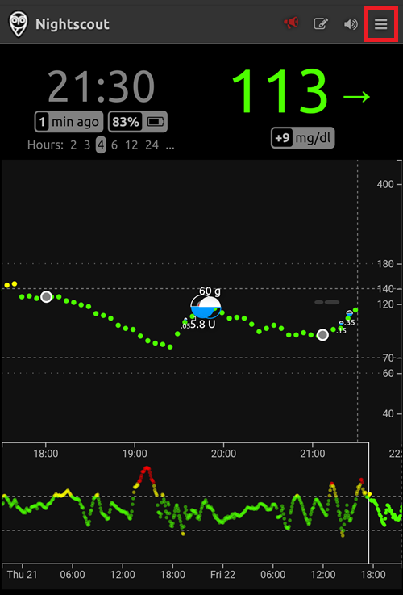

Skrolla ned till ”Settings” (Inställningar). Du kanske vill ändra ”scale” (skala) till ”linear” (linjär), eftersom BG visas logaritmiskt som standard. Under ”render basal” väljer du ”default” så att pumpens basal visas.


Välj de alternativ du vill ha. Avmarkera larm om du använder en annan app för larm.

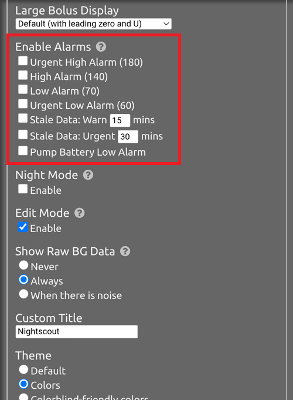

Fortsätt att skrolla ned tills du kommer till ”show plugins”.

Se till att ”careportal” är markerat. Du kan också välja olika andra värden (mest användbara är: IOB, care portal, pump, kanylålder, insulinålder, basalprofil och OpenAPS).

Viktigt: du måste nu trycka på ”save” (spara) längst ned för att ändringarna ska gälla.

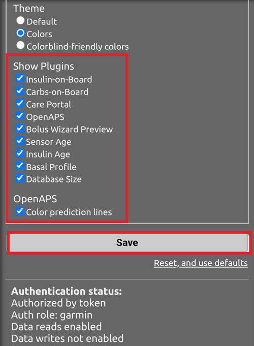

När du har tryckt på ”save” går appen tillbaka till Nightscouts huvudskärm, som ser ut ungefär så här:

1. Aktuellt glukosvärde
2. Information om AAPS-systemets status – tryck på de olika flikarna på skärmen för att visa mer information. Lägg till eller ta bort dessa visningsalternativ via hamburgermenyn.
3. Senaste glukoskurvan med behandlingar (kolhydrater, bolusar)
4. Glukoskurva för en längre period
5. ”Hamburgermeny” för visningsalternativ, rapporter, redigering av profiler och administrationsverktyg för Nightscout
6. Menyn ”**+**” för att ange behandlingar (se [nedan](#RemoteControl_nightscout-treatments) om när **AAPS** tillämpar dem).
7. Välj en annan tidsperiod att visa
8. Basalinsulinprofil
9. Grön linje = tidigare glukosvärden Blå linjer = förutsagda glukosvärden

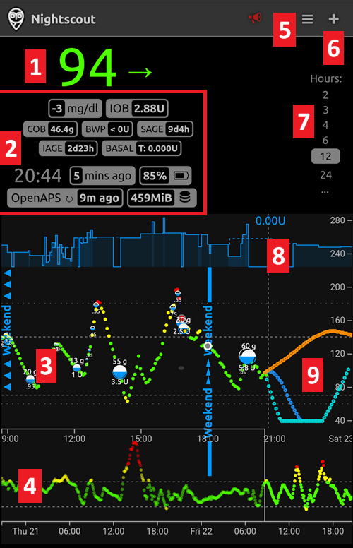

En närmare titt på menyn uppe till vänster i Nightscout-appen:

1. Redigera tidigare poster i Careportal
2. Slå på/av larm
3. Hamburgermeny – för inställningar
4. Careportal – logga behandling (se [nedan](#RemoteControl_nightscout-treatments) om när **AAPS** tillämpar dessa)

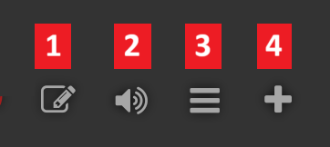

Det finns mycket information om statusen för **AAPS**-systemet i de grå flikarna på den här skärmen (och ännu mer information visas om du trycker på fliken):

1. Glukostrend för 5 min
2. Förhandsvisning av kalkylatorn (Bolus wizard preview)
3. Tryck på Basal för att se din aktuella profil och information om basal
4. Tid sedan det senaste CGM-värdet i AAPS
5. **Pump**: insulin, batterinivå i % och när AAPS senast anslöt till pumpen
6. Senaste gången AAPS uppdaterades – om det är mer än 5 min sedan kan det tyda på ett anslutningsproblem mellan AAPS-telefonen och pumpen/CGM
7. Tryck på IOB för att se fördelningen mellan basal- och bolusinsulin
8. Insulinets ålder i reservoaren
9. Kanylålder
10. Batteristatus för AAPS-telefonen
11. Storleken på din databas. Om den blir för full (bara för egen Nightscout – värdtjänster kan bortse från detta) kan du börja få anslutningsproblem. Du kan ta bort data för att minska storleken i menyn Admin tools (via hamburgermenyn).

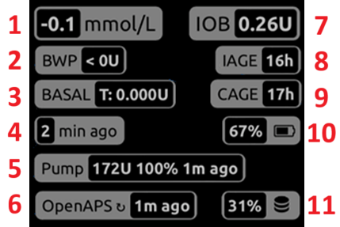

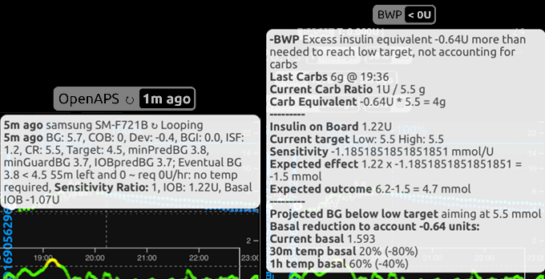

Tryck på ”refresh” längst ned på sidan för att stänga rutan.

(RemoteControl_nightscout-treatments)=
### Skicka behandlingar till AAPS via Nightscout-appen

I **AAPS** 4 är det sätt som stöds för att fjärrstyra **AAPS** en **parkopplad AAPSClient**, se [Styrning huvudenhet ↔ klient](#client-master-control): varje klient har en [roll](#client-master-control-roles) som begränsar vad den får göra, och varje kommando signeras av klienten och kontrolleras och bekräftas sedan av **AAPS**-telefonen. Medan klientstyrning är på är **AAPS**-telefonen i [härdat läge](#client-master-control-hardened-mode): behandlingar, tillfälliga målvärden och profilbyten som anges på Nightscouts webbplats eller i Nightscout-appen tillämpas **inte**. Nightscout-appen är då bara ett verktyg för att följa.

```{admonition} Only when client control is off
:class: warning
Om **Tillåt klientstyrning** är av i **Hantera → Auktoriserade klienter** (och Enkelt läge är av), tillämpar **AAPS** Careportal-poster från Nightscout bara för de datatyper som du har slagit på under **Ta emot** i [avsnittet Synkronisering i NSClientV3-inställningarna](#Preferences-nsclient-synchronization): kolhydrater, tillfälliga målvärden, profilbyten och övriga Careportal-poster. Insulin ges aldrig på detta sätt: en ”Correction bolus” som anges i Nightscout är bara *meddelad*, och **AAPS** räknar den som aktivt insulin (IOB) utan att ge den. Denna inställning rekommenderas inte för fjärrstyrning. Använd en parkopplad **AAPSClient** i stället.
```

Läs mer om alternativen i **Nightscout** [här](https://nightscout.github.io/)

### Tips för att få ut så mycket som möjligt av Nightscout-appen

1). Om du ”fastnar” på en sida och vill se huvudskärmen igen, tryck bara på ”refresh” (längst ned i mitten). Då kommer du tillbaka till **Nightscouts** startsida med BG-grafen.

För att se den aktuella profilen som körs på telefonen, tryck på de olika ikonerna på skärmen ovanför grafen. Mer information (aktuell KH-kvot, känslighet, tidszon osv.) visas om du trycker på ”basal”. ”OpenAPS” visar information om profilen, aktuellt målvärde osv. Både telefonens batterinivå i % och pumpens batterinivå i % kan också övervakas. BWP visar vad algoritmen tror kommer att hända framöver, baserat på IOB och COB.

#### Andra ikoner i menyn: vad betyder pennan (redigera)?

Du kan (tekniskt sett) använda redigeringspennan för att flytta eller ta bort bolus- eller korrektionsbehandlingar från de senaste 48 timmarna.

Mer om detta [här](https://nightscout.github.io/nightscout/discover/#edit-mode-edit)

Det kan vara användbart för att ta bort kolhydrater som angetts (men som ingen bolus har getts för), men i praktiken fungerar det för närvarande inte bra med **AAPS**. Vi rekommenderar att du gör sådana ändringar direkt i **AAPS**-appen.

(RemoteControl_smartwatches)= (remotecontrol-smartwatches)=

## 4) Smartklockor

### Alternativ 1) Styra AAPS från en klocka med Wear OS


När du har [ställt in **AAPS** på din klocka](../WearOS/BuildingAapsWearOS.md) finns utförlig information om urtavlorna och deras funktioner i [Använda Wear AAPS på en smartklocka](../WearOS/WearOsSmartwatch.md).

Som en kort översikt kan följande funktioner startas från smartklockan:

* ställa in ett tillfälligt målvärde

* använda kalkylatorn (värdena för beräkningen kan ställas in i inställningarna på telefonen)

* ge eCarbs

* ge en bolus (insulin + kolhydrater)

* klockans inställningar

* status

* kontrollera pumpstatus

* kontrollera loopstatus

* kontrollera och ändra profil, CPP (Circadian Percentage Profile, dygnsbaserad procentprofil = tidsförskjutning + procent)

* visa TDD (total daglig dos = bolus + basal per dag)

* Bolus på distans när den anhöriga och barnet med typ 1-diabetes är på olika platser (detta är möjligt för **AAPS**-klockan och **AAPS**-telefonen, förutsatt att båda enheterna är anslutna till nätverket)

#### Kommunikation från anhöriga till klockan med andra appar (som WhatsApp)

Det går att lägga till fler appar på klockan, som WhatsApp, till exempel för meddelanden mellan anhöriga och barn. Det är viktigt att bara ha ETT Google-konto kopplat till telefonen, annars överför klockan inte dessa data. Du måste vara minst 13 år för att ha ett Samsung-konto, och det måste ställas in med samma e-postadress som används på Android-telefonen.

En video som förklarar hur du ställer in WhatsApp för meddelanden på klockan Galaxy Watch 4 (du får inte alla funktioner i WhatsApp) finns [här](https://gorilla-fitnesswatches.com/how-to-get-whatsapp-on-galaxy-watch-4/)

Om du gör inställningar både i appen **Galaxy wearable** på **AAPS**-telefonen och på klockan kan WhatsApp-meddelanden aviseras med en lätt vibration och visas ovanpå den aktuella urtavlan.

### Alternativ 2) **AAPS** på klockan, för fjärrstyrning av **AAPS** på en telefon

På samma sätt som med en följartelefon med **AAPSClient** eller SMS-kommandon (se avsnitten ovan) kan en smartklocka användas för att fjärrstyra **AAPS** och visa alla profildata. En viktig skillnad mot en följartelefon är att länken mellan smartklockan och **AAPS**-telefonen går via Bluetooth och varken kräver Nightscout eller en autentiseringskod. En sidoanmärkning: om både smartklockan och **AAPS**-telefonen som är länkade via Bluetooth också är anslutna till ett Wi-Fi- eller mobildatanät, kan klockan även kommunicera med **AAPS**-telefonen på det sättet. Det ger längre räckvidd. Det gör det möjligt att ge en bolus på distans när den anhöriga med **AAPS**-klockan och barnet med typ 1-diabetes (med **AAPS**-telefonen) är på olika platser, vilket kan vara användbart till exempel när barnet är i skolan.

En smartklocka för fjärrstyrning är därför ofta användbar i alla situationer där:

a)  kommandon via **AAPSClient** eller **SMS** inte fungerar, eller

b)  användaren vill slippa skriva in en autentiseringskod (som krävs för SMS-kommandon).

En smartklocka behöver **Wear OS 3 eller senare** för att kunna styra **AAPS**. Kontrollera klockans tekniska specifikationer och se sidan [Smartklockor och AAPS](../Getting-Started/Watches.md). Sök, eller fråga i **AAPS**-grupperna på Facebook/Discord om du är osäker.

Specifika guider för att ställa in **AAPS** på den populära Samsung Galaxy Watch 4 (40 mm) finns nedan. Klockor från [Garmin](https://apps.garmin.com/en-US/apps/a2eebcac-d18a-4227-a143-cd333cf89b55?fbclid=IwAR0k3w3oes-OHgFdPO-cGCuTSIpqFJejHG-klBTm_rmyEJo6gdArw8Nl4Zc#0) är också ett populärt val. Om du har erfarenhet av att ställa in en annan smartklocka som du tror kan vara till nytta för andra, lägg gärna till den på dessa sidor ([redigera dokumentationen](../SupportingAaps/HowToEditTheDocs.md)) och dela det du har lärt dig med hela **AAPS**-communityn.

### Alternativ 3) AAPSClient på en klocka för fjärrstyrning av **AAPS** på en telefon


Programvaran för klockan, **AAPSClient** Wear-apk, kan laddas ned direkt från [GitHub](https://github.com/nightscout/AndroidAPS/releases/).

För att ladda ned programvaran klickar du på den klockapp som passar klientappen på telefonen: **wear-aapsclient-release_**_version_ hör till **AAPSClient**, **wear-aapsclient2-release_**_version_ hör till **AAPSClient2** (se [Om AAPSClient, AAPSClient2 och AAPSClient3](#remotecontrol-aapsclient-versions)):


Välj sedan ”Spara som” och spara filen på ett lämpligt ställe på datorn:


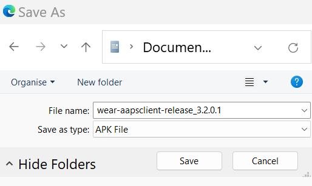


**AAPSClient** Wear-apk kan överföras till telefonen och installeras manuellt på klockan på samma sätt som **AAPS** Wear-appen, som beskrivs i [Överföra Wear-appen till din AAPS-telefon](#remote-control-transferring-the-aaps-wear-app-onto-your-aaps-phone)  


