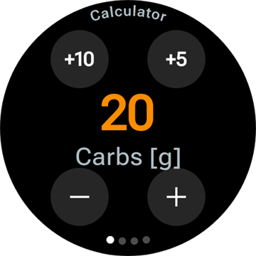
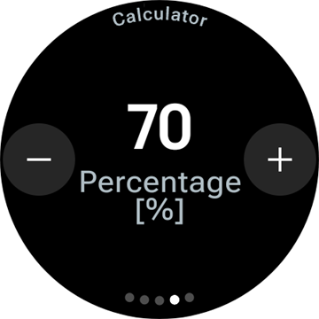
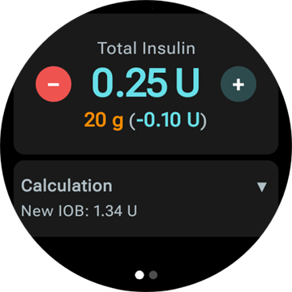
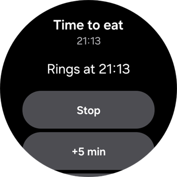
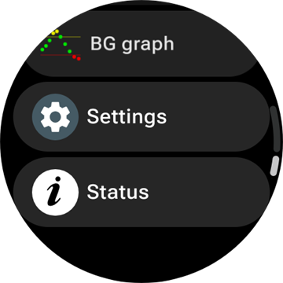
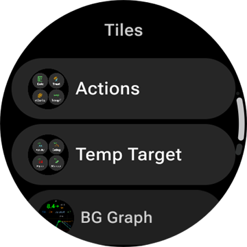
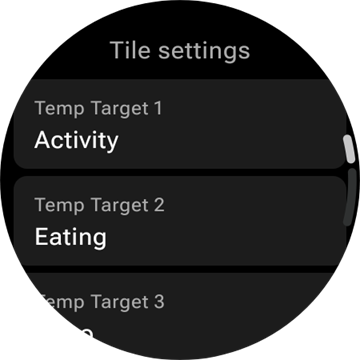
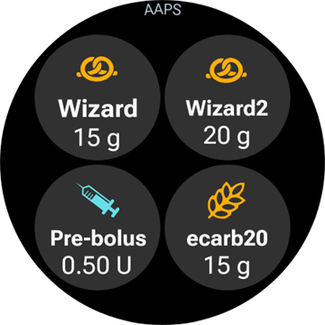

# Styra AAPS från din smartklocka med Wear OS

(Watchfaces-aaps-watchfaces)=

## AAPS-urtavlor

```{warning}
De klassiska urtavlorna i **AAPS** fungerar bara på Wear OS 5 och äldre, och redan Wear OS 5 begränsar dem. På **Wear OS 6 och nyare** installerar klockappen i stället en urtavla i Googles Watch Face Format: din anpassade urtavla som bild, eller **Urtavla med komplikationer**. Se [Ändringar av urtavlor i Wear OS](#wearos-watchface-changes) för vad som slutar fungera i varje version av Wear OS, och [urtavlan som AAPS installerar](#wearos-aaps-v4-watchface) för Wear OS 6.
```

På Wear OS 5 och äldre finns flera klassiska urtavlor inbyggda i klockappen **AAPS**. De visar glukosvärdet med delta, IOB, den aktiva basaldosen och en graf över värdena. Två tryck fungerar på dem:

* Dubbeltryck på glukosvärdet för att öppna huvudmenyn i **AAPS**
* Dubbeltryck på grafen för att ändra dess tidsintervall

I alla versioner av Wear OS fungerar [komplikationerna](#Watchfaces-complications) och [brickorna](#WearOsSmartwatch-wear-os-tiles) som beskrivs på den här sidan med alla urtavlor som har plats för dem.

## Konfiguration

Aktivera **Klocka (Wear)** i [**Konfiguration** > **Kommunikation**](#Config-Builder-wear).

För att ge bolus eller göra andra åtgärder från klockan, slå på **Kontrollera från Wear-klocka**. Kalkylatorns alternativ för klockan ställs in på samma ställe: se [Inställningar > Klocka (Wear)](#preferences-wear). Medan **Kontrollera från Wear-klocka** är av nekar telefonen alla behandlingar och lägesändringar som skickas från klockan, och klockan visar *"Kontroll från Wear-klocka är avstängd i Wear-inställningarna på telefonen."*

Med **Öppna plugin** på kortet **Klocka (Wear)** öppnar du skärmen för Wear:


Den översta raden visar namnet på den anslutna klockan, eller **(Ingen klocka ansluten)**. På den här skärmen kan du

* Skicka all data igen. Kan vara bra om klockan inte har varit ansluten på ett tag och du vill skicka informationen till klockan.
* Öppna inställningarna på klockan direkt från telefonen.
* Välja vilken urtavla **AAPS** installerar på klockan (**Urtavla installerad på klockan**: din anpassade urtavla eller urtavlan med komplikationer). Det här kortet visas bara medan en klocka med **Wear OS 6** eller nyare är ansluten. Se [urtavlan som AAPS installerar](#wearos-aaps-v4-watchface).
* Hantera **Anpassad urtavla** (kortet visas medan en klocka är ansluten): **Ladda urtavla** skickar en anpassad urtavla till klockan, **Info om urtavla** visar detaljer om den laddade urtavlan och vilka fält den innehåller, **Fler urtavlor** öppnar [utbytessidan](../ExchangeSiteCustomWatchfaces/index.md) i webbläsaren, och **Exportera mall** sparar en mall som du kan redigera. En förhandsvisning av den laddade urtavlan visas under knapparna. Se [Byta till en AAPS-urtavla](#WearOS_changing-to-AAPS-watchface).

Se till att aviseringar från AAPS inte är blockerade på klockan. En åtgärd (t.ex. bolus, tillfälligt målvärde) bekräftas med en avisering som du behöver svepa och bocka för.

## Öppna huvudmenyn i AAPS


Öppna huvudmenyn i **AAPS** på något av dessa sätt:

* öppna **AAPS** från klockans applista
* tryck på en komplikation från **AAPS** som öppnar menyn, se [Inställningar för komplikationer](#WearOsSmartwatch-complication-settings)
* tryck på brickan **BG-graf** när dess **Tryckåtgärd** är inställd på **Huvudmeny**, se [Brickinställningar](#WearOsSmartwatch-wear-os-tiles)
* på en klassisk urtavla i **AAPS**: dubbeltryck på glukosvärdet

(WearOsSmartwatch-loop-status)=

## Skärmen Loopstatus

Skärmen **Loopstatus** ger en sammanfattning av vad loopen gör, utan att du behöver ta fram telefonen. Öppna den från huvudmenyn i AAPS (**Loopstatus**, eller **Status → Loop**), eller genom att trycka på komplikationen **Blodsocker**. Menyn **Status** har också en sida **Pump** och en sida **TDD** med de totala dagliga doserna.


Skärmen är en lista med kort. Rulla nedåt för att se alla:

* **Körläge** — aktuellt läge (sluten loop, öppen loop, LGS, pausad, frånkopplad …) och, för ett tillfälligt läge, hur länge det fortsätter.
* **Loopresultat** — när loopen senast kördes, och den tillfälliga basal eller SMB som den begärde.
* **Scen** — bara medan en [scen](#scenes-from-watch) är aktiv: dess namn, återstående tid (eller **Tills avslutad** för en scen utan sluttid) och scenen under **Uppföljning** som startar när den slutar.
* **Mål** — ditt målvärde, och det tillfälliga målvärdet om ett sådant är aktivt.
* **Profil** — namnet på den aktiva profilen, med **Procent** och **Tidsförskjutning** när de inte har standardvärdena. Ett tillfälligt profilbyte är markerat och visar hur länge det fortsätter och vilken profil det **Återgår till** när det slutar.
* **Känslighet** — samma rader som känslighetschipet på telefonens huvudskärm: autosens-värdet och ISF från profilen, variabel ISF och effektiv ISF.

En liten scenikon bredvid ett körläge, ett tillfälligt målvärde eller ett profilbyte betyder att det är **Satt av den aktiva scenen**. Samma ikon visas i väljaren för **Körläge**.


(WearOsSmartwatch-bolus-calculator)=

## Kalkylatorn på klockan

Öppna **Kalkylator** från huvudmenyn i **AAPS**, från [brickan Åtgärder](#WearOsSmartwatch-wear-os-tiles) eller från en komplikation som är inställd på att öppna kalkylatorn. Den går igenom några sidor. Svep från höger till vänster för att gå vidare:

| Kolhydrater                                                            | Begär                                                              | Resultat                                                             | Beräkning                                                                             | Bekräfta                                                              |
| ---------------------------------------------------------------------- | ------------------------------------------------------------------ | -------------------------------------------------------------------- | ------------------------------------------------------------------------------------- | --------------------------------------------------------------------- |
|  |  |  |  |  |

1. **Kolhydrater**: ange kolhydraterna med knapparna **+10**, **+5**, **−** och **+**.
2. **Begär**: den sista sidan innan telefonen tar över. Den visar vad du har angett: kolhydraterna, och måltidstyp, kolhydrattid och procent när du använder dem, se [Valfria sidor](#WearOsSmartwatch-calculator-optional-pages). Tryck på bocken för att skicka det till telefonen, som gör beräkningen.
3. **Resultat**: den bolus som **AAPS** föreslår, med kolhydraterna under: kolhydrater nu och eCarbs senare, kolhydrattiden och klocksymbolen för matpåminnelsen. Justera dosen med **−** och **+**, se nedan. Rulla nedåt till kortet **Beräkning**: tryck på det för att se alla rader i beräkningen, samma som på telefonen.
4. **Bekräfta**: svep till den andra sidan och tryck på bocken. Telefonen ger bolusen och registrerar kolhydraterna.

(WearOsSmartwatch-calculator-optional-pages)=

### Valfria sidor

Tre inställningar på klockan lägger var och en till en sida efter **Kolhydrater**. De är avstängda som standard. Öppna huvudmenyn i **AAPS**, sedan **Inställningar** > **Gränssnitt**, och slå på de du vill ha. Om fler än en är på kommer sidorna i ordningen **Måltidstyp**, **KH-tid**, **Procent**. Prickarna längst ned i kalkylatorn visar hur många sidor den har.

| Settings                                                                                   | Måltidstyp                                                                | Kolhydrattid                                                                | Procent                                                                 |
| ------------------------------------------------------------------------------------------ | ------------------------------------------------------------------------- | --------------------------------------------------------------------------- | ----------------------------------------------------------------------- |
|  |  |  |  |

* **Kalkylator måltidstyp**: **Bröd**, **Tårta** eller **Pizza**, som delar upp kolhydraterna i en långsam måltid i kolhydrater nu och eCarbs senare, se [Välja måltidstyp](#WearOsSmartwatch-wizard-meal-type).
* **Kolhydrattid i kalkylatorn**: minuterna tills du äter, med klocksymbolen **Ställ in alarm** för matpåminnelsen, se [Kolhydrattid och matpåminnelsen](#WearOsSmartwatch-wizard-carb-time).
* **Kalkylator Procent**: en procentandel av den beräknade bolusen, till exempel 70 % när du vill ha en mindre dos. Den startar på **Bolusprocent** från telefonens [kalkylatorinställningar](#Preferences-deliver-this-part-of-bolus-wizard-result), 100 % om du inte har ändrat den. Se också anmärkningen under [Justera bolusen på resultatsidan](#WearOsSmartwatch-wizard-result).

(WearOsSmartwatch-wizard-result)=

### Justera bolusen på resultatsidan

Resultatsidan visar den bolus som **AAPS** föreslår, tillsammans med en knapp **−** och en knapp **+**. Använd dem för att justera dosen innan du bekräftar den, utan att gå tillbaka till telefonen.

| Föreslagen                                                                            | Mer                                                                              | Mindre                                                                              |
| ------------------------------------------------------------------------------------- | -------------------------------------------------------------------------------- | ----------------------------------------------------------------------------------- |
|  |  |  |

* Varje tryck ändrar bolusen med **ett steg på din pump**, så att mängderna alltid passar det som pumpen faktiskt kan ge.
* **Tryck och håll** på en knapp för att fortsätta ändra värdet. Ju längre du håller, desto snabbare går det.
* Du kan inte gå under **0 U** eller över din inställning för **Maximal bolus**.

Den aktuella summan visas på resultatsidan, så att du alltid ser den mängd som du är på väg att bekräfta. Ändringen visas efter kolhydraterna, till exempel *(+0,20 U)*, och knappen du använde blir grön för mer eller röd för mindre.

Om **AAPS** var tvungen att begränsa dosen, till exempel för att den beräknade bolusen är högre än din inställning för **Maximal bolus**, säger en bärnstensfärgad rad under summan det (till exempel *"Bolusbegränsning tillämpad"*). Samma sak gäller för en begränsad mängd kolhydrater.

```{admonition} Detta är inte samma sak som Kalkylator Procent :class: note Inställningen **Kalkylator Procent** låter dig ange en *procentandel* av den beräknade bolusen **innan** resultatsidan visas. Knapparna **−** och **+** justerar den *slutliga mängden* **på** resultatsidan. Du kan använda båda.

    <br />(WearOsSmartwatch-wizard-meal-type)=
    
    ### Välja måltidstyp
    
    Kalkylatorn på klockan kan dela upp kolhydraterna i en långsam måltid i kolhydrater nu och eCarbs senare, som [måltidstyp](#AapsScreens-carbs-type) i telefonens kalkylator. Slå på **Kalkylator måltidstyp** under klockans **Inställningar** > **Gränssnitt**. Inställningen är av som standard, och då hoppas sidan **Måltidstyp** över.
    
    * När du har angett kolhydraterna visar sidan **Måltidstyp** tre ikoner: **Bröd**, **Tårta** och **Pizza**. Tryck på en ikon: dess namn och de kolhydrater den ger visas under ikonerna, till exempel *65 g* för bröd, eller *52+22 g* för pizza (52 g nu och 22 g eCarbs senare). **Bröd** är standard och behåller alla kolhydrater nu.
    * Sidorna Begär och Bekräfta visar kolhydraterna på samma sätt (*52+22 g*). Resultatsidan visar också när eCarbs startar och hur länge de varar.
    * Bolusen beräknas bara för de kolhydrater som äts nu. Uppdelningen använder samma värden som telefonens kalkylator.
    
    (WearOsSmartwatch-wizard-carb-time)=
    
    ### Kolhydrattid och matpåminnelsen
    
    När **Kolhydrattid i kalkylatorn** är på under klockans **Inställningar** > **Gränssnitt** kommer en sida **KH-tid** efter kolhydraterna: minuterna tills du äter, som [KH-tid](#aaps-screens-bolus-wizard) i telefonens kalkylator. **Nu** är standard. **−** och **+** ändrar den i steg om 5 minuter, upp till en timme före eller efter nu. En tid bakåt i tiden är för kolhydrater som du redan har ätit.
    
    Med en tid framåt i tiden visas klocksymbolen **Ställ in alarm** under värdet. Den är på som standard, tryck på den för att stänga av den. Sidorna Begär och Resultat visar kolhydrattiden, till exempel *+30 min*, och klocksymbolen. Telefonen registrerar kolhydraterna vid den tiden, flyttar måltidstypens eCarbs med dem och startar sin påminnelse **Dags att äta**.
    
    | Resultat | BG-graf | Pågår | Dags att äta |
    | --- | --- | --- | --- |
    |  |  |  |  |
    
    Påminnelsen finns också på klockan, så den ringer även när telefonen är utom räckhåll:
    
    * Skärmen **BG-graf**, brickan **BG-graf** och grafen i **Urtavla med komplikationer** ritar en streckad orange linje där påminnelsen ringer, med antalet minuter kvar bredvid.
    * Medan den pågår ligger en tyst avisering **Dags att äta** med **Stoppa** och **+5 min** bland aviseringarna. Den kommer tillbaka när du sveper bort den, tills påminnelsen är över.
    * När det är dags vibrerar klockan, och sedan igen var 30:e sekund i fem minuter tills du svarar. Aviseringen har **Tysta** och **+5 min**, och om du sveper bort den tystas den också.
    
    **Stoppa**, **Tysta** och **+5 min** gör samma sak på klockan, på telefonen och i en **AAPSClient**, och alla visar samma påminnelse.
    
    (Watchfaces-complications)=
    
    ## Komplikationer
    
    _Komplikation_ är en term från traditionell urmakning. Den beskriver ett tillägg till den vanliga urtavlan – ett litet extra fönster eller en liten extra urtavla (med datum, veckodag, månfas osv.). Wear OS 2.0 använder samma idé och tillåter egna datakällor, till exempel väder, aviseringar och träningsräknare, som kan läggas till på alla urtavlor som stöder komplikationer.
    
    Wear OS-appen för AAPS stöder komplikationer sedan version `2.6`. Alla urtavlor från tredje part som stöder komplikationer kan ställas in för att visa data från AAPS (BG med trend, IOB, COB osv.).
    
    Komplikationer fungerar också som **genväg** till funktioner i AAPS. När du trycker på dem kan du öppna menyer och dialogrutor i AAPS (beroende på typ av komplikation och hur den är inställd).
    
    
    
    ### Typer av komplikationer
    
    Wear OS-appen för AAPS levererar bara rådata, enligt fördefinierade format. Det är urtavlan från tredje part som bestämmer var och hur komplikationerna visas, även layout, ram, färg och teckensnitt. Av de många typer av komplikationer som finns i Wear OS använder AAPS:
    
    * `SHORT TEXT` - Innehåller två textrader med 7 tecken var, ibland kallade värde och etikett. Visas oftast i en cirkel eller en liten kapsel – under varandra eller bredvid varandra. Det är en komplikation med mycket lite plats. AAPS försöker ta bort onödiga tecken så att texten får plats: värden avrundas, nollor i början och slutet av värden tas bort osv.
    * `LONG TEXT` - Innehåller två textrader med ungefär 20 tecken var. Visas oftast i en rektangel eller en lång kapsel – under varandra. Den används för mer detaljer och status i textform.
    * `RANGED VALUE` - Används för värden inom ett fördefinierat intervall, till exempel en procentandel. Den innehåller en ikon och en etikett och visas oftast som en cirkulär förloppsmätare.
    * `LARGE IMAGE` - Egen bakgrundsbild som kan användas som bakgrund (om urtavlan stöder det).
    * `SMALL IMAGE` / `MONOCHROMATIC IMAGE` - En liten ikon. I en `SMALL IMAGE`-plats ritar AAPS den i sin egen färg; i en `MONOCHROMATIC IMAGE`-plats färgar urtavlan den.
    
    ### Ställa in komplikationer
    
    För att lägga till en komplikation på urtavlan: tryck länge på urtavlan och tryck på kugghjulsikonen nedanför för att ställa in den. Beroende på hur urtavlan ställer in dem: tryck antingen på platshållarna eller öppna urtavlans inställningsmeny för komplikationer. Komplikationerna från AAPS finns under menyposten AAPS.
    
    När du ställer in komplikationer på urtavlan visar Wear OS bara de komplikationer som passar på den valda platsen på urtavlan. Om du inte hittar en viss komplikation i listan beror det troligen på att dess typ inte kan användas på den platsen.
    
    ### Komplikationer från AAPS
    
    AAPS har följande komplikationer. "Öppnar" är det som ett tryck gör när **Tryckåtgärd för komplikation** är kvar på **Standardinställning**, se [Inställningar för komplikationer](#WearOsSmartwatch-complication-settings).
    
    **Glukos**
    
    * **Blodsocker** (`SHORT TEXT`, öppnar _Loopstatus_): glukosvärdet med trendpilen på första raden, värdets ålder och delta på andra raden.
    * **Blodsocker (stor)** (`SHORT TEXT`, öppnar _BG-graf_): bara glukosvärdet på första raden, så att urtavlan kan visa det stort. Åldern och trendpilen finns på andra raden.
    * **BG-graf** (`SMALL IMAGE` / `LARGE IMAGE`, öppnar _BG-graf_): BG-grafen som bild, för urtavlor med en bildplats. Det är grafen på **Urtavla med komplikationer**.
    * **Full status** (`LONG TEXT`, öppnar _Meny_): det mesta av data på en rad: glukosvärdet med trendpilen, delta och värdets ålder, sedan aktiva kolhydrater, aktivt insulin och basaldosen.
    * **Full status (vänd)** (`LONG TEXT`, öppnar _Meny_): samma sak, men med de två raderna omkastade, för urtavlor som bara visar en av de två raderna i en `LONG TEXT`-plats.
    
    **Insulin och kolhydrater**
    
    * **IoB-ikon** (`SHORT TEXT`, öppnar _Bolus_): aktivt insulin med en sprutikon.
    * **IoB Detaljerad** (`SHORT TEXT`, öppnar _Bolus_): totalt aktivt insulin på första raden, bolus- och basaldelen på andra.
    * **CoB-ikon** (`SHORT TEXT`, öppnar _Kalkylator_): aktiva kolhydrater med en kolhydratikon.
    * **CoB Detaljerad** (`SHORT TEXT`, öppnar _Kalkylator_): aktiva kolhydrater nu på första raden, kolhydrater som kommer senare (eCarbs) på andra.
    * **CoB & IoB** (`SHORT TEXT`, öppnar _Kalkylator_): aktivt insulin på första raden, aktiva kolhydrater på andra.
    
    **Basal och mål**
    
    * **Basal** (`SHORT TEXT`, öppnar _Meny_): den aktuella basaldosen.
    * **Basal & IoB** (`SHORT TEXT`, öppnar _Meny_): aktivt insulin på första raden, basaldosen på andra.
    * **BR & mål** (`SHORT TEXT`, öppnar _Tillfälligt målvärde_): målvärdet på första raden, med återstående tid när ett tillfälligt målvärde är aktivt, och basaldosen på andra.
    * **Mål** (`SHORT TEXT`, öppnar _Tillfälligt målvärde_): målvärdet på första raden och, medan ett tillfälligt målvärde är aktivt, dess återstående tid på andra.
    * **BR, CoB & IoB** (`SHORT TEXT`, öppnar _Meny_): basaldosen på första raden, aktiva kolhydrater och aktivt insulin på andra.
    
    **Loop och telefon**
    
    * **Körläge** (`SMALL IMAGE` / `ICON`, öppnar _väljaren för Körläge_): det aktuella loopläget som ikon: sluten loop, öppen loop, paus vid lågt blodsocker, pausad, frånkopplad eller inaktiverad. Ett tryck öppnar en väljare med de lägesändringar som är tillåtna just nu, till exempel **Pausa loop**, **Koppla från pumpen**, **Återuppta loop** eller **Återanslut pump**. Samma väljare finns i huvudmenyn i **AAPS** under **Körläge**.
    * **Uppladdare/telefonbatteri** (`RANGED VALUE` / `SHORT TEXT` / `ICON`, öppnar _Status_): batterinivån i **AAPS**-telefonen, som en mätare med en batteriikon, som en siffra eller bara som ikonen. Den uppdateras tillsammans med övriga data från **AAPS**, oftast var 5:e minut med ett nytt värde.
    
    Väljaren för **Körläge**, så som den öppnas från komplikationen, huvudmenyn eller brickan Körläge:
    
    
    
    (WearOsSmartwatch-complication-settings)=
    
    ### Inställningar för komplikationer
    
    Öppna **Inställningar** > **Komplikationer** i huvudmenyn i **AAPS** på klockan:
    
    
    
    * **Tryckåtgärd för komplikation** (standard `Standardinställning`): vad ett tryck på en komplikation från **AAPS** öppnar, för alla komplikationer samtidigt:
      * _Standardinställning_: det som komplikationen själv öppnar, se listan ovan
      * _Meny_: huvudmenyn i **AAPS**
      * _Kalkylator_: kalkylatorn
      * _Behandling_: dialogrutan för behandling, insulin och kolhydrater
      * _eCarbs_: dialogrutan för eCarbs
      * _Status_: statusmenyn
      * _Körläge_: väljaren för körläge. Kräver att **Kontrollera från Wear-klocka** är på i Wear-inställningarna på telefonen, annars öppnas huvudmenyn i stället.
      * _Ingen_: ett tryck gör ingenting
    * **Tidsintervall BG-graf** (standard `3 timmar`): hur många timmar komplikationen **BG-graf** visar, 1, 3 eller 6. Brickan BG-graf har en egen inställning.
    * **Unicode i komplikationer** (standard `På`): komplikationerna använder Unicode-symboler som `Δ` för delta, `⁞` som avgränsare och `⎍` för basaldosen. Hur de ser ut beror på urtavlans teckensnitt. Ställ in detta på `Av` när en urtavla visar dem som rutor eller tomrum.
    
    (WearOsSmartwatch-wear-os-tiles)=
    
    ## Brickor i Wear OS
    
    Brickor är sidorna som du når genom att svepa från urtavlan. **AAPS** har sju brickor, var och en med upp till fyra knappar. Ett tryck på en knapp öppnar motsvarande dialogruta på klockan, eller ber dig bekräfta, och sedan gör telefonen jobbet. En bricka är en genväg, inte en statusvisning: den visar inte tillståndet i telefonappen.
    
    Innan du använder brickorna, slå på **Kontrollera från Wear-klocka** i [Inställningar > Klocka (Wear)](#preferences-wear).
    
    ### Lägga till en bricka
    
    Det finns två sätt, beroende på din klocka och telefon:
    
    1. På klockan: svep från urtavlan förbi den sista brickan till **Add tile** (Lägg till bricka) och välj en bricka från **AAPS**. På de flesta klockor öppnar ett långt tryck på en bricka också vyn för att lägga till och ta bort brickor.
    2. På telefonen, i hjälpappen för din klocka (**Galaxy Wearable** för Samsung, **Wear OS** för andra märken): öppna **Tiles** (Brickor), tryck på **Add** (Lägg till) och välj de brickor från **AAPS** som du vill ha. Du kan ändra ordningen på brickorna genom att dra dem.
    
    
    
    ### Brickinställningar
    
    Brickorna **Åtgärder**, **Tillfälligt målvärde**, **BG-graf** och **Scen** har inställningar på klockan. Öppna huvudmenyn i **AAPS**, sedan **Inställningar** > **Brickor**, och välj brickan. Ett långt tryck på brickan öppnar också dess inställningar, utom på Pixel-klockor. De tre andra brickorna fylls i från telefonen och har inget att ställa in på klockan.
    
    | Huvudmeny | Inställningar | Brickor |
    | --- | --- | --- |
    |  |  |  |
    
    Inställningarna för en bricka är en lista med dess fyra platser. Tryck på en plats för att välja vad den visar, eller **Inget** för att lämna den tom.
    
    | Långt tryck på brickan | Inställningar för brickan Tillfälligt målvärde |
    | --- | --- |
    |  |  |
    
    Varje bricka har fyra platser. En bricka med fler poster än så visar de fyra första.
    
    ### Brickan Åtgärder
    
    
    
    Genvägar till dialogrutorna i klockappen **AAPS**. Välj upp till fyra av dessa i brickans inställningar:
    
    * **Kalk**: kalkylatorn, med inmatning av kolhydrater, en valfri procentandel [1] och en valfri måltidstyp [2]
    * **Beh**: insulin och kolhydrater på en gång
    * **Insulin**: en bolus, angiven i enheter
    * **KH**: kolhydrater, även förlängda kolhydrater. Ett **negativt** värde godtas, ned till din aktuella COB, för att rätta kolhydrater som du har angett tidigare. Borttagna kolhydrater visas i BG-grafen på klockan.
    * **eCarbs**: förlängda kolhydrater
    * **Tempmål**: ett tillfälligt målvärde med eget målvärde och egen varaktighet
    * **Profilbyte**: ett profilbyte med procent, tidsförskjutning och varaktighet
    
    
    
    Dialogrutorna som knapparna öppnar. Svep från höger till vänster för att komma till nästa sida i en dialogruta, och tryck på bocken på den sista sidan för att skicka begäran till telefonen:
    
    | Beh | Insulin | KH | eCarbs | Tempmål | Profilbyte |
    | --- | --- | --- | --- | --- | --- |
    |  |  |  |  |  |  |
    
    [1] Under klockans **Inställningar** > **Gränssnitt**, slå på **Kalkylator Procent** för att visa inmatningen av procent i kalkylatorn. Standardprocenten kommer från telefonens inställning ["Bolusprocent"](#Preferences-deliver-this-part-of-bolus-wizard-result). De andra inställningarna för kalkylatorn är telefonens, under **Inställningar** > **Kalkylatorinställningar**.
    
    [2] Under klockans **Inställningar** > **Gränssnitt**, slå på **Kalkylator måltidstyp** för att visa sidan **Måltidstyp**, där du väljer **Bröd**, **Tårta** eller **Pizza** för att dela upp kolhydraterna i en långsam måltid i kolhydrater nu och eCarbs senare. Se [Välja måltidstyp](#WearOsSmartwatch-wizard-meal-type).
    
    ### Brickan Tillfälligt målvärde
    
    
    
    Tillfälliga målvärden från telefonens förinställningar. Ställ in varaktighet och målvärde för varje förinställning på telefonen under **Inställningar** > [Förinställda tillfälliga målvärden](#Preferences-default-temp-targets). Välj upp till fyra av dessa i brickans inställningar:
    
    * **Träning**: för träning och sport
    * **Äter**: äta snart, ett lägre målvärde så att det finns mer aktivt insulin vid måltiden
    * **Hypo**: ett högre målvärde under behandling av en hypo
    * **Manuellt**: eget målvärde och egen varaktighet
    * **Avbryt**: stoppar det aktiva tillfälliga målvärdet. Knappen visas bara medan ett tillfälligt målvärde är aktivt.
    
    ### Brickan Snabbknapp
    
    
    
    De [snabbknappar](#quickwizards) på telefonen som har **Visa på klocka** påslaget, inom sina giltiga tider. En kolhydratpost visar sina kolhydrater i g, en insulinpost sin fasta dos i U. Ett tryck kör posten efter en bekräftelse på klockan. Det finns inget att ställa in på klockan: redigera posterna på telefonen, och slå på **Visa på klocka** under **Enhetsval** för varje post som du vill ha på brickan. Utanför de giltiga tiderna för alla dina poster visar brickan **Ingen konfiguration tillgänglig**.
    
    
    
    ### Brickan Scen
    
    
    
    Telefonens [scener](#scenes-from-watch). Var och en av de fyra platserna ställs in på **Automatisk**, **Inget** eller en scen i brickans inställningar. En plats med **Automatisk** tar nästa scen i telefonens lista som ingen annan plats har tagit. En plats som är inställd på en scen som inte längre finns på telefonen visar **Ej tillgänglig**.
    
    
    
    ### Brickan Körläge
    
    
    
    De [körlägen](#aaps-screens-running-mode) som du kan byta till från det aktuella, med samma ikoner som på telefonen: sluten loop, paus vid lågt blodsocker, öppen loop, inaktivera loop, pausa loop och koppla från pumpen, eller återuppta och återanslut medan något av dem är aktivt. **Pausa loop** och **Koppla från pumpen** frågar först efter en varaktighet. Telefonen bestämmer vilka lägen som erbjuds. Klockan visar de fyra första och utelämnar **Inaktivera loop** när **Pausa loop** finns i listan.
    
    ### Brickan Användaråtgärd
    
    
    
    En knapp för varje [automatisering](#automations-automation-triggers) på telefonen vars utlösare är **Användaråtgärd**. Ett tryck ber dig bekräfta, sedan kör telefonen automatiseringens åtgärder. Knapparna får automatiseringarnas namn, så ge dem korta namn. Det finns inget att ställa in på klockan.
    
    ### Brickan BG-graf
    
    
    
    Glukosvärdet med pil, delta och ålder, under det IOB, COB, basaldos och målvärde, och BG-grafen med prognoser, bolusar, kolhydrater och SMB:er. Två inställningar på klockan: **Tidsintervall** (1, 3 eller 6 timmar) och **Tryckåtgärd**, som öppnar hela skärmen **BG-graf**, **Huvudmeny** eller skärmen **Loopstatus**.
    
    
    
    
    
    ## Alltid på
    
    Det här avsnittet och nästa gäller de klassiska urtavlorna i **AAPS** på Wear OS 5 och äldre. På Wear OS 6 har **Urtavla med komplikationer** en egen visning för Alltid på, se [urtavlan som AAPS installerar](#wearos-aaps-v4-watchface).
    
    Lång batteritid är en utmaning för smartklockor med Android Wear OS. Vissa smartklockor klarar upp till 30 timmar innan de måste laddas. Skärmen bör vara avstängd när den inte används, så sparar du mest ström. De flesta klockor stöder skärmläget ”Alltid på”.
    
    Sedan AAPS version 3 kan vi använda ”Förenkla gränssnittet” i läget Alltid på. Detta gränssnitt visar bara blodsocker, riktning och tid. Detta gränssnitt är strömsnålt: det uppdateras mer sällan, visar mindre information och tänder färre pixlar för att spara ström på OLED-skärmar.
    
    Det förenklade gränssnittet finns för urtavlorna AAPS (DigitalStyle) och AAPS (anpassad). Det förenklade gränssnittet är valfritt och ställs in i urtavlans inställningar (tryck länge på urtavlan och tryck på ”redigera” eller kugghjulsikonen). Välj inställningen ”Förenkla gränssnittet” och ställ in den på ”Alltid På-läge” eller ”Alltid På och vid laddning”.
    
    ### Nattläge
    
    Under laddning vore det bra om skärmen kunde vara ”alltid på” och visa ditt blodsocker under natten. Men de vanliga urtavlorna är för ljusa och visar för mycket information, och detaljerna är svåra att läsa med sömniga ögon. Därför har vi lagt till ett alternativ som förenklar urtavlans gränssnitt bara under laddning, om du ställer in det.
    
    Det förenklade gränssnittet finns för urtavlorna AAPS (DigitalStyle) och AAPS (anpassad). Det förenklade gränssnittet är valfritt och ställs in i urtavlans inställningar (tryck länge på urtavlan och tryck på ”redigera” eller kugghjulsikonen). Välj inställningen ”Förenkla gränssnittet” och ställ in den på ”Vid laddning” eller ”Alltid På och vid laddning”.
    
    Med utvecklaralternativen i Android kan klockan hållas vaken under laddning. För att göra utvecklaralternativen tillgängliga, se den [officiella dokumentationen](https://developer.android.com/training/wearables/get-started/debugging). Ställ in ”Stay awake when charging” (håll skärmen på under laddning) på ”på” i utvecklaralternativen.
    
    Obs! Alla skärmar klarar inte Alltid på särskilt bra. Det kan orsaka inbränning på skärmen, särskilt på äldre OLED-skärmar. Klockor dämpar oftast skärmen för att förhindra inbränning. Läs i bruksanvisningen, fråga tillverkaren eller sök på internet för råd.
    
    
    
    
    
    (WearOsSmartwatch-phone-alarms)=
    
    ## Telefonens larm på klockan
    
    
    
    Klockan visar telefonens larm, så att du ser varför telefonen låter och kan svara direkt från handleden. Klockan vibrerar, och sedan igen var 30:e sekund i fem minuter tills du svarar. En avisering visar larmets titel och text, med samma svar som påminnelsen [Dags att äta](#WearOsSmartwatch-wizard-carb-time):
    
    * **Tysta**, eller svep: larmet slutar, och larmskärmen på telefonen stängs.
    * **Tysta 5 min**: larmet slutar och ringer igen efter fem minuter, på telefonen och på klockan.
    
    Två sorters larm når klockan:
    
    * Telefonens larmskärm (pumpfel, larm från automatiseringar, BG-larm): **Tysta** och **Tysta 5 min**.
    * Brådskande aviseringar med ljud, som *Pumpen kan inte nås* eller ett larm från Nightscout: bara **Tysta**. Telefonen har bara **Avfärda** för dessa, och de kommer tillbaka av sig själva så länge orsaken finns kvar.
    
    Påminnelsen *Dags att äta* skickas inte på det här sättet: klockan ringer för den på egen hand.
    
    ## Genväg för att snooza larm
    
    Klockan [visar larmet](#WearOsSmartwatch-phone-alarms) själv; genvägen är ett andra sätt att tysta det, med ett enda tryck. Du kan skapa en genväg för att snooza larm och varningar från AAPS. Det är praktiskt och snabbare att stänga av ljudet på klockan utan att ta fram telefonen. Obs! Du måste fortfarande läsa larmmeddelandet på telefonen och hantera det, men du kan göra det senare. Om din klocka har två knappar kan du koppla en knapp till programmet `AAPS Snooze-varning`.
    
    För att koppla knappen på Samsung Watch 4, gå till `Settings > Advanced Features > Customize Buttons > Double press > AAPS Snooze Alert` (på svenska heter programmet AAPS Snooze-varning)
    
    På en urtavla med komplikationer gör en komplikation **App shortcut** (appgenväg) som är inställd på **AAPS Snooze-varning** samma sak med ett tryck. [Den alternativa inställningen av urtavlan med komplikationer](#wearos-complications-watchface-setup) använder platsen uppe till höger för den.
    
    ### Snooza xDrip
    
    När du använder xDrip och har xDrip installerat på klockan kommer genvägen 'AAPS Snooze-varning' också att snooza alla larm från xDrip. 
    
    
    ## Tips om prestanda och batteritid
    
    Klockor med Wear OS är enheter med mycket begränsad ström. Klockans storlek begränsar hur stort batteri som får plats. Trots nya framsteg i både hårdvara och programvara måste klockor med Wear OS fortfarande laddas varje dag.
    
    Om batteriet räcker kortare tid än en dag (från morgon till kväll) finns här några tips för att felsöka problemet.
    
    De delar som drar mest batteri är:
    
    * Aktiv skärm med bakgrundsbelysning på (för LED) eller i full styrka (för OLED)
    * Ritning på skärmen
    * Radiokommunikation via Bluetooth
    
    Eftersom vi inte kan kompromissa med kommunikationen (vi behöver aktuella data) och vill att de senaste data visas, kan de flesta optimeringar göras när det gäller _skärmtid_:
    
    * Standardurtavlor är oftast bättre optimerade än anpassade urtavlor som laddats ned från butiken.
    * Det är bättre att använda urtavlor som begränsar mängden data som ritas i inaktivt/dämpat läge.
    * Var försiktig när du blandar in andra komplikationer, till exempel väderwidgets från tredje part eller andra som använder data från externa källor.
    * Börja med enklare urtavlor. Lägg till en komplikation i taget och se hur de påverkar batteritiden.
    * Använd ett mörkt tema på urtavlan. På OLED-skärmar betyder färre tända pixlar mindre strömförbrukning och mindre inbränning.
    * Kontrollera vad som fungerar bäst på din klocka: standardurtavlorna i AAPS eller andra urtavlor med komplikationer från AAPS.
    * Följ upp under några dagar, med olika aktivitetsprofiler. De flesta klockor tänder skärmen när du tittar på den, när du rör dig och vid annan användning.
    * Kontrollera de globala systeminställningarna som påverkar prestandan: aviseringar, tidsgräns för bakgrundsbelysning/aktiv skärm, när GPS är aktiverat.
    * Se [listan över testade telefoner och klockor](#Phones-list-of-tested-phones) och [fråga communityn](../GettingHelp/WhereCanIGetHelp.md) om andra användares erfarenheter och rapporterad batteritid.
    * **Vi kan inte garantera att data som visas på urtavlan eller i en komplikation är aktuella**. Till sist är det Wear OS som bestämmer när en urtavla eller en komplikation uppdateras. Även när appen AAPS begär en uppdatering kan systemet skjuta upp eller ignorera den för att spara batteri. Om du är osäker och klockans batteri är lågt: kontrollera alltid i AAPS-appen på telefonen.
    
    (Watchfaces-troubleshooting-the-wear-app)=
    
    ## Felsökning av Wear-appen
    
    Om klockan inte visar några data eller visar gamla data, kontrollera först anslutningen mellan klockan och telefonen, se [Felsökning av kommunikationen mellan AAPS-klockan och AAPS-telefonen](#wear-os-watch-phone-communication). För en klocka med Wear OS 5, se också [allmänna felsökningsråd för Wear OS 5](#wear-os-5-troubleshooting). En komplikation som inte uppdateras har samma orsaker som en bricka eller urtavla som inte uppdateras, så kontrollera dem först.
    
    ## Fler anpassade urtavlor för AAPS finns också
    
    [Här](../ExchangeSiteCustomWatchfaces/index.md) kan du ladda ned zip-filer med anpassade urtavlor som andra användare har gjort.
    
    ## Bygg din egen urtavla
    
    Om du vill bygga din egen urtavla, följ [guiden här](../ExchangeSiteCustomWatchfaces/CustomWatchfaceReference.md).
    
    När du har byggt en anpassad urtavla kan du dela din egen anpassade urtavla för **AAPS** med andra. Zip-filen kan laddas upp till mappen "ExchangeSiteCustomWatchfaces" via en pull request på GitHub. När pull requesten slås ihop kommer dokumentationsteamet att ta ut filen CustomWatchface.png och sätta zip-filens filnamn först i dess namn.
    
    (WearOsSmartwatch-complications-watchface-download)=
    
    ## Gör din egen version av urtavlan med komplikationer
    
    **Urtavla med komplikationer**, som **AAPS** installerar på Wear OS 6 (se [urtavlan som AAPS installerar](#wearos-aaps-v4-watchface)), är gjord med Samsungs **Watch Face Studio**. Projektfilen kan laddas ned gratis, så du kan ändra den efter din smak, eller använda den på en klocka med Wear OS 5 eller äldre där **AAPS** inte installerar den:
    
    [Urtavla med komplikationer (AAPS V4), zip](https://github.com/openaps/AndroidAPSdocs/raw/refs/heads/master/docs/_static/wearos/Complications_watchface_AAPS_V4.zip)
    
    Zip-filen innehåller fyra filer:
    
    * `AAPS V4_0_2.wfs`: projektet. Öppna den i [Watch Face Studio](https://developer.samsung.com/watch-face-studio/download.html), ändra det du vill och installera den på klockan därifrån.
    * `com.watchfacestudio.aapsv4.apk`: urtavlan som den är, klar att installera med [adb](https://developer.android.com/tools/releases/platform-tools): `adb install com.watchfacestudio.aapsv4.apk` när klockan är ansluten med ADB-felsökning.
    * `README.txt`: de två rekommenderade inställningarna av komplikationer, samma som på [sidan om Wear OS](#wearos-complications-watchface-setup).
    * `AAPS V4.png`: en förhandsvisning.
    
    ```{admonition} Detta är inte en anpassad urtavla
    :class: note
    Zip-filen är inte en anpassad urtavla för **Ladda urtavla** i pluginet **Klocka (Wear)**, och telefonen kan inte installera den. Den måste packas upp och installeras på klockan med Watch Face Studio eller adb, som ovan.