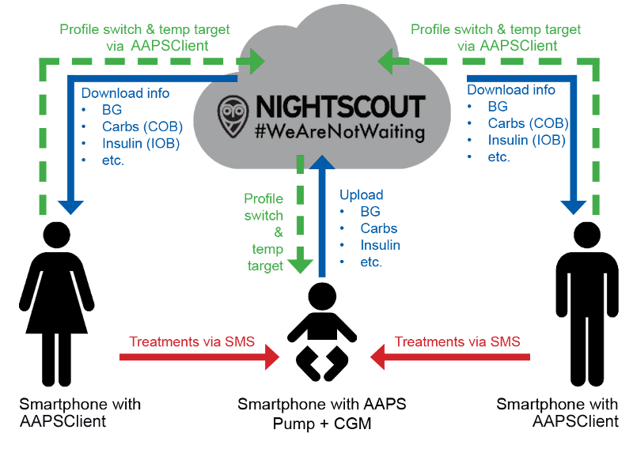

# Fjärrövervakning

__AAPS__ har flera funktioner för fjärrövervakning av barn med typ 1-diabetes. Det går också att skicka kommandon på distans, som ger instruktioner till __AAPS__. På samma sätt kan __AAPSClient__ också användas för fjärrövervakning, för att följa din partners eller väns __AAPS__.

## Funktioner

- Barnets pump styrs av barnets telefon med __AAPS__.
- Anhöriga kan följa på distans och se alla viktiga data, till exempel glukosvärden, aktiva kolhydrater, aktivt insulin osv., med **AAPSClient-apk:n** på sin Android-telefon (en iPhone-version av **AAPSClient** håller på att utvecklas, se [AAPSClient](AapsClient.md)). Inställningar som ändras i __AAPS__ synkroniseras med __AAPSClient__ och tvärtom.
- Anhöriga kan få larm med **xDrip-appen i följarläge** på sin Android-telefon, om xDrip är inställt som följeslagarapp (companion mode).
- Fjärrstyrning av __AAPS__ med [SMS-kommandon](../RemoteFeatures/SMSCommands.md) skyddas med tvåfaktorsautentisering.
- Fjärrstyrning via __AAPSClient__ använder den signerade kommandokanalen som infördes i **AAPS** 4: klienten måste först **parkopplas** med huvudenheten (med en QR-kod eller en PIN-kod), och varje kommando bekräftas och utförs av huvudenheten. Varje anhörigs telefon kan få en egen [roll](#client-master-control-roles), från skrivskyddad till full kontroll – se [Styrning huvudenhet ↔ klient](#client-master-control).

## Verktyg och appar för fjärrövervakning

- [Nightscout](https://nightscout.github.io/) i en webbläsare (främst för att visa data).
- [__AAPSClient__](AapsClient.md) är en avskalad version av __AAPS__ som kan följa __AAPS__ på huvudenheten och, när den är **parkopplad**, skicka kommandon på distans: kolhydrater, __Tillfälliga målvärden__, __Profilbyten__ och till och med bolusar (se [Styrning huvudenhet ↔ klient](#client-master-control)). Det finns 3 appar: [AAPSClient, AAPSClient2 och AAPSClient3 att ladda ned](https://github.com/nightscout/AndroidAPS/releases/), så att en anhörig kan följa upp till tre olika personer från samma telefon (t.ex. två barn med typ 1-diabetes, som var och en har ett eget Nightscout-konto och __AAPS__ på en egen huvudenhet).
- Dexcom Follow om du använder den officiella Dexcom-appen (endast BG-värden).
- [xDrip](../CompatibleCgms/xDrip.md) i följarläge (främst BG-värden och **larm**).
- [Sugarmate](https://sugarmate.io/) eller [Spike](https://spike-app.com/) på iOS (främst BG-värden och **larm**).
- Vissa användare tycker att ett verktyg för full fjärråtkomst, som [TeamViewer](https://www.teamviewer.com/), är till hjälp vid avancerad felsökning på distans.

## Alternativ med smartklocka

En smartklocka kan vara ett mycket användbart verktyg för att hantera __AAPS__ för barn med typ 1-diabetes. Det finns några olika alternativ:

- Alternativ 1 – Om __AAPSClient__ är installerad på den anhörigas telefon kan [Wear OS-appen för AAPSClient](https://github.com/nightscout/AndroidAPS/releases/) installeras på en kompatibel smartklocka som är ansluten till den anhörigas telefon. Den visar aktuellt __BG__, loopstatus och bolushistorik, och du kan ange kolhydrater och ändra __Tillfälliga målvärden__ och __Profil__. Om klienten är **parkopplad** med huvudenheten kan klockan också starta en **bolus**: kommandot skickas vidare via klienten till huvudenheten, som bekräftar och ger bolusen (se [Styrning huvudenhet ↔ klient](#client-master-control)).
- Alternativ 2 – [Wear OS-appen för AAPS](../WearOS/WearOsSmartwatch.md) kan också byggas och installeras på en kompatibel smartklocka som är ansluten till barnets telefon men bärs av den anhöriga. Då får du alla funktioner som nämns ovan, och dessutom kan du ge insulinbolus direkt, utan att behöva ta barnets telefon från barnet.
- Alternativ 3 – Endast visning: en klocka som **AAPS** inte stöder direkt (Xiaomi, Amazfit eller en Wear OS-klocka som visar en komplikation) kan visa glukos, IOB, COB och loopstatus via en hjälpapp som WatchDrip+ eller GlucoDataHandler. Hjälpappen får data från pluginet **Externa hjälpappar** i telefonen med **AAPS** eller **AAPSClient** som klockan är ansluten till. Se [Externa hjälpappar](#watches-external-companion-apps).

## Saker att tänka på

- Tänk på att det finns en tidsfördröjning mellan huvudenheten och följaren, eftersom data måste laddas upp och ned, och eftersom __AAPS__ på huvudtelefonen bara laddar upp efter att loopen har körts.
- Vad är din reservplan om fjärrstyrningen inte fungerar (_t.ex._ nätverksproblem eller förlorad Bluetooth-anslutning)? Tänk alltid på vad som händer med **AAPS** om du plötsligt inte kan skicka ett nytt kommando. **AAPS** skriver över pumpens basal, ISF och KH-kvot (ICR) med värdena i den aktuella profilen. Använd bara tillfälliga profilbyten (_dvs._ med en angiven varaktighet) om du byter till en starkare insulinprofil, ifall fjärranslutningen bryts. Då går pumpen tillbaka till den ursprungliga profilen när tiden har gått ut.
