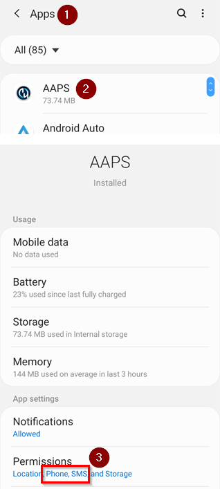
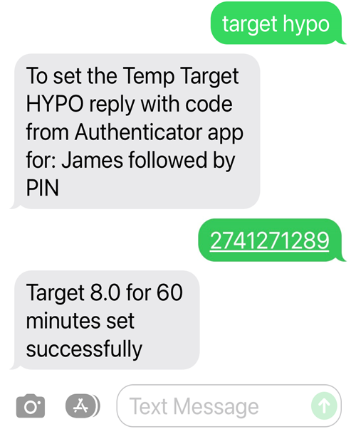

# SMS-kommandon

```{contents} Table of contents
:depth: 2
```

De flesta justeringar på distans (tillfälliga målvärden, kolhydrater, profilbyten och, när klienten är parkopplad, bolusar) kan göras med [appen **AAPSClient**](../RemoteFeatures/RemoteMonitoring.md) på en Android-telefon med internetanslutning, se [Styrning huvudenhet ↔ klient](#client-master-control) (en iPhone-version av **AAPSClient** håller på att utvecklas, se [AAPSClient](AapsClient.md)). SMS-kommandon är fortfarande ett alternativ som fungerar utan internet, och det enda fjärralternativet om du använder en iPhone som följare och inte har **AAPSClient** ännu.

**SMS-kommandon är mycket användbara:**
1. För vanlig fjärrstyrning

2. Om du vill ge insulinbolus på distans utan en parkopplad **AAPSClient**

3. I ett område med dålig internettäckning, där SMS kommer fram men data/internet i telefonen är begränsat. Det är mycket användbart när du åker till avlägsna platser (t.ex. camping, skidåkning).

4. Om ditt andra sätt att fjärrstyra (**AAPSClient**) tillfälligt inte fungerar

## Säkerheten först

Om du aktiverar **SMS-kommunikation** i **AAPS**, tänk på att telefonen som är inställd för att skicka fjärrkommandon kan bli stulen och/eller användas av någon annan. Lås alltid telefonen med åtminstone en PIN-kod. Ett starkt lösenord och/eller biometriskt lås rekommenderas starkt. Se till att det skiljer sig från ditt huvudlösenord för APK:n (lösenordet som krävs för att exportera inställningar i **AAPS**).

Dessutom rekommenderas att du tillåter ett [andra telefonnummer](#SMSCommands-authorized-phone-numbers) för SMS-kommandon. Då kan du använda det andra numret för att [inaktivera](#SMSCommands-other) SMS-kommunikation, om din vanliga fjärrtelefon har hamnat i fel händer.

Standardvärdet för minsta tid mellan bolus-kommandon är 15 minuter, räknat från när pumpen tar emot en bolus. Av säkerhetsskäl måste du lägga till minst två godkända telefonnummer för att kunna ändra det till en kortare tid. Om du försöker ge en ny fjärrbolus inom 15 minuter efter den förra bolusen får du svaret ”Fjärrbolus inte tillgängligt. Försök igen senare.”

AAPS meddelar dig också med SMS om dina fjärrkommandon, till exempel en bolus eller ett profilbyte, har utförts. Det är klokt att ställa in det så att bekräftelser skickas till minst två olika telefonnummer, ifall en av de mottagande telefonerna blir stulen.

**Om du ger bolus med SMS-kommandon måste du ange kolhydraterna separat (ett andra SMS, AAPSClient ...)!** Om du inte gör det blir IOB rätt men COB för låg. Det kan leda till att en korrektionsbolus inte ges, eftersom **AAPS** tror att du har för mycket aktivt insulin.

För de känsliga kommandona måste en autentiseringsapp med tidsbaserade engångslösenord användas för att öka säkerheten.

Om du vill ta bort möjligheten för en anhörigs telefon att skicka SMS-kommandon, använd nödknappen ”[Återställ autentiseringsfunktioner](#sms-commands-authenticator-setup)” i **AAPS** eller skicka SMS-kommandot ”[SMS stop](#SMSCommands-other)”. När du återställer autentiseringen blir ALLA anhörigas telefoner ogiltiga. Du måste då ställa in dem igen.

## Ställa in SMS-kommandon

```{contents} The overall process is as follows
:depth: 1
:local: true
```

(sms-commands-authenticator-setup)=
### Konfiguration av autentisering

Tvåfaktorsautentisering används för att öka säkerheten.

Ladda ned (från App Store eller Google Play) och installera en autentiseringsapp på den anhörigas telefon. Populära gratisappar är:
  - [Authy](https://authy.com/download/)
  - Google Authenticator - [Android](https://play.google.com/store/apps/details?id=com.google.android.apps.authenticator2) / [iOS](https://apps.apple.com/de/app/google-authenticator/id388497605)
  - [LastPass Authenticator](https://lastpass.com/auth/)
  - [FreeOTP Authenticator](https://freeotp.github.io/)

De här autentiseringsapparna skapar ett tidsbegränsat engångslösenord med 6 siffror, ungefär som för mobilbank eller nätköp. Du kan använda en annan autentiseringsapp, så länge den stöder RFC 6238 TOTP-tokens. Microsoft Authenticator fungerar inte.

### Kontrollera telefonens inställningar

Gå till **Appar > AAPS > Behörigheter** på din telefon. Se till att **SMS** och **Telefon** är tillåtna.



```{admonition} "App was denied access to SMS"
:class: tip
Android kan blockera behörigheten **SMS** för appar som inte har installerats från en appbutik, som **AAPS**. Om du ser det här meddelandet när du ger behörigheten **SMS**, öppna telefonens **Inställningar > Appar > AAPS**, tryck på menyn **⋮** (uppe till höger) och välj **Tillåt begränsade inställningar**. Ge sedan behörigheten **SMS** igen.
```


### Synkronisera datum och tid

Tiden på de båda telefonerna måste vara synkroniserad. Bäst är att tiden ställs in automatiskt från nätverket. Tidsskillnader kan leda till problem med autentiseringen.

Kontrollera att datum och tid är synkroniserade på både **AAPS**-telefonen och den anhörigas telefon. Exakt hur du gör beror på din enhet. Du kan behöva prova olika inställningar.

Exempel (för Samsung S23): **Inställningar > Allmän hantering > Datum och tid**: se till att **Automatiskt datum och tid** är markerat.

Vissa alternativ kan vara nedtonade, eftersom de måste hanteras av en administratör via ett familjekonto om telefonen har ställts in som ett barnkonto. På en anhörigs/förälders iPhone heter den här inställningen för datum och tid ”Ställ in automatiskt”. Om du inte är säker på om telefonerna är synkroniserade, oroa dig inte. Du kan ställa in SMS-kommandona och felsöka efteråt om det verkar orsaka problem (be om hjälp om det behövs).

### Inställningar i AAPS

När telefonens inställningar är kontrollerade går du till [**Konfiguration** → **Kommunikation**](../SettingUpAaps/ConfigBuilder.md) i själva **AAPS**-appen och aktiverar pluginet **SMS-kommunikation**.

Öppna inställningarna för **SMS-kommunikation**.

Aktivera **Tillåt fjärrkommandon via SMS**. Alternativen **Extra obligatorisk PIN-kod på slutet av token** och **Konfiguration av autentisering** visas först när detta är aktiverat:


(SMSCommands-authorized-phone-numbers)=
#### Godkända telefonnummer

Ange den anhörigas telefonnummer. Ta med landsnumret och ta bort den första ”0” i telefonnumret, som i de här exemplen:
* Telefonnummer i Storbritannien: +447976304596
* Telefonnummer i USA: +11234567890
* Telefonnummer i Frankrike:  +33612344567
* _osv._

Observera att ”+” före numret kanske behövs, beroende på var du bor. För att ta reda på det kan du skicka ett test-SMS. Det visar formatet som togs emot på skärmen för pluginet **SMS-kommunikation** (**Konfiguration** → **Kommunikation** → **SMS-kommunikation** → **Öppna plugin**).

Om du vill lägga till mer än ett telefonnummer, skilj dem åt med semikolon, **UTAN mellanslag mellan numren** (det är mycket viktigt!). Välj **OK**:


#### Minsta tid mellan fjärrbolus

- Du kan ange minsta tid (i minuter) mellan två bolusar som ges via SMS.
- Av säkerhetsskäl måste du lägga till minst två godkända telefonnummer för att kunna ändra det här värdet.

#### Extra obligatorisk PIN-kod på slutet av token

Av säkerhetsskäl måste svarskoden följas av en PIN-kod. Välj en PIN-kod som du (och andra anhöriga) ska skriva i slutet av autentiseringskoden när SMS-kommandot skickas.

Krav på PIN-koden:

* minst 6 siffror
* bara siffror

För en säkrare PIN-kod, använd inte samma siffra många gånger (_t.ex._ 111111) eller en sekvens (_t.ex._ 123456).


#### Konfiguration av autentisering

* Tryck på **Konfiguration av autentisering** och följ instruktionerna på skärmen steg för steg.
* Öppna autentiseringsappen som du har installerat på _den anhörigas telefon_, lägg till en ny anslutning och
* Använd den anhörigas telefon för att skanna QR-koden som visas under **Skanna koden för att ställa in OTP-koder för AAPS**.


* Under **Testa engångslösenord** anger du engångskoden från autentiseringsappen på den anhörigas telefon, följd av din PIN-kod, i **Kod att kontrollera**:

Exempel:
* Token från autentiseringsappen är 457051
* Din obligatoriska PIN-kod är 2401
* Kod att kontrollera: 4570512401

Om inmatningen är rätt ändras den röda texten ”FEL PIN” automatiskt till ett grönt ”OK”. **Det finns ingen knapp att trycka på!** Processen är nu klar. Det finns ingen ”OK”-knapp som du behöver trycka på efter att du har angett koden:


Nu ska SMS-kommandona vara inställda.

Använd knappen **Återställ autentiseringsfunktioner** längst ned på skärmen **Konfiguration av autentisering** om du vill ta bort de autentiseringsappar som har ställts in. (När du återställer autentiseringen blir ALLA autentiseringsappar som redan har ställts in ogiltiga. Du måste då ställa in dem igen.)

## Använda SMS-kommandon

### Första stegen med SMS-kommandon

1)  För att kontrollera att allt är rätt inställt, testa anslutningen genom att skicka ”bg” som SMS från den anhörigas telefon till **AAPS**-telefonen. Du bör få ett svar som liknar det som visas här:


Om du inte får något svar, se avsnittet [Felsökning](#SMSCommands-troubleshooting) nedan.

2)  Prova nu ett SMS-kommando som kräver autentisering, _t.ex._ ”target hypo”. Den anhörigas telefon får ett SMS tillbaka som ber dig att ange det **sexsiffriga lösenordet** från autentiseringsappen, följt av den extra hemliga **PIN-koden** som bara anhöriga/följare känner till (totalt tolv siffror, om din PIN-kod har 6 siffror).

När du skickar ett SMS-kommando för första gången, gör det när du är i närheten av **AAPS**-telefonen, så att du ser hur det fungerar:


Den anhörigas telefon får ett SMS som svar från **AAPS** som bekräftar om SMS-kommandot har utförts.

Om kommandot lyckas får du ett svar som bekräftar det. Om det blir ett problem får du ett felmeddelande. Se [Felsökning](#SMSCommands-troubleshooting) nedan för vanliga fel.

**Tips**: Det kan vara bra att ha obegränsat antal SMS i mobilabonnemanget (för varje telefon som används) om många SMS kommer att skickas.

### Ge måltidsbolus med SMS-kommandon

Insulinbolus på distans kan ges via **SMS-kommandon** eller via en parkopplad **AAPSClient** (se [Styrning huvudenhet ↔ klient](#client-master-control)). Det går inte att göra via Nightscout-webbplatsen. Kolhydrater kan också anges via SMS eller **AAPSClient**. Med SMS går det inte att skicka både kolhydrater och insulin i ett och samma SMS. Kommandona måste skickas separat, så här:

1)  Att skicka insulinbolusen (_t.ex._ ger ”bolus 2” en bolus på 2 enheter) med SMS-kommandon motsvarar **Behandlingar** → **Insulin** i **AAPS**. 2)  Skicka kolhydraterna (_t.ex._ anger ”carbs 20” 20 g kolhydrater). Det motsvarar **Behandlingar** → **Kolhydrater** i **AAPS**.

För att undvika hypo är det en bra idé att börja försiktigt och ge **mindre insulin** än vad som behövs enligt din KH-kvot, eftersom du inte tar hänsyn till den aktuella glukosnivån eller glukostrenden.

**Ordningen som du skickar kommandona i är viktig**. Om du anger en stor mängd kolhydrater, på vilket sätt som helst, och har SMB aktiverat, kan **AAPS** genast svara med att ge en del av insulinbolusen. Om du sedan försöker skicka en insulinbolus _efter_ att du har angett kolhydraterna kan du därför få en frustrerande fördröjning och meddelandet ”bolus pågår”, och sedan måste du kontrollera vad som har getts som SMB. Eller, om du inte märker att en SMB håller på att ges och din egen bolus efteråt också lyckas, kan det totalt ges för mycket insulin till måltiden. Skicka därför alltid insulinbolusen _före_ kolhydraterna när du ger bolus till måltider på distans. Om du vill kan du kombinera **AAPSClient** med SMS-kommandon: kolhydrater som anges i en parkopplad **AAPSClient** behöver ingen autentiseringskod och går därför snabbare än SMS-kommandon. Kolhydrater eller andra behandlingar som anges på Nightscout-webbplatsen används **inte** när klientstyrning är på. **AAPS** är då i [härdat läge](#client-master-control-hardened-mode).

(SMSCommands-commands)=
## Kommandon

```{contents} List of command groups
:depth: 1
:local: true
```

Kommandona måste skickas på engelska. Svaret kommer på ditt språk om svarstexten redan är [översatt](#translations-translate-strings-for-AAPS-app). Kommandona är inte skiftlägeskänsliga, du kan använda små eller stora bokstäver.


**Tabellerna med SMS-kommandon** nedan visar alla möjliga SMS-kommandon. _Exempelvärden_ finns med för att göra det lättare att förstå. Kommandona har samma intervall av möjliga värden (målvärden, procent av profil osv.) som är tillåtna i själva **AAPS**-appen.

(authentication-or-not)=
### Autentisering eller inte?

Vissa SMS-kommandon ger ett svar direkt, och vissa SMS-kommandon kräver stark **autentisering** via autentiseringsappen. En enkel fråga som ”**BG**” (som ber om aktuellt glukosvärde) går snabbt att skriva, behöver ingen autentisering och returnerar statusinformationen från **AAPS** som visas nedan:


Kommandon som behöver mer säkerhet kräver att du anger en kod, till exempel:



Kolumnen *Autentisering* i tabellerna nedan visar om ett kommando kräver stark autentisering.

### CGM-data

| Kommando   | Autentisering | Funktion och *svar*                                                                                                                                                                                                                                          |
| ---------- | ------------- | ------------------------------------------------------------------------------------------------------------------------------------------------------------------------------------------------------------------------------------------------------------ |
| BG         | Nej           | Returnerar: senaste BG, delta, IOB (bolus och basal), COB<br/>*Senaste BG: 5,6 4 min sedan, Delta: -0,2 mmol, IOB: 0,20 U (Bolus: 0,10 U Basal: 0,10 U)*                                                                                               |
| CAL 5.6/90 | Ja            | Kalibrerar CGM med värdet 5.6/90<br/>(använd det värde som passar dina glukosenheter)<br/>Fungerar bara om det är rätt inställt i **AAPS**.<br/>*Kalibrering skickad. Observera att xDrip+ måste vara inställd att ta emot kalibreringar.* |

### Pump

| Kommando             | Autentisering | Funktion och *svar*                                                                                  |
| -------------------- | ------------- | ---------------------------------------------------------------------------------------------------- |
| PUMP                 | Nej           | LastConn: 1 min ago<br/>Temp: 0.00U/h @11:38 5/30min<br/>IOB: 0.5U Reserv: 34U Batt: 100 |
| PUMP DISCONNECT *30* | Ja            | Kopplar från pumpen i *30* minuter                                                                   |
| PUMP CONNECT         | Ja            | Pump återansluten                                                                                    |

### Basal

| Kommando          | Autentisering | Funktion och *svar*            |
| ----------------- | ------------- | ------------------------------ |
| BASAL 0.3         | Ja            | Startar basal 0,3 U/h i 30 min |
| BASAL 0.3 20      | Ja            | Startar basal 0,3 U/h i 20 min |
| BASAL 30%         | Ja            | Startar basal 30 % i 30 min    |
| BASAL 30% 50      | Ja            | Startar basal 30 % i 50 min    |
| BASAL STOP/CANCEL | Ja            | Stoppar tillfällig basal       |

Vissa pumpar tar bara emot tillfällig basal i procent, andra bara i U/h. Om du använder den andra formen svarar **AAPS** *"Den här pumpen tar bara emot tillfällig basal i procent, inte i U/h."* (eller tvärtom) och ställer inte in något. Varaktigheten måste vara en multipel av det tidssteg som din pump använder för tillfällig basal.


### Loop

| Kommando          | Autentisering | Funktion och *svar*                                                                                                                                                                                                                                                                                              |
| ----------------- | ------------- | ---------------------------------------------------------------------------------------------------------------------------------------------------------------------------------------------------------------------------------------------------------------------------------------------------------------- |
| LOOP STATUS       | Nej           | Svaret beror på aktuell status:<br/> - *Loop är inaktiverad* om loopen är inaktiverad<br/> - *Loop är aktiverad* om loopen är sluten, öppen eller i läget Paus vid lågt blodsocker (LGS)<br/> - *Pump frånkopplad* om pumpen är frånkopplad<br/> - *Pausad (10 min)* om loopen är pausad |
| LOOP STOP/DISABLE | Ja            | Pumpen går tillbaka till den förprogrammerade basaldosen.<br/>*Loop inaktiverad*                                                                                                                                                                                                                           |
| LOOP SUSPEND 20   | Ja            | *Loop pausad*                                                                                                                                                                                                                                                                                                    |
| LOOP RESUME       | Ja            | *Loop återupptagen*                                                                                                                                                                                                                                                                                              |
| LOOP CLOSED       | Ja            | *Nuvarande körläge: Sluten loop*                                                                                                                                                                                                                                                                                 |
| LOOP LGS          | Ja            | *Nuvarande körläge: Paus vid lågt blodsocker*                                                                                                                                                                                                                                                                    |

### Bolus

Fjärrbolus är inte tillåten inom 15 min (värdet kan bara ändras om 2 telefonnummer har lagts till) efter senaste bolus-kommando eller fjärrkommando! I så fall blir svaret *Fjärrbolus inte tillgängligt. Försök igen senare.* Det här svaret skickas också när pumpen håller på att ge en bolus.

| Kommando             | Autentisering | Funktion och *svar*                                                                                                                                                 |
| -------------------- | ------------- | ------------------------------------------------------------------------------------------------------------------------------------------------------------------- |
| BOLUS 1.2            | Ja            |                                                                                                                                                                     |
| BOLUS 0.60 MEAL      | Ja            | Ger den angivna bolusen på 0,60 U<br/>**och** ställer in [tillfälligt målvärde Äta snart](#TempTargets-eating-soon-temp-target)                               |
| CARBS 5              | Ja            | Anger 5 g, utan bolus                                                                                                                                               |
| CARBS 5 17:35/5:35PM | Ja            | Anger 5 g kl. 17:35.<br/>Vilket tidsformat som fungerar beror<br/> på tidsinställningen (12 h/24 h) i telefonen.                                        |
| EXTENDED 2 120       | Ja            | Startar förlängd bolus på 2 U i 120 min.<br/>Bara för [kompatibla pumpar](#Extended-Carbs-extended-bolus-and-switch-to-open-loop-dana-and-insight-pump-only). |
| EXTENDED STOP/CANCEL | Ja            | Stoppar förlängd bolus                                                                                                                                              |

### Profil

| Kommando       | Autentisering | Funktion och *svar*                                                                                                                       |
| -------------- | ------------- | ----------------------------------------------------------------------------------------------------------------------------------------- |
| PROFILE STATUS | Nej           | Aktuell profil och procent                                                                                                                |
| PROFILE LIST   | Nej           | Den aktuella listan med profiler i **AAPS**, t.ex.:<br/>1. Profile1<br/> 2. Profile2                                          |
| PROFILE 1      | Ja            | Byter till profil 1 i listan.<br/>Använd numren som **PROFILE LIST** returnerar,<br/>inte profilnamnen som du sparade dem med |
| PROFILE 2 30   | Ja            | Byter till Profile2 30 %                                                                                                                  |

Procenten måste vara mellan 30 och 250 %, som i appen. Ett värde utanför det intervallet avvisas innan du blir ombedd att ange autentiseringskoden.

### Tillfälliga målvärden

| Kommando                  | Autentisering | Funktion och *svar*                                |
| ------------------------- | ------------- | -------------------------------------------------- |
| TARGET MEAL/ACTIVITY/HYPO | Ja            | Ställer in tillfälligt målvärde MEAL/ACTIVITY/HYPO |
| TARGET STOP/CANCEL        | Ja            | Avbryter tillfälligt målvärde                      |


(SMSCommands-other)=
### Other

| Kommando         | Autentisering | Funktion och *svar*                                                                                                                                                                                                                                                                 |
| ---------------- | ------------- | ----------------------------------------------------------------------------------------------------------------------------------------------------------------------------------------------------------------------------------------------------------------------------------- |
| RESTART          | Ja            | Startar om AAPS. Användbart om du har problem som brukar lösas med en omstart.                                                                                                                                                                                                      |
| SMS DISABLE/STOP | Ja            | För att inaktivera fjärrkommandon via SMS, svara med koden.<br/>Tänk på att du bara kan aktivera dem igen direkt<br/>på huvudtelefonen för **AAPS**.                                                                                                                    |
| HELP             | Nej           | Returnerar alla funktioner som går att fråga efter:<br/>BG, LOOP, PUMP, BASAL, BOLUS, EXTENDED, CAL, PROFILE, TARGET, SMS, CARBS, HELP, RESTART<br/>Skicka sedan kommandot ***HELP ***FUNCTION****** för att lista<br/>alla alternativ som finns i det avsnittet. |
| HELP BOLUS       |               | *BOLUS 1.2<br/>BOLUS 1.2 MEAL*                                                                                                                                                                                                                                                |

(SMSCommands-troubleshooting)=
## Felsökning och vanliga frågor

```{contents} List of questions and issues
:depth: 1
:local: true
```

### Vad _kan_ vi inte göra med SMS-kommandon?

1)  **Du kan inte göra ett _tillfälligt_ profilbyte** (till exempel ställa in "profile exercise" i 60 minuter), men du kan byta till ”profile exercise” permanent. Tillfälliga profilbyten kan i stället göras via **AAPSClient**.

2)  **Du kan inte avbryta automatiseringar** eller **ställa in egna målvärden**, men det finns ungefärliga lösningar: Tänk dig till exempel att det vanliga målvärdet i profilen är 5,5. Du har ställt in en automatisering i AAPS som alltid ställer in ett högt målvärde på 7,0 mellan 14.30 och 15.30 på grund av en idrottslektion i skolan, och ett villkor i automatiseringen är att ”inget tillfälligt målvärde finns”. Den här veckan får du med kort varsel veta att idrottslektionen är inställd och ersätts av pizzaätande, men ditt barn är redan i skolan med **AAPS**-telefonen. Om det höga tillfälliga målvärdet på 7,0 startas av automatiseringen och du avbryter det (på **AAPS**-telefonen eller på distans) är villkoren för automatiseringen fortfarande uppfyllda, och **AAPS** ställer helt enkelt in det höga målvärdet igen en minut senare.

**Om du hade tillgång till AAPS-telefonen** kunde du avmarkera/ändra automatiseringen, eller, om du inte vill göra det, helt enkelt ställa in ett nytt tillfälligt målvärde på 5,6 i 60 min genom att trycka på målvärdet på huvudskärmen eller via **Hantera** → **Tillfälligt målvärde**. Det skulle hindra automatiseringen från att ställa in det höga målvärdet på 7,0.

**Om du inte har tillgång till AAPS-telefonen** kan SMS-kommandon användas för en ungefärlig lösning: till exempel kommandot ”target meal” som ställer in målvärdet 5,0 i 45 min (de andra förinställda målvärdena är 8,0 för träning eller hypo, se tabellen). Men med SMS-kommandon kan du inte ange ett _eget_ målvärde (till exempel 5,6 i 60 minuter). För det behöver du använda **AAPSClient**.

### Vad händer om jag ångrar ett kommando som jag nyss har skickat?

**AAPS** utför bara det senaste kommandot. Om du alltså skriver ”bolus 1.5” och sedan, utan att autentisera, skickar ett nytt kommando ”bolus 1”, ignoreras det tidigare kommandot 1.5. **AAPS** skickar alltid ett svar till den anhörigas telefon som bekräftar vilket SMS-kommando det gäller innan du blir ombedd att ange autentiseringskoden, och dessutom ett svar efter att åtgärden har utförts.

### Varför fick jag inget svar på ett SMS-kommando?

Det kan bero på något av följande:

1)  Meddelandet har inte kommit fram till telefonen (nätverksproblem). 2)  **AAPS** håller fortfarande på att bearbeta begäran (_t.ex._ en bolus, som kan ta en stund att ge beroende på din bolushastighet). 3)  **AAPS**-telefonen har ingen bra Bluetooth-anslutning till pumpen när kommandot tas emot, och kommandot har misslyckats (det ger oftast ett larm på **AAPS**-telefonen).

### Inget svar alls på SMS-kommandon

Prova att inaktivera följande alternativ på den anhörigas telefon och/eller **AAPS**-telefonen:
* **Send as chat message** (Skicka som chattmeddelande) 
* Om du använder appen Android Messages eller Google Messages, inaktivera RCS-meddelanden:
  - öppna SMS-konversationen i Meddelanden
  - Välj menyn med tre punkter uppe till höger
  - välj "Detaljer"
  - Aktivera "Only send SMS and MMS messages" (skicka bara SMS och MMS) 

### Fel när kommandon ska utföras

Det finns flera möjliga orsaker till att kommandot inte lyckas:

* Inställningen av SMS-kommandon är inte klar/korrekt
* Du skickade ett kommando med fel format (som ”disconnect pump 45” i stället för ”pump disconnect 45”)
* Du använde en felaktig eller utgången autentiseringskod (det är oftast bra att vänta några sekunder på en ny kod om den nuvarande snart går ut)
* Koden + PIN-koden var rätt, men SMS:et blev fördröjt när det skickades/kom fram, så **AAPS** beräknade att autentiseringskoden hade gått ut
* **AAPS**-telefonen är utom räckhåll/har ingen kontakt med pumpen
* Systemet håller redan på att ge en bolus

Vanliga fel visas i exemplen nedan:


### Hur kan jag stoppa ett kommando när det redan har autentiserats?

Det kan du inte. Men du kan avbryta en bolus som har skickats med SMS direkt på **AAPS**-telefonen, genom att avbryta den i bolusrutan som visas, om du är snabb. Många SMS-kommandon (utom bolus och kolhydrater) kan lätt ångras, eller så kan du göra något för att minska oönskade effekter om du gör ett misstag.

Även vid fel i bolus och kolhydrater kan du göra något. Om du till exempel har angett 20 g kolhydrater men ditt barn bara äter 10 g, och du (eller en anhörig på plats) inte kan radera behandlingen direkt i **AAPS**-telefonen, kan du ställa in ett högt tillfälligt målvärde eller en lägre profil, så att **AAPS** blir mindre aggressiv.

### Flera SMS

Om du får samma meddelande om och om igen (_t.ex._ ett profilbyte) kan du av misstag ha skapat en slinga med andra appar. Det kan till exempel vara xDrip. Se i så fall till att xDrip (eller någon annan app) inte laddar upp behandlingar till Nightscout.

Om den andra appen är installerad på flera telefoner, se till att stänga av uppladdningen på alla.

(sms-commands-too-many-messages)=
### Jag får alldeles för många SMS från SMS-kommandon. Kan jag få färre, eller få dem att sluta?

SMS-kommandon kan skapa många automatiska meddelanden från **AAPS**-telefonen till den anhörigas telefon. Du får också meddelanden, till exempel ”Basalprofilen uppdaterad i pumpen”, om du har automatiseringar inställda i **AAPS**. Det kan vara bra att ha obegränsat antal SMS i abonnemanget för **AAPS**-telefonen (och för varje anhörigs telefon som används) om många SMS kommer att skickas, och att stänga av SMS-aviseringar, larm och vibrationer på alla telefoner. Det går inte att använda SMS-kommandon utan att få de här uppdateringarna. Därför kan du vilja ha ett annat sätt att kommunicera direkt med ditt barn (om barnet är tillräckligt stort) i stället för SMS. Vanliga appar för kommunikation som anhöriga till **AAPS**-användare använder är bland annat WhatsApp, LINE, Telegram och Facebook Messenger.

Det går att stänga av SMS:et "Basalprofilen uppdaterad i pumpen" när profilbytet kom från Nightscout. Du gör det genom att skapa en fil med **exakt** namnet `do_not_send_sms_on_profile_change` i katalogen `extra` i din AAPS-katalog.
